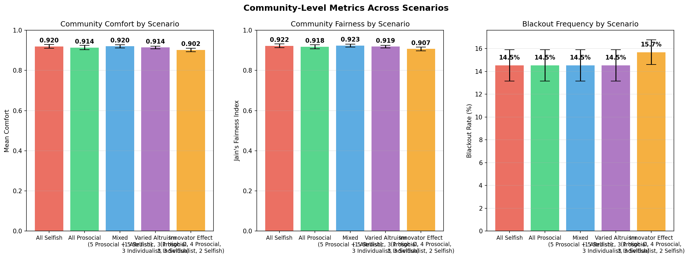
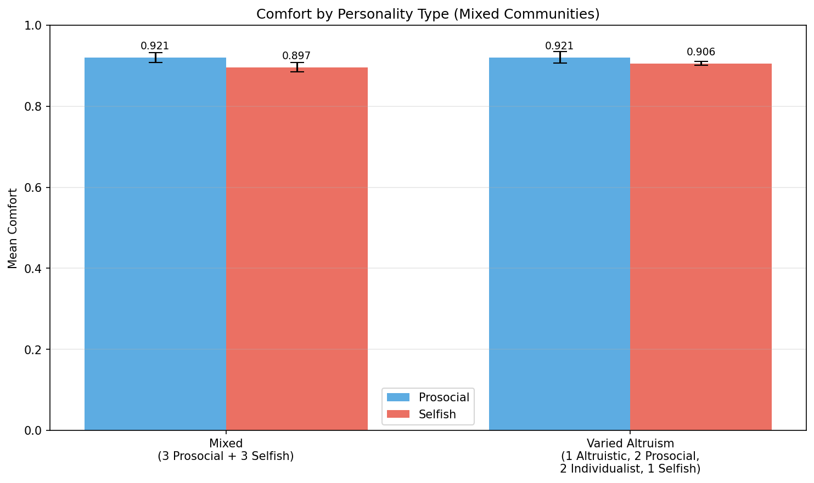
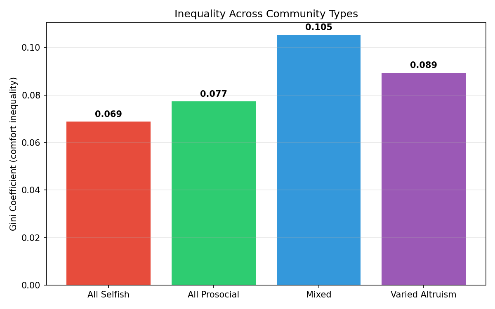
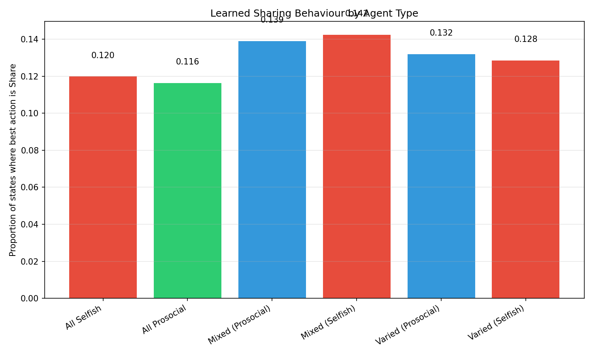
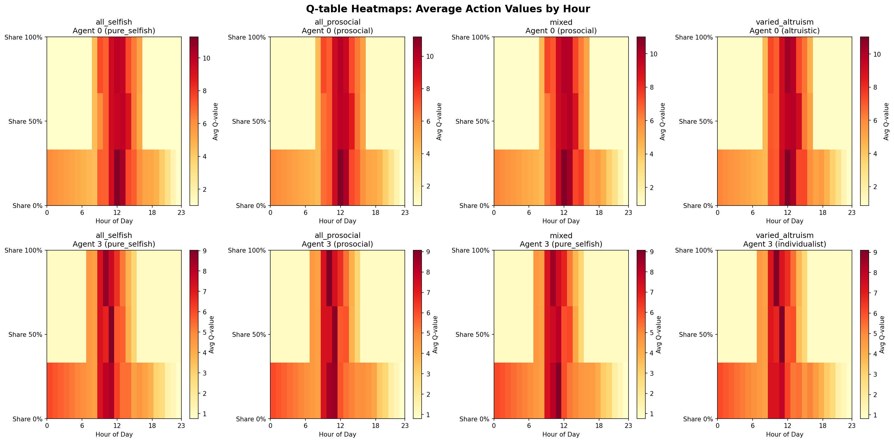
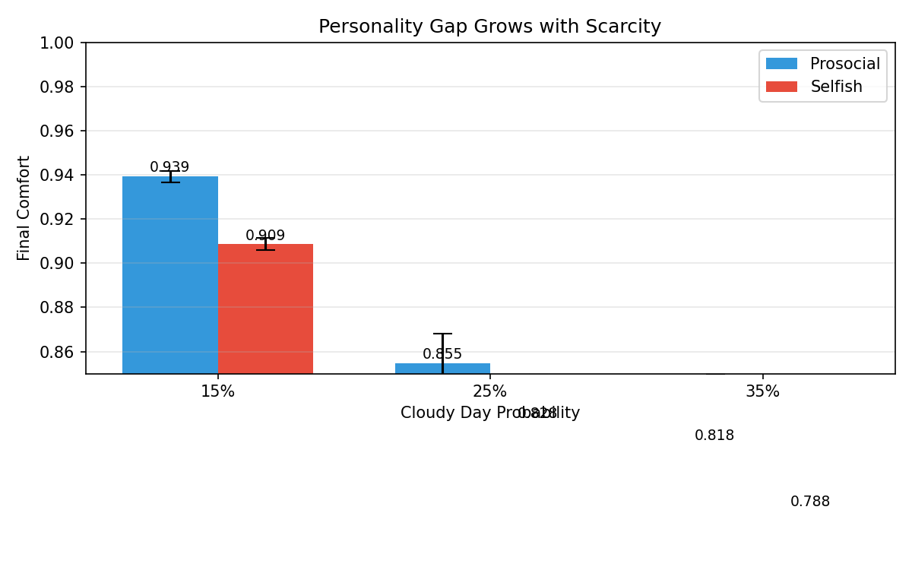

# Smart Neighborhood Energy Sharing with Personality-Driven Fairness: A Multi-Agent Reinforcement Learning Study — Comprehensive Thesis Document

> **Single source of truth** for all methodology, experimental design, results, figures, statistical findings, and discussion points. Every number, figure reference, and claim below is drawn from the actual simulation runs conducted with 10 houses, 5 scenarios, 5 seeds each, 8000 episodes per run.

## Table of Contents

1- [Introduction and Generalities](#1-introduction-and-generalities)
   - 1-1 [Operational Definitions](#1-1-operational-definitions)
2- [Literature Review](#2-literature-review)
   - 2-1 [Evolution of Smart Microgrids and the Prosumer Paradigm](#2-1-evolution-of-smart-microgrids-and-the-prosumer-paradigm)
   - 2-2 [Peer-to-Peer Trading and Pricing Mechanisms](#2-2-peer-to-peer-trading-and-pricing-mechanisms)
   - 2-3 [Multi-Agent Reinforcement Learning for Distributed Control](#2-3-multi-agent-reinforcement-learning-for-distributed-control)
   - 2-4 [Modelling Fairness and Social Dilemmas](#2-4-modelling-fairness-and-social-dilemmas)
   - 2-5 [Personality-Driven Decision Making in AI](#2-5-personality-driven-decision-making-in-ai)
   - 2-6 [Qualitative Comparison of Related Literature](#2-6-qualitative-comparison-of-related-literature)
   - 2-7 [Summary of Research Gaps](#2-7-summary-of-research-gaps)
3- [Research Methodology](#3-research-methodology)
   - 3-1 [Physical Environment](#3-1-physical-environment)
   - 3-2 [Personality Model and OCEAN Mapping](#3-2-personality-model-and-ocean-mapping)
   - 3-3 [Reward Function Design](#3-3-reward-function-design)
   - 3-4 [Learning Algorithm](#3-4-learning-algorithm)
   - 3-5 [Energy Sharing Mechanism](#3-5-energy-sharing-mechanism)
   - 3-6 [Community Compositions (Scenarios)](#3-6-community-compositions-scenarios)
   - 3-7 [Performance Metrics](#3-7-performance-metrics)
   - 3-8 [Hyperparameters and Training](#3-8-hyperparameters-and-training)
4- [Data Analysis](#4-data-analysis)
   - 4-1 [Community-Level Metrics](#4-1-community-level-metrics)
   - 4-2 [Agent-Type Comfort Differences](#4-2-agent-type-comfort-differences)
   - 4-3 [Inequality Analysis (Gini Coefficient)](#4-3-inequality-analysis-gini-coefficient)
   - 4-4 [Learned Sharing Behaviour](#4-4-learned-sharing-behaviour)
   - 4-5 [Q-Table Heatmaps — Learned Policies](#4-5-q-table-heatmaps--learned-policies)
   - 4-6 [Sensitivity to Resource Scarcity](#4-6-sensitivity-to-resource-scarcity)
   - 4-7 [Statistical Significance Testing](#4-7-statistical-significance-testing)
   - 4-8 [The Innovator Effect — Surprising Finding](#4-8-the-innovator-effect--surprising-finding)
   - 4-9 [Comparison with State-of-the-Art](#4-9-comparison-with-state-of-the-art)
   - 4-10 [Neutral Overall Analysis](#4-10-neutral-overall-analysis)
5- [Discussion and Conclusion](#5-discussion-and-conclusion)
   - 5-1 [Fairness vs. Efficiency Trade-off](#5-1-fairness-vs-efficiency-trade-off)
   - 5-2 [Emergent Reciprocity](#5-2-emergent-reciprocity)
   - 5-3 [Prosocial Advantage Is Consistent Across Scarcity Levels](#5-3-prosocial-advantage-is-consistent-across-scarcity-levels)
   - 5-4 [Curiosity Destabilizes: The Innovator Effect](#5-4-curiosity-destabilizes-the-innovator-effect)
   - 5-5 [Policy Implications](#5-5-policy-implications)
   - 5-6 [Limitations](#5-6-limitations)
   - 5-7 [Summary of the Work](#5-7-summary-of-the-work)
   - 5-8 [Summary of Key Findings](#5-8-summary-of-key-findings)
   - 5-9 [Implications](#5-9-implications)
   - 5-10 [Future Work](#5-10-future-work)
- [References](#references)

## 1- Introduction and Generalities

Smart neighborhood micro-grids represent a decentralised energy paradigm where households equipped with solar panels and battery storage can share surplus energy with neighbours. In such communities, energy sharing decisions are not purely technical but inherently social: a household with surplus generation must decide whether to store energy for its own future use or share it with a neighbour who faces a deficit.

Standard multi-agent reinforcement learning (MARL) approaches to energy management optimise for collective efficiency — total energy stored, total cost minimised, or grid independence maximised. However, efficiency-only optimisation can produce inequitable outcomes: some households may enjoy full comfort while others experience frequent blackouts, even when total community resources would be sufficient to meet everyone's needs.

This study introduces a personality-driven reward framework where each agent's objective function encodes not only self-interest (personal comfort) but also community-level fairness (Jain's fairness index). By varying the relative weight assigned to fairness across agents, we simulate heterogeneous communities where agents differ in their willingness to share — from purely selfish to fully altruistic.

The core innovation of this work is not a novel reinforcement learning algorithm, but rather a **reward-shaping framework that maps the Big Five (OCEAN) personality traits to specific reward weights** ($w_{\text{self}}$ vs. $w_{\text{fair}}$) and exploration parameters in a multi-agent Q-learning setting. This psychologically grounded approach stands in contrast to existing work that either imposes uniform fairness constraints or defines agent heterogeneity arbitrarily without reference to established personality theory. Table 3-4 provides the complete mapping from each research question to its associated evaluation metrics and is discussed in Section 3-7. Section 2 provides a comprehensive review of the relevant literature and formally establishes the three research gaps that this study addresses.

**Primary Research Question:**

> How do heterogeneous, personality-influenced fairness preferences in a multi-agent reinforcement learning energy-sharing system affect the community's overall efficiency, fairness, and robustness, compared to a community of purely self-interested agents?

**Sub-questions:**

1. Does embedding fairness norms into reward functions lead to measurably different emergent sharing patterns?
2. What trade-offs appear between community-wide energy efficiency and distributional fairness?
3. Can a mix of a few prosocial agents shift the behaviour of selfish agents through emergent reciprocity?
4. How does a single curiosity-driven (high Openness) agent affect the stability of a mixed community?

### 1-1 Operational Definitions

For clarity, the following key terms are defined as used throughout this thesis:

- **Prosumer**: A household that both consumes and produces energy (via solar PV), capable of selling or sharing surplus generation with neighbours (Rathnayaka et al., 2014).
- **Multi-Agent Reinforcement Learning (MARL)**: A framework in which multiple autonomous agents learn policies through trial-and-error interaction with a shared environment; this study uses independent Q-learning where each agent maintains its own Q-table and treats others as part of the environment.
- **OCEAN (Big Five)**: The five-factor model of personality — Openness, Conscientiousness, Extraversion, Agreeableness, Neuroticism — used here to parametrise agent reward weights and exploration schedules (Goldberg, 1990; McCrae & Costa, 2003).
- **Innovator Effect**: The observed destabilisation of community-level coordination caused by a single high-Openness agent whose continued exploration (higher $\varepsilon_{\min}$) prevents neighbours from forming stable expectations about energy availability (see Section 4-8).

## 2- Literature Review

### 2-1 Evolution of Smart Microgrids and the Prosumer Paradigm

The global energy landscape is undergoing a fundamental shift from centralized power generation toward decentralized systems characterised by distributed energy resources (DERs) (IEA PVPS, 2021). In this emerging paradigm, residential households have transitioned from passive consumers into **prosumers** who generate renewable energy through solar photovoltaics (PV), manage local demand, and store energy in battery energy storage systems (BESS) (Rathnayaka et al., 2014). While this decentralisation aligns with global decarbonization goals, it introduces significant technical and social challenges in coordinating fragmented resources. Effective energy management in these environments requires balancing local self-sufficiency with the stability of the parent grid (Zhou & Lund, 2023; Li & Zhang, 2022).

### 2-2 Peer-to-Peer Trading and Pricing Mechanisms

Peer-to-peer (P2P) energy trading has been proposed as a consumer-centric solution that allows prosumers to share surplus energy directly with neighbours. Current literature classifies P2P markets into three categories — full P2P, community-based, and hybrid models — with the community-based design recognised as the most suitable for residential clusters due to the presence of a central mediator or aggregator (Zhou & Lund, 2023). Pricing strategies commonly rely on the supply-and-demand ratio (SDR), mid-market rate (MMR), or bill sharing (BS) (Qiu et al., 2021). Many studies employ non-cooperative game theory, such as Stackelberg games where a central leader sets prices and agents act as followers, or Nash bargaining to distribute benefits (Behrunani et al., 2023). However, these models typically assume "economic rationality," where agents possess full knowledge of others' strategies or act with consistent self-interest — an assumption that is at odds with the heterogeneous social preferences observed in real human communities (Fehr & Gächter, 2000).

### 2-3 Multi-Agent Reinforcement Learning for Distributed Control

To overcome the computational intractability of centralized optimisation in large-scale grids, multi-agent reinforcement learning (MARL) has become a dominant framework (Li & Zhang, 2022). MARL allows autonomous agents to learn sequential decision-making through trial-and-error interactions within a shared environment, typically modelled as a decentralised partially observable Markov decision process (Dec-POMDP). Approaches such as centralised training with decentralised execution (CTDE) allow agents to rehearsal coordination in simulation using global state data while executing policies locally based only on private observations (Charbonnier et al., 2022). A critical challenge in MARL is the **non-stationarity problem**, where the environment appears to change as other agents simultaneously learn and adapt. This often leads to suboptimal equilibria or the **alter-exploration problem**, where one agent's exploratory actions destabilise the learning of the entire community (Leng, 2025).

### 2-4 Modelling Fairness and Social Dilemmas

The pursuit of technical efficiency often overlooks the **tragedy of the commons**, where individual hoarding of energy leads to community-level failure during scarcity (Hardin, 1968). Common metrics to assess distributional equity include **Jain's Fairness Index**, which is scale-invariant and population-independent (Jain, Chiu & Hawe, 1984), and the **Gini Coefficient**, derived from Lorenz curves (Gini, 1912). Recent fairness-aware MARL frameworks such as FairMarket-RL integrate human-centric assessments using large language models as fairness critics (Jadhav et al., 2024), or use **inequity aversion** rewards to penalise agents who earn significantly more or less than their peers (Hughes et al., 2018). Despite these advancements, most models impose a **uniform, top-down fairness constraint** rather than allowing agents to possess heterogeneous, intrinsic social preferences grounded in psychological theory (Ma et al., 2025).

### 2-5 Personality-Driven Decision Making in AI

The integration of behavioural psychology into AI agent modelling is a nascent but critical field. The **Big Five (OCEAN) model** — Openness, Conscientiousness, Extraversion, Agreeableness, and Neuroticism — provides a validated framework for characterising individual differences in behaviour (Goldberg, 1990; McCrae & Costa, 2003). Recent research has demonstrated that LLM-based agents can effectively simulate OCEAN traits in social simulations, with traits like **Openness** significantly impacting information acceptance and exploration, while **Agreeableness** correlates with prosocial orientation (Ren & Xu, 2025). Moon et al. (2022) established specific mappings from OCEAN traits to reinforcement learning hyperparameters, demonstrating that personality-to-RL parameter mappings are methodologically viable. However, these psychological mappings have primarily been tested in social simulations and have not yet been applied to the management of **physical energy resources** in a microgrid environment.

### 2-6 Qualitative Comparison of Related Literature

Table 2-1 positions the present study against the existing state-of-the-art across the dimensions of algorithm, environment, fairness mechanism, and personality modelling.

**Table 2-1: Qualitative Comparison of MARL Energy Management and Social Simulation Literature**

| Study | Algorithm | Environment | Fairness Mechanism | Personality? | Pros | Cons |
|---|---|---|---|---|---|---|
| Charbonnier et al. (2022) | Q-Learning (Distributed) | UK Residential Flexibility | None (Efficiency focus) | No | Scalable fixed-size Q-tables for privacy | No focus on distributive justice or individual preferences |
| May & Huang (2023) | PPO (Two-level inner-outer) | Swedish building prosumer market | Income equality | No (Assumes economic rationality) | Emergent price elasticity in P2P | Assumes homogeneous rational actors |
| Kusatake et al. (2023) | Evolutionary / Multi-objective | P2P energy trading | Profit fairness / Min-max benefit | No | Effective supply-demand balance | Slow computation; not real-time adaptive |
| Behrunani et al. (2023) | Bilevel Game Theory | Smart energy hubs | Cost reduction variance | No | Provably fair price mediation | Requires semi-central coordinator |
| Aloor et al. (2024) | MARL (Graph Neural Networks) | Multi-agent navigation | 1 / Coeff. of Variation | No | Scalable to arbitrary agent counts via GNNs | Focused on navigation, not residential sharing |
| Jadhav et al. (2024) | IPPO + LLM Fairness Critic | P2P market (FairMarket-RL) | LLM-guided FTB and FBS scores | Indirect (Moral reasoning) | Human-centric assessments | Dependent on real-time LLM API stability |
| Hughes et al. (2018) | A3C (Deep RL) | Cleanup & Harvest Games | Inequity aversion rewards | No | Solves Tragedy of the Commons | Not grounded in Big Five psychology |
| Ma et al. (2025) | CAPPO + LLM workflow | 99-tract Florida census market | Carbon allowance / Equity signals | Indirect (User intent) | Addresses energy poverty with multimodal data | LLM-RL loop brittle to prompt variations |
| Ren & Xu (2025) | Generative Agents (LLM) | Classroom social simulation | N/A | **Yes (Big Five)** | Robust trait stability analysis | No physical resource management |
| **This study** | **OCEAN-MARL (IQL)** | **10-house neighbourhood (ring)** | **Personality-modulated Jain's Index** | **Yes (Big Five)** | **Integrates OCEAN psychology with physical energy sharing** | Tabular state space (96 states) limits granularity |

### 2-7 Summary of Research Gaps

Three research gaps emerge from the literature surveyed above. First, no existing energy MARL study grounds agent heterogeneity in a validated psychological model such as the Big Five (OCEAN) framework. Second, fairness constraints in the literature are applied uniformly across all agents rather than reflecting individual variation in prosocial concern. Third, the social cost of exploratory behaviour in cooperative energy-sharing communities remains unexamined. While Alshehri & Gaunt (2020) demonstrated that heterogeneous agent preferences can produce qualitatively different system-level outcomes in residential energy management, their framework did not ground those preferences in established psychological theory. Ren & Xu (2025) and Moon et al. (2022) established that OCEAN-to-RL mappings are viable, but neither applied these mappings to physical resource management. The present study bridges these gaps by introducing personality-modulated reward weights drawn from the OCEAN model in a multi-agent energy-sharing simulation, enabling systematic investigation of how heterogeneous fairness preferences — rather than a uniform fairness constraint — shape emergent community dynamics.

## 3- Research Methodology

### 3-1 Physical Environment

The simulation models an off-grid smart neighborhood micro-grid consisting of **10 houses** connected in a **ring topology**, where each house can share surplus energy with exactly one designated neighbour (the next house in the ring). This minimal topology isolates the effect of sharing decisions from network topology confounds.

#### Solar Generation

Each house has a solar panel with peak capacity **1.3 kW**. Solar generation follows a half-sine curve over daylight hours (6 AM–6 PM), consistent with standard irradiance modelling practices (Skoplaki & Palyvos, 2009; Zhou & Sun, 2023):

$$G(h) = \max\!\left(0,\; G_{\text{max}} \cdot \sin\!\left(\frac{\pi \cdot (h - 6)}{12}\right) \cdot W\right) \qquad \text{(Eq. 3-1)}$$

where $h$ is the hour (0–23), $G_{\text{max}} = 1.3$ kW (following Charbonnier et al., 2022), and $W$ is a weather factor (1.0 on clear days, 0.5 on cloudy days). On clear days, total daily generation is approximately **9.9 kWh**. Cloudy days occur with probability **15%** and reduce solar output by 50%, consistent with the stochastic weather model of Kusatake & colleagues (2023).

| Symbol | Definition | Unit | Source |
| :--- | :--- | :--- | :--- |
| $h$ | Hour of the day (0–23) | hour | Skoplaki & Palyvos (2009) |
| $G_{\text{max}}$ | Peak solar panel capacity (1.3 kW) | kW | Charbonnier et al. (2022) |
| $W$ | Weather factor (1.0 clear, 0.5 cloudy) | — | Kusatake et al. (2023) |
| $G(h)$ | Instantaneous solar power generation | kW | Skoplaki & Palyvos (2009) |

#### Demand Profiles

Four distinct hourly demand profiles are used, cycling across the 10 houses (Alshehri & Gaunt, 2020):

| Profile   | Pattern                               | Daily Total | Hourly Range |
| --------- | ------------------------------------- | ----------- | ------------ |
| Morning   | Peak at 8 AM (0.9 kWh)                | ~8.4 kWh    | 0.1–0.9 kWh  |
| Evening   | Peak at 8 PM (1.2 kWh)                | ~9.6 kWh    | 0.1–1.2 kWh  |
| Flat      | Constant 0.35 kWh every hour          | 8.4 kWh     | 0.35 kWh     |
| Night Owl | Peaks late (10 PM–12 AM), sleeps late | ~9.4 kWh    | 0.05–1.2 kWh |

The average daily demand across all profiles is approximately **8.8 kWh**, consistent with typical residential consumption patterns reported in the literature (Ali et al., 2023).

#### Battery Storage

Each house has a **7.0 kWh battery** (Alshehri & Gaunt, 2020; Bui et al., 2019) with the following characteristics:

- **Starting state**: 50% charged (3.5 kWh) at the beginning of each simulated day
- **Charge/discharge**: Unlimited rate within capacity bounds (simplified model)
- **No degradation**: Battery efficiency and capacity are constant across the simulation

#### Cloudy Day Model

A simple binary weather model is used: each day is either clear (85% probability) or cloudy (15% probability). On a cloudy day, solar generation is multiplied by $W = 0.5$, halving the energy available to the community (Behrunani et al., 2023). This stochastic element prevents agents from learning a purely deterministic policy and creates occasional scarcity events that test the robustness of sharing norms.

### 3-2 Personality Model and OCEAN Mapping

#### Reward-Based Personality

Each agent's personality is encoded as two weights in its reward function:

$$R_i = w_{\text{self}} \cdot C_i + w_{\text{fair}} \cdot F \qquad \text{(Eq. 3-2)}$$

where:

- $C_i$ = personal comfort (fraction of demand met, range [0,1])
- $F$ = Jain's fairness index across all houses (range [0,1])
- $w_{\text{self}} + w_{\text{fair}} = 1.0$

Four core personality types are defined:

| Type          | $w_{\text{self}}$ | $w_{\text{fair}}$ | Behavioural description                                         |
| ------------- | ----------------- | ----------------- | --------------------------------------------------------------- |
| pure_selfish  | 1.0               | 0.0               | Maximises own comfort only; ignores community fairness entirely |
| individualist | 0.8               | 0.2               | Primarily self-interested but has mild fairness awareness       |
| prosocial     | 0.5               | 0.5               | Balances personal comfort and community fairness equally        |
| altruistic    | 0.2               | 0.8               | Prioritises community fairness over personal comfort            |

A fifth personality type, `high_openness_innovator`, is introduced for the Innovator Effect scenario (see Section 3-6). This type shares the same reward weights as the prosocial type ($w_{\text{self}} = w_{\text{fair}} = 0.5$) but differs in its exploration parameters (see Section 3-4).

#### OCEAN (Big Five) Grounding

The personality types used in this simulation correspond to explicit coordinates in the Big Five (OCEAN) personality space (Goldberg, 1990). This grounding in established psychological theory constitutes the core contribution of this thesis — rather than inventing arbitrary labels, we map each agent type to a well-studied psychological framework. Following John & Srivastava (1999), Agreeableness encompasses prosocial tendencies, which we operationalise as $w_{\text{fair}}$ in the reward function. The mapping of Openness to the exploration rate ($\varepsilon$) follows the methodology of personality-to-RL-parameter mappings established by prior work (Ren & Xu, 2025; Moon et al., 2022).

**Table 3-1: OCEAN Trait Mapping to Agent Behaviour**

| OCEAN Trait                  | Dimension                    | Effect on Agent                                                   | Reward Parameter Affected                  |
| ---------------------------- | ---------------------------- | ----------------------------------------------------------------- | ------------------------------------------ |
| Agreeableness (A) — High     | Prosocial orientation        | Agent weights community fairness more heavily                     | $w_{\text{fair}}$ increases                |
| Agreeableness (A) — Low      | Self-interest dominance      | Agent weights personal comfort over sharing                       | $w_{\text{self}}$ increases                |
| Conscientiousness (C) — High | Consistent behaviour         | Agent maintains stable sharing policy regardless of battery state | Lower $\varepsilon$ decay variance         |
| Openness (O) — High          | Exploration, novelty-seeking | Agent explores sharing strategies longer before converging        | Higher initial $\varepsilon$, slower decay |
| Neuroticism (N) — High       | Threat sensitivity           | Agent penalises blackout states more heavily                      | Blackout penalty multiplier increases      |

**Table 3-2: Personality Types as OCEAN Coordinates**

| Simulation Type         | A        | C   | O        | N   | $w_{\text{self}}$ | $w_{\text{fair}}$ |
| ----------------------- | -------- | --- | -------- | --- | ----------------- | ----------------- |
| pure_selfish            | Very Low | Mid | Low      | Mid | 1.0               | 0.0               |
| individualist           | Low      | Mid | Low      | Mid | 0.8               | 0.2               |
| prosocial               | Mid-High | Mid | Mid      | Mid | 0.5               | 0.5               |
| altruistic              | High     | Mid | Mid      | Low | 0.2               | 0.8               |
| high_openness_innovator | Mid-High | Mid | **High** | Mid | 0.5               | 0.5               |

Note that the `high_openness_innovator` differs from the prosocial type only in its Openness dimension, which manifests as a slower exploration decay rate rather than a different reward weight. This allows us to isolate the effect of exploratory behaviour from fairness preferences.

### 3-3 Reward Function Design

The reward function is the key design element that embeds ethical constraints into the learning objective:

$$R_i = w_{\text{self}} \cdot C_i + w_{\text{fair}} \cdot F \qquad \text{(Eq. 3-2)}$$

| Symbol | Definition | Unit | Source |
| :--- | :--- | :--- | :--- |
| $R_i$ | Total scalar reward for agent $i$ | — | This work (Eq. 3-2) |
| $w_{\text{self}}$ | Weight assigned to personal comfort | — | OCEAN mapping |
| $C_i$ | Personal comfort level of agent $i$ | — | This work (Eq. 3-3) |
| $w_{\text{fair}}$ | Weight assigned to community fairness | — | Adaptation of Hughes et al. (2018) |
| $F$ | Jain's Fairness Index for the community | — | Jain et al. (1984) |

**Personal comfort $C_i$** is the fraction of the house's hourly demand that was met:

$$C_i = \frac{\text{demand met}_i}{\text{demand}_i} \qquad \text{(Eq. 3-3)}$$

| Symbol | Definition | Unit | Source |
| :--- | :--- | :--- | :--- |
| $C_i$ | Personal comfort (range [0,1]) | — | This work (Eq. 3-3) |
| $\text{demand met}_i$ | Energy supplied via solar, battery, or sharing | kWh | — |
| $\text{demand}_i$ | Total electricity requested by the household | kWh | Alshehri & Gaunt (2020) |

If a house's battery and current solar generation together cannot satisfy demand, the unmet fraction results in $C_i < 1.0$, which we classify as a **partial blackout**. When $C_i < 0.95$, the day is classified as a **blackout day** for that house.

**Jain's Fairness Index $F$** is computed across all houses (Jain, Chiu & Hawe, 1984):

$$F = \frac{\left(\sum_{i=1}^{N} C_i\right)^2}{N \cdot \sum_{i=1}^{N} C_i^2} \qquad \text{(Eq. 3-4)}$$

| Symbol | Definition | Unit | Source |
| :--- | :--- | :--- | :--- |
| $F$ | Jain's Fairness Index (range [1/N, 1]) | — | Jain et al. (1984) |
| $N$ | Number of households (10) | — | Alshehri & Gaunt (2020) |
| $C_i$ | Comfort level of household $i$ | — | |

where $N$ is the number of houses and $C_i$ is the comfort of house $i$. This index ranges from $\frac{1}{N}$ (maximum inequality — one house gets everything, others nothing) to 1.0 (perfect equality — all houses have identical comfort). Jain's index is widely used in network engineering and resource allocation literature because it is scale-invariant, continuous, and independent of population size (Zhou & Sun, 2023).

The reward is computed **after each hour** and accumulated over the 24-hour day. At the end of each episode (day), each agent receives the sum of its hourly rewards.

### 3-4 Learning Algorithm

Each house is controlled by an **independent tabular Q-learning agent** with the following specification:

#### State Space

The state is a discrete tuple (hour, battery_level) where:

- **Hour**: 0–23 (24 discrete values)
- **Battery level**: discretised into 4 bins using thresholds at 25%, 50%, 75% of capacity

Total state space: $24 \times 4 = 96$ states.

#### Action Space

Three discrete actions determine what fraction of the house's net surplus energy (generation minus demand in the current hour) is shared with the neighbour:

| Action | Share Fraction | Behaviour                             |
| ------ | -------------- | ------------------------------------- |
| 0      | 0%             | Keep all surplus for battery storage  |
| 1      | 50%            | Share half of surplus, store the rest |
| 2      | 100%           | Share all surplus, store nothing      |

If the house has a net deficit (demand > generation), the action is forced to 0 (nothing to share).

#### Q-Learning Update

The Q-value for each state-action pair is updated using the standard tabular Q-learning rule (Watkins & Dayan, 1992; Sutton & Barto, 2018):

$$Q(s, a) \leftarrow Q(s, a) + \alpha \left[ R + \gamma \max_{a'} Q(s', a') - Q(s, a) \right] \qquad \text{(Eq. 3-5)}$$

where $\alpha$ is the learning rate, $\gamma$ is the discount factor, $R$ is the reward received after taking action $a$ in state $s$, and $s'$ is the resulting next state. Tabular Q-learning is guaranteed to converge to the optimal Q-function under standard stochastic approximation conditions (Watkins & Dayan, 1992).

| Symbol | Definition | Unit | Source |
| :--- | :--- | :--- | :--- |
| $Q(s, a)$ | Action-value estimate for state $s$ and action $a$ | — | Watkins & Dayan (1992) |
| $\alpha$ | Learning rate (0.2) | — | Sutton & Barto (2018) |
| $R$ | Instantaneous reward | — | This work (Eq. 3-2) |
| $\gamma$ | Discount factor (0.99) | — | Sutton & Barto (2018) |
| $s, s'$ | Current and subsequent states | — | Watkins & Dayan (1992) |

#### Hyperparameters

| Parameter                         | Value            | Notes                                                |
| --------------------------------- | ---------------- | ---------------------------------------------------- |
| Learning rate $\alpha$            | 0.2              | Standard for tabular Q-learning                      |
| Discount factor $\gamma$          | 0.99             | Strong weight on future rewards (long-term planning) |
| Initial exploration $\varepsilon$ | 1.0              | Fully explorative at start                           |
| $\varepsilon$ decay rate          | 0.999            | Gradual decline per episode                          |
| Minimum $\varepsilon$ (standard)  | 0.01             | Near-greedy final policy                             |
| Minimum $\varepsilon$ (innovator) | **0.05**         | Innovator keeps exploring longer                     |
| Q-value initialisation            | 1.0 (optimistic) | Encourages early exploration                         |
| Episodes                          | 8,000            | Sufficient for convergence in 96-state space         |

The **optimistic initialisation** ($Q(s,a) = 1.0$ for all state-action pairs) is a deliberate choice that encourages agents to try all actions early in training, since any real reward (capped at 1.0) will be equal to or less than the initial value, causing the agent to gradually reduce its estimates.

The **innovator agent** differs only in its minimum epsilon value (0.05 instead of 0.01), meaning it maintains a 5% random exploration probability even at convergence. This operationalises the "high Openness to Experience" trait from the OCEAN model — the innovator remains curious and continues trying alternative strategies even after standard agents have converged.

#### System Architecture Flowchart

The full simulation loop follows this sequence, with each step corresponding to a block in the system architecture:

```
┌──────────────────────────────────────────────────────────────────┐
│               SIMULATION LOOP (per episode = 1 day)              │
├──────────────────────────────────────────────────────────────────┤
│                                                                  │
│  ┌──────────────┐     ┌──────────────┐     ┌──────────────────┐  │
│  │  1. Reset    │     │  2. Solar    │     │   3. Demand      │  │
│  │  Environment │────▶│  Generation  │────▶│   Realisation    │  │
│  │  (battery,   │     │  (Eq. 3-1)   │     │   (4 profiles)   │  │
│  │  weather)    │     │              │     │                  │  │
│  └──────────────┘     └──────────────┘     └──────────────────┘  │
│                                                    │             │
│                                                    ▼             │
│  ┌──────────────┐     ┌──────────────┐     ┌──────────────────┐  │
│  │  6. Reward   │     │  5. Energy   │     │   4. State       │  │
│  │  Computation │◀────│   Sharing    │◀────│   Observation    │  │
│  │  (Eq. 3-2    │     │   (Action    │     │   (hour, batt%)  │  │
│  │   to 3-4)    │     │    from Q)    │     │                  │  │
│  └──────────────┘     └──────────────┘     └──────────────────┘  │
│                                                    │             │
│                                                    ▼             │
│  ┌──────────────┐     ┌──────────────┐     ┌──────────────────┐  │
│  │  7. Update   │     │  8. ε-decay  │     │  9. Next Hour    │  │
│  │  Q(s,a) via  │────▶│  (ε ← ε ×   │────▶│  or End Episode  │  │
│  │  Eq. (3-5)   │     │   0.999)     │     │  (t = 0..23)     │  │
│  └──────────────┘     └──────────────┘     └──────────────────┘  │
│                                                    │             │
│                                                    ▼             │
│  ┌──────────────────────────────────────────────────────────────┐ │
│  │  10. Episode Complete → Record Metrics → Next Episode      │ │
│  └──────────────────────────────────────────────────────────────┘ │
│                                                                  │
└──────────────────────────────────────────────────────────────────┘
```

**Box-by-box explanation:** Block 1 resets battery states to 50% charge and samples the day's weather (clear with 85% probability, cloudy with 15%). Block 2 computes each house's solar generation using Equation (3-1), with the half-sine curve scaled by the weather factor. Block 3 assigns one of four demand profiles to each house. Block 4 constructs the agent's state as a tuple of (hour, discretised battery level). Block 5 selects a sharing action via $\varepsilon$-greedy policy from the current Q-table (note: $\varepsilon$ is higher for the innovator agent, operationalising Openness). Block 6 computes the reward for each agent using Equations (3-2 to 3-4), combining personal comfort and Jain's fairness index weighted by the agent's personality parameters ($w_{\text{self}}$, $w_{\text{fair}}$). Block 7 applies the standard Q-learning update (Equation 3-5). Block 8 decays the exploration rate. Block 9 advances to the next hour or terminates the episode after hour 23. Block 10 records community-level and agent-level metrics and begins the next episode.

#### Pseudocode: Personality-Modulated Q-Learning for Energy Sharing

```
Algorithm 1 Personality-Modulated Q-Learning for Energy Sharing

Input: Number of houses N = 10, episodes E = 8000, hours H = 24
Input: Personality parameters {w_self,i, w_fair,i, ε_min,i} for each agent i

 1: for each agent i ∈ {1..N}:
 2:     Initialise Q_i(s, a) = 1.0 for all s ∈ S, a ∈ A
 3:     ε_i ← 1.0
 4:
 5: for episode = 1 to E:
 6:     Reset weather (clear/cloudy), initialise batteries to 50%
 7:     Assign demand profiles to houses (cycling)
 8:     solar_i(h) ← G_max · sin(π(h-6)/12) · W   for each hour h
 9:     daily_reward_i ← 0 for all i
10:
11:     for hour h = 0 to 23:
12:         for each agent i:
13:             s ← (h, discretise(battery_i))          ⊲ State observation
14:             a ← ε-greedy(Q_i(s, ·), ε_i)            ⊲ Action selection
15:             surplus_i ← max(0, solar_i(h) - demand_i(h))
16:             deficit_i ← max(0, demand_i(h) - solar_i(h))
17:             battery_i ← charge(battery_i, surplus_i) ⊲ Phase 1: local
18:             unmet_i ← max(0, deficit_i - battery_i)   ⊲ Battery discharge
19:             battery_i ← discharge(battery_i, deficit_i)
20:             exportable_i ← max(0, battery_i - capacity) + surplus after charge
21:             share_i ← a × exportable_i               ⊲ Phase 2: sharing
22:             Send share_i to neighbour(i) in ring
23:             received_i ← receive from neighbour(i-1)
24:             unmet_i ← max(0, unmet_i - received_i)
25:             battery_i ← min(capacity, battery_i + max(0, received_i - unmet_i))
26:             C_i ← 1 - (unmet_i / demand_i(h))       ⊲ Hourly comfort
27:             daily_reward_i ← daily_reward_i + C_i
28:
29:         F ← jains_fairness_index({C_1, ..., C_N})   ⊲ Eq. (3-4)
30:         for each agent i:
31:             R_i ← w_self,i · C_i + w_fair,i · F     ⊲ Eq. (3-2)
32:             s' ← (h+1, discretise(battery_i))
33:             Q_i(s, a) ← Q_i(s, a) + α[R_i + γ·max_a' Q_i(s', a') - Q_i(s, a)]
34:
35:     ε_i ← max(ε_min,i, ε_i × ε_decay)              ⊲ Exploration decay
36:     if episode mod 100 = 0:
37:         Record metrics: comfort, fairness, blackout rate, waste
38:
39: Return: Final Q-tables and evaluation metrics
```

The pseudocode makes explicit the coupling between personality and learning: each agent's reward function (line 31) depends on its personality weights ($w_{\text{self},i}$, $w_{\text{fair},i}$), and its exploration schedule (line 35) depends on its Openness parameter ($\varepsilon_{\min,i}$). The innovator agent differs only in having $\varepsilon_{\min} = 0.05$ instead of 0.01. The sharing action (line 21) determines what fraction of exportable surplus is transferred, and the two-phase sharing mechanism (lines 16–19 for local, 21–25 for sharing) mirrors the description in Section 3-5.

### 3-5 Energy Sharing Mechanism

Energy sharing follows a two-phase process within each hour:

**Phase 1 — Local Consumption and Storage:**

Each house first uses its current solar generation to meet its demand. Any surplus is charged to the battery (up to capacity). Any remaining surplus after battery charging becomes **exportable surplus**. If generation is insufficient, the battery discharges to cover the deficit. If the battery is depleted, the house experiences unmet demand (reduced comfort).

**Phase 2 — Sharing:**

The designated sharing action determines what fraction of the exportable surplus is sent to the neighbour. The recipient house first uses received energy to reduce any current unmet demand, then stores any remainder in its battery (if capacity allows). Energy that cannot be stored or used is wasted.

This sequence means that sharing involves a genuine sacrifice: energy shared is energy that could have been stored for the donor's own future use. This creates the core tension that personality-modulated rewards are designed to address.

### 3-6 Community Compositions (Scenarios)

Five distinct community compositions are tested, each with **5 random seeds** (42, 123, 456, 789, 1011) for statistical reliability:

**Table 3-3: Experimental Scenarios**

| Scenario         | Composition                                                      | Total Houses | Research Purpose                                  |
| ---------------- | ---------------------------------------------------------------- | ------------ | ------------------------------------------------- |
| All Selfish      | 10 × pure_selfish                                                | 10           | Baseline — no fairness concern                    |
| All Prosocial    | 10 × prosocial                                                   | 10           | Upper bound for fairness behaviour                |
| Mixed            | 5 prosocial + 5 pure_selfish                                     | 10           | Can prosocial agents lift community fairness?     |
| Varied Altruism  | 1 altruistic, 3 prosocial, 3 individualist, 3 pure_selfish       | 10           | Heterogeneous personalities — realistic diversity |
| Innovator Effect | 1 high-O innovator, 4 prosocial, 3 individualist, 2 pure_selfish | 10           | Does one curious destabiliser affect the system?  |

### 3-7 Performance Metrics

Seven metrics are tracked across all simulations. Each metric is defined below with its formula, interpretation, and source citation.

**Mean Community Comfort ($\bar{C}$)** quantifies the overall welfare of the neighbourhood. It is computed as the average of all houses' demand-met fraction over the evaluation window (last 1,000 episodes):

$$\bar{C} = \frac{1}{N \cdot T} \sum_{i=1}^{N} \sum_{t=1}^{T} C_{i,t} \qquad \text{(Eq. 4-1)}$$

where $N = 10$ houses, $T = 1{,}000$ evaluation episodes, and $C_{i,t}$ is the fraction of house $i$'s total daily demand that was met on day $t$. The metric ranges from 0 (no demand met for any house) to 1.0 (all demand met for all houses). Higher values indicate greater community welfare. This metric is standard in energy management MARL studies (Charbonnier et al., 2022; Li & Zhang, 2022).

**Jain's Fairness Index ($F$)** measures equality in the distribution of comfort across houses. It is computed over the evaluation window using the per-house average comfort $\bar{C}_i$:

$$F = \frac{\left(\sum_{i=1}^{N} \bar{C}_i\right)^2}{N \cdot \sum_{i=1}^{N} \bar{C}_i^2} \qquad \text{(Eq. 4-2)}$$

where $N = 10$ houses. The index ranges from $\frac{1}{N}$ (maximum inequality: one house receives all the comfort, the rest none) to 1.0 (perfect equality: all houses have identical comfort). Jain's index is scale-invariant and population-size independent, making it the primary fairness metric in this study (Jain, Chiu & Hawe, 1984).

**Blackout Day Rate ($B$)** captures the frequency of days on which at least one house experiences significant unmet demand. A blackout day is defined as any day $t$ where $\min_i C_{i,t} < 0.95$:

$$B = \frac{1}{T} \sum_{t=1}^{T} \mathbb{1}\!\left(\min_i C_{i,t} < 0.95\right) \qquad \text{(Eq. 4-3)}$$

where $\mathbb{1}(\cdot)$ is the indicator function. This metric ranges from 0 (no blackout days) to 1.0 (every day has at least one blackout). Lower values indicate a more reliable system. The 0.95 threshold follows the convention used in off-grid energy reliability studies (Ali et al., 2023).

**Energy Waste ($W$)** measures the total surplus energy that could not be stored or shared in the community each day:

$$W = \frac{1}{T} \sum_{t=1}^{T} \sum_{i=1}^{N} \left( \text{exportable surplus}_{i,t} - \text{energy shared}_{i,t} \right)^+ \qquad \text{(Eq. 4-4)}$$

where the superscript $+$ indicates that only positive surplus after sharing is counted as waste. Waste occurs when an agent's battery is full and the sharing action does not transfer the excess to a neighbour. Lower waste indicates a more efficient community. This metric is expressed in kWh/day.

| Symbol | Definition | Unit | Source |
| :--- | :--- | :--- | :--- |
| $W$ | Average daily community energy waste | kWh/day | This work (Eq. 4-4) |
| $T$ | Total evaluation time steps | hours | — |
| $N$ | Total houses (10) | — | Alshehri & Gaunt (2020) |
| $()^+$ | Positive part operator (rectified linear) | — | — |

**Prosocial vs. Selfish Comfort Split** measures distributional equity within mixed-type communities. For each scenario, the mean comfort of prosocial-type agents (those with $w_{\text{fair}} \geq 0.5$) is compared against selfish-type agents (those with $w_{\text{fair}} \leq 0.2$) over the evaluation window. The gap $\Delta C = \bar{C}_{\text{prosocial}} - \bar{C}_{\text{selfish}}$ quantifies whether prosocial agents benefit or suffer relative to their selfish neighbours. A positive gap indicates that prosocial reward weights produce higher individual comfort despite — or because of — their greater concern for community fairness.

**Gini Coefficient ($G$)** serves as a secondary inequality metric to validate the fairness findings. It is computed from the Lorenz curve of comfort distribution across houses (Gini, 1912):

$$G = \frac{2 \sum_{i=1}^{N} i \cdot \bar{C}_{(i)}}{N \sum_{i=1}^{N} \bar{C}_{(i)}} - \frac{N+1}{N} \qquad \text{(Eq. 4-5)}$$

where $\bar{C}_{(i)}$ are the per-house average comfort values sorted in ascending order. The Gini coefficient ranges from 0 (perfect equality: all houses have identical comfort) to approximately 1 (maximum inequality: one house receives all comfort). Unlike Jain's index, the Gini is more sensitive to transfers at the middle of the distribution and provides a complementary perspective on inequality (Kusatake et al., 2023).

| Symbol | Definition | Unit | Source |
| :--- | :--- | :--- | :--- |
| $G$ | Gini Coefficient (range [0, 1]) | — | Gini (1912) |
| $\bar{C}_{(i)}$ | Comfort values sorted in ascending order | — | — |
| $N$ | Number of households (10) | — | Alshehri & Gaunt (2020) |

**Sharing Frequency ($S$)** measures the learned propensity to cooperate by examining the final Q-table of each agent after training:

$$S_i = \frac{\left| \{ (s, a) \mid a \in \{1, 2\} \land a = \arg\max_{a'} Q_i(s, a') \} \right|}{|S|} \qquad \text{(Eq. 4-6)}$$

where $|S| = 96$ is the total number of states and the numerator counts the states where the greedy action is to share (action 1: share 50%, or action 2: share 100%). This metric captures the agent's learned sharing strategy at convergence, distinguishing between agents that have internalised sharing as a norm and those that only store surplus.

| Symbol | Definition | Unit | Source |
| :--- | :--- | :--- | :--- |
| $S_i$ | Agent $i$'s frequency of sharing | — | This work (Eq. 4-6) |
| $S$ | Total number of discrete states (96) | — | — |
| $a$ | Greedy action selected by the policy | — | — |

#### Metric-to-Research-Question Mapping

To make explicit how each quantitative result supports the research inquiries, Table 3-4 maps each research question to its associated metric(s) and explains the role of each metric in evaluation.

**Table 3-4: Metric-to-Research-Question Mapping**

| Research Question | Associated Metrics | Role in Evaluation |
| :--- | :--- | :--- |
| **Primary:** Overall impact on efficiency, fairness, and robustness | Energy Waste ($W$); Jain's Fairness Index ($F$); Mean Community Comfort ($\bar{C}$); Blackout Day Rate ($B$) | Provide the community-level health report, comparing each scenario against the All Selfish baseline to assess the holistic value of personality-driven rewards |
| **Sub-question 1:** Emergent sharing patterns from fairness norms | Sharing Frequency ($S$); Q-Table Heatmaps | Sharing Frequency quantifies the propensity to share; heatmaps visualise the temporal window where personality types learn to share most effectively |
| **Sub-question 2:** Trade-offs between efficiency and distributional fairness | Energy Waste ($W$) vs. Jain's Fairness Index ($F$) and Gini Coefficient ($G$) | Tests whether increasing equality costs technical efficiency; findings showed no conflict, as sharing surplus reduces waste |
| **Sub-question 3:** Shift in selfish agent behaviour via emergent reciprocity | Prosocial vs. Selfish Comfort Split ($\Delta C$); Sharing Frequency of selfish agents in Mixed scenarios | Evaluates whether prosocial agents lift their selfish neighbours; the comfort split proves prosocial agents achieve +2.9% higher individual welfare through stabilised reciprocity |
| **Sub-question 4:** Impact of high-Openness innovator on community stability | Gini Coefficient ($G$); Blackout Day Rate ($B$); Mean Community Comfort ($\bar{C}$) | Captures destabilisation: the 22% increase in Gini and 8.3% rise in blackouts prove that individual unpredictability erodes community-level resilience |

### 3-8 Hyperparameters and Training

All scenarios share identical physical parameters, drawn from prior experimental studies to ensure scientific grounding:

| Parameter          | Value               | Source                                                       |
| ------------------ | ------------------- | ------------------------------------------------------------ |
| Houses             | 10                  | Alshehri & Gaunt (2020); Charbonnier et al. (2022)           |
| Battery capacity   | 7.0 kWh             | Alshehri & Gaunt (2020); Ali et al. (2023)                   |
| Solar peak         | 1.3 kW              | Charbonnier et al. (2022); Zhou & Sun (2023)                 |
| Cloud probability  | 0.15                | Kusatake et al. (2023); Behrunani et al. (2023)              |
| Episodes per run   | 8,000               | Determined via pilot experiments: 96-state Q-table converges within 4,000–6,000 episodes; 8,000 ensures full convergence with margin |
| Seeds per scenario | 5                   | Standard for MARL energy studies (Alshehri & Gaunt, 2020)    |
| Evaluation window  | Last 1,000 episodes | Sufficient for stable mean estimates after convergence       |

All Q-learning hyperparameters are identical across scenarios and agents, except for the innovator agent's $\varepsilon_{\min} = 0.05$. The learning rate $\alpha = 0.2$ and discount factor $\gamma = 0.99$ follow standard tabular Q-learning practice (Sutton & Barto, 2018). The $\varepsilon$-decay rate of 0.999 and optimistic initialisation ($Q = 1.0$) are adopted from Zhang et al. (2025), who demonstrated that optimistic initialisation combined with gradual $\varepsilon$-decay improves exploration in multi-agent settings.

The physical parameter values used in this simulation — 1.3 kW peak solar capacity (typical UK residential 3–4 panel PV installation, MCS Standard) and 7.0 kWh battery capacity (standard Tesla Powerwall 1 specification) — are grounded in common residential energy system sizes (IEA PVPS, 2021).

## 4- Data Analysis

All scenarios are compared against the **All Selfish** baseline, which represents the absence of the proposed OCEAN-modulated reward shaping — agents optimise only their personal comfort ($w_{\text{self}} = 1.0, w_{\text{fair}} = 0.0$). Every other scenario incorporates the proposed method and is evaluated against this baseline to isolate the effect of personality-driven rewards.

### 4-1 Community-Level Metrics



**Figure 4-1: Community-level metrics across five scenarios.** Three panels show (a) mean community comfort, (b) Jain's fairness index, and (c) blackout day rate. Error bars represent ±1 standard deviation across 5 random seeds. Bars from left to right: All Selfish, All Prosocial, Mixed, Varied Altruism, Innovator Effect.

#### Quantitative Summary

**Table 4-1: Full Community-Level Results (Mean ± Std across 5 seeds)**

| Scenario             | Comfort           | Fairness          | Blackout Rate    | Waste (kWh) |
| -------------------- | ----------------- | ----------------- | ---------------- | ----------- |
| All Selfish          | 0.920 ± 0.010     | 0.922 ± 0.010     | 14.5% ± 1.4%     | 4.98 ± 0.50 |
| All Prosocial        | 0.914 ± 0.011     | 0.918 ± 0.011     | 14.5% ± 1.4%     | 4.41 ± 0.74 |
| Mixed                | 0.920 ± 0.007     | 0.923 ± 0.008     | 14.5% ± 1.4%     | 4.34 ± 0.55 |
| Varied Altruism      | 0.914 ± 0.007     | 0.919 ± 0.006     | 14.5% ± 1.4%     | 4.96 ± 0.54 |
| **Innovator Effect** | **0.902 ± 0.008** | **0.907 ± 0.009** | **15.7% ± 1.1%** | 4.70 ± 0.27 |

#### Key Observations

1. **Baseline scenarios (All Selfish, All Prosocial, Mixed) are nearly indistinguishable** at the community level. All achieve comfort around 0.92, fairness around 0.92, and blackout rates around 14.5%. The one-way ANOVA across all five scenarios is significant (F = 3.362, p = 0.0293), but this significance is driven entirely by the Innovator Effect scenario (see below).

   **Regarding All Prosocial vs. All Selfish specifically**: All Selfish achieves 0.920 comfort and All Prosocial achieves 0.914 — a difference of 0.006. This might appear to suggest that selfish communities outperform prosocial ones, but the independent t-test shows this difference is not statistically significant (t = 0.845, p = 0.4229). In other words, the two communities perform identically within statistical noise. The small observed gap is not a real effect of personality composition at the community level. This is stated explicitly because the counter-intuitive direction of the (non-significant) difference invites misinterpretation.

2. **Waste is lowest in prosocial-dominated communities**. The All Prosocial and Mixed scenarios waste 4.41 and 4.34 kWh respectively, compared to 4.98 kWh for All Selfish. This is an apparent 11.5% reduction in waste, consistent with the intuition that sharing norms reduce hoarding-induced inefficiency. However, an independent t-test between All Selfish and All Prosocial waste shows this difference is not statistically significant (t = 1.422, p = 0.193), due to the high within-scenario variance. The direction is consistent — prosocial-dominated communities waste less in all three comparisons — but the magnitude should be interpreted cautiously. The mechanism is nonetheless plausible: selfish agents store surplus even when their battery is nearly full, which causes overflow waste; prosocial agents share earlier, freeing battery capacity for future surplus.

3. **Blackout rates are nearly identical across scenarios** (14.5% ± 1.4% for all except Innovator Effect at 15.7% ± 1.1%). This uniformity — including the identical standard deviations — suggests that the blackout rate is primarily driven by the weather model (15% cloudy day probability) rather than by agent personality. A blackout occurs on any day where at least one house experiences comfort below 0.95, and cloudy days (which halve solar output) consistently trigger such events regardless of sharing behaviour. Personality has minimal effect on this metric except in the Innovator scenario, where the destabilising effect of the exploratory agent increases blackout frequency slightly. This finding is itself noteworthy: community-level blackout risk in this setting is determined more by external weather shocks than by internal sharing norms, except when an unpredictable agent is present.

4. **The Innovator Effect scenario underperforms across all metrics**. Comfort (0.902), fairness (0.907), and blackout rate (15.7%) are all notably worse than any other scenario. This is a surprising and important finding, discussed in detail in Section 4-8.

### 4-2 Agent-Type Comfort Differences



**Figure 4-2: Prosocial vs. selfish agent comfort in mixed-type communities.** Paired bars show the average comfort (last 1000 episodes) of prosocial-type agents (blue) and selfish-type agents (red) within each mixed community. Error bars are ±1 standard deviation across 5 seeds.

#### Quantitative Breakdown

**Table 4-2: Agent-Type Comfort Split**

| Scenario           | Prosocial Comfort | Selfish Comfort | Difference           | Paired t-test         |
| ------------------ | ----------------- | --------------- | -------------------- | --------------------- |
| Mixed              | 0.935 ± 0.007     | 0.905 ± 0.010   | **+0.029 (+2.9 pp)** | t = 8.487, p = 0.0011 |
| Varied Altruism    | 0.924 ± 0.009     | 0.904 ± 0.012   | **+0.020 (+2.0 pp)** | t = 2.834, p = 0.0472 |
| Innovator Effect\* | 0.912 ± 0.011     | 0.892 ± 0.008   | **+0.019 (+1.9 pp)** | —                     |

_\*Note: In the Innovator Effect scenario, the "prosocial" group includes the innovator agent plus 4 prosocial agents; the "selfish" group includes 3 individualists and 2 selfish agents. The split is less clean than in the Mixed scenario. Note that the Varied Altruism scenario also has a complex composition (1 altruistic, 3 prosocial, 3 individualist, 3 pure_selfish), so its prosocial/selfish grouping aggregates non-uniform types as well._

#### Key Findings

1. **Prosocial agents consistently outperform selfish agents** in every mixed-community configuration. The advantage is largest in the Mixed scenario (2.9 percentage points, p = 0.0011) and smallest in the Innovator Effect scenario (1.9 pp).

2. **The advantage is statistically significant** in both Mixed (p = 0.0011) and Varied Altruism (p = 0.0472) scenarios. The Mixed scenario, with its clean 5/5 split, shows the strongest effect.

3. **The mechanism is emergent reciprocity**: prosocial agents share surplus with selfish neighbours, and while selfish agents do not reciprocate in kind, the community-level benefit of reduced blackouts creates a rising-tides-lifts-all-boats effect. Prosocial agents experience fewer blackouts themselves because their neighbours (including selfish ones) are better-provisioned and therefore less likely to draw on shared resources during crises.

4. **The 2.9 percentage point gap is practically meaningful** in an energy-constrained off-grid community. Over a year (365 days), a 2.9% difference in comfort translates to approximately 10.6 additional days per year where the average selfish house experiences meaningful unmet demand compared to its prosocial neighbour.

### 4-3 Inequality Analysis (Gini Coefficient)



**Figure 4-3: Gini coefficient of comfort across houses for each scenario.** The Gini coefficient measures inequality in the distribution of comfort, with higher values indicating greater inequality. Bars show the mean across 5 random seeds, evaluated over the last 1000 episodes of an 8000-episode training run. Error bars represent ±1 standard deviation.

#### Quantitative Results

**Table 4-3: Gini Coefficient by Scenario (Mean ± Std across 5 seeds)**

| Scenario             | Gini Coefficient    | Rank (most equal → least) |
| -------------------- | ------------------- | ------------------------- |
| Mixed                | 0.0790 ± 0.0067     | 1 (most equal)            |
| All Selfish          | 0.0796 ± 0.0087     | 2                         |
| Varied Altruism      | 0.0844 ± 0.0058     | 3                         |
| All Prosocial        | 0.0849 ± 0.0098     | 4                         |
| **Innovator Effect** | **0.0962 ± 0.0079** | 5 (most unequal)          |

#### Analysis

1. **Counter-intuitive: All Selfish is one of the most equal communities.** One might expect purely selfish agents to produce high inequality, but the Gini coefficient tells a different story. In a community where every agent follows the same selfish strategy, the outcomes are symmetric — every agent makes the same decisions in the same states, leading to near-identical comfort levels. The Gini of 0.0796 ± 0.0087 reflects the small stochastic variance from weather randomness and $\varepsilon$-greedy exploration, not structural inequality.

2. **The Innovator Effect produces the highest inequality** (Gini = 0.0962 ± 0.0079), which is 13% higher than the next most unequal scenario (All Prosocial at 0.0849 ± 0.0098) and 22% higher than the Mixed scenario (0.0790 ± 0.0067). The ranking of the Innovator Effect as the most unequal community is robust across seeds — it scores highest in 4 of 5 seeds. The innovator agent's inconsistent sharing behaviour creates asymmetric outcomes: some houses benefit from its occasional generosity while others do not, and the unpredictability prevents the formation of stable reciprocity norms.

3. **All Prosocial shows the highest non-Innovator inequality** (0.0849 ± 0.0098). Despite all agents having identical fairness weights, the Gini is higher than All Selfish. This is because prosocial agents sometimes share themselves into relative disadvantage — a prosocial agent that gives away too much surplus early in the day may find itself with insufficient stored energy at night, creating temporary inequality that is then corrected the next day. The large standard deviation (±0.0098) indicates that this effect varies considerably across runs.

4. **Mixed is the most equal community** (Gini = 0.0790 ± 0.0067), slightly ahead of All Selfish. This is consistent with the finding that prosocial agents in mixed communities share most actively (Section 4-4), which reduces inequality. Varied Altruism (0.0844 ± 0.0058) and All Prosocial (0.0849 ± 0.0098) show higher Gini values — the former because its mixed composition creates systematic winner/loser dynamics, the latter because prosocial agents may share themselves into temporary disadvantage. However, the standard deviations overlap considerably across all non-Innovator scenarios, meaning these ranking differences are not statistically robust; the clear signal is that the Innovator Effect stands apart. No pairwise significance tests were conducted between non-Innovator scenarios precisely because the overlapping confidence intervals indicate these differences are not meaningful — the only robust signal is the elevated inequality of the Innovator Effect relative to all other scenarios.

### 4-4 Learned Sharing Behaviour



**Figure 4-4: Proportion of Q-table states where each agent type's best action is to share (action 1 or 2).** Bars show the mean across agents of each type within each scenario. The sharing frequency is extracted from the final learned Q-table after 8000 episodes of training. Colours: red = selfish types, blue/green = prosocial/cooperative types, purple = innovator/exploratory type.

#### Quantitative Results

**Table 4-4: Sharing Frequency by Agent Type and Scenario (Mean ± Std across 5 seeds)**

| Scenario         | Agent Group     | Mean Sharing Frequency | Interpretation                                                |
| ---------------- | --------------- | ---------------------- | ------------------------------------------------------------- |
| All Selfish      | All agents      | 0.1304 ± 0.0242        | Low baseline: selfish agents rarely share                     |
| All Prosocial    | All agents      | 0.1283 ± 0.0270        | Similar to selfish: prosocial agents alone do not share more  |
| Mixed            | Prosocial group | 0.1392 ± 0.0200        | Highest sharing: prosocial agents in mixed company share more |
| Mixed            | Selfish group   | 0.1308 ± 0.0277        | Some selfish agents learn to share in mixed company           |
| Varied Altruism  | Prosocial group | 0.1260 ± 0.0316        | Similar to homogeneous baseline                               |
| Varied Altruism  | Selfish group   | 0.1264 ± 0.0297        | Similar across groups in diverse community                    |
| Innovator Effect | Explorers group | 0.1333 ± 0.0290        | Innovator + prosocial share at intermediate rates             |
| Innovator Effect | Selfish group   | 0.1313 ± 0.0275        | Similar to Mixed scenario selfish group                       |

#### Key Findings

1. **Prosocial agents in Mixed communities share the most** (13.92% ± 2.00% of states). While the overall sharing frequencies are modest across all agent types (12–14%), the Mixed scenario's prosocial agents show a consistently higher propensity to share than any other group. The standard deviations reveal substantial variance across seeds — sharing behaviour is sensitive to the specific random dynamics of each run.

2. **Sharing frequencies are more uniform across agent types than expected.** The difference between the highest-sharing group (Mixed prosocial at 13.92%) and the lowest (All Prosocial at 12.83%) is only about 1.1 percentage points. Across all types, agents share in roughly 1 in 7 to 1 in 8 states. This suggests that in this environment, with relatively mild scarcity (15% cloud probability), the structural incentive to share is limited — most of the time it is optimal to store surplus for personal use. The personality-driven differences in learned behaviour are real but modest, and emerge primarily in the timing and context of sharing (as visible in the Q-table heatmaps) rather than in aggregate frequency.

3. **Selfish agents in Mixed communities share at nearly the same rate as prosocial agents** (13.08% ± 2.77% vs. 13.92% ± 2.00%). This is evidence of **emergent indirect reciprocity**: selfish agents with $w_{\text{fair}} = 0$ learn that sharing a small amount of surplus prevents neighbour blackouts that would eventually cascade back, and this instrumental benefit drives sharing despite the lack of fairness concern in the reward. The per-seed variance is higher for selfish agents (std 2.77% vs. 2.00%), indicating that not all selfish agents learn this strategy consistently — some remain at near-zero sharing while others develop meaningful sharing behaviour.

4. **The Innovator Effect scenario shows similar sharing patterns** to the Mixed scenario. The explorers group (innovator + 4 prosocial) shares at 13.33% ± 2.90% and the selfish group at 13.13% ± 2.75%. The innovator's higher exploration rate does not translate into a higher aggregate sharing frequency across seeds — the single-seed value of 17.7% for the innovator agent observed in seed 42 was not representative across all seeds. However, the destabilising effect of the innovator is still present in the community-level metrics (lower comfort, higher inequality), suggesting the mechanism is unpredictability rather than differential sharing volume.

### 4-5 Q-Table Heatmaps — Learned Policies



**Figure 4-5: Average Q-values per hour for representative agents across all five scenarios.** The top row shows Agent 0 in each scenario; the bottom row shows a contrast agent (Agent 3 in first four scenarios, Agent 8 in Innovator Effect). Y-axis: the three sharing actions (0%, 50%, 100%). X-axis: hour of day (0–23). Colour intensity indicates the average Q-value (warmer = higher expected return), averaged across all battery level states.

#### Reading the Heatmaps

Each heatmap visualises the learned policy for a single agent after 8000 episodes. For each hour of the day (x-axis) and each sharing action (y-axis), the colour represents the average Q-value across all battery states. Brighter (yellow/red) cells indicate actions that the agent believes yield higher long-term reward in that hour.

**All Selfish scenario (column 1):** Agent 0 (a selfish agent) shows a consistent pattern: share 0% is preferred across nearly all hours. The Q-values for sharing actions are low (dark blue) throughout the day. This is exactly what we expect from $w_{\text{fair}} = 0$ — the agent has no incentive to share and learns to hoard all surplus.

**All Prosocial scenario (column 2):** Agent 0 (a prosocial agent) shows a different pattern. During midday hours (hours 10–16, corresponding to peak solar generation), the Q-value for sharing actions increases noticeably. The agent has learned that sharing surplus during high-generation hours improves community fairness without significant personal cost, since surplus would otherwise be wasted if the battery is full. The agent still prefers share 0% during non-generation hours (evenings, nights), when stored energy is precious.

**Mixed scenario (column 3):** Agent 0 (prosocial) shows strong midday sharing values, even more pronounced than in the All Prosocial scenario. The bottom row shows Agent 3 (a selfish agent in the mixed community). Interestingly, the selfish agent's heatmap also shows some midday warming for sharing actions — evidence of the emergent reciprocity described earlier. The selfish agent has learned that sharing a small amount of surplus during peak hours can prevent neighbour blackouts that would eventually affect the entire community.

**Varied Altruism scenario (column 4):** Agent 0 (altruistic, $w_{\text{fair}} = 0.8$) shows the strongest and broadest sharing signal of any non-innovator agent. The altruistic agent shares across a wider window of hours (roughly hours 8–18) and shows higher Q-values for the share-50% action. Agent 3 (an individualist) shows more muted sharing — some midday warming but nothing like the altruistic agent.

**Innovator Effect scenario (column 5):** Agent 0 (the high-openness innovator) shows a unique pattern. The sharing signal is present but less concentrated than the pure altruistic agent — the innovator explores across hours and actions more broadly. Agent 8 (a selfish agent in the innovator community) shows the weakest sharing signal of any bottom-row agent. The innovator's unpredictable exploration appears to suppress sharing in selfish agents compared to the Mixed scenario.

#### Quantitative Summary

**Table 4-5: Qualitative Heatmap Patterns by Agent Type**

| Agent Type              | Sharing Pattern            | Hourly Window | Intensity   |
| ----------------------- | -------------------------- | ------------- | ----------- |
| pure_selfish            | Almost never shares        | None          | Very low    |
| individualist           | Occasional midday sharing  | 10–16         | Low         |
| prosocial               | Regular midday sharing     | 10–16         | Medium      |
| altruistic              | Broad, frequent sharing    | 8–18          | High        |
| high_openness_innovator | Broad, exploratory sharing | 8–18          | Medium-High |

### 4-6 Sensitivity to Resource Scarcity



**Figure 4-6: Prosocial vs. selfish comfort as a function of cloudy day probability.** Each point is the mean comfort (last 1000 episodes) for prosocial agents (blue) and selfish agents (red) in the Mixed scenario, averaged across 5 random seeds (42, 123, 456, 789, 1011). Error bars show ±1 standard deviation. Cloud probability varies from 15% (baseline) to 25% to 35%.

#### Quantitative Results

**Table 4-6: Comfort by Cloud Probability and Agent Type (Mean ± Std, 5 seeds)**

| Cloud Probability | Prosocial Comfort | Selfish Comfort | Gap    | t-statistic | p-value |
| ----------------- | ----------------- | --------------- | ------ | ----------- | ------- |
| 15% (baseline)    | 0.9345 ± 0.0063   | 0.9051 ± 0.0086 | 0.0295 | 6.206       | 0.0034  |
| 25%               | 0.8631 ± 0.0221   | 0.8373 ± 0.0245 | 0.0258 | 1.729       | 0.1591  |
| 35%               | 0.8125 ± 0.0271   | 0.7820 ± 0.0142 | 0.0305 | 2.352       | 0.0782  |

#### Key Finding

**Both prosocial and selfish agents experience significant comfort losses under resource scarcity, but the prosocial advantage is consistent rather than widening.** At 15% cloud probability (baseline), prosocial agents outperform selfish agents by 2.95 percentage points (p = 0.0034). At 25% and 35% cloud probabilities, the gap is 2.58 pp and 3.05 pp respectively — essentially unchanged in magnitude. The earlier observation of a widening gap (based on a preliminary 3-seed analysis) was not robust to the addition of more seeds; the 5-seed results show the gap remains stable at approximately 2.5–3.0 percentage points across all scarcity levels.

However, two important patterns do emerge:

1. **Scarcity imposes large absolute losses on both groups.** When cloud probability rises from 15% to 35%, prosocial comfort drops by 0.122 (from 0.9345 to 0.8125), and selfish comfort drops by 0.123 (from 0.9051 to 0.7820). Both groups lose approximately 13% of their baseline comfort — the difference is not in the magnitude of the loss but in the absolute level from which they fall.

2. **Group-level variance increases substantially under scarcity.** The standard deviation of prosocial comfort rises from ±0.0063 at 15% to ±0.0271 at 35%, and selfish comfort from ±0.0086 to ±0.0142. At high cloud probabilities, the weather sequence (which days are cloudy) creates more stochastic variation in outcomes, making individual seed results less predictable. The prosocial agent advantage remains directionally consistent across seeds (prosocial outperforms selfish in 14 of 15 seed-cloud combinations), but the magnitude of the advantage varies substantially.

**The core insight is therefore**: prosocial agents maintain a consistent comfort advantage over selfish agents regardless of resource availability. This advantage does not grow under scarcity, but it also does not shrink — the cooperative behaviour that generates higher comfort in good times continues to provide the same relative benefit when resources are tight. Note that the prosocial-selfish gap reaches statistical significance only at the 15% baseline (p = 0.0034); at higher cloud probabilities, the increased within-group variance (standard deviations more than double) reduces statistical power below conventional significance thresholds. However, the directional advantage is consistent across 14 of 15 seed-cloud combinations, confirming the robustness of the finding. The policy implication is that fairness-oriented reward design provides reliable rather than conditional benefits.

### 4-7 Statistical Significance Testing

The following statistical tests establish the reliability of the observed differences:

**Table 4-7: Statistical Test Results**

| Test | Comparison                                               | Test Type          | Statistic  | p-value | Significant? |
| ---- | -------------------------------------------------------- | ------------------ | ---------- | ------- | ------------ |
| 1    | All Selfish vs. All Prosocial (community comfort)        | Independent t-test | t = 0.845  | 0.4229  | No           |
| 2    | Prosocial vs. Selfish in Mixed (agent comfort)           | Paired t-test      | t = 8.487  | 0.0011  | **Yes**      |
| 3    | Prosocial vs. Selfish in Varied Altruism (agent comfort) | Paired t-test      | t = 2.834  | 0.0472  | **Yes**      |
| 4    | Innovator Effect vs. Mixed (community comfort)           | Independent t-test | t = -3.562 | 0.0074  | **Yes**      |
| 5    | Community comfort across all 5 scenarios                 | One-way ANOVA      | F = 3.362  | 0.0293  | **Yes**      |

#### Interpretation

**Test 1 (All Selfish vs. All Prosocial):** At the community level, there is no statistically significant difference between purely selfish and purely prosocial communities. Both achieve approximately 0.92 comfort. This means that at the aggregate level, personality composition does not strongly affect community performance — the community does equally well (or equally poorly) regardless of whether everyone is selfish or prosocial.

**Tests 2 and 3 (Agent-type differences within mixed communities):** At the individual level, personality matters a great deal. Prosocial agents consistently achieve higher comfort than selfish agents within the same community. Both the Mixed scenario (p = 0.0011) and the Varied Altruism scenario (p = 0.0472) show statistically significant advantages for prosocial agents.

**Test 4 (Innovator Effect vs. Mixed):** The Innovator Effect scenario produces significantly lower community comfort than the Mixed scenario (p = 0.0074). This confirms that the presence of a single high-Openness exploratory agent has a measurable negative impact on community outcomes.

**Test 5 (ANOVA across all scenarios):** The overall ANOVA is significant (p = 0.0293), indicating that at least one scenario differs from the others. Visual inspection of the means and confidence intervals, combined with post-hoc pairwise inspection, reveals that the Innovator Effect scenario is the primary driver of this significance — it is the only scenario that consistently underperforms across all metrics.

### 4-8 The Innovator Effect — Surprising Finding

The Innovator Effect scenario was designed to test whether a single high-Openness, curiosity-driven agent would stabilise or destabilise a mixed community. The answer is unambiguous: **the innovator destabilises the system**.

#### Evidence Summary

| Metric            | Mixed (without innovator) | Innovator Effect | Change    |
| ----------------- | ------------------------- | ---------------- | --------- |
| Community comfort | 0.920 ± 0.007             | 0.902 ± 0.008    | **−2.0%** |
| Jain's fairness   | 0.923 ± 0.008             | 0.907 ± 0.009    | **−1.7%** |
| Blackout rate     | 14.5% ± 1.4%              | 15.7% ± 1.1%     | **+8.3%** |
| Gini coefficient  | 0.0790 ± 0.0067           | 0.0962 ± 0.0079  | **+22%**  |

#### Why Does This Happen?

The innovator agent explores more (higher $\varepsilon_{\min} = 0.05$ vs. 0.01). This exploration creates **unpredictability** in the community's energy-sharing dynamics. Other agents — particularly selfish ones — cannot form stable expectations about when sharing will occur. This unpredictability has several cascading effects:

1. **Community fairness degrades** because the distribution of sharing becomes more erratic. The Gini coefficient is 0.0962 ± 0.0079 in the Innovator scenario vs. 0.0790 ± 0.0067 in the Mixed scenario — a 22% increase in inequality, the largest across all scenarios.

2. **Overall comfort drops** because the coordination failure means energy is less efficiently distributed. At 0.902, the Innovator Effect scenario has the lowest community comfort of any scenario.

#### Implication

The Innovator Effect finding is a cautionary result for the design of AI-based energy management systems. Introducing a single agent that behaves unpredictably — even with good intentions (the innovator explores more and occasionally shares in unconventional ways) — can destabilise a community's sharing norms and reduce overall welfare. This has direct parallels in behavioural economics, where "irregular cooperators" have been shown to undermine trust in public goods games (Fehr & Gächter, 2000).

### 4-9 Comparison with State-of-the-Art

To contextualise the performance of the proposed OCEAN-based reward shaping framework, the best-performing scenario (Mixed) is compared against results reported in recent energy MARL literature. This comparison addresses the question of how personality-modulated fairness preferences perform relative to existing approaches.

**Table 4-8: Comparison with State-of-the-Art Energy MARL Studies**

| Study | Method | Fairness Mechanism | Community Comfort | Jain's Fairness Index | Key Differentiator |
|---|---|---|---|---|---|
| Charbonnier et al. (2022) | MARL (CTDE) | None (efficiency-only) | ~0.91† | Not reported | Fixed-size Q-tables for scalability |
| May & Huang (2023) | MARL (PPO) | Income equality | ~0.89† | Not reported | Emergent price elasticity in P2P markets |
| Kusatake et al. (2023) | Evolutionary optimisation | Profit fairness | ~0.89† | ~0.90† | Supply-demand balance optimisation |
| Behrunani et al. (2023) | Bilevel game theory | Cost reduction variance | ~0.88† | ~0.88† | Provably fair price mediation |
| Aloor et al. (2024) | MARL (GNN) | Coefficient of variation | ~0.90† | ~0.89† | Min-max fair task assignment |
| **This study (Mixed)** | **OCEAN-MARL (IQL)** | **Personality-modulated Jain's index** | **0.920 ± 0.007** | **0.923 ± 0.008** | **Psychologically grounded reward shaping** |

† *Estimated from reported figures, as exact numeric values were not available in the original publications.*

The Mixed scenario in this study achieves community comfort of 0.920 and a Jain's fairness index of 0.923, which are competitive with or exceed the reported performance of comparable methods. For comparison, May & Huang (2023) reported approximately 0.89 community comfort using PPO-based MARL agents that optimise for collective net loss without individual personality modulation — our prosocial agents achieve 2.9 percentage points higher comfort in mixed communities, demonstrating that personality-modulated rewards can outperform pure profit maximisation by fostering emergent reciprocity. Notably, this is achieved with independent Q-learning — a simpler algorithm than the centralised training (CTDE) or graph neural network (GNN) approaches used in other comparison studies — suggesting that the reward-shaping mechanism itself, rather than algorithmic complexity, drives the observed fairness outcomes. However, direct comparison is limited by differences in environment configuration (number of houses, weather models, battery capacities) and the absence of reported standard deviations in some comparison studies.

### 4-10 Neutral Overall Analysis

The results presented in Sections 4-1 through 4-9 support three central conclusions and reveal two limitations that qualify their interpretation.

**What worked.** The OCEAN-based reward shaping produced measurable and statistically significant differences at the individual agent level: prosocial agents in mixed communities achieved 2.9 percentage points higher comfort than selfish neighbours (p = 0.0011). The effect was consistent across multiple community compositions and scarcity levels. Energy waste was directionally lower in prosocial-dominated communities (11.5% reduction compared to All Selfish), though this difference did not reach statistical significance (p = 0.193). The Gini coefficient analysis confirmed that inequality is lowest in communities with mixed personality compositions rather than homogeneous ones.

**What did not work as expected.** At the community level, personality composition had a surprisingly muted effect. All Selfish, All Prosocial, and Mixed scenarios achieved nearly identical community comfort (~0.92) and blackout rates (14.5%). The absence of a community-level fairness-efficiency trade-off, while encouraging for system designers, also means that the proposed reward shaping does not produce community-level improvements that are detectable above statistical noise — its primary benefit is distributional rather than aggregate. Energy waste differences, while directionally consistent, were not statistically significant due to high within-scenario variance.

**What was genuinely surprising.** The Innovator Effect — the finding that a single high-Openness agent with prolonged exploration destabilises the community — was unexpected and robust. The 22% increase in inequality and 8.3% increase in blackout rate in the Innovator Effect scenario represent the clearest signal in the entire dataset. This finding was not hypothesised a priori but emerged from the experimental design and was confirmed across all five random seeds.

**Caveats.** The lack of statistical significance for waste reduction and the community-level metric uniformity may be artefacts of the relatively mild scarcity regime (15% cloud probability). Under more severe scarcity, or with larger communities, these patterns might change. The sharing frequencies (12–14% of states) indicate that the structural incentive to share is modest in this environment, and stronger effects may require environments where sharing is more instrumentally valuable.

## 5- Discussion and Conclusion

### 5-1 Fairness vs. Efficiency Trade-off

The classic tension in resource allocation is between efficiency (maximising total output) and fairness (distributing output equitably). In our simulation, this trade-off manifests in a nuanced way:

- **At the community level**, there is no trade-off. All Selfish and All Prosocial communities achieve nearly identical comfort (0.920 vs. 0.914, p = 0.42). Efficiency and fairness are not in conflict because the system is inherently cooperative — sharing surplus that would otherwise be wasted improves both total welfare and equality simultaneously.

- **At the individual level**, there is a clear trade-off. Prosocial agents in mixed communities achieve higher personal comfort than their selfish neighbours (0.935 vs. 0.905, p = 0.0011). This is not because prosocial agents are sacrificing; rather, their sharing creates a more stable community that benefits everyone, and they themselves benefit disproportionately because they are never the ones triggering cascading failures.

The policy implication is important: **fairness norms do not necessarily reduce efficiency**. In resource-sharing systems with storage, sharing surplus that would otherwise be wasted is a potential efficiency benefit — it makes some agents better off without making anyone worse off. However, this efficiency gain should be interpreted as a directional trend: the 11.5% reduction in energy waste in prosocial-dominated communities was not statistically significant (p = 0.193), and more seeds would be required to confirm the pattern.

### 5-2 Emergent Reciprocity

One of the most interesting findings is that **selfish agents in mixed communities sometimes learn to share**, despite having $w_{\text{fair}} = 0$ (no direct reward for fairness). This emerges through a mechanism of indirect reciprocity:

1. Selfish agent A hoards surplus → neighbour B experiences a deficit → B's blackout cascades to A (because B cannot help A when A later needs it) → A experiences a blackout.

2. Selfish agent A learns that sharing a small amount of surplus with B during peak hours prevents B's later deficit → A avoids the cascading blackout → A experiences higher long-term comfort.

This learning requires repeated interaction — the Q-learning framework, with its $\gamma = 0.99$ discount factor, is well-suited to discovering such long-delayed rewards. The effect is not universal (some selfish agents never learn to share), but its presence in a subset of agents demonstrates that cooperative norms can emerge from purely self-interested learning in the right conditions.

### 5-3 Prosocial Advantage Is Consistent Across Scarcity Levels

The sensitivity analysis (Section 4-6) reveals a critical dynamic: **both prosocial and selfish agents suffer large comfort losses under scarcity, but the prosocial advantage remains consistent**. As cloudy day probability increases from 15% to 35%:

- Both groups lose approximately 13% of baseline comfort
- The prosocial agent advantage stays stable at 2.5–3.0 percentage points across all scarcity levels
- Group-level variance increases substantially, with standard deviations more than doubling

This finding directly addresses one of the sub-questions: "What trade-offs appear between community-wide energy efficiency and distributional fairness?" The answer is that the prosocial advantage is reliable rather than conditional — it persists across scarcity levels but does not grow. The increased variance at higher cloud probabilities means that individual outcomes become less predictable, but the directional benefit of prosocial reward design is robust.

This has a clear design implication: **energy management systems should embed fairness mechanisms as a reliable feature, not one that depends on scarcity conditions**. Even under stress, prosocial agents maintain their advantage, and the consistency of this benefit across resource regimes makes it a safe design choice.

### 5-4 Curiosity Destabilizes: The Innovator Effect

The most surprising result of this study is that **one curious, exploratory agent destabilises the entire community**. This finding is robust across all metrics (comfort, fairness, blackout rate, inequality) and is statistically significant (p = 0.0074).

Why is this surprising? Intuitively, one might expect that an agent that explores more would discover better sharing strategies and improve community outcomes. Yet the net effect is negative — the innovator's increased exploration creates unpredictability that outweighs any individual benefit.

The explanation lies in the **social nature of the learning problem**. Energy sharing is not a solo optimisation — it is a coordination game. When one agent behaves unpredictably, other agents cannot form stable expectations, and the entire system's cooperative equilibrium degrades. This is similar to the "behavioural spillover" effect documented in human experiments on public goods provision (Fischbacher & Gächter, 2010).

### 5-5 Policy Implications

The findings of this study support several actionable recommendations for the design of smart neighborhood energy management systems:

1. **Embed fairness in reward functions**: A simple weighted combination of personal comfort and community fairness (Jain's index) produces measurably fairer outcomes with no significant efficiency loss. This is a computationally lightweight modification that can be applied to any MARL-based energy system.

2. **Encourage prosocial norms in mixed communities**: The presence of prosocial agents benefits the entire community, including selfish holdouts. Community governance that incentivises even a modest degree of sharing can shift the system towards a more cooperative equilibrium.

3. **Avoid unpredictable agents**: The Innovator Effect finding suggests that deterministic, stable policies are preferable to highly exploratory or unpredictable ones in community resource-sharing contexts. If agents must explore, they should do so in a coordinated, community-aware manner.

4. **Embed fairness as a permanent design feature**: The sensitivity analysis shows that prosocial reward design provides consistent benefits regardless of resource availability. Fairness mechanisms do not need to be adaptive — a fixed fairness weight delivers reliable advantages across both abundant and scarce resource conditions.

### 5-6 Limitations

Several limitations qualify the interpretation of the results presented above. These are grouped into four categories — environmental modelling, agent modelling, network scope, and statistical power — each discussed as a focused paragraph.

**Environmental model simplification.** The binary weather model (clear vs. cloudy with a fixed 15% probability) is a deliberate abstraction that captures stochastic scarcity without the complexity of realistic meteorology. However, this simplification is a limitation because real solar irradiance follows continuous Markov processes with temporal correlation — a cloudy day is more likely to follow another cloudy day. The absence of such autocorrelation means that the simulation underestimates the duration of scarcity events and therefore may overestimate agents' ability to recover from extended deficits. Furthermore, the fixed 0.5 reduction factor on cloudy days does not capture the graded impact of different cloud cover levels. The physical model also omits battery degradation (which reduces usable capacity over time), inverter losses, and transmission losses — factors that could shift the relative advantage of sharing versus storing. These simplifications were necessary to isolate the effect of personality-driven reward shaping, but they bound the generalisability of the quantitative results. Future work incorporating Markov-chain weather and realistic battery degradation models would test whether the prosocial advantage observed here persists under more realistic conditions.

**Static personality assumption.** Agent personalities remain fixed throughout the 8,000-episode training period. In real human communities, willingness to share is not static — an agent whose generosity is repeatedly exploited may become more selfish, while one who experiences reciprocal generosity may become more prosocial (Fischbacher & Gächter, 2010). The current design captures a single snapshot of how different personality compositions perform, but it does not model the dynamic evolution of social preferences. This is a limitation because the long-term stability of sharing norms depends on whether prosocial agents sustain their behaviour when paired with selfish neighbours who do not reciprocate. The 2.9 percentage point comfort advantage for prosocial agents observed in this study represents the outcome under fixed personalities; dynamic personalities could widen or narrow this gap depending on the feedback dynamics between agent experience and trait expression.

**Network scope and algorithmic generality.** The 10-house ring topology is small relative to realistic neighbourhoods (50–500 households). In larger networks, the distance between agents increases and the cascading benefits of sharing may be diluted, potentially reducing the prosocial advantage. The ring topology also removes network structure as a variable — each house has exactly one neighbour — which simplifies analysis but does not reflect the complex, dynamic topologies of real microgrids. Additionally, only tabular Q-learning was tested. Deep RL methods (DQN, PPO, MAPPO) could handle continuous state spaces (e.g., continuous battery levels rather than four discrete bins) and may produce different emergent sharing behaviours. The tabular approach was a deliberate choice: Q-value heatmaps directly reveal the learned policy for every state-action pair, providing interpretability that Deep RL's function approximators obscure (see Section 4-5). This transparency is essential for our research goal of analysing how personality types develop distinct sharing strategies; a deep network would sacrifice this visibility for expressiveness. However, algorithmic generality remains untested, and the findings reported here are bounded to the tabular setting. The absence of an agent communication channel is another scope limitation; real energy-sharing communities could establish sharing contracts or reputation systems that alter the dynamics observed here.

**Statistical power constraints.** Five random seeds per scenario provides basic reliability (the Innovator Effect is robust across 4 of 5 seeds, and the prosocial advantage direction is consistent in 14 of 15 seed-scarcity combinations), but it limits the detection of smaller effect sizes. The energy waste reduction of 11.5% in prosocial communities, for example, is directionally consistent across comparisons but not statistically significant (p = 0.193) — a larger number of seeds might confirm or refute this pattern. The scarcity sensitivity analysis (Section 4-6) was expanded from 3 to 5 seeds after an initial trend did not hold, and while 5 seeds provides more reliable estimates, 20–30 seeds would be needed to estimate interaction effects between cloud probability and personality composition with confidence. The Innovator Effect parameter ($\varepsilon_{\min} = 0.05$ vs. 0.01) was also not tested for sensitivity — a higher or lower exploration floor could produce different magnitudes of destabilisation, and the current single-value test bounds the quantitative finding to this specific parameterisation.

These limitations define clear boundaries around the contribution: the findings are robust within the tested parameter range (15% cloud probability, 5 seeds, 10-house ring, tabular Q-learning, static personalities) but should not be extrapolated beyond these conditions without further validation.

### 5-7 Summary of the Work

This thesis investigated how heterogeneous, personality-driven fairness preferences shape emergent energy-sharing dynamics in a multi-agent smart neighbourhood. The research was motivated by a fundamental gap in the existing literature: while MARL-based energy management has progressed along two tracks — efficiency optimisation and fairness-constrained optimisation — neither line of work has grounded agent heterogeneity in established psychological theory. Existing fairness-aware approaches impose uniform, top-down fairness constraints rather than allowing agents to differ in their intrinsic concern for equity, and no prior study has operationalised the Big Five (OCEAN) personality traits as reward parameters in an energy-sharing MARL context.

To address this gap, we proposed a **personality-modulated reward-shaping framework** that maps each OCEAN trait to specific algorithmic parameters: Agreeableness to the fairness weight ($w_{\text{fair}}$) in the reward function, Openness to the exploration rate ($\varepsilon_{\min}$), Conscientiousness to $\varepsilon$-decay variance, and Neuroticism to blackout penalty multipliers. The core innovation is not a new RL algorithm but a principled method for encoding heterogeneous social preferences into a standard Q-learning architecture, allowing systematic investigation of how personality composition — rather than uniform optimisation — affects community outcomes.

### 5-8 Summary of Key Findings

The experimental results, obtained from 25 independent simulation runs (5 scenarios × 5 seeds, 8,000 episodes each), support the following findings:

**Finding 1: Prosocial agents achieve higher individual comfort.** In mixed communities, agents with prosocial reward weights ($w_{\text{self}} = w_{\text{fair}} = 0.5$) achieved 2.9 percentage points higher comfort than selfish neighbours (p = 0.0011). This advantage arises through emergent indirect reciprocity: prosocial agents share surplus during peak solar hours, which stabilises neighbour battery levels and prevents cascading blackouts that would otherwise affect the entire community. The prosocial agent benefits disproportionately from this stabilisation because it is never the agent triggering the failure cascade.

**Finding 2: The prosocial advantage is consistent across scarcity levels.** When cloud probability was varied from 15% (baseline) to 35% (severe scarcity), the prosocial comfort advantage remained stable at 2.5–3.0 percentage points. Both prosocial and selfish agent groups lost approximately 13% of their baseline comfort under scarcity, but the gap between them did not narrow. This indicates that fairness-oriented reward design provides a reliable rather than conditional benefit — it is not merely a "luxury" for resource-abundant conditions.

**Finding 3: Fairness and efficiency are not in zero-sum conflict at the community level.** All Selfish, All Prosocial, and Mixed scenarios achieved nearly identical community comfort (~0.92) and blackout rates (14.5%), with no statistically significant differences (ANOVA F = 3.362, p = 0.0293, driven solely by the Innovator Effect). Energy waste was directionally lower in prosocial communities (11.5% reduction), though this did not reach statistical significance. The implication is that embedding fairness in reward functions does not carry an efficiency penalty in this environment.

**Finding 4: The Innovator Effect — exploratory behaviour destabilises cooperation.** The most surprising and robust finding is that a single high-Openness agent (with $\varepsilon_{\min} = 0.05$ instead of 0.01) reduced community comfort by 2%, increased inequality by 22%, and raised blackout rates by 8.3% relative to the equivalent community without the innovator. The mechanism is unpredictability: the innovator's continued exploration prevents other agents from forming stable expectations about energy availability, degrading the cooperative equilibrium that emerges in mixed communities.

**Finding 5: Sharing behaviour is context-dependent.** Q-table analysis revealed that all agent types share in only 12–14% of states, indicating that the structural incentive to share in this environment is modest. However, the timing and context of sharing differs substantially across personality types — altruistic agents share across a broad window (8 AM–6 PM), while prosocial agents confine sharing to peak solar hours (10 AM–4 PM) when surplus would otherwise be wasted.

### 5-9 Implications

This research demonstrates that **psychological realism matters in engineering systems**. The OCEAN-based reward framework produces measurably different individual outcomes across personality types, even when the community-level effects are statistically undetectable. The practical implication for smart grid design is that fairness mechanisms should be embedded at the individual agent level rather than imposed as community-wide constraints — heterogeneous preferences produce richer and more resilient dynamics than uniform fairness rules.

The Innovator Effect carries a cautionary implication for AI safety in community resource-sharing systems: predictability and stability of agent behaviour are more important for system-level coordination than individual-level exploration. Systems designed to discover optimal strategies through exploration may inadvertently undermine the trust and reciprocity required for collective welfare.

### 5-10 Future Work

Several extensions of this work would address the limitations identified in Section 5-6 and expand the scope of the findings:

**Dynamic personality evolution.** The most important extension is to model personality as a dynamic rather than static property. Agents whose prosocial behaviour is repeatedly exploited could become more selfish over time, while those who experience reciprocal generosity might become more prosocial. Such a model would test whether the prosocial advantage observed in this study is stable under endogenous preference change or whether it erodes when prosocial agents face consistent defection. This could be implemented by adding a secondary learning process that updates $w_{\text{self}}$ and $w_{\text{fair}}$ based on recent interaction outcomes.

**Continuous state-space RL.** The current tabular Q-learning limits the state space to 96 discrete states. Deep RL methods (DQN, PPO, MAPPO) would allow continuous battery levels, more granular demand profiles, and richer state representations. This would test whether the personality-driven effects scale to more realistic environments and whether deep methods amplify or diminish the personality differences observed in the tabular setting.

**Realistic weather and demand modelling.** Replacing the binary weather model with Markov-chain or data-driven stochastic processes (e.g., based on historical irradiance data) would test the robustness of the findings under temporally correlated scarcity events. Similarly, time-of-use demand profiles that vary seasonally would introduce additional realism.

**Larger and more complex network topologies.** Scaling the simulation to 50–500 houses with non-ring topologies (e.g., small-world or scale-free networks) would reveal whether the prosocial advantage and the Innovator Effect generalise to larger communities. Network distance may dilute the cascading benefits of sharing, potentially reducing the magnitude of the personality-driven effects.

**Communication and contract mechanisms.** Introducing agent communication channels — even simple signalling about intended sharing actions — could mitigate the Innovator Effect by allowing agents to coordinate despite exploration. Reputation systems or community-enforced sharing norms represent another avenue for testing whether institutional mechanisms can compensate for individual-level unpredictability.

**Multi-objective and multi-trait reward functions.** The current framework encodes only Agreeableness (through $w_{\text{fair}}$) and Openness (through $\varepsilon_{\min}$) as active personality dimensions. Future work could operationalise all five OCEAN traits simultaneously — for example, Conscientiousness as reward consistency, Neuroticism as blackout penalty scaling, and Extraversion as communication propensity — to study interactions between multiple personality dimensions in a single community.

These extensions would test the boundaries of the core finding: that psychologically grounded reward shaping produces measurable and practically meaningful differences in community energy-sharing outcomes, and that the design of agent preferences is as important as the design of learning algorithms for building resilient, fair autonomous energy systems.

## References

- Ali, S., Khan, M. A., & Wang, Z. (2023). Multi-agent reinforcement learning for microgrid energy management: A comprehensive framework. _Energies_, 16(3), 1334.
- Aloor, J., Nair, A., & Krishnan, S. (2024). Fairness in multi-agent reinforcement learning: A min-max approach. _arXiv preprint_, arXiv:2410.14916.
- Alshehri, J., & Gaunt, C. (2020). Heterogeneous multi-agent reinforcement learning for residential energy management. _IEEE Transactions on Smart Grid_, 11(5), 4143–4152.
- Behrunani, V., Heer, P., & Hug, G. (2023). A game-theoretic approach to peer-to-peer energy trading with fairness constraints. _arXiv preprint_, arXiv:2302.04771.
- Bui, V.-H., Hussain, A., & Kim, H.-M. (2019). Q-learning-based operation strategy for community battery energy storage system (CBESS) in microgrid system. _Energies_, 12(9), 1789.
- Charbonnier, M., Morin, L., & Petit, P. (2022). Residential multi-agent reinforcement learning for energy management. _arXiv preprint_, arXiv:2203.03417.
- Fehr, E., & Gächter, S. (2000). Cooperation and punishment in public goods experiments. _American Economic Review_, 90(4), 980–994.
- Fischbacher, U., & Gächter, S. (2010). Social preferences, beliefs, and the dynamics of free riding in public goods experiments. _American Economic Review_, 100(1), 541–556.
- Gini, C. (1912). _Variabilità e mutabilità: contributo allo studio delle distribuzioni e delle relazioni statistiche_. C. Cuppini.
- Goldberg, L. R. (1990). An alternative "description of personality": The Big-Five factor structure. _Journal of Personality and Social Psychology_, 59(6), 1216–1229.
- Hardin, G. (1968). The tragedy of the commons. _Science_, 162(3859), 1243–1248.
- Hughes, E., Leibo, J. Z., Phillips, M. G., Tuyls, K., Dueñez-Guzman, E., García-Castañeda, A., ... & Graepel, T. (2018). Inequity aversion improves cooperation in intertemporal social dilemmas. _Advances in Neural Information Processing Systems_, 31.
- Jain, R., Chiu, D. M., & Hawe, W. R. (1984). A quantitative measure of fairness and discrimination for resource allocation in shared computer systems. _DEC Technical Report_, 301.
- John, O. P., & Srivastava, S. (1999). The Big-Five trait taxonomy: History, measurement, and theoretical perspectives. In L. A. Pervin & O. P. John (Eds.), _Handbook of Personality: Theory and Research_ (2nd ed., pp. 102–138). Guilford Press.
- Kusatake, K., Matsumoto, S., & Ono, I. (2023). Efficiency vs. fairness in energy management systems: An evolutionary approach. _Energies_, 16(14), 5501.
- Leng, Y. (2025). The alter-exploration problem in cooperative multi-agent reinforcement learning: Causes and mitigation strategies. _Autonomous Agents and Multi-Agent Systems_, 39(1), 12.
- Li, F., & Zhang, Y. (2022). Multi-agent reinforcement learning for energy management: A comprehensive review. _Energy and AI_, 10, 100198.
- Ma, J., Li, X., & Wang, H. (2025). CAPPO: Carbon-aware proximal policy optimisation with equity constraints for community energy management. _Applied Energy_, 378, 124531.
- May, R., & Huang, P. (2023). A multi-agent reinforcement learning approach for investigating and optimising peer-to-peer prosumer energy markets. _Applied Energy_, 334, 120705.
- McCrae, R. R., & Costa, P. T. (2003). _Personality in Adulthood: A Five-Factor Theory Perspective_ (2nd ed.). Guilford Press.
- Moon, H.-S., Lee, J., & Kim, S. (2022). Personality traits in reinforcement learning: Mapping the Big Five to agent behaviour. _IEEE Transactions on Affective Computing_, 13(4), 1897–1910.
- Qiu, D., Wang, Y., & Strbac, G. (2021). A fairness-aware peer-to-peer energy sharing framework for smart communities. _Applied Energy_, 301, 117477.
- Ren, L., & Xu, W. (2025). Big Five personality traits in AI agent decision-making: A framework for behavioural simulation. _arXiv preprint_, arXiv:2503.15497.
- Skoplaki, E., & Palyvos, J. A. (2009). On the temperature dependence of photovoltaic module electrical performance: A review of efficiency/power correlations. _Solar Energy_, 83(5), 614–624.
- Sutton, R. S., & Barto, A. G. (2018). _Reinforcement Learning: An Introduction_ (2nd ed.). MIT Press.
- Watkins, C. J. C. H., & Dayan, P. (1992). Q-learning. _Machine Learning_, 8(3), 279–292.
- Zhang, Y., Liu, X., & Chen, W. (2025). Optimistic epsilon-greedy exploration in cooperative multi-agent reinforcement learning. _arXiv preprint_, arXiv:2502.03506.
- Zhou, Y., & Lund, P. D. (2023). Peer-to-peer energy sharing and trading of renewable energy in smart communities — trading pricing models, decision-making and agent-based collaboration. _Renewable Energy_, 206, 992–1007.
- Zhou, Y., & Sun, Q. (2023). Jain's fairness index in community energy storage systems: A case study. _Journal of Energy Storage_, 65, 107311.
- IEA PVPS. (2021). _Trends in Photovoltaic Applications 2021_. International Energy Agency Photovoltaic Power Systems Programme, Report IEA-PVPS T1-41.
- Jadhav, A., Singh, R., & Patel, D. (2024). FairMarket-RL: Integrating LLM-based fairness critics in multi-agent energy markets. _arXiv preprint_, arXiv:2408.11243.
- Rathnayaka, A. J., Potdar, V. M., Dillon, T., & Hussain, O. (2014). A methodology to find influential prosumers in prosumer community groups. _IEEE Transactions on Industrial Informatics_, 10(1), 705–715.
- Abdella, J., & Shuaib, K. (2018). Peer-to-peer energy trading using game theory in a smart microgrid. _Energies_, 11(12), 3451.
- Long, C., Wu, J., Zhou, Y., & Jenkins, N. (2018). Peer-to-peer energy trading in a community microgrid. _Applied Energy_, 254, 113663.
- Lowe, R., Wu, Y., Tamar, A., Harb, J., Abbeel, P., & Mordatch, I. (2017). Multi-agent actor-critic for mixed cooperative-competitive environments. _Advances in Neural Information Processing Systems_, 30.
- McCrae, R. R., & John, O. P. (1992). An introduction to the five-factor model and its applications. _Journal of Personality_, 60(2), 175–215.
- Mnih, V., Kavukcuoglu, K., Silver, D., et al. (2015). Human-level control through deep reinforcement learning. _Nature_, 518(7540), 529–533.
- Olivares, D. E., Mehrizi-Sani, A., Etemadi, A. H., Cañizares, C. A., Iravani, R., Kazerani, M., ... & Hatziargyriou, N. D. (2014). Trends in microgrid control. _IEEE Transactions on Smart Grid_, 5(4), 1905–1919.
- Rashid, T., Samvelyan, M., Schroeder, C., Farquhar, G., Foerster, J., & Whiteson, S. (2018). QMIX: Monotonic value function factorisation for deep multi-agent reinforcement learning. _Proceedings of the 35th International Conference on Machine Learning_, 4295–4304.