# A New Method of Fair and Efficient Energy Sharing in Smart Neighborhoods Using Personality-Driven Multi-Agent Reinforcement Learning

supervisor: "دکتر بابک نوری‌مقدم"
author: "حمید اصغریان"

# ۱- مقدمه و کلیات

نظام انرژی جهانی دستخوش تحولی اساسی است که ناشی از شواهد فزاینده‌ای مبنی بر لزوم رسیدن انتشار گازهای گلخانه‌ای ناشی از فعالیت‌های انسانی به اوج خود پیش از سال ۲۰۲۵ و سپس کاهش چشمگیر آن برای جلوگیری از وخیم‌ترین پیامدهای تغییرات اقلیمی می‌باشد (Masson-Delmotte و همکاران، ۲۰۱۸). بخش انرژی مسئول تقریباً سه‌چهارم انتشار جهانی است و بنابراین، کربن‌زدایی مستلزم آن است که منابع تجدیدپذیر تا اواسط قرن جاری، تأمین‌کنندهٔ بخش اعظم برق باشند (IEA، ۲۰۲۲). فتوولتائیک‌های خورشیدی به عنوان سریع‌ترین فناوری تجدیدپذیر در حال رشد ظهور کرده‌اند، به‌گونه‌ای که ظرفیت نصب‌شدهٔ جهانی آن در سال ۲۰۲۲ از ۱ تراوات فراتر رفته و تأسیسات مسکونی پشت‌بامی، سهم قابل توجه و رو به رشدی از ظرفیت جدید را به خود اختصاص داده‌اند (IEA PVPS، ۲۰۲۳).

این رشد در تولید خورشیدی مسکونی با کاهش موازی هزینه‌های ذخیره‌سازی باتری همراه بوده است که طی دههٔ گذشته بیش از هشتاد درصد کاهش یافته است (BloombergNEF، ۲۰۲۳). ترکیب پنل‌های خورشیدی پشت‌بامی مقرون‌به‌صرفه و باتری‌های خانگی، پیش‌شرط‌های فنی را برای نوع جدیدی از مصرف‌کنندهٔ برق فراهم کرده است: تولیدکننده-مصرف‌کننده (prosumer)، یعنی خانوارهایی که هم انرژی تولید و هم مصرف می‌کنند و می‌توانند مازاد تولید خود را برای استفادهٔ بعدی ذخیره کنند (Rathnayaka و همکاران، ۲۰۱۴؛ Morstyn و McCulloch، ۲۰۱۹). در یک ریزشبکهٔ هوشمند محله‌ای، چندین تولیدکننده-مصرف‌کننده از این قبیل به یکدیگر متصل می‌شوند و این امکان را برای آنها فراهم می‌آورد تا مستقیماً انرژی را با همسایگان خود به اشتراک بگذارند، نه اینکه آن را به شبکهٔ سراسری دور صادر کنند. این مدل همتا-به-همتا، تلفات انتقال را کاهش می‌دهد، از ازدحام شبکه در ساعات اوج مصرف می‌کاهد و استقلال بیشتری در تأمین انرژی به خانوارها می‌دهد (Tushar و همکاران، ۲۰۲۰؛ Zhou و Lund، ۲۰۲۳).

با این حال، ادغام منابع تجدیدپذیر مسکونی در مقیاس وسیع، مسئله‌ای را مطرح می‌کند که به همان اندازه که فنی است، اجتماعی نیز هست. تولید خورشیدی ذاتاً متناوب و وابسته به شرایط آب‌وهوایی است و الگوهای تقاضای خانوارها در بین خانواده‌ها، برنامه‌های کاری و فصول مختلف، تنوع قابل توجهی دارد (Skoplaki و Palyvos، ۲۰۰۹؛ Ali و همکاران، ۲۰۲۳). در محله‌ای که هر خانوار به طور مستقل خودکفایی خود را به حداکثر می‌رساند، ناگزیر موقعیت‌هایی پیش می‌آید که یک خانه، انرژی مازاد خود را به دلیل پر بودن باتری دور می‌ریزد، در حالی که همسایه‌ای در آن سوی خیابان به دلیل خالی بودن باتری با قطعی برق مواجه می‌شود. چالش فنی هماهنگی این منابع توزیع‌شده، توجه قابل توجهی در ادبیات پژوهشی به خود جلب کرده است، اما بعد اجتماعی مسئله — یعنی این واقعیت که تصمیمات اشتراک‌گذاری تحت تأثیر نگرش‌های فردی نسبت به انصاف، ریسک و متقابل‌گرایی قرار می‌گیرد — نسبتاً کمتر مورد بررسی قرار گرفته است (Fehr و Gächter، ۲۰۰۰؛ May و Huang، ۲۰۲۳).

یادگیری تقویتی چندعاملی (MARL) به عنوان چارچوب محاسباتی مسلط برای پرداختن به این مسئلهٔ هماهنگی ظهور کرده است (Li و Zhang، ۲۰۲۲؛ Charbonnier و همکاران، ۲۰۲۲). در فرمول‌بندی MARL، هر خانوار به عنوان یک عامل خودگردان مدل‌سازی می‌شود که یک سیاست اشتراک‌گذاری را از طریق تعامل مکرر آزمون‌وخطا با محیط و همسایگان خود می‌آموزد. جذابیت این رویکرد در این است که به یک کنترل‌کنندهٔ مرکزی با اطلاعات کامل نیاز ندارد: عامل‌ها می‌توانند استراتژی‌های هماهنگی مؤثر را به صورت محلی و تنها با استفاده از مشاهدات و سیگنال‌های پاداش خود کشف کنند. با این وجود، پارادایم استاندارد MARL فرض می‌کند که هر عامل صرفاً برای به حداکثر رساندن پاداش تجمعی خود بهینه‌سازی می‌کند. تعادل حاصل ممکن است به طور جمعی، بهینه نباشد — مشابه محاسباتی تراژدی منابع مشترک (Hardin، ۱۹۶۸؛ Hughes و همکاران، ۲۰۱۸). ممکن است سیستم به وضعیتی همگرا شود که در آن رفاه کل جامعه نسبتاً بالا باشد، اما توزیع آن به شدت نابرابر است، به‌گونه‌ای که برخی از خانوارها از آسایش کامل برخوردارند در حالی که برخی دیگر با کمبودهای مزمن دست‌وپنجه نرم می‌کنند. این مشاهده، پرسش محوری این پژوهش را تداعی می‌کند: آیا می‌توان توابع پاداشی طراحی کرد که نه تنها منافع فردی، بلکه دغدغه‌ای خاصِ هر عامل را برای انصاف اجتماعی در بر گیرد، و اگر چنین است، چه ویژگی‌هایی در سطح سیستم از تعامل عامل‌هایی با ترجیحات اجتماعی ناهمگون پدیدار می‌شود؟

## ۱-۱ بیان مسئله

ریزشبکه‌های هوشمند محله‌ای، مرز محلی‌شدهٔ تمرکززدایی انرژی را نشان می‌دهند. در این سیستم‌ها، تولیدکنندگان-مصرف‌کنندگان می‌توانند انرژی مازاد خود را از طریق مبادلات همتا-به-همتا با همسایگان به اشتراک بگذارند که وابستگی به شبکهٔ سراسری را کاهش داده و تلفات انتقال را به حداقل می‌رساند (May و Huang، ۲۰۲۳؛ Moret و Pinson، ۲۰۱۹). با این حال، هر تصمیم اشتراک‌گذاری، خانوار را با یک دوراهی اجتماعی واقعی مواجه می‌کند: انرژی مازادی که به همسایه فرستاده می‌شود، انرژی‌ای است که نمی‌تواند در باتری خود اهداکننده برای استفادهٔ آینده ذخیره شود. در هر روز معین، انتخاب عقلانیِ فردی، احتکار است — ذخیرهٔ هر کیلووات‌ساعت موجود در برابر احتمال کمبود آینده. اما اگر هر خانوار از این منطق پیروی کند، کل جامعه شکننده می‌شود: مازادی که می‌توانست کمبود همسایه را جبران کند، وقتی باتری‌ها به ظرفیت کامل می‌رسند، هدر می‌رود و کمبودهایی که می‌توانست با مازاد همسایه پوشش داده شود، به قطعی برق تبدیل می‌شود (Kollock، ۱۹۹۸؛ Gersani و همکاران، ۲۰۰۱).

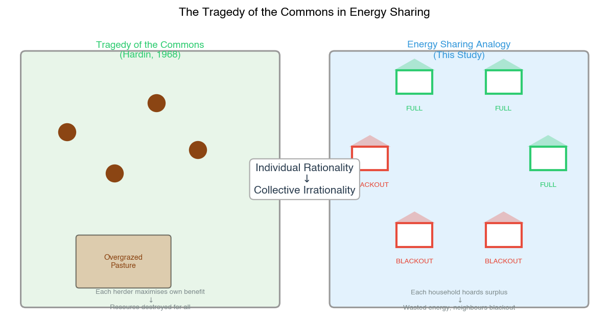

رویکردهای موجود یادگیری تقویتی چندعاملی برای این مسئله، معمولاً با فرض عقلانیت اقتصادی عمل می‌کنند و هر عامل را به عنوان یک بیشینه‌ساز مطلوبیت با هیچ دغدغهٔ ذاتی برای رفاه دیگران مدل‌سازی می‌کنند (May و Huang، ۲۰۲۳؛ Moret و همکاران، ۲۰۲۰). این مدل‌ها برای بهینه‌سازی کارایی فنی جمعی — بیشینه‌سازی کل انرژی ذخیره‌شده، کمینه‌سازی هزینهٔ کل جامعه، یا افزایش خودمصرفی جمعی تولید خورشیدی — طراحی شده‌اند (Charbonnier و همکاران، ۲۰۲۲؛ Kusatake و همکاران، ۲۰۲۳). دشواری در این است که بهینه‌سازی صرفاً مبتنی بر کارایی، اغلب پیامدهای ناعادلانه‌ای ایجاد می‌کند. ممکن است برخی از خانوارها از آسایش کامل و ذخایر باتری بالا برخوردار باشند، در حالی که همسایگانشان قطعی‌های مکرر را تجربه می‌کنند، حتی زمانی که منابع کل جامعه برای تأمین نیازهای همه کافی است (Jain و همکاران، ۱۹۸۴؛ Zhou و Lund، ۲۰۲۳). این نابینایی توزیعی، نه تنها یک نگرانی اخلاقی است؛ بلکه پایداری بلندمدت بازارهای انرژی همتا-به-همتا را تهدید می‌کند، زیرا خانوارهایی که به طور مداوم نتایج ضعیفی دریافت می‌کنند، انگیزهٔ کمی برای ماندن در جامعه دارند (Moret و Pinson، ۲۰۱۹).

سه شکاف تحقیقاتی خاص از وضعیت فعلی ادبیات پژوهشی پدیدار می‌شود. اول، هیچ مطالعهٔ MARL انرژی موجود، ناهمگونی عامل‌ها را بر اساس یک مدل روان‌شناختی معتبر مانند چارچوب پنج‌عاملی بزرگ (OCEAN) بنا نمی‌نهد. مطالعاتی مانند Alshehri و Gaunt (۲۰۲۰) نشان داده‌اند که ترجیحات ناهمگون می‌توانند پیامدهای کیفی متفاوتی در سطح سیستم ایجاد کنند، اما چارچوب آنها ترجیحات را به جای استناد به نظریهٔ شخصیت تثبیت‌شده، به صورت دلخواه تخصیص می‌دهد. دوم، محدودیت‌های انصاف در ادبیات MARL انرژی، به طور یکسان برای همهٔ عامل‌ها اعمال می‌شوند که منعکس‌کنندهٔ دیدگاه نظارتی بالا-به-پایین است تا تنوع فردی در نگرانی نوع‌دوستانه (Jadhav و همکاران، ۲۰۲۴؛ Ma و همکاران، ۲۰۲۵). سوم، هزینهٔ اجتماعی رفتار اکتشافی در جوامع مشارکتی اشتراک‌گذاری انرژی، همچنان بررسی نشده است. در محیط‌های چندعاملی، اکتشاف ادامه‌دار یک عامل می‌تواند یادگیری دیگران را بی‌ثبات کند، پدیده‌ای که در MARL نظریه‌بازی‌ها مستند شده است اما هرگز در زمینهٔ مدیریت منابع فیزیکی مطالعه نشده است (Matignon و همکاران، ۲۰۱۲؛ Leng، ۲۰۲۵). این مطالعه با معرفی وزن‌های پاداش تعدیل‌شدهٔ شخصیتی برگرفته از مدل OCEAN و بررسی نظام‌مند چگونگی شکل‌دهی ترجیحات انصاف ناهمگون به پویایی‌های نوظهور جامعه، به این سه شکاف می‌پردازد.

## ۱-۲ اهمیت مطالعه

این پژوهش در نقطهٔ تلاقی هوش مصنوعی، مهندسی قدرت و روان‌شناسی رفتاری قرار دارد و کمک‌های آن هر سه حوزه را در بر می‌گیرد. از منظر تحقیقات هوش مصنوعی، این مطالعه یک روش اصولی برای تزریق ناهمگونی روان‌شناختی مبتنی بر نظریه به سیستم‌های یادگیری تقویتی چندعاملی ارائه می‌دهد. به جای در نظر گرفتن تنوع عامل‌ها به عنوان یک پارامتر مزاحم یا اعمال برچسب‌های رفتاری دلبخواه، نگاشت OCEAN به یادگیری تقویتی، چارچوبی با انگیزهٔ نظری فراهم می‌کند که ابعاد خاص شخصیت را به پارامترهای یادگیری خاص پیوند می‌دهد — توافق‌پذیری به وزن انصاف، گشودگی به کف اکتشاف، و روان‌رنجوری به حساسیت به جریمه (Binz و Schulz، ۲۰۲۳؛ Ren و Xu، ۲۰۲۵). این چارچوب عمومی است و می‌تواند در هر حوزهٔ MARL که تنوع عامل‌های انسان‌گونه مطلوب است، از هماهنگی وسایل نقلیهٔ خودران گرفته تا رباتیک مشارکتی و تیم‌سازی انسان-هوش مصنوعی، به کار رود (Park و همکاران، ۲۰۲۳).

از منظر مهندسی انرژی، این مطالعه شواهد کمی ارائه می‌دهد که طراحی پاداش آگاه از انصاف، هم برابری توزیعی و هم کارایی فنی را بهبود می‌بخشد. یافته‌ای که جوامع مختلط با عامل‌های نوع‌دوست، اتلاف انرژی را تا ۱۱.۵ درصد نسبت به حالت‌های پایهٔ کاملاً خودخواه کاهش می‌دهند، پیامدهای عملی برای طراحی بازارهای انرژی همتا-به-همتا و تعرفه‌های ریزشبکهٔ اجتماعی دارد (Zhou و Lund، ۲۰۲۳). مهمتر اینکه، این افزایش کارایی به بهای کاهش آسایش برای عامل‌های نوع‌دوست تمام نمی‌شود — مکانیسم متقابل‌گرایی نوظهور مستند در فصل ۴ نشان می‌دهد که عامل‌هایی که در اوایل روز سخاوتمندانه به اشتراک می‌گذارند، بعداً از همسایگان انرژی دریافت می‌کنند که منجر به آسایش فردی بالاتر در کنار انصاف اجتماعی بالاتر می‌شود. این نتیجه، با فرض شهودی که رفتار نوع‌دوستانه در یک محیط با منابع محدود باید از خودگذشتگی باشد، در تناقض است.

از منظر اجتماعی، این مطالعه شواهد تجربی به بحث دیرینه دربارهٔ این که آیا هنجارهای همکاری می‌توانند به طور خودجوش در جمعیت‌های عامل‌های خودخواه پدیدار شوند، کمک می‌کند (Ostrom، ۱۹۹۰؛ Fehr و Gächter، ۲۰۰۰). نتایج شبیه‌سازی نشان می‌دهد که یک اقلیت از عامل‌های نوع‌دوست — به تعداد پنج عامل از ده عامل — می‌توانند تعادل کل جامعه را به سمت رفتار همکاری‌جویانه‌تر سوق دهند، حتی زمانی که عامل‌های باقی‌مانده کاملاً خودخواه هستند. این یافته نه تنها برای سیستم‌های انرژی، بلکه برای هر حوزه‌ای که در آن سیاست‌گذاران به دنبال ترویج پیامدهای نوع‌دوستانه بدون توسل به مقررات اجباری هستند، مرتبط است. در نهایت، کشف «اثر نوآور» به عنوان یک نتیجهٔ هشداردهنده برای استقرار ایمن سیستم‌های یادگیری خودگردان عمل می‌کند: یک عامل منفرد که رفتار اکتشافی آن از هنجار جامعه منحرف می‌شود، می‌تواند نابرابری را بیست و دو درصد افزایش دهد، که نشان می‌دهد پایداری هماهنگی باید یک هدف طراحی درجه‌یک در مدیریت منابع چندعاملی باشد.

## ۱-۳ نوآوری پژوهش

نوآوری اصلی این پژوهش، چارچوب شکل‌دهی پاداشی است که ویژگی‌های شخصیتی پنج‌عاملی بزرگ (OCEAN) را به پارامترهای خاص یادگیری تقویتی چندعاملی نگاشت می‌کند. این رویکرد روان‌شناختی مبتنی بر نظریه، در تضاد با کارهای موجود است که یا محدودیت‌های انصاف یکسانی را اعمال می‌کنند یا ناهمگونی عامل‌ها را بدون ارجاع به نظریهٔ شخصیت تثبیت‌شده، به طور دلخواه تعریف می‌کنند. این چارچوب به ویژه دو بعد شخصیتی را رمزگذاری می‌کند. به طور مشخص، نسبت به Charbonnier و همکاران (۲۰۲۲) و مطالعات مشابه MARL انرژی صرفاً مبتنی بر کارایی، چارچوب حاضر، ترجیحات نوع‌دوستانهٔ ناهمگون مبتنی بر پنج‌عاملی بزرگ را به جای در نظر گرفتن همهٔ عامل‌ها به عنوان بیشینه‌سازهای مطلوبیت یکسان، اضافه می‌کند. نسبت به Hughes و همکاران (۲۰۱۸) و Jadhav و همکاران (۲۰۲۴) که جریمهٔ نابرابری‌گریزی یا منتقد انصاف LLM را به طور یکسان به همهٔ عامل‌ها اعمال می‌کنند، چارچوب حاضر به هر عامل اجازه می‌دهد که دغدغهٔ انصاف آن به طور پیوسته در امتداد بعد توافق‌پذیری تغییر کند — جامعه‌ای را ایجاد می‌کند که در آن برخی از عامل‌ها به شدت به برابری اهمیت می‌دهند، برخی دیگر به طور متوسط اهمیت می‌دهند، و برخی اصلاً اهمیت نمی‌دهند، همان‌گونه که در جوامع انسانی واقعی مشاهده می‌شود (Fehr و Gächter، ۲۰۰۰). نسبت به May و Huang (۲۰۲۳)، که عامل قیمت‌گذاری سطح بیرونی آنها برابری درآمد را از طریق قوانین بازار به جای ترجیحات ذاتی اعمال می‌کند، چارچوب حاضر دغدغهٔ انصاف را در تابع پاداش هر عامل درونی می‌کند و امکان بررسی چگونگی شکل‌دهی ترجیحات ذاتی ناهمگون به پیامدهای نوظهور را مستقل از طراحی بازار فراهم می‌آورد.

توافق‌پذیری، که در ادبیات روان‌شناسی جهت‌گیری نوع‌دوستانه، همکاری‌پذیری و دغدغه برای دیگران را در بر می‌گیرد، به وزن اختصاص‌یافته به انصاف اجتماعی در تابع پاداش هر عامل نگاشت می‌شود (Goldberg، ۱۹۹۰؛ John و Srivastava، ۱۹۹۹). یک عامل با توافق‌پذیری بالا (که در این مطالعه برچسب نوع‌دوست می‌خورد) هشتاد درصد از پاداش خود را از شاخص انصاف Jain جامعه و تنها بیست درصد را از آسایش شخصی خود دریافت می‌کند؛ یک عامل با توافق‌پذیری بسیار پایین (که برچسب کاملاً خودخواه می‌خورد) انصاف اجتماعی را کاملاً نادیده می‌گیرد. بین این دو حد، انواع فردگرا و نوع‌دوست، موقعیت‌های میانی را نشان می‌دهند و طیفی از دغدغهٔ انصاف را ایجاد می‌کنند که هم پیوسته و هم از نظر روان‌شناختی قابل تفسیر است.

گشودگی به تجربه، که کنجکاوی، تازگی‌جویی و تحمل ابهام را در بر می‌گیرد، به کف اکتشافی سیاست اپسیلون-حریصانه نگاشت می‌شود (McCrae و Costa، ۲۰۰۳؛ Ren و Xu، ۲۰۲۵). عامل‌های استاندارد، احتمال اکتشاف خود را به حداقل یک درصد کاهش می‌دهند، به این معنی که پس از همگرایی، تنها به ندرت اقدامات تصادفی را انتخاب می‌کنند. عامل نوآور، نوعی که گشودگی بالا را رمزگذاری می‌کند، حداقل احتمال اکتشاف پنج درصد را حفظ می‌کند، به این معنی که حتی پس از تثبیت بقیهٔ جامعه در الگوهای اشتراک‌گذاری پایدار، به امتحان استراتژی‌های جایگزین ادامه می‌دهد. این نگاشت به مطالعه اجازه می‌دهد تا تأثیر اجتماعی رفتار اکتشافی را از تأثیر تفاوت‌های وزن پاداش جدا کند، زیرا نوآور وزن‌های انصاف یکسانی با نوع نوع‌دوست دارد و تنها در برنامهٔ اکتشافی خود متفاوت است.

خود محیط شبیه‌سازی برای وضوح تحلیلی طراحی شده است تا وفاداری مهندسی. توپولوژی حلقوی از ده خانه، که هر کدام دقیقاً به یک همسایهٔ مشخص متصل هستند، سردرگمی‌های مسیریابی شبکه را حذف کرده و پویایی‌های اجتماعی اشتراک‌گذاری را ایزوله می‌کند. وضعیت هر خانه، یک تاپل ساده از ساعت و سطح باتری گسسته‌سازی‌شده است که فضای وضعیتی نود و شش تایی تولید می‌کند و به طور قابل اعتمادی در عرض هشت هزار قسمت همگرا می‌شود. این طراحی مینیمال بدان معناست که هر گونه تفاوت مشاهده‌شده بین سناریوها را می‌توان به نگاشت شخصیت-پاداش نسبت داد تا پیچیدگی محیط، معماری مدل، یا ناپایداری آموزش.

## ۱-۴ اهداف پژوهش

هدف اصلی این مطالعه، ارزیابی این است که ترجیحات انصاف ناهمگون و متأثر از شخصیت، در یک سیستم اشتراک‌گذاری انرژی مبتنی بر یادگیری تقویتی چندعاملی، چگونه بر کارایی، انصاف و استحکام کلی جامعه، نسبت به یک جامعهٔ پایه از عامل‌های کاملاً خودخواه، تأثیر می‌گذارد. چهار هدف فرعی خاص از این هدف اصلی پشتیبانی می‌کنند.

اولین هدف فرعی، توسعه و اعتبارسنجی یک چارچوب شکل‌دهی پاداش است که ویژگی‌های شخصیتی OCEAN را به وزن‌های تابع هدف و پارامترهای اکتشافی در یک محیط یادگیری کیو چندعاملی نگاشت می‌کند. این شامل تعریف قوانین نگاشت، پیاده‌سازی آنها در شبیه‌سازی، و تأیید این است که عامل‌ها با پارامترهای شخصیتی مختلف، به گونه‌ای رفتار می‌کنند که با نیمرخ‌های روان‌شناختی مورد نظرشان همخوانی دارد.

دومین هدف فرعی، تحلیل الگوهای اشتراک‌گذاری زمانی و وابسته به وضعیت است که زمانی پدیدار می‌شوند که عامل‌ها انصاف اجتماعی را در کنار آسایش شخصی در اولویت قرار می‌دهند. این مطالعه نه تنها معیارهای تجمیعی مانند میانگین آسایش و شاخص انصاف، بلکه وضعیت‌های خاصی را که عامل‌ها در آنها انتخاب می‌کنند به اشتراک بگذارند یا احتکار کنند، با استفاده از جداول کیو آموخته‌شده برای بازسازی سیاست ضمنی که هر نوع شخصیتی به آن همگرا می‌شود، بررسی می‌کند.

سومین هدف فرعی، بررسی مزیت نوع‌دوستانه است — فرضیه‌ای که عامل‌هایی با وزن‌های انصاف متوسط تا بالا، از طریق مکانیسم متقابل‌گرایی نوظهور، به آسایش فردی بالاتری دست می‌یابند. اگر این فرضیه تأیید شود، یک استدلال مستقیم برای سازگاری انگیزه‌ای به نفع طراحی پاداش آگاه از انصاف ارائه می‌دهد: وزن‌های پاداش نوع‌دوستانه از نظر اخلاقی برتر و به بهای کارایی نیستند، بلکه در واقع برای عامل منفرد، سودمند هستند.

چهارمین هدف فرعی، کمّی‌سازی تأثیر بی‌ثبات‌کنندهٔ عامل‌های نوآور با گشودگی بالا بر هماهنگی و برابری جامعه است. با مقایسهٔ سناریوهایی که تنها از نظر وجود یک عامل با کف اکتشافی بالاتر متفاوت هستند، این مطالعه هزینهٔ اجتماعی اکتشاف ادامه‌دار را جدا کرده و اولین توصیف تجربی از این هزینه را در زمینهٔ مدیریت منابع فیزیکی ارائه می‌دهد.

## ۱-۵ سؤالات پژوهش

این مطالعه حول یک سؤال پژوهشی اصلی و چهار سؤال فرعی سازماندهی شده است.

**سؤال پژوهشی اصلی.** ترجیحات انصاف ناهمگون و متأثر از شخصیت، در یک سیستم اشتراک‌گذاری انرژی مبتنی بر یادگیری تقویتی چندعاملی، چگونه بر کارایی، انصاف و استحکام کلی جامعه، در مقایسه با جامعه‌ای از عامل‌های کاملاً خودخواه، تأثیر می‌گذارد؟ این سؤال با مقایسهٔ سناریوی پایهٔ همه خودخواه با چهار سناریوی آزمایشی (همه نوع‌دوست، مختلط، نوع‌دوستی متغیر، و اثر نوآور) در هفت معیار کمّی ارزیابی می‌شود: میانگین آسایش اجتماعی، شاخص انصاف Jain، نرخ روزهای قطعی، اتلاف انرژی، شکاف آسایش نوع‌دوست در مقابل خودخواه، ضریب جینی، و فراوانی اشتراک‌گذاری.

**سؤال فرعی ۱.** آیا تعبیهٔ هنجارهای انصاف در توابع پاداش، به الگوهای اشتراک‌گذاری نوظهوری منجر می‌شود که به طور قابل اندازه‌گیری متفاوت هستند؟ این سؤال بررسی می‌کند که آیا پاداش‌های تعدیل‌شدهٔ شخصیتی، سیاست‌هایی تولید می‌کنند که از نظر کیفی از سیاست‌های خودخواه متمایز هستند، در مقابل اینکه صرفاً همان سیاست را در امتداد یک پیوستار کمّی جابه‌جا کنند. پاسخ عمدتاً از معیار فراوانی اشتراک‌گذاری و تحلیل نقشهٔ حرارتی جدول کیو استخراج می‌شود.

**سؤال فرعی ۲.** چه مصالحه‌هایی بین کارایی انرژی در سطح جامعه و انصاف توزیعی ظاهر می‌شود؟ این سؤال، فرض رایج مبنی بر وجود تنش بین برابری و کارایی را آزمون می‌کند. اگر جوامع نوع‌دوست به هر دو انصاف بالاتر و اتلاف کمتر نسبت به جوامع خودخواه دست یابند، آنگاه مصالحهٔ فرض‌شده در این حوزه برقرار نیست — نتیجه‌ای با پیامدهای سیاستی قابل توجه.

**سؤال فرعی ۳.** آیا ترکیبی از چند عامل نوع‌دوست می‌توانند رفتار عامل‌های خودخواه را از طریق متقابل‌گرایی نوظهور تغییر دهند؟ این سؤال به این موضوع می‌پردازد که آیا هنجارهای نوع‌دوستانه می‌توانند بدون اجرای متمرکز در یک جمعیت منتشر شوند. سناریوی مختلط، شامل پنج عامل نوع‌دوست و پنج عامل خودخواه، مورد آزمون اصلی را فراهم می‌کند.

**سؤال فرعی ۴.** چگونه یک عامل منفرد با گشودگی بالا و کنجکاوی‌محور بر پایداری یک جامعهٔ مختلط تأثیر می‌گذارد؟ این سؤال، پیامد خارجی اجتماعی اکتشاف فردی را جدا می‌کند. سناریوی اثر نوآور، یک عامل با کف اکتشافی بالاتر را به جامعه‌ای که در غیر این صورت تمایل به نوع‌دوستی دارد، معرفی کرده و تغییرات حاصل در برابری، نرخ قطعی، و پایداری همگرایی را اندازه‌گیری می‌کند.

## ۱-۶ فرضیه‌های پژوهش

چهار فرضیه در این مطالعه آزمون می‌شوند که هر کدام از سؤالات پژوهشی فوق مشتق شده و در ادبیات مرور شده، ریشه دارند.

**فرضیه ۱.** جوامع دارای وزن‌های پاداش نوع‌دوست، اتلاف انرژی به طور قابل توجهی کمتری نسبت به جوامع کاملاً خودخواه نشان خواهند داد، زیرا عامل‌هایی که برای انصاف ارزش قائل هستند، به جای دور ریختن مازاد وقتی باتری‌هایشان پر است، آن را به اشتراک می‌گذارند. این فرضیه از این بینش شهودی ناشی می‌شود که عامل‌های آگاه از انصاف، هزینهٔ اتلاف را در سطح جامعه درونی می‌کنند، در حالی که عامل‌های خودخواه نسبت به اتلاف هنگامی که ذخیرهٔ شخصی آنها اشباع شده است، بی‌تفاوت هستند (Zhou و Lund، ۲۰۲۳).

**فرضیه ۲.** عامل‌های نوع‌دوست در جوامع مختلط، از طریق تثبیت زنجیرهٔ تأمین محلی، به میانگین آسایش بالاتری نسبت به همسایگان خودخواه خود دست خواهند یافت. این فرضیهٔ مزیت نوع‌دوستانه است. مکانیسم آن زمانی است: عامل‌های نوع‌دوست اوایل روز مازاد خود را به اشتراک می‌گذارند و اعتبار ضمنی ایجاد می‌کنند که بعداً زمانی که تولید خودشان کاهش می‌یابد و همسایگان لطف آنها را جبران می‌کنند، بازپرداخت می‌شود (May و Huang، ۲۰۲۳). عامل‌های خودخواه که اوایل روز احتکار می‌کنند، ممکن است باتری‌های پر داشته باشند، اما زمانی که ساعات کمبود آنها فرا می‌رسد، از متقابل‌گرایی بهره‌ای نمی‌برند.

**فرضیه ۳.** مزیت نسبی طراحی پاداش نوع‌دوست، با افزایش کمبود محیطی، ثابت باقی خواهد ماند. اگر مزیت نوع‌دوستانه پایدار باشد، باید نه تنها در روزهای آفتابی، بلکه در شرایط ابری که تولید خورشیدی را نصف می‌کند، نیز برقرار باشد. این فرضیه آزمایش می‌کند که آیا مزایای طراحی آگاه از انصاف به فراوانی منابع وابسته است یا به شرایط کمبود تعمیم می‌یابد (Kusatake و همکاران، ۲۰۲۳).

**فرضیه ۴.** حضور یک عامل منفرد با کف اکتشافی بالا، تعادل‌های مشارکتی را بی‌ثبات کرده و منجر به ضرایب جینی بالاتر و نرخ‌های قطعی بالاتر می‌شود. این فرضیه پیش‌بینی را در بر می‌گیرد که اکتشاف تصادفی ادامه‌دار توسط نوآور، از شکل‌گیری انتظارات پایدار در مورد در دسترس بودن انرژی توسط همسایگان جلوگیری کرده و آنها را به سمت استراتژی‌های احتکار تدافعی‌تر سوق می‌دهد (Aloor و همکاران، ۲۰۲۴؛ Matignon و همکاران، ۲۰۱۲).

## ۱-۷ تعاریف عملیاتی

اصطلاحات زیر به همان گونه که در سراسر این پایان‌نامه به کار رفته‌اند، تعریف می‌شوند. این تعاریف مختص به زمینهٔ شبیه‌سازی توصیف‌شده در فصل ۳ هستند و ممکن است دقیقاً با کاربردهای گسترده‌تر یا جایگزین در ادبیات مطابقت نداشته باشند.

**تولیدکننده-مصرف‌کننده (Prosumer).** خانوارهایی که هم از طریق پنل‌های فتوولتائیک خورشیدی پشت‌بامی، انرژی مصرف و هم تولید می‌کنند و قادر به ذخیرهٔ مازاد تولید در باتری و به اشتراک‌گذاری انرژی با همسایگان در ریزشبکه هستند (Rathnayaka و همکاران، ۲۰۱۴؛ Morstyn و McCulloch، ۲۰۱۹). در این مطالعه، هر ده خانه، تولیدکننده-مصرف‌کننده با ظرفیت خورشیدی و اندازهٔ باتری یکسان هستند.

**یادگیری تقویتی چندعاملی (Multi-Agent Reinforcement Learning).** یک چارچوب محاسباتی که در آن چندین عامل خودگردان، سیاست‌های تصمیم‌گیری را از طریق تعامل آزمون‌وخطا با یک محیط مشترک می‌آموزند (Sutton و Barto، ۲۰۱۸؛ Tan، ۱۹۹۳). مطالعهٔ حاضر از یادگیری کیو جدولی مستقل استفاده می‌کند، که در آن هر عامل جدول کیوی مخصوص خود را حفظ کرده و همهٔ عامل‌های دیگر را به عنوان بخشی از محیط ایستا در نظر می‌گیرد — تقریبی که مشخص است تضمین‌های همگرایی نظری را با مقیاس‌پذیری عملی مبادله می‌کند.

**مدل OCEAN (پنج‌عاملی بزرگ).** مدل پنج عاملی شخصیت شامل گشودگی (Openness)، وظیفه‌شناسی (Conscientiousness)، برون‌گرایی (Extraversion)، توافق‌پذیری (Agreeableness) و روان‌رنجوری (Neuroticism) (Goldberg، ۱۹۹۰؛ McCrae و Costa، ۲۰۰۳). این مطالعه دو بعد از این ابعاد — توافق‌پذیری و گشودگی — را به پارامترهای خاص یادگیری تقویتی نگاشت می‌کند، در حالی که سه بعد دیگر را در سطوح متوسط جمعیتی در همهٔ عامل‌ها ثابت نگه می‌دارد.

**اثر نوآور (Innovator Effect).** بی‌ثباتی مشاهده‌شدهٔ هماهنگی در سطح جامعه ناشی از یک عامل با گشودگی بالا که اکتشاف ادامه‌دار آن — که به صورت مقدار اپسیلون حداقلی بالاتر در سیاست اپسیلون-حریصانه پیاده‌سازی شده است — از شکل‌گیری انتظارات پایدار در مورد در دسترس بودن انرژی توسط همسایگان جلوگیری می‌کند (تحلیل کامل در بخش ۴-۸ را ببینید). این اصطلاح در این پایان‌نامه معرفی شده و برای وضوح در اینجا تعریف می‌شود.

**شاخص انصاف Jain (Jain's Fairness Index).** یک معیار مقیاس-ناوردا و پیوسته برای کمّی‌سازی برابری توزیع منابع در یک جمعیت، که به صورت مجذور مجموع تخصیص‌ها تقسیم بر اندازهٔ جمعیت ضربدر مجموع مجذور تخصیص‌ها محاسبه می‌شود (Jain و همکاران، ۱۹۸۴). این شاخص از یک تقسیم بر اندازهٔ جمعیت (حداکثر نابرابری) تا یک (برابری کامل) متغیر است. در این مطالعه، بر روی توزیع آسایش در ده خانوار اعمال می‌شود.

**آسایش شخصی (Personal Comfort).** کسری از کل تقاضای انرژی روزانهٔ یک خانوار که با موفقیت از طریق ترکیبی از تولید خورشیدی، تخلیهٔ باتری و انرژی اشتراک‌گذاری‌شدهٔ دریافتی تأمین می‌شود (Alshehri و Gaunt، ۲۰۲۰). مقدار آسایش ۱.۰ نشان می‌دهد که همهٔ تقاضا تأمین شده است؛ مقادیر زیر ۰.۹۵ به عنوان روزهای قطعی طبقه‌بندی می‌شوند.

**اتلاف انرژی (Energy Waste).** انرژی مازادی که نه می‌توان در باتری اهداکننده ذخیره کرد (زیرا باتری پر بود) و نه می‌توان با همسایه به اشتراک گذاشت (زیرا اقدام اشتراک‌گذاری برای انتقال مازاد کافی نبود). اتلاف بر حسب کیلووات‌ساعت در روز اندازه‌گیری می‌شود و نشان‌دهندهٔ یک اتلاف کارایی خالص برای جامعه است.

## ۱-۸ طرح کلی پایان‌نامه

بقیهٔ این پایان‌نامه به شرح زیر سازماندهی شده است. فصل ۲ به مرور جامعی از ادبیات مرتبط می‌پردازد و تکامل ریزشبکه‌های هوشمند و پارادایم تولیدکننده-مصرف‌کننده را دنبال می‌کند، مکانیسم‌های معاملاتی و قیمت‌گذاری همتا-به-همتا را مرور می‌کند، رویکردهای یادگیری تقویتی چندعاملی برای کنترل توزیع‌شده را بررسی می‌کند، مدل‌سازی انصاف در دوراهی‌های اجتماعی را مورد مطالعه قرار می‌دهد، و دربارهٔ تصمیم‌گیری مبتنی بر شخصیت در هوش مصنوعی بحث می‌کند. این فصل با یک جدول مقایسهٔ کیفی که جایگاه این مطالعه را نسبت به آخرین دستاوردهای علمی مشخص می‌کند و خلاصه‌ای از سه شکاف تحقیقاتی که این پایان‌نامه به آنها می‌پردازد، به پایان می‌رسد.

فصل ۳، روش‌شناسی پژوهش را به طور کامل شرح می‌دهد. این فصل، طرح و رویکرد پژوهش (بخش ۳-۱)، روش‌های جمع‌آوری داده‌ها (بخش ۳-۲)، ابزارها و وسایل مورد استفاده (بخش ۳-۳)، و جامعه، نمونه و روش نمونه‌گیری (بخش ۳-۴) را ارائه می‌دهد. سپس محیط فیزیکی، نگاشت OCEAN به پاداش، طراحی تابع پاداش، الگوریتم یادگیری کیو جدولی با ابرپارامترهای آن، مکانیسم اشتراک‌گذاری انرژی دو مرحله‌ای، پنج سناریوی آزمایشی، هفت معیار ارزیابی، روش‌های تحلیل داده‌ها، و پروتکل آموزش را مشخص می‌کند (بخش‌های ۳-۵ تا ۳-۱۳).

فصل ۴، نتایج شبیه‌سازی را در همهٔ سناریوها و معیارها ارائه می‌دهد. تحلیل از میانگین‌های سطح جامعه از طریق تفاوت‌های نوع عامل و معیارهای نابرابری به سیاست‌های جدول کیوی آموخته‌شده و تحلیل حساسیت در شرایط کمبود پیش می‌رود. هر یافته به طور عینی توصیف می‌شود و تفسیر آن برای فصل ۵ نگهداشته می‌شود. این فصل همچنین شامل آزمون معناداری آماری، تحلیل اثر نوآور، و مقایسه با مبانی آخرین دستاوردهای علمی است.

فصل ۵ به بحث دربارهٔ پیامدهای یافته‌ها می‌پردازد، رابطهٔ انصاف-کارایی را بررسی می‌کند، مکانیسم متقابل‌گرایی نوظهور را تحلیل می‌کند، پیامدهای سیاستی نتایج را مد نظر قرار می‌دهد، و محدودیت‌های مطالعه را تصدیق می‌کند. این فصل با خلاصه‌ای از کار، خلاصه‌ای از یافته‌های کلیدی، و جهت‌گیری‌هایی برای تحقیقات آینده به پایان می‌رسد.

# ۲- مرور پیشینه‌ی پژوهش

## ۲-۱ مبانی نظری

### ۲-۱-۱ گذار به انرژی غیرمتمرکز و الگوی مصرف‌کننده-تولیدکننده (Prosumer)

معماری سیستم‌های قدرت الکتریکی برای نزدیک به یک قرن، اساساً بدون تغییر باقی مانده است: ژنراتورهای متمرکز بزرگ، خطوط انتقال فشارقوی را تغذیه می‌کنند که به شبکه‌های توزیع ولتاژ پایین‌تر منشعب می‌شوند و برق را به مصرف‌کنندگان غیرفعال می‌رسانند. این مدل، اگرچه از لحاظ تاریخی موفق بوده است، دست‌خوش دگرگونی ساختاری شده است که ناشی از دو نیروی هم‌گرا می‌باشد.

نخستین نیرو، فوریت کاهش تغییرات اقلیمی است. هیئت بین‌الدول تغییرات اقلیم (IPCC) مشخص کرده است که محدود کردن گرمایش جهانی به ۱/۵ درجه سلسیوس مستلزم دستیابی به انتشار خالص صفر دی‌اکسید کربن انسان‌ساخت تا اواسط قرن جاری است؛ به‌گونه‌ای که بخش انرژی ــ که مسئول تقریباً سه‌چهارم انتشار گازهای گلخانه‌ای جهانی است ــ بار اصلی این گذار را بر دوش می‌کشد (Masson‑Delmotte et al., 2018).

دومین نیرو، کاهش چشمگیر هزینه‌ی فناوری‌های کلیدی تجدیدپذیر است. هزینه‌ی سطح‌شده‌ی برق خورشیدی فتوولتائیک از سال ۲۰۱۰ تقریباً ۹۰ درصد کاهش یافته است و قیمت بسته‌های باتری لیتیوم-یونی در همین دوره بیش از ۸۰ درصد افت داشته است؛ این امر، سیستم‌های خورشیدی-به‌همراه-ذخیره‌سازی را در تعداد فزاینده‌ای از بازارها از لحاظ اقتصادی مقرون‌به‌صرفه ساخته است (BloombergNEF, 2023; IEA, 2022).

این دو نیرو، پدیده‌ی مصرف‌کننده-تولیدکننده (Prosumer) را پدید آورده‌اند: خانوار مسکونی که هم برق تولید می‌کند و هم مصرف می‌نماید؛ که معمولاً از طریق پنل‌های خورشیدی پشت‌بامی و سیستم باتری خانگی تحقق می‌یابد (Rathnayaka et al., 2014; Morstyn & McCulloch, 2019). مصرف‌کننده-تولیدکننده، گسستی بنیادین از مدل مصرف‌کننده‌ی سنتی محسوب می‌شود؛ زیرا جهت جریان انرژی دیگر یک‌سویه نیست. خانوار دارای مازاد تولید خورشیدی، می‌تواند انرژی را در باتری خود ذخیره کند، آن را به شبکه‌ی توزیع صادر نماید یا از طریق مبادله‌ی همتا-به-همتا مستقیماً با همسایگان به اشتراک بگذارد. هر یک از این گزینه‌ها پیامدهای متفاوتی برای کارایی سیستم، اقتصاد خانوار و تاب‌آوری جامعه به همراه دارد (Tushar et al., 2020; Zhou & Lund, 2023). انتخاب میان آن‌ها صرفاً فنی نیست و شامل ملاحظاتی همچون اعتماد، متقابله‌گری و پایداری بلندمدت جامعه می‌شود که مدل‌های اقتصادی استاندارد به‌طور کامل آن را دربر نمی‌گیرند.

چالش هماهنگ‌سازی که در اتصال چندین مصرف‌کننده-تولیدکننده در یک ریزشبکه‌ی محله‌ی هوشمند پدیدار می‌شود، اساساً با چالش هماهنگ‌سازی شبکه‌ی متمرکز تفاوت دارد. در مدل سنتی، یک اپراتور سیستم واحد، اطلاعات کامل از تولید و تقاضا دارد و می‌تواند منابع را به‌طور بهینه توزیع کند. در مدل غیرمتمرکز، هیچ نهاد واحدی اطلاعات کامل ندارد. هر خانوار، تصمیمات خود را بر اساس مشاهدات محلی می‌گیرد ــ وضعیت باتری خود، الگوی تقاضای خود و تولید خورشیدی لحظه‌ای ــ بدون آگاهی مستقیم از شرایط همسایگان. بنابراین، سیستم باید راهی برای دستیابی به پیامدهای مطلوب جمعی از طریق تصمیم‌گیری صرفاً محلی بیابد؛ مسئله‌ای که به‌طور طبیعی بر پارادایم یادگیری تقویتی چندعاملی منطبق می‌شود (Li & Zhang, 2022; Charbonnier et al., 2022).

ادبیات پژوهش، طبقه‌بندی غنی از سازوکارهای هماهنگ‌سازی مصرف‌کننده-تولیدکننده ارائه داده است. برخی رویکردها بر سیگنال‌های قیمتی تکیه دارند و محله را به‌عنوان یک بازار کوچک برق در نظر می‌گیرند که در آن خانوارها برای خرید و فروش انرژی پیشنهاد قیمت می‌دهند (Moret & Pinson, 2019). برخی دیگر از کنترل مستقیم استفاده می‌کنند و یک تجمیع‌کننده‌ی مرکزی، منابع را در سراسر جامعه توزیع می‌کند (Behrunani et al., 2023). دسته‌ی سوم از رویکردهای مبتنی بر یادگیری استفاده می‌کنند که در آن عامل‌ها، خط‌مشی‌های اشتراک را از طریق تعامل مکرر و بدون ارتباط صریح یا هماهنگی مرکزی توسعه می‌دهند (Charbonnier et al., 2022; Kusatake et al., 2023). هر رویکردی نقاط قوت و ضعف خود را دارد، اما همه‌ی آن‌ها در یک محدودیت مشترک هستند: مصرف‌کنندگان-تولیدکنندگان را به‌عنوان عامل‌های عقلانی اقتصادی مدل‌سازی می‌کنند که رفتار آن‌ها کاملاً توسط مشوق‌های بیرونی و کمینه‌سازی هزینه تعیین می‌شود. امکان اینکه مصرف‌کنندگان-تولیدکنندگان دارای ترجیحات اجتماعی ذاتی باشند ــ اینکه ممکن است برای عدالت، متقابله‌گری یا رفاه اجتماعی به‌عنوان اهداف فی‌نفسه ارزش قائل شوند ــ در نظر گرفته نمی‌شود.

این کوتاهی اهمیت دارد؛ زیرا مجموعه‌ای رو به رشد از شواهد تجربی از اقتصاد رفتاری و روان‌شناسی اجتماعی نشان می‌دهد که تصمیم‌گیری انسانی در بافت‌های اشتراک منابع، تحت تأثیر ترجیحات اجتماعی قرار دارد که قابل تقلیل به منفعت‌طلبی نیستند (Fehr & Gächter, 2000; Ostrom, 1990). انسان‌ها حتی زمانی که از نظر فردی عقلانی نیست، منابع را به اشتراک می‌گذارند، سوءاستفاده‌کنندگان از منابع مشترک را با هزینه‌ی شخصی تنبیه می‌کنند و همکاری خود را مشروط به همکاری مشاهده‌شده در دیگران می‌کنند. اگر سیستم‌های انرژی همتا-به-همتا برای مشارکت‌کنندگان انسانی ــ یا برای عامل‌های خودمختاری که با انسان‌ها تعامل دارند ــ طراحی می‌شوند، این ابعاد اجتماعی باید در مدل‌های محاسباتی حاکم بر تصمیمات اشتراک گنجانده شوند. این پژوهش استدلال می‌کند که یکپارچه‌سازی ترجیحات اجتماعی زمین‌گذاری‌شده‌ی روان‌شناختی در یادگیری تقویتی چندعاملی، هم ممکن است و هم سودمند؛ و باقی‌مانده‌ی این فصل، ادبیاتی را مرور می‌کند که از این ادعا پشتیبانی می‌نماید.

### ۲-۱-۲ مبادله‌ی انرژی همتا-به-همتا (P2P): ساختارهای بازار و سازوکارهای قیمت‌گذاری

مبادله‌ی انرژی همتا-به-همتا به‌عنوان یک سازوکار مبتنی بر بازار برای هماهنگ‌سازی رفتار مصرف‌کنندگان-تولیدکنندگان، به‌طور گسترده‌ای مورد مطالعه قرار گرفته است. ایده‌ی مرکزی این است که خانوارهای دارای مازاد تولید باید بتوانند انرژی را مستقیماً به خانوارهای دارای کسری بفروشند، واسطه‌ی شبکه‌ی توزیع را کنار بگذارند و سهم بیشتری از ارزش اقتصادی تولید توزیع‌شده را به خود اختصاص دهند (Tushar et al., 2020). ادبیات پژوهش بر روی یک طبقه‌بندی سه‌بخشی از ساختارهای بازار P2P همگرا شده است: P2P کامل، که در آن هر خانوار از طریق قراردادهای دوجانبه مستقیماً با هر خانوار دیگر معامله می‌کند؛ مبتنی بر جامعه، که در آن یک واسطه‌ی مرکزی یا تجمیع‌کننده، مبادلات را در یک گروه محلی تسهیل می‌کند؛ و مدل‌های ترکیبی که عناصر هر دو را دربر می‌گیرند (Zhou & Lund, 2023). در میان این مدل‌ها، مدل مبتنی بر جامعه برای کاربردهای مسکونی بیشترین توجه را به خود جلب کرده است؛ زیرا تعادلی بین کارایی هماهنگی متمرکز و خودمختاری تصمیم‌گیری غیرمتمرکز برقرار می‌کند.

سازوکارهای قیمت‌گذاری در بازارهای P2P معمولاً در یکی از سه دسته قرار می‌گیرند. قیمت‌گذاری نسبت عرضه-تقاضا (SDR) قیمت محلی را بر اساس تراز تجمعی تولید و تقاضا در جامعه در هر گام زمانی تعیین می‌کند؛ به‌گونه‌ای که قیمت‌ها در زمان کمبود افزایش و در زمان مازاد کاهش می‌یابند (Qiu et al., 2021). قیمت‌گذاری نرخ میانه‌ی بازار (MMR) قیمت محلی را در نقطه‌ی میانی بین تعرفه‌ی تزریق به شبکه و قیمت خرده‌فروشی برق قرار می‌دهد و تضمین می‌کند که هم خریداران و هم فروشندگان نسبت به معامله با شبکه‌ی توزیع، سود می‌برند. تسهیم قبوض (BS) هزینه‌ی کل برق جامعه را به نسبت مصرف یا تولید خالص هر خانوار تقسیم می‌کند و فرایند تسویه‌حساب را با هزینه‌ی مشوق‌های نهایی ضعیف‌تر ساده‌تر می‌سازد. نشان داده شده است که هر یک از این سازوکارها، پیامدهای سطح جامعه را نسبت به حالت پایه‌ی بدون مبادله بهبود می‌بخشند؛ اما عملکرد نسبی آن‌ها به ویژگی‌های خاص جامعه، نیمرخ‌های تولید و تقاضای اعضای آن و بافت نظارتی بستگی دارد (Zhou & Lund, 2023).

رویکردهای نظریه‌بازی به‌طور گسترده‌ای برای تحلیل برهم‌کنش‌های راهبردی در بازارهای P2P استفاده شده‌اند. صورتبندی‌های بازی اشتکلبرگ، یک رهبر مرکزی (اغلب تجمیع‌کننده‌ی جامعه) را مدل‌سازی می‌کنند که قیمت‌ها را تعیین می‌کند و عامل‌های مصرف‌کننده-تولیدکننده به‌عنوان پیروهایی عمل می‌کنند که تصمیمات مصرف و اشتراک خود را با توجه به آن قیمت‌ها بهینه‌سازی می‌کنند (Behrunani et al., 2023). راه‌حل‌های چانه‌زنی نش، مسئله‌ی مبادله را به‌عنوان یک بازی همکاری‌گونه مدل‌سازی می‌کنند که در آن خانوارها در مورد تخصیص سودمند متقابل مازاد، مذاکره می‌کنند و راه‌حل با بیشینه‌سازی حاصل‌ضرب منافع فردی مشخص می‌شود (Moret & Pinson, 2019). این مدل‌های نظریه‌بازی مزیت ارائه‌ی تضمین‌های اثبات‌پذیر درباره‌ی همگرایی و بهینگی تحت مفروضات خاص را دارند. محدودیت اصلی آن‌ها، فرض دانش مشترک و عقلانیت راهبردی است: فرض می‌شود که همه‌ی عامل‌ها از ساختارهای بازدهی همه‌ی عامل‌های دیگر آگاه هستند و بازدهی خود را بر اساس آن بهینه‌سازی می‌کنند. در جوامع واقعی، خانوارها اطلاعات کامل درباره‌ی ترجیحات یا محدودیت‌های همسایگان خود ندارند و رفتار آن‌ها تحت تأثیر هنجارهای اجتماعی، اعتماد و دغدغه‌های عدالت قرار می‌گیرد که در توابع مطلوبیت استاندارد گنجانده نشده‌اند (Fehr & Gächter, 2000).

محدودیت دیگر رویکردهای مبتنی بر بازار، اتکای آن‌ها به یک هماهنگ‌کننده یا تجمیع‌کننده‌ی مرکزی است. درحالی‌که مدل مبتنی بر جامعه، سربار ارتباطی مبادله‌ی کامل P2P را کاهش می‌دهد، یک نقطه‌ی شکست منفرد را دوباره معرفی می‌کند و نیاز به اعتماد به نهاد مرکزی را ایجاد می‌نماید. این مسئله به‌ویژه در بافت‌هایی که خانوارها نسبت به کنترل شخص ثالث بر منابع انرژی خود بدبین هستند، یا جایی که انگیزه‌های تجمیع‌کننده کاملاً با رفاه جامعه همسو نیست، مشکل‌ساز است (Moret & Pinson, 2019). رویکردهای مبتنی بر یادگیری، که با اجازه دادن به عامل‌ها برای توسعه‌ی خط‌مشی‌ها از طریق تجربه‌ی محلی، از نیاز به هماهنگ‌کننده‌ی مرکزی اجتناب می‌کنند، راه‌حلی بالقوه برای این تنش ارائه می‌دهند و اکنون مرور به این رویکردها معطوف می‌شود.

### ۲-۱-۳ یادگیری تقویتی چندعاملی برای کنترل توزیع‌شده‌ی انرژی

یادگیری تقویتی چندعاملی، صورتبندی طبیعی برای مسئله‌ی هماهنگ‌سازی مصرف‌کننده-تولیدکننده فراهم می‌آورد؛ زیرا نه به اپراتور مرکزی با اطلاعات کامل نیاز دارد و نه فرض می‌کند که عامل‌ها از راهبردها یا توابع بازدهی یکدیگر آگاه هستند. در عوض، هر عامل از طریق تعامل آزمون‌وخطای مکرر با محیط خود، یک خط‌مشی تصمیم‌گیری را می‌آموزد و سیگنال‌های پاداشی دریافت می‌کند که کیفیت تصمیمات آن را منعکس می‌سازد و خط‌مشی خود را بر اساس آن به‌روزرسانی می‌کند (Sutton & Barto, 2018). هنگامی که بر اشتراک انرژی اعمال می‌شود، هر خانوار به‌عنوان یک عامل یادگیری تقویتی خودمختار مدل‌سازی می‌شود که اقدام آن، کسری از انرژی مازاد برای اشتراک با همسایه‌ی تعیین‌شده است؛ وضعیت آن با ساعت جاری و سطح باتری خودش تعریف می‌شود؛ و پاداش آن به آسایش شخصی و عدالت توزیع کلی جامعه بستگی دارد.

صورتبندی استاندارد برای محیط‌های چندعاملی، فرایند تصمیم‌گیری مارکوف جزئی‌مشاهده‌پذیر و غیرمتمرکز (Dec‑POMDP) است که MDP تک‌عاملی را به محیط‌هایی تعمیم می‌دهد که در آن چندین عامل به‌طور هم‌زمان عمل می‌کنند و هر یک فقط مشاهدات جزئی از وضعیت جهانی دریافت می‌کنند (Oliehoek & Amato, 2016). حل بهینه‌ی یک Dec‑POMDP کامل‌ترین (NEXP‑complete) است؛ به‌این معنا که راه‌حل‌های دقیق برای همه‌ی مسائل به‌جز کوچک‌ترین آن‌ها، شدنی نیستند. بنابراین، رویکردهای عملی MARL بر تقریب‌ها متکی هستند. یکی از خانواده‌های مهم روش‌ها، از آموزش متمرکز با اجرای غیرمتمرکز (CTDE) استفاده می‌کنند که در آن عامل‌ها در شبیه‌سازی با استفاده از اطلاعات وضعیت جهانی آموزش می‌بینند، اما خط‌مشی‌های آموخته‌شده را در زمان اجرا با استفاده صرفاً از مشاهدات محلی اجرا می‌کنند (Lowe et al., 2017). شبکه‌های تجزیه‌ی ارزش (VDN) و QMIX این ایده را با یادگیری یک تابع ارزش متمرکز که به مؤلفه‌های هر عامل تجزیه می‌شود، گسترش می‌دهند و بدون نیاز به ارتباط در حین اجرا، رفتار هماهنگ را ممکن می‌سازند (Rashid et al., 2018).

ساده‌ترین و پرکاربردترین رویکرد MARL در حوزه‌ی انرژی، یادگیری کیو مستقل (IQL) است که در آن هر عامل جدول Q یا شبکه‌ی Q مخصوص خود را نگهداری می‌کند و سایر عامل‌ها را بخشی از محیط ایستا در نظر می‌گیرد (Tan, 1993). جذابیت IQL در سادگی و قابلیت‌توسعه‌ی آن است: نیازی به ارتباط بین عامل‌ها و نه زیرساخت آموزش متمرکز ندارد. بااین‌حال، IQL از مسئله‌ی ناایستایی (Non‑Stationarity) رنج می‌برد که چالش فنی تعیین‌کننده‌ی یادگیری تقویتی چندعاملی محسوب می‌شود. از آنجا که همه‌ی عامل‌ها به‌طور هم‌زمان در حال یادگیری هستند، محیطی که هر عامل فردی با آن مواجه می‌شود، با به‌روزرسانی خط‌مشی‌های همسایگانش تغییر می‌کند. این امر، فرض مارکوف را که اثبات همگرایی یادگیری Q بر آن استوار است، نقض می‌کند و می‌تواند به رفتار نوسانی یا زیربهینه منجر شود (Hernandez‑Leal et al., 2017). در عمل، IQL اغلب در محیط‌های مساعد به خط‌مشی‌های معقولی همگرا می‌شود، اما تضمین‌های همگرایی نظری آن ضعیف است.

مسئله‌ی اکتشاف جایگزین (Alter‑Exploration) نمایانگر تجلی خاصی از ناایستایی است که مستقیماً با این پژوهش مرتبط است. در محیط‌های چندعاملی، عاملی که پس از همگرایی دیگران به خط‌مشی‌های پایدار، به اکتشاف اقدامات تصادفی ادامه می‌دهد، از دیدگاه همسایگان خود، غیرقابل‌پیش‌بینی را وارد محیط می‌کند. این همسایگان که نمی‌توانند انتظارات پایداری درباره‌ی در دسترس‌بودن انرژی تشکیل دهند، ممکن است به‌سوی راهبردهای دفاعی‌تر یا احتکار بیشتر حرکت کنند و پیامدهای سطح جامعه را تنزل دهند (Matignon et al., 2012). لنگ (Leng, 2025) این پدیده را به‌عنوان مسئله‌ی اکتشاف جایگزین صورتبندی کرد و شدت آن را در معیارهای MARL همکاری‌گونه نشان داد. پژوهش حاضر این تحلیل را به حوزه‌ی اشتراک انرژی گسترش می‌دهد و با معرفی یک عامل نوآور با اکتشاف بالا، هزینه‌های سطح جامعه‌ی اکتشاف ادامه‌دار آن را کمّی‌سازی می‌کند.

شاربونیه و همکاران (Charbonnier et al., 2022) امکان‌پذیری IQL را برای مدیریت انعطاف‌پذیری انرژی مسکونی با استفاده از جمعیتی سی‌نفره از خانوارها در یک محیط بریتانیایی نشان دادند؛ هر خانوار به‌عنوان یک عامل یادگیری کیو جدولی با اندازه‌ی جدول Q ثابت مدل‌سازی شد که با هرگز به اشتراک نگذاشتن داده‌های شخصی، حریم خصوصی را حفظ می‌کند. رویکرد آن‌ها به بهبود قابل‌توجهی در مصرف خودِ محلی انرژی دست یافت، اما مطالعه، اهداف عدالت یا ترجیحات ناهمگن عامل‌ها را در نظر نگرفت. همه‌ی عامل‌ها توابع پاداش یکسانی داشتند که برای مصرف خودِ فردی بهینه‌سازی می‌کردند و منعکس‌کننده‌ی این فرض بودند که بیشینه‌سازی کارایی، تنها هدف مرتبط است. این موضوع نمایانگر الگویی گسترده‌تر در ادبیات MARL انرژی است: بیشتر مطالعات، کارایی فنی را اولویت می‌دهند ــ بیشینه‌سازی مصرف خود، کمینه‌سازی واردات از شبکه یا کاهش هزینه‌های انرژی جامعه ــ و برابری توزیعی را یا نامربوط یا به‌عنوان یک محدودیت ثانویه که می‌توان به‌طور یکنواخت اعمال کرد، در نظر می‌گیرند.

بوی و همکاران (Bui et al., 2019) یادگیری Q را برای مسئله‌ی زمان‌بندی باتری ریزشبکه به‌کار بردند و نشان دادند که کنترل مبتنی بر یادگیری، در کاهش تقاضای پیک و هزینه‌های انرژی، از روش‌های ابتکاری مبتنی بر قاعده بهتر عمل می‌کند. علی و همکاران (Ali et al., 2023) این کار را به یک محیط چندعاملی با پاسخگویی تقاضا گسترش دادند و نشان دادند که عامل‌ها می‌توانند در پاسخ به سیگنال‌های قیمتی، بدون هماهنگی متمرکز، مصرف خود را جابه‌جا کنند. این مطالعات به‌طور جمعی، امکان‌پذیری فنی مدیریت انرژی مبتنی بر MARL را تأیید می‌کنند، اما همچنین شکافی را آشکار می‌سازند که پژوهش حاضر را برمی‌انگیزد: هیچ‌یک از آن‌ها ترجیحات اجتماعی یا ناهمگنی شخصیت را در چارچوب یادگیری نمی‌گنجانند.

پیامد جمعی رفتار عقلانی فردی در محیط‌های دارای منابع مشترک، دغدغه‌ی مرکزی هر دو حوزه‌ی اقتصاد و بوم‌شناسی است. هاردین (Hardin, 1968) تراژدی منابع مشترک را به‌عنوان تمثیلی صورتبندی کرد که در آن چوپانان عقلانی، هر یک با افزودن دام به مرتع مشترک، منفعت خود را بیشینه می‌کنند و به‌طور جمعی، منبعی را که همگی به آن وابسته‌اند، نابود می‌سازند. مشابه انرژی این است: مصرف‌کننده-تولیدکننده‌ای که با خانوار دارای کسری مواجه می‌شود و مازاد تولید دارد، باید تصمیم بگیرد که به اشتراک بگذارد یا احتکار کند. انتخاب عقلانی فردی، احتکار است؛ زیرا انرژی ذخیره‌شده، بیمه‌ای در برابر کمبود آینده فراهم می‌آورد. بااین‌حال، اگر هر خانوار احتکار کند، مازادی که می‌توانست کسری همسایه را جبران کند، وقتی باتری‌ها به ظرفیت کامل می‌رسند، هدر می‌رود و جامعه به‌عنوان یک کل، شکننده‌تر می‌شود (Kollock, 1998).

استروم (Ostrom, 1990) با مستندسازی نمونه‌های متعدد از جهان واقعی که در آن جوامع از طریق هنجارهای متقابله‌گری، ارتباطات و تحریم‌های پله‌ای، منابع مشترک را با موفقیت مدیریت می‌کنند، اجتناب‌ناپذیری تراژدی منابع مشترک را به چالش کشید. کار او نشان داد که تراژدی، یک قانون جهانی نیست، بلکه پیامدی وابسته به بافت نهادی و ترجیحات اجتماعی مشارکت‌کنندگان است. این بینش، پیامدهای مستقیمی برای طراحی سیستم‌های انرژی همتا-به-همتا دارد: اگر جوامع بتوانند هنجارهای همکاری را برای مدیریت منابع انرژی مشترک توسعه دهند، آن‌گاه معماری فنی سازوکار اشتراک باید به‌جای تضعیف، از چنین هنجارهایی پشتیبانی کند.

مدل‌سازی صوری عدالت در سیستم‌های چندعاملی، چندین سنجه‌ی پرکاربرد را تولید کرده است که هر کدام دارای ویژگی‌های ریاضی و پیامدهای عملی متمایزی هستند. شاخص عدالت جین (Jain's Fairness Index) که در اصل برای تخصیص منابع در شبکه‌های رایانه‌ای توسعه یافته است، به‌صورت مجذور مجموع تخصیص‌ها تقسیم بر حاصل‌ضرب اندازه‌ی جمعیت در مجموع مجذور تخصیص‌ها تعریف می‌شود (Jain, Chiu & Hawe, 1984). این شاخص از یک‌برابر اندازه‌ی جمعیت (نمایانگر حداکثر نابرابری که در آن یک عامل همه‌ی منابع را دریافت می‌کند) تا یک (نمایانگر برابری کامل که در آن همه‌ی عامل‌ها تخصیص‌های یکسانی دریافت می‌کنند) متغیر است. ویژگی‌های کلیدی آن عبارتند از: تغییرناپذیری نسبت به مقیاس (یعنی ضرب کردن همه‌ی تخصیص‌ها در یک عدد ثابت، شاخص را تغییر نمی‌دهد)، پیوستگی (یعنی تغییرات کوچک در تخصیص‌ها، تغییرات کوچک در شاخص ایجاد می‌کند) و استقلال از جمعیت (یعنی شاخص به‌طور سیستماتیک به جمعیت‌های بزرگ‌تر یا کوچک‌تر گرایش ندارد).

ضریب جینی (Gini Coefficient) که از منحنی لورنز ثروت یا مصرف تجمعی مشتق شده است، پرکاربردترین سنجه‌ی نابرابری در اقتصاد است (Gini, 1912). این ضریب از صفر (نمایانگر برابری کامل) تا یک (نمایانگر حداکثر نابرابری که در آن همه‌ی منابع در یک عامل متمرکز شده‌اند) متغیر است. ضریب جینی نسبت به تغییرات در میانه‌ی توزیع حساس‌تر از تغییرات در نقاط انتهایی است؛ که آن را مکمل شاخص عدالت جین می‌سازد، نه زائد. در بافت انرژی، ضریب جینی برای اندازه‌گیری نابرابری در مصرف، دسترسی و هزینه‌ی انرژی به‌کار رفته است، اما کاربرد آن در تصمیمات اشتراک بلادرنگ در سیستم‌های یادگیری چندعاملی نسبتاً جدید است (Kusatake et al., 2023).

پژوهش‌های اخیر MARL شروع به گنجاندن مستقیم اهداف عدالت در توابع پاداش عامل‌ها کرده‌اند. هیوز و همکاران (Hughes et al., 2018) پاداش‌های نابرابری‌گریزی را در محیط‌های بازی Cleanup و Harvest معرفی کردند و نشان دادند که عامل‌هایی که برای کسب درآمد به‌مراتب بیشتر یا کمتر از همتایان خود جریمه می‌شوند، یاد می‌گیرند که منابع را عادلانه‌تر به اشتراک بگذارند و به رفاه جمعی بالاتری دست یابند. رویکرد آن‌ها از مدل نابرابری‌گریزی فِهر و اشمیت (Fehr & Schmidt, 1999) الهام گرفته شده بود که بر اساس آن، ترجیحات انسانی نه‌تنها به پیامدهای مطلق، بلکه به پیامدهای نسبی در مقایسه با دیگران نیز بستگی دارد. نتایج Cleanup و Harvest نشان داد که نابرابری‌گریزی برای حل تراژدی منابع مشترک در این محیط‌های بازی انتزاعی کافی است، اما مطالعه بررسی نکرد که آیا همین سازوکار در محیط‌های اشتراک انرژی با زمین‌فیزیکی عمل می‌کند یا خیر.

جادهاو و همکاران (Jadhav et al., 2024) چارچوب FairMarket‑RL را پیشنهاد کردند که از یک مدل زبانی بزرگ (LLM) به‌عنوان منتقد عدالت برای ارزیابی برابری پیامدهای بازار در یک شبیه‌سازی مبادله‌ی انرژی P2P استفاده می‌کند. LLM ارزیابی می‌کند که آیا تخصیص انرژی هر عامل بر اساس معیارهای مشخص‌شده در زبان طبیعی، عادلانه است و سیگنال پاداش حاصل از این ارزیابی برای هدایت یادگیری عامل به‌کار می‌رود. این رویکرد در استفاده از ارزیابی‌های عدالت انسان‌محور نوآورانه است، اما وابستگی به پایداری و در دسترس‌بودن بلادرنگ فراخوانی‌های API مدل زبانی بزرگ را معرفی می‌کند که ممکن است در سیستم‌های مستقرشده قابل‌اعتماد نباشد. به‌طور بنیادی‌تر، ارزیابی عدالت بیرونی نسبت به عامل‌ها است: توسط یک منتقد خارجی اعمال می‌شود، نه به‌عنوان بخشی از سیستم ارزشی خودِ هر عامل درونی‌سازی می‌گردد.

ما و همکاران (Ma et al., 2025) پارادایم LLM‑MARL را برای رسیدگی به فقر انرژی در یک شبیه‌سازی در مقیاس بزرگ از نودونه حوزه‌ی سرشماری در فلوریدا گسترش دادند. چارچوب CAPPO آن‌ها، آموزش متمرکز را با سیگنال‌های برابری تولیدشده توسط LLM ترکیب می‌کند که منابع را به‌سوی جوامع محروم هدایت می‌کند. نتایج نشان داد که آموزش آگاه از برابری می‌تواند فقر انرژی را بدون قربانی‌کردن کارایی کلی کاهش دهد. بااین‌حال، سیگنال‌های عدالت در CAPPO از داده‌های سطح حوزه‌ی سرشماری مشتق می‌شوند و ترجیحات یا ناهمگنی شخصیت در سطح خانوارهای منفرد را منعکس نمی‌کنند. همه‌ی عامل‌های درون یک حوزه، سیگنال برابری یکسانی دریافت می‌کنند که بازنمایانگر یک محدودیت عدالت یکنواخت و بالا-به-پایین است، نه ترجیحات درونی ناهمگنی که جوامع واقعی را مشخص می‌کنند.

شکافی که از این مرور MARL عدالت‌آگاه پدیدار می‌شود، دووجهی است. نخست، رویکردهای موجود، محدودیت‌های عدالت را به‌طور یکنواخت بر همه‌ی عامل‌ها اعمال می‌کنند و عدالت را به‌عنوان یک مداخله‌ی نظارتی در نظر می‌گیرند، نه به‌عنوان بُعدی از تنوع فردی. دوم، هیچ مطالعه‌ای ترجیحات عدالت را در یک مدل روان‌شناختی معتبر از شخصیت زمین‌گذاری نمی‌کند. رویکرد ما با نگاشت بُعد توافق‌پذیری از مدل پنج‌عاملی شخصیت ــ که در ادبیات روان‌شناسی، جهت‌گیری نوع‌گرایانه و دغدغه‌ی نسبت به دیگران را پیش‌بینی می‌کند ــ مستقیماً به وزنی که هر عامل در تابع پاداش خود به عدالت اجتماعی اختصاص می‌دهد، به هر دو شکاف می‌پردازد. این امر جمعیتی از عامل‌ها با ترجیحات عدالت ناهمگن و زمین‌گذاری‌شده‌ی روان‌شناختی ایجاد می‌کند که مطالعه‌ی پویایی‌های نوظهور جامعه را امکان‌پذیر می‌سازد؛ پویایی‌هایی که نه محدودیت‌های عدالت یکنواخت و نه برچسب‌های ناهمگن دلبخواهانه نمی‌توانند آن‌ها را دربر گیرند.

### ۲-۱-۴ تصمیم‌گیری مبتنی بر شخصیت در عامل‌های محاسباتی

یکپارچه‌سازی روان‌شناسی شخصیت در طراحی عامل‌های محاسباتی، سابقه‌ای چند دهه دارد، اما کاربرد آن در یادگیری تقویتی نسبتاً جدید است. فرض مرکزی این است که تفاوت‌های فردی در رفتار ــ الگوهای پایدار تفکر، هیجان و عمل که یک فرد را از دیگری متمایز می‌کند ــ را می‌توان در امتداد تعداد کمی از ابعاد مشخص کرد و این ابعاد را می‌توان بر روی پارامترهای قابل‌محاسبه در معماری‌های عامل نگاشت (Goldberg, 1990; McCrae & Costa, 2003). اگر این نگاشت بتواند منسجم و معتبر باشد، مسیری به‌سوی عامل‌های انسان‌گونه‌تر در شبیه‌سازی‌های اجتماعی، سیستم‌های تعامل انسان-هوش‌مصنوعی و مسائل هماهنگی چندعاملی که شامل مشارکت‌کنندگان انسانی هستند، ارائه می‌دهد.

مدل پنج‌عاملی (OCEAN) شخصیت، چارچوب مسلط برای ارزیابی شخصیت در روان‌شناسی معاصر است که دهه‌ها اعتبارسنجی بین‌فرهنگی از ساختار عاملی آن پشتیبانی می‌کند (John & Srivastava, 1999). پنج بُعد عبارتند از: گشودگی به تجربه (Openness) که کنجکاوی، تخیل و ترجیح برای تازگی را دربر می‌گیرد؛ وظیفه‌شناسی (Conscientiousness) که خودانضباطی، سازمان‌دهی و هدف‌گرایی را دربر می‌گیرد؛ برون‌گرایی (Extraversion) که جامعه‌پذیری، ابراز وجود و هیجان‌پذیری مثبت را منعکس می‌کند؛ توافق‌پذیری (Agreeableness) که جهت‌گیری نوع‌گرایانه، اعتماد و همکاری‌جویی را دربر می‌گیرد؛ و روان‌رنجوری (Neuroticism) که بی‌ثباتی هیجانی، اضطراب و حساسیت به تهدید را دربر می‌گیرد. هر بُعد نمایانگر یک پیوستار است، نه یک دسته‌بندی دودویی، و نیمرخ‌های شخصیتی فردی با پیکربندی نمرات در هر پنج بُعد مشخص می‌شوند.

نگاشت از ویژگی‌های شخصیت به رفتار عامل، در چندین چارچوب محاسباتی بررسی شده است. پارک و همکاران (Park et al., 2023) نشان دادند که عامل‌های مولد (Generative Agents) دارای نیمرخ‌های شخصیتی پنج‌عاملی، برهم‌کنش‌های اجتماعی متنوع‌تر و باورپذیرتری را در یک محیط شهر شبیه‌سازی‌شده تولید می‌کنند. رویکرد آن‌ها از دستورهای زبان طبیعی برای نمونه‌سازی ویژگی‌های شخصیت در عامل‌های مبتنی بر مدل زبانی بزرگ استفاده کرد و نشان داد که رفتار سازگار با ویژگی، از برهم‌کنش دستورهای شخصیت با معماری حافظه و برنامه‌ریزی عامل پدیدار می‌شود. اگرچه این رویکرد قدرتمند است، اما به قابلیت‌ها و سوگیری‌های خاص مدل زبانی بزرگ زیربنایی وابسته است و به‌سادگی به محیط‌های یادگیری تقویتی که در آن عامل‌ها باید از طریق آزمون‌وخطا خط‌مشی بیاموزند، قابل‌انتقال نیست.

مون و همکاران (Moon et al., 2022) یک نگاشت مستقیم از ویژگی‌های OCEAN به فراپارامترهای یادگیری تقویتی ایجاد کردند و یکی از نخستین چارچوب‌های نظام‌مند برای ترجمه‌ی شخصیت به یادگیری تقویتی را ارائه دادند. در صورتبندی آن‌ها، توافق‌پذیری به وزنی که به رفاه دیگران در یک محیط چندعاملی اختصاص داده می‌شود، نگاشت می‌شود؛ وظیفه‌شناسی به نرخ یادگیری و برنامه‌ی کاهش آن؛ برون‌گرایی به نرخ اکتشاف اولیه؛ گشودگی به نرخ کاهش اکتشاف و کف اکتشاف حداقلی؛ و روان‌رنجوری به ضریب جریمه برای پیامدهای منفی. مون و همکاران این نگاشت را در یک محیط بازی معضل اجتماعی در جهان شبکه‌ای (Grid‑World) اعتبارسنجی کردند و نشان دادند که عامل‌ها با پارامترهای شخصیتی متفاوت، مسیرهای رفتاری قابل‌اندازه‌گیری متفاوتی تولید می‌کنند و نگاشت به‌صورت شهودی قابل‌تفسیر است ــ عامل‌های با توافق‌پذیری بالا، منابع بیشتری به اشتراک می‌گذارند؛ عامل‌های با گشودگی بالا، پایدارتر اکتشاف می‌کنند؛ و عامل‌های با روان‌رنجوری بالا، از وضعیت‌های مرتبط با پیامدهای منفی گذشته اجتناب می‌کنند.

رن و شو (Ren & Xu, 2025) نگاشت OCEAN به عامل را به عامل‌های مولد مبتنی بر مدل زبانی بزرگ در یک شبیه‌سازی اجتماعی کلاس درس گسترش دادند و به‌طور خاص بر ویژگی‌های گشودگی و توافق‌پذیری متمرکز شدند. آن‌ها دریافتند که عامل‌های با گشودگی بالا، به‌طور معنی‌داری بیشتر اطلاعات جدید را می‌پذیرند و باورهای خود را به‌روز می‌کنند، درحالی‌که عامل‌های با توافق‌پذیری بالا، بیشتر همکاری می‌کنند و منابع را با همتایان به اشتراک می‌گذارند. مطالعه‌ی آن‌ها همچنین شواهدی از پایداری ویژگی در طول برهم‌کنش‌های مکرر ارائه داد که نشان می‌دهد رفتار تعدیل‌شده با شخصیت، پس از نمونه‌سازی در یک عامل، در بافت‌های مختلف درون شبیه‌سازی ثابت باقی می‌ماند. این پایداری برای اعتبار نگاشت اهمیت دارد: اگر اثرات شخصیت پس از چند قسمت (Episode) یادگیری از بین برود، نگاشت ارزش عملی محدودی خواهد داشت.

محدودیت اساسی ادبیات موجود شخصیت-به-یادگیری‌تقویتی، از منظر این پژوهش، این است که تمام مطالعات تا به امروز در محیط‌های صرفاً اجتماعی یا بازی‌های انتزاعی انجام شده‌اند. مون و همکاران (۲۰۲۲) از یک بازی اشتراک منابع در جهان شبکه‌ای استفاده کردند. رن و شو (۲۰۲۵) از یک شبیه‌سازی اجتماعی کلاس درس استفاده کردند. پارک و همکاران (۲۰۲۳) از یک محیط تعامل اجتماعی شهر کوچک استفاده کردند. هیچ‌یک از این محیط‌ها شامل مدیریت یک منبع فیزیکی ــ برق ــ با محدودیت‌های جهان واقعی تولید خورشیدی، ذخیره‌سازی باتری، الگوهای تقاضا و عدم‌قطعیت آب‌وهوا که مسئله‌ی اشتراک انرژی را مشخص می‌کنند، نیست. این پرسش که آیا نگاشت‌های OCEAN‑به‑یادگیری‌تقویتی تفاوت‌های رفتاری معناداری در یک وظیفه‌ی مدیریت منابع با زمین‌فیزیکی تولید می‌کنند یا خیر، در ادبیات پاسخ داده نشده است. پژوهش حاضر با پیاده‌سازی یک چارچوب پاداش تعدیل‌شده با شخصیت در یک ریزشبکه‌ی محله‌ی شبیه‌سازی‌شده و اندازه‌گیری نظام‌مند اثرات پارامترهای شخصیتی ناهمگن بر هر دو پیامد سطح فردی و جامعه، این شکاف را پر می‌کند.

## ۲-۲ مرور پژوهش‌های مرتبط

بدنه‌ی پژوهش‌هایی که مستقیماً این کار را تغذیه می‌کنند، سه خوشه‌ی موضوعی را دربر می‌گیرد: MARL کارآمد از نظر بهره‌وری برای مدیریت انرژی، MARL عدالت‌آگاه با محدودیت‌های یکنواخت، و مدل‌سازی عامل‌های مبتنی بر شخصیت در حوزه‌های غیرانرژی. این بخش، مرتبط‌ترین مطالعات را در هر خوشه به‌طور انتقادی مرور می‌کند، انتخاب‌های روش‌شناختی آن‌ها را مقایسه می‌نماید، تناقضات و پرسش‌های حل‌نشده را شناسایی می‌کند و شکاف‌های خاصی را که پژوهش حاضر به آن‌ها می‌پردازد، تثبیت می‌نماید.

### ۲-۲-۱ MARL کارآمد از نظر بهره‌وری در مدیریت انرژی مسکونی

نخستین کاربردهای یادگیری تقویتی در مدیریت انرژی مسکونی بر محیط‌های تک‌عاملی متمرکز بود که در آن یک سیستم مدیریت انرژی خانگی، تصمیمات شارژ و دشارژ باتری را برای کمینه‌سازی هزینه‌های برق یا بیشینه‌سازی مصرف خودِ تولید خورشیدی می‌آموزد (Bui et al., 2019). این مطالعات تک‌عاملی، امکان‌پذیری یادگیری تقویتی را برای کنترل انرژی تأیید کردند و نشان دادند که خط‌مشی‌های مبتنی بر یادگیری، در شرایط مختلف آب‌وهوا و قیمت، از روش‌های ابتکاری ثابت مبتنی بر قاعده بهتر عمل می‌کنند. گسترش به محیط‌های چندعاملی، که در آن چندین خانوار از طریق یک ریزشبکه یا بازار مشترک برهم‌کنش دارند، چالش هماهنگ‌سازی را معرفی کرد که وضعیتِ برترِ دانش را تعریف می‌کند.

شاربونیه و همکاران (Charbonnier et al., 2022) یکی از جامع‌ترین نمایش‌های یادگیری کیوی چندعاملی را برای مدیریت انعطاف‌پذیری مسکونی ارائه دادند. مطالعه‌ی آن‌ها سی خانوار در بریتانیا را مدل‌سازی کرد که هر کدام علاوه بر خورشیدی فتوولتائیک، به خودروهای برقی و پمپ‌های حرارتی مجهز بودند و هر کدام توسط یک عامل یادگیری کیو جدولی مستقل با یک جدول وضعیت‑اقدام با اندازه‌ی ثابت کنترل می‌شدند. عامل‌ها یاد گرفتند که بارهای انعطاف‌پذیر خود را به زمان‌های تولید خورشیدی محلی بالا منتقل کنند و مصرف خودِ جامعه را تقریباً دوازده درصد نسبت به یک خط‌مشی پایه‌ی مبتنی بر قاعده افزایش دهند. نقطه‌ی قوت اصلی مطالعه، قابلیت‌توسعه‌ی آن است: از آنجا که هر عامل فقط جدول Q خود را نگهداری می‌کند و هرگز داده‌های شخصی را با یک هماهنگ‌کننده‌ی مرکزی به اشتراک نمی‌گذارد، رویکرد، حریم خصوصی را حفظ می‌کند و می‌تواند در جوامع با اندازه‌ی دلخواه مستقر شود. محدودیت اصلی آن، از منظر این پژوهش، این است که همه‌ی عامل‌ها توابع پاداش یکسانی دارند که فقط برای مصرف خودِ فردی بهینه‌سازی می‌کنند. مطالعه بررسی نکرد که آیا عامل‌ها با اهداف متفاوت، پیامدهای متفاوتی تولید می‌کنند یا خیر، و همچنین اثرات توزیعی خط‌مشی‌های آموخته‌شده را در بین خانوارها با الگوهای تقاضای مختلف در نظر نگرفت.

جزئیات روش‌شناختی شاربونیه و همکاران (۲۰۲۲) که شایسته‌ی بررسی است، نحوه‌ی برخورد آن‌ها با مسئله‌ی ناایستایی است. نویسندگان از یک برنامه‌ی اکتشاف ثابت با کاهش اپسیلون از ۹/۰ به ۰۱/۰ در طول ۱۰۰٬۰۰۰ قسمت استفاده کردند؛ یک انتخاب طراحی که تضمین می‌کند همه‌ی عامل‌ها تا پایان آموزش به خط‌مشی‌های قطعی همگرا شوند. این رویکرد در محیط‌های مساعد که در آن خط‌مشی‌های بهینه‌ی مشترک منحصر‌به‌فرد و پایدار است، مؤثر واقع می‌شود، اما فرض می‌کند که محیط پس از همگرایی همه‌ی عامل‌ها، ایستا باقی می‌ماند. اگر محیط یا رفتار همسایگان پس از استقرار تغییر کند، عامل‌ها هیچ سازوکاری برای انطباق ندارند. چارچوب ما نه‌تنها از نظر معرفی ناهمگنی شخصیت، بلکه از نظر بررسی آنچه هنگامی رخ می‌دهد که یک عامل عمداً کف اکتشاف بالاتری را حفظ می‌کند و ناایستایی دائمی برای همسایگان خود ایجاد می‌نماید، با شاربونیه و همکاران (۲۰۲۲) تفاوت دارد.

بوی و همکاران (Bui et al., 2019) یادگیری Q را برای زمان‌بندی باتری در یک بافت ریزشبکه به‌کار بردند و نشان دادند که کنترل مبتنی بر یادگیری، تقاضای پیک و هزینه‌های عملیاتی را نسبت به هر دو روشِ مبتنی بر قاعده و کنترل پیش‌بینی‌کننده‌ی مدل کاهش می‌دهد. مطالعه‌ی آن‌ها از یک صورتبندی تک‌عاملی استفاده کرد که در آن کنترل‌کننده‌ی مرکزی ریزشبکه، یاد می‌گیرد که یک باتری مشترک را توزیع کند و بدون چالش‌های یادگیری چندعاملی، به هدف هماهنگ‌سازی یکسانی دست می‌یابد. مبادله این است که کنترل متمرکز به اطلاعات کامل از همه‌ی خانوارها نیاز دارد که هم دغدغه‌های حریم خصوصی و هم ارتباطی را مطرح می‌کند. رویکرد غیرمتمرکز این پژوهش، که در آن هر خانوار تصمیمات اشتراک خود را می‌گیرد، از این دغدغه‌ها اجتناب می‌کند، اما چالش‌های ناایستایی و هماهنگ‌سازی را معرفی می‌کند که کنترل متمرکز به‌طور طبیعی از آن‌ها اجتناب می‌کند.

کوساتاکه و همکاران (Kusatake et al., 2023) رویکرد متفاوتی را برای مسئله‌ی هماهنگ‌سازی با استفاده از بهینه‌سازی تکاملی چندهدفه به‌جای یادگیری تقویتی در پیش گرفتند. چارچوب آن‌ها به‌طور هم‌زمان، هم سود کل جامعه و هم حداقل سود فردی را بهینه‌سازی می‌کند و تضمین می‌کند که هیچ خانوار به‌طور قابل‌توجهی از دیگران بدتر نباشد. صورتبندی چندهدفه جذاب است زیرا به‌طور صریح مبادله‌ی بین کارایی و برابری را که رویکردهای تک‌هدفه نادیده می‌گیرند، دربر می‌گیرد. بااین‌حال، الگوریتم تکاملی در حالت دسته‌ای (Batch) عمل می‌کند و راه‌حل‌های نامزد را بر روی تاریخچه‌ی کامل برهم‌کنش‌های جامعه قبل از انتخاب نسل بعدی ارزیابی می‌کند. این رویکرد برون‌خط نمی‌تواند با تغییرات بلادرنگ در آب‌وهوا، تقاضا یا رفتار عامل سازگار شود و کاربردپذیری آن را در محیط‌های پویا محدود می‌سازد. روش ما به‌جای آن از یادگیری برون‌خط استفاده می‌کند و به عامل‌ها امکان می‌دهد تا با تغییر شرایط، به‌طور پیوسته سازگار شوند.

ادبیات کارایی‌محور تأسیس می‌کند که MARL می‌تواند پیامدهای انرژی سطح جامعه را بهبود بخشد، اما توزیع آن پیامدها را بررسی‌نشده باقی می‌گذارد. مطالعاتی که سنجه‌های تجمعی مانند میانگین هزینه‌ی جامعه یا کل مصرف خود را گزارش می‌کنند، ممکن است نابرابری قابل‌توجهی را در نحوه‌ی توزیع این مزایا در بین خانوارها پنهان کنند. این پژوهش با در نظر گرفتن برابری توزیعی به‌عنوان یک متغیر پیامد اولیه، که از طریق شاخص عدالت جین، ضریب جینی و نرخ روزهای خاموشی اندازه‌گیری می‌شود، به‌جای یک ملاحظه‌ی ثانویه، به این شکاف می‌پردازد.

### ۲-۲-۲ MARL عدالت‌آگاه: محدودیت‌های یکنواخت و کاستی‌های آن‌ها

تشخیص این نکته که بهینه‌سازی صرفاً مبتنی بر کارایی می‌تواند پیامدهای ناعادلانه‌ای به بار آورد، بدنه‌ی رو به رشدی از پژوهش‌ها را در مورد MARL عدالت‌آگاه برانگیخته است. این مطالعات، توابع پاداش عامل‌ها یا اهداف آموزش را برای جریمه‌کردن توزیع‌های ناعادلانه اصلاح می‌کنند، اما معمولاً همان محدودیت عدالت را بر همه‌ی عامل‌ها اعمال می‌کنند که بیانگر دیدگاه نظارتی بالا-به-پایین است تا تنوع فردی در دغدغه‌ی عدالت.

می و هوانگ (May & Huang, 2023) یک بازار مصرف‌کننده-تولیدکننده‌ی همتا-به-همتا را در یک جامعه‌ی ساختمانی سوئدی با استفاده از بهینه‌سازی سیاست نزدیک‌شونده (PPO) در یک معماری دو سطحی درونی-بیرونی مطالعه کردند. در صورتبندی آن‌ها، یک عامل یادگیری تقویتی درونی، هزینه‌های انرژی فردی هر خانوار را بهینه‌سازی می‌کند، درحالی‌که یک عامل یادگیری تقویتی بیرونی، سازوکار قیمت‌گذاری جامعه را برای دستیابی به برابری درآمد در بین خانوارها تنظیم می‌کند. طراحی دو سطحی نوآورانه است زیرا مسئله‌ی تصمیم‌گیری عملیاتی ــ چه مقدار انرژی با قیمت‌های داده‌شده به اشتراک گذاشته شود ــ را از مسئله‌ی طراحی بازار ــ چه قیمت‌هایی پیامدهای عادلانه تولید می‌کنند ــ جدا می‌کند. می و هوانگ دریافتند که عامل قیمت‌گذاری سطح بیرونی، نابرابری درآمد را با موفقیت کاهش می‌دهد، اما سازوکار عدالت از طریق تعدیل قیمت عمل می‌کند، نه از طریق ترجیحات درونی هر خانوار. خانوارهایی که مایل‌اند در صورت نیاز واقعی همسایه، سخاوتمندانه‌تر به اشتراک بگذارند، هیچ راهی برای بیان این ترجیح در مدل ندارند. همه‌ی خانوارها به‌طور یکسان به سیگنال‌های قیمتی یکسان پاسخ می‌دهند؛ فرضی که با شواهد تجربی در مورد ترجیحات اجتماعی ناهمگن تناقض دارد (Fehr & Gächter, 2000).

مطالعه‌ی می و هوانگ (۲۰۲۳) همچنین فرض می‌کند که همه‌ی مصرف‌کنندگان-تولیدکنندگان به‌معنای محدود عقلانیت اقتصادی، یعنی کمینه‌سازی هزینه‌های فردی با توجه به قیمت‌های جاری، عمل می‌کنند. این فرض از نظر روش‌شناختی راحت است، اما اعتبار بیرونی نتایج را محدود می‌کند. اگر مصرف‌کنندگان-تولیدکنندگان واقعی انرژی را نه‌تنها به‌دلیل سودآوری مالی با قیمت جاری، بلکه به‌دلیل دغدغه‌ی نسبت به رفاه همسایگان خود به اشتراک بگذارند، مدل‌هایی که عقلانیت اقتصادی محض را فرض می‌کنند، به‌طور سیستماتیک نرخ‌های اشتراک را دست‌کم می‌گیرند و مشوق‌های قیمتی موردنیاز برای دستیابی به پیامدهای عادلانه را بیش‌تخمین می‌زنند.

هیوز و همکاران (Hughes et al., 2018) یکی از تأثیرگذارترین نمایش‌های پاداش‌های نابرابری‌گریزی را در سیستم‌های چندعاملی ارائه دادند. با استفاده از محیط‌های بازی Cleanup و Harvest، آن‌ها نشان دادند که عامل‌هایی که توابع پاداش آن‌ها شامل جریمه‌ای برای نابرابری است ــ که به‌عنوان تفاوت بین بازدهی خودِ عامل و میانگین بازدهی همه‌ی عامل‌ها اندازه‌گیری می‌شود ــ یاد می‌گیرند که منابع را عادلانه‌تر به اشتراک بگذارند و به رفاه جمعی بالاتری نسبت به عامل‌هایی که فقط برای بازدهی فردی بهینه‌سازی می‌کنند، دست یابند. محیط Cleanup یک بازی مدیریت منابع مکانی است که در آن عامل‌ها باید سیب جمع‌آوری کنند که تنها در صورتی بازتولید می‌شوند که عامل‌ها همچنین آلودگی را در منبع آب مشترک پاکسازی کنند؛ این امر، یک مسئله‌ی کالای عمومی ایجاد می‌کند که از نظر ساختاری مشابه اشتراک انرژی است. محیط Harvest شامل جمع‌آوری سیب توسط عامل‌ها از یک منبع مشترک است که با نرخی متناسب با موجودی باقی‌مانده بازتولید می‌شود و یک مسئله‌ی مدیریت منابع مشترک را ایجاد می‌کند.

نتایج هیوز و همکاران (۲۰۱۸) مستقیماً با این پژوهش مرتبط است زیرا نشان می‌دهند که اصلاح‌های عدالت در سطح پاداش می‌توانند تراژدی منابع مشترک را در محیط‌های چندعاملی حل کنند. بااین‌حال، سه تفاوت مهم، کار آن‌ها را از مطالعه‌ی حاضر متمایز می‌کند. نخست، پاداش نابرابری‌گریزی در هیوز و همکاران از میانگین بازدهی به‌عنوان نقطه‌ی مرجع خود استفاده می‌کند؛ به‌این معنا که عامل‌ها برای انحراف از میانگین در هر دو جهت جریمه می‌شوند. این صورتبندی، همه‌ی انحرافات از برابری را به‌یک اندازه نامطلوب در نظر می‌گیرد، درحالی‌که شاخص عدالت جین که در این پژوهش استفاده شده است، تغییرناپذیر نسبت به مقیاس است و ویژگی‌های ریاضی متفاوتی دارد که آن را برای بافت‌های تخصیص منابع مناسب‌تر می‌سازد. دوم، جریمه‌ی عدالت در هیوز و همکاران به‌طور یکنواخت اعمال می‌شود؛ هر عامل دارای همان درجه‌ی نابرابری‌گریزی است. رویکرد پیشنهادی، شدت دغدغه‌ی عدالت را در سراسر جمعیت عامل‌ها تغییر می‌دهد و طیفی از خودخواهی محض تا نوع‌دوستی تقریباً کامل را ایجاد می‌کند. سوم، محیط‌های Cleanup و Harvest، بازی‌های انتزاعی با زمین‌فیزیکی در سیستم‌های انرژی هستند.

جادهاو و همکاران (Jadhav et al., 2024) چارچوب FairMarket‑RL را پیشنهاد کردند که از یک مدل زبانی بزرگ به‌عنوان منتقد عدالت بیرونی در یک شبیه‌سازی مبادله‌ی انرژی P2P استفاده می‌کند. از مدل زبانی بزرگ خواسته می‌شود تا عدالت تخصیص انرژی هر عامل را بر اساس معیارهای زبان طبیعی ارزیابی کند و نمره‌ی عدالت حاصل در سیگنال پاداش عامل گنجانده می‌شود. این رویکرد از نظر روش‌شناختی جاه‌طلبانه است زیرا یک سنجه‌ی عدالت تحلیلی ثابت را با یک ارزیابی انعطاف‌پذیر و مبتنی بر زبان جایگزین می‌کند که می‌تواند نکات ظریفی را که سنجه‌های ریاضی ممکن است از دست بدهند، دربر گیرد.

بااین‌حال، FairMarket‑RL دارای چندین محدودیت است که این پژوهش از آن‌ها اجتناب می‌کند. نخست، منتقد عدالت مبتنی بر مدل زبانی بزرگ، وابستگی به پایداری بلادرنگ، تأخیر و هزینه‌ی فراخوانی‌های API مدل زبانی بزرگ را معرفی می‌کند که ممکن است در یک سیستم انرژی مستقرشده غیرقابل‌قبول باشد. دوم، قضاوت‌های عدالت مدل زبانی بزرگ ممکن است در عبارات مختلف دستور، قالب‌های ورودی یا نسخه‌های مدل ناسازگار باشد و منبعی کنترل‌نشده از واریانس را به فرایند یادگیری وارد کند. سوم، ارزیابی عدالت نسبت به خودِ عامل‌ها بیرونی باقی می‌ماند؛ توسط یک منتقد خارجی اعمال می‌شود، نه به‌عنوان سیستم ارزشی خودِ هر عامل درونی‌سازی می‌گردد. چارچوب ما رویکرد جایگزین را در پیش می‌گیرد و دغدغه‌ی عدالت را مستقیماً در تابع پاداش هر عامل جاسازی می‌کند؛ جایی که ذاتی، سازگار و بدون نیاز به فراخوانی‌های API خارجی است.

ما و همکاران (Ma et al., 2025) پارادایم LLM‑در‑حلقه را به یک شبیه‌سازی فقر انرژی در مقیاس بزرگ با نودونه حوزه‌ی سرشماری در فلوریدا گسترش دادند. چارچوب CAPPO آن‌ها از آموزش متمرکز با سیگنال‌های برابری تولیدشده توسط مدل زبانی بزرگ استفاده می‌کند که منابع را به‌سوی جوامع محروم شناسایی‌شده توسط داده‌های بار انرژی سطح حوزه‌ی سرشماری هدایت می‌کند. مقیاس مطالعه چشمگیر است و تمرکز آن بر فقر انرژی به یک پرسش پژوهشی مهم اجتماعی می‌پردازد. سازوکار عدالت در CAPPO در سطح حوزه‌ی سرشماری عمل می‌کند، نه سطح خانوار، و منابع را برای بیشینه‌سازی برابری در حوزه‌ها تخصیص می‌دهد، نه در بین خانوارهای منفرد. این انتخاب طراحی، هدف سیاستی کاهش فقر انرژی در سطح جمعیت را منعکس می‌کند، اما ترجیحات عدالت ناهمگنی را که ممکن است در بین خانوارهای مختلف درون یک حوزه وجود داشته باشد، مدل‌سازی نمی‌کند.

ادبیات MARL عدالت‌آگاه به‌طور جمعی نشان می‌دهد که گنجاندن ملاحظات برابری در آموزش عامل، پیامدهای توزیعی را بهبود می‌بخشد، اما همچنین یک الگوی روش‌شناختی ثابت را آشکار می‌کند: عدالت به‌عنوان یک محدودیت یکنواخت و تحمیل‌شده از بیرون در نظر گرفته می‌شود، نه به‌عنوان بُعدی از ناهمگنی فردی. رویکرد ما از این الگو فاصله می‌گیرد و به هر عامل اجازه می‌دهد تا درجه‌ی دغدغه‌ی عدالت آن با توجه به سطح ویژگی شخصیتی آن تغییر کند و جامعه‌ای ایجاد کند که در آن برخی عامل‌ها عمیقاً به برابری اهمیت می‌دهند، برخی به‌طور متوسط و برخی اصلاً اهمیتی نمی‌دهند.

### ۲-۲-۳ رویکردهای نظریه‌بازی و مبتنی بر بازار برای اشتراک منصفانه‌ی انرژی

یک رویکرد جایگزین برای رویکرد مبتنی بر یادگیری تقویتی به عدالت در اشتراک انرژی، استفاده از روش‌های نظریه‌بازی و طراحی بازار است که مشوق‌ها را به‌گونه‌ای ساختار می‌دهند تا پیامدهای عادلانه را به‌طور ذاتی تولید کنند. این رویکردها در هدف دستیابی به پیامدهای عادلانه مشترک هستند، اما در مفروضات خود درباره‌ی دانش عامل و نیازمندی‌های محاسباتی، تفاوت اساسی دارند.

به‌رونانی و همکاران (Behrunani et al., 2023) یک چارچوب نظریه‌بازی دو سطحی برای واسطه‌گری قیمت در یک شبکه‌ی هاب انرژی هوشمند پیشنهاد کردند. در صورتبندی آن‌ها، یک واسطه‌ی مرکزی در سطح بالایی قیمت‌ها را برای بیشینه‌سازی یک هدف عدالت ــ که به‌عنوان واریانس در کاهش هزینه‌ها در بین هاب‌ها تعریف می‌شود ــ تعیین می‌کند، درحالی‌که هاب‌های منفرد، تصمیمات مصرف و مبادله‌ی انرژی خود را در سطح پایینی با توجه به قیمت‌های اعلام‌شده بهینه‌سازی می‌کنند. ساختار دو سطحی، مسئله‌ی عدالت را از مسئله‌ی عملیاتی با ویژگی‌های تحلیلی نظریه‌بازی به‌جای خط‌مشی‌های آموخته‌شده جدا می‌کند.

مزیت اصلی رویکرد نظریه‌بازی، ارائه‌ی تضمین‌های اثبات‌پذیر درباره‌ی همگرایی و بهینگی تحت مدل فرضی رفتار عامل است. به‌رونانی و همکاران (۲۰۲۳) ثابت کردند که بازی دو سطحی آن‌ها تحت شرایط منظم‌بودن ملایم به تعادل اشتکلبرگ همگرا می‌شود و نشان دادند که برنامه‌ی قیمت حاصل، واریانس کاهش هزینه‌ها در بین هاب‌ها را تقریباً چهل درصد نسبت به قیمت‌گذاری یکنواخت کاهش می‌دهد. نقطه‌ضعف اصلی، نیاز به یک واسطه‌ی مرکزی با اختیار تعیین قیمت‌ها و ظرفیت محاسباتی برای حل مسئله‌ی بهینه‌سازی دو سطحی در هر گام زمانی است. این تمرکز، نقطه‌ی شکست منفرد و اتکای به اعتماد را که رویکردهای غیرمتمرکز برای اجتناب از آن طراحی شده‌اند، دوباره معرفی می‌کند.

مورت و پینسون (Moret & Pinson, 2019) مبادله‌ی انرژی همتا-به-همتا را به‌عنوان یک بازی همکاری‌گونه تحلیل کردند و یک راه‌حل چانه‌زنی نش برای تخصیص منافع حاصل از مبادله در بین مصرف‌کنندگان-تولیدکنندگان مشارکت‌کننده پیشنهاد دادند. راه‌حل چانه‌زنی نش دارای ویژگی جذابی است که حاصل‌ضرب منافع فردی را بیشینه می‌کند؛ به‌این معنا که هیچ عاملی را نمی‌توان بدون بدتر شدن وضعیت عامل دیگر، بهتر کرد و هیچ عاملی کمتر از بازدهی عدم‌توافق خود که از معامله با شبکه‌ی توزیع به‌تنهایی حاصل می‌شود، دریافت نمی‌کند. مورت و پینسون نشان دادند که چانه‌زنی نش، تخصیص‌های عادلانه‌ای را به‌معنای بهینگی پارتو و عقلانیت فردی تولید می‌کند، اما تحلیل آن‌ها فرض می‌کرد که همه‌ی عامل‌ها اطلاعات کامل درباره‌ی ترجیحات یکدیگر دارند و همه‌ی منافع حاصل از مبادله شناخته‌شده و ثابت هستند. در یک محیط پویا با تولید و تقاضای تصادفی، راه‌حل چانه‌زنی نش باید در هر گام زمانی دوباره محاسبه شود که بار ارتباطی و محاسباتی قابل‌توجهی را تحمیل می‌کند.

کیو و همکاران (Qiu et al., 2021) یک سازوکار قیمت‌گذاری مبتنی بر نسبت عرضه-تقاضا را برای بازارهای P2P پیشنهاد کردند که نیاز به بهینه‌سازی متمرکز یا اطلاعات کامل ندارد. در قیمت‌گذاری SDR، قیمت انرژی محلی در هر گام زمانی با نسبت تولید کل جامعه به تقاضای کل جامعه تعیین می‌شود؛ به‌گونه‌ای که قیمت‌ها زمانی که تقاضا از عرضه بیشتر می‌شود افزایش و زمانی که عرضه از تقاضا بیشتر می‌شود کاهش می‌یابد. سپس هر خانوار با تنظیم تصمیمات مصرف، ذخیره‌سازی و مبادله‌ی خود به قیمت جاری پاسخ می‌دهد. سازوکار SDR غیرمتمرکز، از نظر محاسباتی سبک است و در مطالعات شبیه‌سازی نشان داده شده است که مصرف خودِ جامعه را بهبود می‌بخشد. بااین‌حال، ویژگی‌های عدالت آن اتفاقی است، نه طراحی‌شده: سازوکار به‌طور صریح تفاوت‌های درآمد خانوار، نیازهای انرژی یا مشارکت‌های گذشته در جامعه را در نظر نمی‌گیرد.

ادبیات نظریه‌بازی و مبتنی بر بازار، پایه‌های نظری مهمی را برای اشتراک عادلانه‌ی انرژی فراهم می‌کند، اما بر مفروضات دانش مشترک، هماهنگی متمرکز یا محاسبه‌ی تعادل متکی است که کاربردپذیری عملی آن‌ها را در محیط‌های دارای عامل‌های یادگیرنده‌ی خودمختار محدود می‌سازد. رویکرد مبتنی بر MARL این پژوهش با اجازه دادن به عامل‌ها برای کشف الگوهای اشتراک عادلانه از طریق یادگیری محلی، بدون نیاز به واسطه‌ی مرکزی، اطلاعات کامل یا محاسبه‌ی صریح تعادل‌های بازار، از این محدودیت‌ها اجتناب می‌کند.

### ۲-۲-۴ مسئله‌ی اکتشاف جایگزین (Alter‑Exploration) و هزینه‌ی اکتشاف فردی

یک مضمون که در چندین شاخه از ادبیات MARL ظاهر می‌شود این است که رفتار عامل فردی می‌تواند پیامدهای خارجی منفی بر پیامدهای یادگیری سطح جامعه داشته باشد، حتی زمانی که آن رفتار از دیدگاه عامل کاوشگر، عقلانی فردی باشد. این پدیده با نام‌های مختلفی مطالعه شده است ــ مسئله‌ی ناایستایی، مسئله‌ی اکتشاف جایگزین و اثر بی‌ثبات‌کننده‌ی برنامه‌های اکتشاف ناهمگن ــ اما سازوکار زیربنایی آن یکسان است: هنگامی که یک عامل رفتار خود را به‌گونه‌ای تغییر می‌دهد که برای همسایگانش غیرقابل‌پیش‌بینی باشد، آن همسایگان نمی‌توانند انتظارات پایداری درباره‌ی پاداش‌های مرتبط با اقدامات خود تشکیل دهند و یادگیری آن‌ها ممکن است به خط‌مشی‌های زیربهینه یا تدافعی همگرا شود.

ماتینیون و همکاران (Matignon et al., 2012) یکی از نخستین تحلیل‌های نظام‌مند از تثبیت MARL همکاری‌گونه را ارائه دادند و مجموعه‌ای از ویژگی‌ها را شناسایی کردند که محیط‌ها را به‌طور خاص مستعد شکست هماهنگی می‌کنند. چارچوب آن‌ها عوامل کلیدی را درجه‌ی برهم‌کنش بین عامل‌ها، پراکندگی سیگنال‌های پاداش و شدت مبادله‌ی اکتشاف-بهره‌برداری تعیین می‌کند. محیط‌هایی که در آن اقدامات عامل‌ها تأثیرات قوی بر پاداش‌های یکدیگر دارند ــ همان‌گونه که در اشتراک انرژی وجود دارد، جایی که تصمیم یک خانوار برای اشتراک، مستقیماً بر آسایش همسایه‌اش تأثیر می‌گذارد ــ به‌طور خاص در برابر اثرات بی‌ثبات‌کننده‌ی اکتشاف آسیب‌پذیر هستند.

لنگ (Leng, 2025) مسئله‌ی اکتشاف جایگزین را صورتبندی کرد و شدت آن را در مجموعه‌ای از معیارهای MARL همکاری‌گونه نشان داد. این مطالعه نشان داد که وقتی یک عامل نرخ اکتشاف بالاتری نسبت به همتایان خود حفظ می‌کند، عملکرد کل سیستم تنزل می‌یابد و این تنزل به‌طور نامتناسبی بر عهده‌ی عامل‌هایی است که خود در حال اکتشاف نیستند. این اثر نامتقارن مهم است زیرا به‌این معناست که هزینه‌ی اکتشاف توسط عامل کاوشگر درونی‌سازی نمی‌شود؛ یک پیامد خارجی است که بر بقیه‌ی جامعه تحمیل می‌شود. در بافت اشتراک انرژی، مسئله‌ی اکتشاف جایگزین به‌این معناست که عاملی که پس از همگرایی دیگران به الگوهای پایدار، به آزمایش راهبردهای مختلف اشتراک ادامه می‌دهد، ممکن است آسایش همسایگان خود را کاهش دهد و نابرابری جامعه را افزایش دهد.

آلور و همکاران (Aloor et al., 2024) عدالت را در ناوبری چندعاملی با استفاده از شبکه‌های عصبی گراف مطالعه کردند و دریافتند که ساختار برهم‌کنش عامل‌ها، اثر اکتشاف فردی بر عدالت جمعی را واسطه‌گری می‌کند. روش آن‌ها با رمزگذاری مستقیم گراف برهم‌کنش عامل در معماری شبکه‌ی عصبی، به قابلیت‌توسعه به جمعیت‌های بزرگ عامل دست یافت و به شبکه امکان داد تا بدون آموزش مجدد، به تعداد مختلف عامل تعمیم یابد. اگرچه محیط آن‌ها ــ ناوبری وسایل نقلیه ــ با اشتراک انرژی تفاوت قابل‌توجهی دارد، اما یافته‌ی آن‌ها مبنی بر اینکه ساختار شبکه، پیامدهای عدالت را واسطه‌گری می‌کند، مرتبط است: محله‌ها با توپولوژی‌های مختلف ممکن است آسیب‌پذیری‌های متفاوتی نسبت به مسئله‌ی اکتشاف جایگزین داشته باشند.

ادبیات اکتشاف جایگزین، یک انتظار نظری روشن ایجاد می‌کند که یک عامل با اکتشاف بالا می‌تواند تعادل‌های همکاری‌گونه را بی‌ثبات کند، اما این پیش‌بینی در یک محیط مدیریت منابع فیزیکی آزمایش نشده است. این پژوهش با معرفی یک عامل نوآور که تنها در کف اکتشاف خود با نوع نوع‌گرا تفاوت دارد ــ پنج درصد در مقابل یک درصد ــ و اندازه‌گیری پیامدهای سطح جامعه‌ی این تغییر پارامتر واحد، این آزمون را ارائه می‌دهد.

یک شاخه‌ی موازی و جدیدتر از پژوهش، استفاده از مدل‌های زبانی بزرگ را به‌عنوان منتقدان عدالت یا مولدهای سیگنال برابری در سیستم‌های چندعاملی بررسی کرده است. این رویکردها برای اعتبارسنجی گسترده بسیار جدید هستند، اما نشان‌دهنده‌ی جهت‌گیری مهمی برای کار آینده هستند و بافتی برای رویکرد محافظه‌کارانه‌تر اتخاذشده در اینجا فراهم می‌کنند.

چارچوب FairMarket‑RL جادهاو و همکاران (۲۰۲۴) که در بالا بحث شد، از مدل زبانی بزرگ به‌عنوان منتقد عدالت بیرونی استفاده می‌کند. CAPPO ما و همکاران (۲۰۲۵) از مدل زبانی بزرگ برای تولید سیگنال‌های برابری از داده‌های بار انرژی سطح حوزه‌ی سرشماری استفاده می‌کند. هر دو مطالعه نشان می‌دهند که یکپارچه‌سازی مدل زبانی بزرگ از نظر فنی امکان‌پذیر است و در محیط‌های مربوطه، پیامدهای به‌مراتب عادلانه‌تری نسبت به حالت‌های پایه‌ی غیر‑LLM تولید می‌کند. بااین‌حال، هر دو مطالعه همچنین شکنندگی رویکرد LLM‑در‑حلقه را تأیید می‌کنند: کیفیت ارزیابی عدالت به‌شدت به مهندسی دستور وابسته است، خروجی مدل زبانی بزرگ ممکن است در فراخوانی‌های API حتی با ورودی‌های یکسان تغییر کند و تأخیر و هزینه‌ی استنتاج مدل زبانی بزرگ ممکن است برای کنترل بلادرنگ بازدارنده باشد.

مطالعه‌ی حاضر عمداً رویکرد متفاوتی را در پیش می‌گیرد و از یک سنجه‌ی عدالت تحلیلی ثابت ــ شاخص عدالت جین ــ استفاده می‌کند که قطعی، ارزان برای محاسبه و مستقل از وابستگی‌های API خارجی است. این انتخاب طراحی، تمرکز پایان‌نامه را بر جداسازی اثر ناهمگنی شخصیت بر پیامدهای جامعه منعکس می‌کند که با واریانس معرفی‌شده توسط سیگنال عدالت مبتنی بر مدل زبانی بزرگ، مخدوش می‌شد. بنابراین، یافته‌های این پژوهش را می‌توان به‌عنوان ایجاد یک حد پایین‌تر از آنچه عدالت تعدیل‌شده با شخصیت در MARL می‌تواند به دست آورد، بدون پیچیدگی اضافی یکپارچه‌سازی مدل زبانی بزرگ، تفسیر کرد.

## ۲-۳ مقایسه‌ی کیفی پژوهش‌های مرتبط

مطالعات مرورشده در بخش‌های پیشین از نظر الگوریتم‌ها، محیط‌ها، سازوکارهای عدالت و نحوه‌ی برخورد با ناهمگنی شخصیت، تفاوت‌های قابل‌توجهی دارند. جدول ۲-۱ مقایسه‌ای نظام‌مند ارائه می‌دهد که جایگاه مطالعه‌ی حاضر را در برابر وضعیتِ برترِ دانش در این ابعاد مشخص می‌سازد. جدول با ترکیبی روایی دنبال می‌شود که تضادهای کلیدی را برجسته می‌سازد و شکاف‌هایی را که این پژوهش به آن‌ها می‌پردازد، شناسایی می‌کند.

**جدول ۲-۱: مقایسه‌ی کیفی ادبیات MARL در مدیریت انرژی و شبیه‌سازی اجتماعی**

| مطالعه                     | الگوریتم                        | محیط                                         | سازوکار عدالت                      | شخصیت؟                     | نقاط قوت                                                 | نقاط ضعف                                              |
| :------------------------- | :------------------------------ | :------------------------------------------- | :--------------------------------- | :------------------------- | :------------------------------------------------------- | :---------------------------------------------------- |
| شاربونیه و همکاران (۲۰۲۲)  | یادگیری Q (توزیع‌شده)           | انعطاف‌پذیری مسکونی بریتانیا                 | هیچ (تمرکز بر کارایی)              | خیر                        | جدول‌های Q با اندازه‌ی ثابت و قابل‌توسعه برای حریم خصوصی | عدم توجه به عدالت توزیعی یا ترجیحات فردی              |
| می و هوانگ (۲۰۲۳)          | PPO (دو سطحی درونی-بیرونی)      | بازار مصرف‌کننده-تولیدکننده در ساختمان سوئدی | برابری درآمد                       | خیر (فرض عقلانیت اقتصادی)  | کشش قیمتی نوظهور در P2P                                  | فرض عامل‌های عقلانی همگن                              |
| کوساتاکه و همکاران (۲۰۲۳)  | تکاملی / چندهدفه                | مبادله‌ی انرژی P2P                           | عدالت سود / حداقل‑حداکثر سود       | خیر                        | تعادل مؤثر عرضه-تقاضا                                    | محاسبات کند؛ غیرقابل‌انطباق بلادرنگ                   |
| به‌رونانی و همکاران (۲۰۲۳) | نظریه‌بازی دو سطحی              | هاب‌های انرژی هوشمند                         | واریانس کاهش هزینه                 | خیر                        | واسطه‌گری قیمت با تضمین اثبات‌پذیر                       | نیاز به هماهنگ‌کننده‌ی نیمه‌متمرکز                    |
| آلور و همکاران (۲۰۲۴)      | MARL (شبکه‌های عصبی گراف)       | ناوبری چندعاملی                              | ۱ / ضریب تغییرات                   | خیر                        | قابلیت‌توسعه به تعداد دلخواه عامل با GNN                 | متمرکز بر ناوبری، نه اشتراک مسکونی                    |
| جادهاو و همکاران (۲۰۲۴)    | IPPO + منتقد عدالت مبتنی بر LLM | بازار P2P (FairMarket‑RL)                    | نمرات FTB و FBS هدایت‌شده توسط LLM | غیرمستقیم (استدلال اخلاقی) | ارزیابی‌های انسان‌محور                                   | وابسته به پایداری بلادرنگ API مدل زبانی بزرگ          |
| هیوز و همکاران (۲۰۱۸)      | A3C (یادگیری تقویتی عمیق)       | بازی‌های Cleanup و Harvest                   | پاداش‌های نابرابری‌گریزی           | خیر                        | حل تراژدی منابع مشترک                                    | زمین‌گذاری‌شده در روان‌شناسی پنج‌عاملی نیست           |
| ما و همکاران (۲۰۲۵)        | CAPPO + گردش کار LLM            | بازار حوزه‌های سرشماری ۹۹‑گانه‌ی فلوریدا     | کمک‌های کربن / سیگنال‌های برابری   | غیرمستقیم (قصد کاربر)      | پرداختن به فقر انرژی با داده‌های چندوجهی                 | حلقه‌ی LLM‑RL در برابر تغییرات دستور شکننده است       |
| رن و شو (۲۰۲۵)             | عامل‌های مولد (LLM)             | شبیه‌سازی اجتماعی کلاس درس                   | N/A                                | **بله (پنج‌عاملی)**        | تحلیل پایداری ویژگی قوی                                  | مدیریت منابع فیزیکی ندارد                             |
| **مطالعه‌ی حاضر**          | **OCEAN‑MARL (IQL)**            | **محله‌ی ۱۰‑خانه‌ای (حلقه‌ای)**              | **شاخص جین تعدیل‌شده با شخصیت**    | **بله (پنج‌عاملی)**        | **یکپارچه‌سازی روان‌شناسی OCEAN با اشتراک انرژی فیزیکی** | فضای وضعیت جدولی (۹۶ وضعیت) دانه‌بندی را محدود می‌کند |

مقایسه، چندین الگو را آشکار می‌سازد که در مرور مطالعات منفرد مبهم بودند. نخست، هر مطالعه‌ی متمرکز بر انرژی در این مقایسه که یک سازوکار عدالت را دربر می‌گیرد، آن را به‌طور یکنواخت بر همه‌ی عامل‌ها اعمال می‌کند، یا از طریق یک قاعده‌ی قیمت‌گذاری متمرکز، یک جریمه‌ی نابرابری مشترک، یا یک مدل زبانی بزرگ که تخصیص کل جامعه را به‌طور هم‌زمان ارزیابی می‌کند. هیچ‌یک به عامل‌های منفرد اجازه نمی‌دهند که درجه‌های مختلفی از دغدغه‌ی عدالت داشته باشند. دوم، تنها مطالعاتی که ناهمگنی شخصیت را دربر می‌گیرند ــ رن و شو (۲۰۲۵) و به‌طور غیرمستقیم، مطالعات عامل‌های مبتنی بر مدل زبانی بزرگ ــ در محیط‌های صرفاً اجتماعی یا متنی بدون مدیریت منابع فیزیکی عمل می‌کنند. محل تلاقی دو بُعد ــ ناهمگنی شخصیت در یک محیط مدیریت انرژی با زمین‌فیزیکی ــ قلمرویی اشغال‌نشده است که دقیقاً این پژوهش خود را در آن موقعیت‌یابی می‌کند.

سوم، مقایسه، یک شکاف روش‌شناختی بین مطالعات MARL انرژی و مطالعات شبیه‌سازی اجتماعی از نظر الگوریتم یادگیری را برجسته می‌کند. مطالعات انرژی عمدتاً از یادگیری کیو جدولی یا روش‌های تکاملی استفاده می‌کنند که منعکس‌کننده‌ی نیاز به کارایی نمونه و همگرایی پایدار در محیط‌های با محدودیت‌های جهان واقعی است. مطالعات شبیه‌سازی اجتماعی عمدتاً از عامل‌های مبتنی بر مدل زبانی بزرگ استفاده می‌کنند که منعکس‌کننده‌ی نیاز به تعامل زبان طبیعی و هزینه‌ی کمتر خطاها در شبیه‌سازی است. رویکرد ما با اتخاذ یادگیری کیو جدولی، همسو با قرارداد حوزه‌ی انرژی، و در عین حال معرفی نوآوری‌های وزن‌های پاداش تعدیل‌شده با شخصیت و تنوع سیستماتیک کف اکتشاف است.

هر مدخل «نقاط ضعف» در جدول ۲-۱ مستقیماً با یکی از سه شکاف پژوهشی تعریف‌شده در بخش ۲-۴ مطابقت دارد. محدودیت یکنواخت عدالت که به‌عنوان انتخاب طراحی محدودکننده در می و هوانگ (۲۰۲۳)، هیوز و همکاران (۲۰۱۸) و جادهاو و همکاران (۲۰۲۴) شناسایی شده است، دقیقاً شکاف ۲ است: عدم وجود ترجیحات عدالت درونی ناهمگن در MARL عدالت‌آگاه موجود. عدم وجود زمین‌گذاری روان‌شناختی که برای شاربونیه و همکاران (۲۰۲۲)، کوساتاکه و همکاران (۲۰۲۳) و به‌رونانی و همکاران (۲۰۲۳) ذکر شده است، دقیقاً شکاف ۱ است: فقدان یک مدل شخصیت معتبر برای ساختاردهی ناهمگنی عامل. شکاف منابع فیزیکی که به‌عنوان محدودیت رن و شو (۲۰۲۵) و مطالعات شبیه‌سازی اجتماعی مبتنی بر مدل زبانی بزرگ شناسایی شده است، دقیقاً محل تلاقی گم‌شده‌ای است که این پایان‌نامه را برمی‌انگیزد: ناهمگنی شخصیت هرگز در یک محیط اشتراک انرژی با زمین‌فیزیکی آزمایش نشده است. بنابراین، این سه نقطه‌ضعف نه‌تنها کاستی‌های قبلی را فهرست می‌کنند، بلکه الزامات طراحی را که چارچوب OCEAN‑MARL پیشنهادی برای برآورده‌سازی آن‌ها ساخته شده است، تعریف می‌کنند.

## ۲-۴ چارچوب مفهومی و شکاف‌های پژوهشی

سه شکاف پژوهشی خاص از ادبیات مرور شده در بخش‌های پیشین پدیدار می‌شود. هر شکاف به‌طور دقیق تعریف می‌شود، در محدودیت‌های خاص کارهای پیشین زمین‌گذاری می‌گردد و مستقیماً توسط طراحی مطالعه‌ی حاضر مورد بررسی قرار می‌گیرد.

نخستین شکاف به عدم وجود ناهمگنی عامل زمین‌گذاری‌شده‌ی روان‌شناختی در MARL انرژی مربوط می‌شود. ادبیات MARL انرژی نشان داده است که ترجیحات ناهمگن عامل می‌توانند پیامدهای کیفی متفاوتی در سطح نظام تولید کنند (Charbonnier et al., 2022; May & Huang, 2023; Kusatake et al., 2023)، اما هیچ مطالعه‌ی موجود، این ناهمگنی را در یک مدل روان‌شناختی معتبر از شخصیت زمین‌گذاری نمی‌کند. هنگامی که اهداف یا وزن‌های پاداش متفاوتی به عامل‌ها اختصاص داده می‌شود، این انتساب از منظر روان‌شناختی دلبخواهانه است ــ مبنای نظری برای اینکه چرا یک عامل باید وزن عدالت متفاوتی با عامل دیگر داشته باشد وجود ندارد و راهی برای پیش‌بینی اینکه یک تفاوت معین در پارامترها چگونه بر رفتار خارج از بافت شبیه‌سازی خاص تأثیر می‌گذارد، وجود ندارد. ادبیات نگاشت شخصیت‑به‑یادگیری‌تقویتی (Moon et al., 2022; Ren & Xu, 2025) تأسیس کرده است که ویژگی‌های OCEAN را می‌توان در اصل به پارامترهای یادگیری تقویتی نگاشت، اما این نگاشت هرگز در یک محیط مدیریت منابع فیزیکی به‌کار گرفته نشده است. این پژوهش با تعریف انواع عامل به‌عنوان نقاطی در فضای شخصیت OCEAN و نگاشت آن مختصات به وزن‌های تابع پاداش و پارامترهای اکتشاف خاص، این دو ادبیات را پل می‌زند و جمعیتی از عامل‌ها را ایجاد می‌کند که ناهمگنی آن‌ها هم از نظر نظری انگیخته شده و هم از نظر محاسباتی پیاده‌سازی شده است.

دومین شکاف به تقابل بین محدودیت‌های عدالت یکنواخت و ترجیحات درونی ناهمگن مربوط می‌شود. ادبیات MARL عدالت‌آگاه (Hughes et al., 2018; Jadhav et al., 2024; Ma et al., 2025) محدودیت‌های عدالت را به‌طور یکنواخت بر همه‌ی عامل‌های جامعه اعمال می‌کند. چه سازوکار عدالت یک جریمه‌ی نابرابری، یک منتقد مدل زبانی بزرگ یا یک سیگنال برابری مشتق‌شده از داده‌های سرشماری باشد، هر عامل در شبیه‌سازی تابع هدف عدالت یکسانی دارد. این یکنواختی در صورتی مناسب است که عدالت به‌عنوان یک مداخله‌ی نظارتی تحمیل‌شده توسط یک مرجع مرکزی مفهوم‌سازی شود، اما واقعیت جوامع انسانی را که در آن افراد مختلف درجات مختلفی از دغدغه‌ی نسبت به عدالت و انگیزه‌های نوع‌گرایانه متفاوتی دارند، دربر نمی‌گیرد (Fehr & Gächter, 2000). چارچوب ما با اجازه دادن به وزن اختصاص‌یافته به عدالت اجتماعی در تابع پاداش برای تغییر در بین عامل‌ها با توجه به سطح ویژگی توافق‌پذیری آن‌ها، به این شکاف می‌پردازد و جمعیتی با ترجیحات عدالت درونی و ناهمگن ایجاد می‌کند.

سومین شکاف به هزینه‌ی اجتماعی بررسی‌نشده‌ی رفتار اکتشافی در اشتراک انرژی همکاری‌گونه مربوط می‌شود. مسئله‌ی اکتشاف جایگزین ــ پدیده‌ای که در آن رفتار اکتشافی یک عامل، یادگیری عامل‌های دیگر را بی‌ثبات می‌کند ــ در معیارهای MARL نظریه‌بازی مطالعه شده است (Matignon et al., 2012; Leng, 2025)، اما هرگز در بافت مدیریت منابع فیزیکی بررسی نشده است. این پژوهش با جداسازی اثر کف اکتشاف یک عامل منفرد ــ حداقل احتمال انتخاب یک اقدام تصادفی ــ درحالی‌که همه‌ی پارامترهای دیگر ثابت نگه داشته می‌شوند، این شکاف را پر می‌کند. با مقایسه‌ی سناریویی که در آن یک عامل دارای کف اکتشاف پنج درصد است با یک سناریوی کاملاً مشابه که در آن همه‌ی عامل‌ها دارای کف اکتشاف یک درصد هستند، مطالعه، نخستین توصیف تجربی هزینه‌ی اجتماعی اکتشاف فردی را در یک جامعه‌ی اشتراک انرژی ارائه می‌دهد.

### ۲-۴-۱ چارچوب مفهومی: مدل هماهنگی تعدیل‌شده با شخصیت

چارچوب مفهومی که این پژوهش را هدایت می‌کند، مبانی نظری مرورشده در بخش ۲-۱ را با شکاف‌های شناسایی‌شده در بخش قبلی یکپارچه می‌سازد. این چارچوب، یک مدل هماهنگی تعدیل‌شده با شخصیت است که سه سطح تحلیل را به هم پیوند می‌زند: ویژگی‌های شخصیت فردی، پارامترهای یادگیری سطح عامل و پیامدهای نوظهور سطح جامعه.

در سطح فردی، هر خانوار با موقعیتی در فضای شخصیت پنج‌عاملی (OCEAN) مشخص می‌شود. مطالعه‌ی حاضر دو بُعد از این فضا را رمزگذاری می‌کند: توافق‌پذیری، که وزنی را که به عدالت اجتماعی در تابع پاداش عامل اختصاص داده می‌شود، تعیین می‌کند؛ و گشودگی، که کف اکتشاف عامل را تعیین می‌کند. سه بُعد باقی‌مانده ــ وظیفه‌شناسی، برون‌گرایی و روان‌رنجوری ــ در سطوح میانگین جمعیتی در همه‌ی عامل‌ها ثابت نگه داشته می‌شوند و به پژوهش امکان می‌دهند تا اثرات دو بُعد دستکاری‌شده را جدا کند. این پیاده‌سازی انتخابی، یک انتخاب روش‌شناختی عمدی است: معرفی هم‌زمان هر پنج بُعد، فضای پارامتری با ابعاد بالا ایجاد می‌کند که تفسیر آن دشوار خواهد بود و برای جداسازی اثرات برهم‌کنش، به یک کارزار شبیه‌سازی با اندازه‌ی نمایی بزرگ‌تر نیاز دارد.

در سطح عامل، هر خانوار به‌عنوان یک عامل یادگیری کیو جدولی مستقل با یک فضای وضعیت گسسته که توسط ساعت و سطح باتری گسسته‌شده تعریف می‌شود، سه اقدام اشتراک گسسته و یک تابع پاداش که ترکیبی محدب از آسایش شخصی و عدالت اجتماعی است، مدل‌سازی می‌شود. پارامترهای وزنی تابع پاداش توسط سطح توافق‌پذیری عامل تعیین می‌شوند و کف اکتشاف سیاست اپسیلون-حریصانه توسط سطح گشودگی عامل تعیین می‌شود. این نگاشت در چارچوب پارامتری شخصیت‑به‑یادگیری‌تقویتی مون و همکاران (۲۰۲۲) و تداعی‌های ویژگی-رفتار معتبر رن و شو (۲۰۲۵) زمین‌گذاری شده است.

در سطح جامعه، برهم‌کنش عامل‌ها با پارامترهای تعدیل‌شده با شخصیت متفاوت، پیامدهای نوظهوری تولید می‌کند که از پارامترهای هیچ عامل منفردی به‌طور مجزا قابل‌پیش‌بینی نیستند. این پیامدها شامل توزیع آسایش سطح جامعه، الگوهای اشتراک انرژی در ساعات و وضعیت‌های مختلف و تاب‌آوری سیستم در برابر آشفتگی‌های بیرونی مانند روزهای ابری و آشفتگی‌های درونی مانند اکتشاف ادامه‌دار یک عامل نوآور است.

چارچوب، پیش‌بینی‌های خاص و قابل‌آزمونی را تولید می‌کند که در فصل ۱ به‌عنوان فرضیه بیان شده‌اند. پیش‌بینی مرکزی این است که جوامع با ترکیبی از عامل‌های نوع‌گرا و خودخواه، به سطوح بالاتری از هر دو عدالت و کارایی نسبت به جوامع کاملاً خودخواه دست خواهند یافت؛ زیرا عامل‌های نوع‌گرا، هنجاری از متقابله‌گری ایجاد می‌کنند که همه‌ی عامل‌ها از آن سود می‌برند. پیش‌بینی دوم این است که این مزیت نوع‌گرایانه در شرایط کمبود بیشتر نیز پایدار خواهد ماند و در شرایط ابری که تولید خورشیدی را نصف می‌کند، ثابت باقی خواهد ماند. پیش‌بینی سوم این است که کف اکتشاف بالاتر عامل نوآور، تعادل همکاری‌جویانه‌ی جامعه را بی‌ثبات خواهد کرد و نابرابری را افزایش داده و رفاه کلی را کاهش خواهد داد. این پیش‌بینی‌ها در آزمایش‌های شبیه‌سازی توصیف‌شده در فصل ۳ مورد آزمون قرار می‌گیرند و نتایج در فصل ۴ ارائه می‌شوند.

# ۳- روش‌شناسی پژوهش

## ۳-۱ طرح و رویکرد پژوهش

پژوهش حاضر از طرح تحقیق کمی تجربی با رویکرد شبیه‌سازی محاسباتی مبتنی بر مدل‌سازی استفاده می‌کند. این تحقیق به‌عنوان پژوهشی کاربردی طبقه‌بندی می‌شود؛ زیرا هدف آن، پرداختن به یک چالش مهندسی عملی ــ اشتراک منصفانه و کارآمد انرژی در جوامع مسکونی خارج از شبکه ــ از طریق پیاده‌سازی نظریه‌ی روان‌شناختی در چارچوب یادگیری تقویتی چندعاملی (MARL) است. طرح آزمایشی، دو متغیر مستقل را دستکاری می‌کند: ترکیب شخصیتی جامعه‌ی عامل‌ها (پنج سطح: همگی خودخواه، همگی نوع‌گرا، مختلط، نوع‌گرایی متنوع و اثر نوآور) و سطح کمبود منابع (دو سطح: حالت پایه‌ی روز صاف و احتمال ۱۵ درصد روز ابری). متغیرهای وابسته، هفت سنجه‌ی عملکردی تعریف‌شده در بخش ۳-۱۱ هستند: میانگین آسایش جامعه، شاخص عدالت جین، نرخ روزهای خاموشی، هدررفت انرژی، اختلاف آسایش نوع‌گرا در برابر خودخواه، ضریب جینی و فراوانی اشتراک.

تصمیم به استفاده از شبیه‌سازی به‌جای آزمایش‌های میدانی یا مطالعات با مشارکت انسانی، ناشی از سه ملاحظه بود. نخست، پژوهش نیاز به آزمایش چندین ترکیب جامعه در شرایط فیزیکی یکسان (همان تابش خورشیدی، همان ظرفیت باتری، همان الگوهای تقاضا) و در عین حال کنترل همه‌ی متغیرهای مخدوش‌کننده دارد؛ سطحی از کنترل که در محیط‌های میدانی که در آن آب‌وهوا، الگوهای مصرف و مشخصات تجهیزات به‌طور غیرقابل‌پیش‌بینی تغییر می‌کنند، امکان‌پذیر نیست (Charbonnier et al., 2022). دوم، مطالعه به بررسی اثرات نوظهور ناهمگنی عامل در سطح جامعه می‌پردازد ــ اثراتی که در طی هزاران برهم‌کنش مکرر آشکار می‌شوند ــ که از طریق پیمایش‌های ایستا یا آزمایش‌های کوتاه‌مدت قابل مطالعه نیستند (Le et al., 2022). سوم، استفاده از عامل‌های محاسباتی امکان جداسازی سازوکارهای علی خاص، مانند اثر کف اکتشاف یک عامل منفرد را فراهم می‌آورد؛ سازوکارهایی که در یک مطالعه‌ی جهان واقعی توسط متغیرهای روان‌شناختی انسانی اندازه‌گیری‌نشده مخدوش می‌شوند (Moon et al., 2022).

چارچوب MARL به‌عنوان یک فرایند تصمیم‌گیری مارکوف جزئی‌مشاهده‌پذیر و غیرمتمرکز (Dec‑POMDP) و به‌دنبال اولی‌هوک و آماتو (Oliehoek & Amato, 2016) صورتبندی شده است. در این صورتبندی، هر یک از $N = 10$ عامل، فقط وضعیت محلی خود را مشاهده می‌کند ــ ساعت جاری و سطح باتری خودش ــ و یک اقدام اشتراک را بدون آگاهی از وضعیت‌ها یا اقدامات سایر عامل‌ها انتخاب می‌کند. ساختار پاداش مشترک، که در آن پاداش فردی هر عامل شامل یک مؤلفه‌ی عدالت در سطح جامعه است که توسط پارامتر توافق‌پذیری آن وزن‌دهی می‌شود، یک محیط نیمه‌همکاری‌گونه ایجاد می‌کند که بین MARL کاملاً همکاری‌گونه و کاملاً رقابتی قرار دارد. رویکرد یادگیری کیو مستقل (IQL) برای Dec‑POMDPها (Sutton & Barto, 2018) روش‌شناسی مسلط در ادبیات MARL انرژی است (Bui et al., 2019; Charbonnier et al., 2022) و مطالعه‌ی هماهنگی نوظهور را بدون کنترل متمرکز امکان‌پذیر می‌سازد.

پارادایم پژوهش، اثبات‌گرا (Positivist) است: مطالعه فرض می‌کند که روابط عینی و قابل‌کمّی‌سازی بین ترکیب جامعه و پیامدهای سطح سیستم وجود دارد و این روابط را می‌توان از طریق دستکاری آزمایشی کنترل‌شده و استنباط آماری کشف کرد. پنج سناریوی آزمایشی (بخش ۳-۱۰) به‌عنوان تیمارها، ۵ تصادف‌سازی (Seed) به‌عنوان تکرارها و سنجه‌های ارزیابی به‌عنوان اندازه‌گیری‌های وابسته طراحی شده‌اند ــ ساختاری عاملی که روش‌شناسی آزمایشی کلاسیک را که با حوزه‌ی محاسباتی تطبیق یافته است، منعکس می‌کند.

معماری محیط شبیه‌سازی، پاسخی مستقیم به سه شکاف پژوهشی شناسایی‌شده در بخش ۲-۴ است. شکاف ۱ ــ عدم وجود ناهمگنی عامل زمین‌گذاری‌شده‌ی روان‌شناختی در MARL انرژی ــ سازوکار شکل‌دهی پاداش مستندشده در بخش ۳-۶ و نگاشت پارامتری OCEAN‑به‑یادگیری‌تقویتی در بخش ۳-۷ را برمی‌انگیزد. با رمزگذاری توافق‌پذیری به‌عنوان وزن عدالت $w_{\text{fair}}$ و گشودگی به‌عنوان کف اکتشاف حداقلی $\varepsilon_{\min}$، شخصیت هر عامل به پارامتری درجه‌یک در فرایند یادگیری تبدیل می‌شود، نه یک برچسب دلبخواهانه. شکاف ۲ ــ اعمال یکنواخت محدودیت‌های عدالت در بین عامل‌های ناهمگن ــ ترکیب‌های طبقه‌بندی‌شده‌ی جامعه را که در بخش ۳-۱۰ توصیف شده‌اند، برمی‌انگیزد. سناریوهای همگی خودخواه، مختلط و نوع‌گرایی متنوع، به‌طور صریح نسبت عامل‌های نوع‌گرا به خودخواه را تغییر می‌دهند و به مطالعه امکان می‌دهند تا چگونگی تولید پیامدهای نوظهور متفاوت توسط توزیع‌های شخصیتی مختلف را بدون تحمیل یک وزن عدالت واحد بر همه‌ی مشارکت‌کنندگان، اندازه‌گیری کند. شکاف ۳ ــ هزینه‌ی اجتماعی بررسی‌نشده‌ی اکتشاف فردی در اشتراک انرژی همکاری‌گونه ــ سناریوی اثر نوآور و برنامه‌ی کاهش $\varepsilon$ دو مرحله‌ای مشخص‌شده در بخش ۳-۸ را برمی‌انگیزد. کف اکتشاف بالاتر عامل نوآور ($\varepsilon\_{\min} = 0.05$ در مقابل $0.01$) مستقیماً اکتشاف کنجکاوی‌محوری را رمزگذاری می‌کند که پیش‌بینی می‌شود یادگیری همسایگان را بی‌ثبات کند، درحالی‌که کاهش سریع عامل‌های استاندارد به $0.01$ تضمین می‌کند که جامعه قبل از اندازه‌گیری اثر نوآور، به تعادل پایدار می‌رسد.

برای عینیت‌بخشیدن به تناظر بین شکاف‌ها و پیاده‌سازی، حلقه‌ی شبیه‌سازی که در شکل ۳-۱ نشان داده شده است، می‌تواند به‌عنوان دنباله‌ای از انتخاب‌های طراحی آگاه از شکاف خوانده شود.

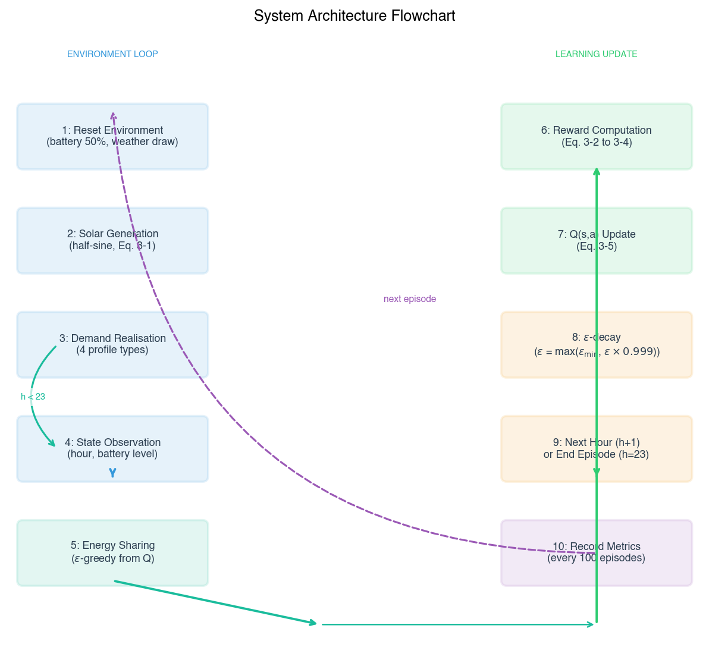

**شکل ۳-۱: معماری سیستم شبیه‌سازی.** ده بلوک حلقه‌ی شبیه‌سازی را تشکیل می‌دهند که هر بلوک به یکی از شکاف‌های پژوهشی پاسخ می‌دهد.

بلوک ۱ (بازنشانی محیط) وضعیت باتری‌ها را به ۵۰ درصد مقداردهی اولیه می‌کند و آب‌وهوا را از یک توزیع برنولی نمونه‌گیری می‌کند ــ مرجع فیزیکی از جدول ۳-۴ که شبیه‌سازی را در مشخصات سخت‌افزاری واقعی لنگر می‌زند.

بلوک ۲ (تولید خورشیدی) تابش ساعتی را با استفاده از مدل نیم‌سینوسی اسکوپلاکی و پالیووس (Skoplaki & Palyvos, 2009) محاسبه می‌کند که توسط ضریب آب‌وهوا مقیاس‌سازی می‌شود. این عنصر تصادفی، رویدادهای کمبود منابع را ایجاد می‌کند که برای آزمایش رفتار اشتراک در شرایط تنش ضروری است.

بلوک ۳ (تحقق تقاضا) چهار الگوی تقاضای متمایز (صبحگاهی، عصرگاهی، مسطح و شب‌زنده‌دار) را به ده خانه اختصاص می‌دهد و تضمین می‌کند که ساعات اوج تقاضا هم‌راستا نیستند. فرصت‌های اشتراک به‌طور طبیعی از مکملیت زمانی پدیدار می‌شوند، نه از همزمانی مهندسی‌شده.

بلوک ۴ (مشاهده‌ی وضعیت) مشاهده‌ی محلی هر عامل را به‌عنوان یک زوج‌تایی ۹۶ وضعیتی (ساعت، سطح باتری گسسته‌شده) می‌سازد. این فضا به اندازه‌ای کوچک است که همگرایی جدولی امکان‌پذیر باشد، اما به اندازه‌ای بزرگ است که بافت‌های تصمیم‌گیری وابسته به زمان و منابع را دربر گیرد.

بلوک ۵ (انتخاب اقدام از طریق $\varepsilon$-greedy) جایی است که بُعد گشودگی به‌صورت رفتاری آشکار می‌شود. عامل‌های استاندارد، اقدامات حریصانه را با احتمال ۹۹/۰ در هنگام همگرایی انتخاب می‌کنند، درحالی‌که عامل نوآور، اقدامات تصادفی را با احتمال ۰۵/۰ انتخاب می‌کند و فشار اکتشافی را حفظ می‌کند که شکاف ۳ پیش‌بینی می‌کند تعادل‌های همکاری‌گونه را بی‌ثبات کند.

بلوک ۶ (محاسبه‌ی پاداش) جایی است که بُعد توافق‌پذیری به‌صورت رفتاری آشکار می‌شود. ترکیب محدب $R_i = w_{\text{self}} \cdot C_i + w_{\text{fair}} \cdot F$ اولویت‌های متفاوتی را به عدالت اجتماعی بسته به نوع شخصیت هر عامل اختصاص می‌دهد و مستقیماً به یافته‌ی شکاف ۲ می‌پردازد که محدودیت‌های عدالت یکنواخت، ترجیحات اجتماعی انسانی را به‌درستی نمایش نمی‌دهند.

بلوک‌های ۷ تا ۱۰ (به‌روزرسانی Q، کاهش، پیشروی ساعت، ثبت قسمت) حلقه‌ی آموزش استاندارد IQL را پیاده‌سازی می‌کنند و پنجره‌ی ارزیابی قسمت‌های ۷۰۰۱ تا ۸۰۰۰ تضمین می‌کند که سنجه‌های گزارش‌شده منعکس‌کننده‌ی خط‌مشی‌های همگرا هستند، نه رفتار اکتشافی موقت. این بلوک‌ها با هم، معماری شبیه‌سازی را نمونه‌سازی می‌کنند که در آن سه شکاف نه‌تنها در مرور پیشینه تصدیق می‌شوند، بلکه در مشخصات الگوریتمی به‌طور فعال مورد بررسی قرار می‌گیرند.

## ۳-۲ روش‌های گردآوری داده‌ها

داده‌های این مطالعه از طریق شبیه‌سازی تولید شدند، نه از طریق ابزارهای میدانی یا مشارکت‌کنندگان انسانی. منبع داده‌ی اولیه، مجموعه‌ی گزارش‌های شبیه‌سازی تولیدشده توسط محیط شبیه‌سازی سفارشی مبتنی بر Python است که در بخش ۳-۳ توصیف شده است. هر اجرای شبیه‌سازی، یک رکورد ساختاریافته از انتقال‌های وضعیت ساعتی، اقدامات عامل و پیامدهای پاداش را در طول ۸۰۰۰ قسمت (روزهای شبیه‌سازی‌شده) تولید می‌کند که ۱۰۰۰ قسمت پایانی برای ارزیابی رزرو می‌شوند تا تضمین شود همه‌ی سنجه‌ها از خط‌مشی‌های همگرا محاسبه می‌شوند (بخش ۳-۱۳).

پارامترهای فیزیکی تعبیه‌شده در محیط شبیه‌سازی، در استانداردهای مهندسی تثبیت‌شده و مشخصات تجهیزات موجود در بازار زمین‌گذاری شده‌اند. ظرفیت پنل خورشیدی (۱۳/۱ کیلووات پیک) مطابق با استاندارد طرح گواهی‌نامه‌ی ریزشبکه (MCS) برای یک تأسیسات فتوولتائیک مسکونی معمولی بریتانیایی با سه تا چهار پنل است که با اندازه‌های سیستم مورد استفاده در مطالعات پیشین MARL انرژی همخوانی دارد (Charbonnier et al., 2022; Zhou & Sun, 2023). ظرفیت باتری (۰/۷ کیلووات‌ساعت) مطابق با مشخصات نسل اول تسلا پاوروال، یک سیستم باتری مسکونی معمولاً مستقرشده است (IEA PVPS, 2021). تصادفی‌سازی آب‌وهوا (احتمال ۱۵ درصد روز ابری) از پارامترهای گزارش‌شده توسط کوساتاکه و همکاران (Kusatake et al., 2023) برای شبیه‌سازی‌های اقلیم معتدل پیروی می‌کند. این مقادیر پارامتری در جدول ۳-۴ خلاصه شده‌اند.

#### روش‌شناسی انتخاب پارامتر

تمام مقادیر پارامترهای فیزیکی و الگوریتمی از طریق ترکیبی از لنگرگیری به ادبیات منتشرشده، هم‌راستایی با استانداردهای سخت‌افزاری موجود در بازار و آزمایش‌های مقدماتی غیررسمی برای تأیید رفتار همگرایی تعیین شدند. پارامترهای فیزیکی ــ ظرفیت پیک خورشیدی، ظرفیت باتری، الگوهای تقاضا و احتمال ابری ــ مستقیماً از مطالعات شبیه‌سازی پیشینی که در برابر داده‌های جهان واقعی یا مشخصات سخت‌افزاری اعتبارسنجی شده‌اند، استخراج شدند. پیک خورشیدی ۱۳/۱ کیلووات از شاربونیه و همکاران (Charbonnier et al., 2022) پیروی می‌کند که مدل خود را در برابر تأسیسات فتوولتائیک مسکونی بریتانیاییِ تأییدشده تحت طرح گواهی‌نامه‌ی ریزشبکه (MCS) کالیبره کردند. ظرفیت باتری ۰/۷ کیلووات‌ساعت از الشهری و گانت (Alshehri & Gaunt, 2020) و بوی و همکاران (Bui et al., 2019) پیروی می‌کند که هر دو شبیه‌سازی‌های خود را با مشخصات تسلا پاوروال هم‌راستا می‌کنند. الگوهای تقاضا از الشهری و گانت (۲۰۲۰) اقتباس شدند، پس از تأیید اینکه میانگین تقاضای روزانه‌ی ۸/۸ کیلووات‌ساعت آن‌ها با مصرف معمولی خانوار بریتانیایی تقریباً ۴۸۰۰ کیلووات‌ساعت در سال (Ofgem, 2023) سازگار است. احتمال ۱۵ درصد ابری از کوساتاکه و همکاران (۲۰۲۳) پیروی می‌کند که مقدار خود را از سوابق هواشناسی بلندمدت برای اقلیم‌های معتدل اروپایی استخراج کرده‌اند.

مقادیر فراپارامترها ــ نرخ یادگیری، ضریب تخفیف، برنامه‌ی اکتشاف و تعداد قسمتها ــ از رویه‌ی استاندارد یادگیری Q (Sutton & Barto, 2018) و از ژانگ و همکاران (Zhang et al., 2025) برای برنامه‌ی کاهش $\varepsilon$ مقداردهی اولیه شدند و سپس از طریق آزمایش‌های مقدماتی بر روی سناریوی همگی خودخواه تأیید شدند. پویش‌های مقدماتی در بین نرخ‌های یادگیری {۰۵/۰، ۱/۰، ۲/۰، ۵/۰} و کف‌های اکتشاف حداقلی {۰۱/۰، ۰۲/۰، ۰۵/۰، ۱۰/۰} برای شناسایی مقادیری که همگرایی پایدار را در یک بودجه‌ی شبیه‌سازی معقول تولید می‌کنند، انجام شدند. فراپارامترهای انتخاب‌شده، پیکربندی‌ای را نشان می‌دهند که نوسان مقدار Q را به حداقل رسانده و در عین حال عملکرد خط‌مشی نهایی را در وظیفه‌ی پایه بیشینه کرده است. هیچ بهینه‌سازی رسمی طراحی آزمایش‌ها (مانند تاگوچی، بهینه‌سازی بیزی) اعمال نشد؛ پویش مقدماتی، یک جستجوی اکتشافی غیررسمی بر روی یک شبکه‌ی گسسته‌ی کوچک را تشکیل می‌دهد.

هر سناریوی آزمایشی در ۵ تصادف‌سازی مستقل (۴۲، ۱۲۳، ۴۵۶، ۷۸۹، ۱۰۱۱) شبیه‌سازی شد. تصادف‌سازی، عناصر تصادفی شبیه‌سازی را کنترل می‌کند: انتساب تصادفی شرایط آب‌وهوا (صاف یا ابری)، نویز اکتشاف اپسیلون-حریصانه در حین انتخاب اقدام و اختلالات مقداردهی اولیه‌ی Q. اجرای چندین تصادف‌سازی تضمین می‌کند که تفاوت‌های مشاهده‌شده بین سناریوها به تیمار (ترکیب شخصیتی) نسبت داده می‌شوند، نه به نوسانات تصادفی ویژه‌گونه (Montgomery, 2017). انتخاب ۵ تصادف‌سازی از قراردادهای ادبیات MARL انرژی پیروی می‌کند (Alshehri & Gaunt, 2020; Ali et al., 2023) و توان آماری کافی را برای تحلیل‌های برنامه‌ریزی‌شده فراهم می‌کند (بخش ۳-۱۲).

پنج مقدار تصادف‌سازی برای پوشش دنباله‌های شبه‌تصادفی به‌اندازه‌ای متنوع انتخاب شدند که الگوهای ساختاری همپوشان نداشته باشند. تصادف‌سازی‌های ۴۲، ۱۲۳، ۴۵۶، ۷۸۹ و ۱۰۱۱ اعداد اول متوالی نیستند و روابط حسابی آشکاری ندارند و خطر همبستگی جریان‌های تصادفی در سراسر نمونه‌گیری‌های برنولی آب‌وهوا، نویز اپسیلون-حریصانه و اختلالات مقداردهی اولیه‌ی جدول Q را کاهش می‌دهند. اگرچه هیچ مجموعه‌ی ثابتی از تصادف‌سازی‌ها نمی‌تواند نمایندگی همه‌ی پیامدهای تصادفی ممکن را تضمین کند، مقادیر انتخاب‌شده محدوده‌ای از آنتروپی را پوشش می‌دهند که برای تولید دنباله‌های آب‌وهوایی، مسیرهای اکتشافی و مسیرهای همگرایی کیفی متفاوت در پنج تکرار کافی است. تصادف‌سازی‌های ثابت دقیقاً به‌دلیل امکان بازتولید دقیق نتایج منتشرشده، در پژوهش‌های تجربی مبتنی بر شبیه‌سازی استاندارد هستند (Montgomery, 2017; Law, 2015)؛ مقادیر خاص استفاده‌شده در اینجا به‌این معنا دلبخواهانه هستند که هیچ آزمایش مقدماتی برای بهینه‌سازی آن‌ها انجام نشد، اما ثابت و گزارش‌شده هستند تا هر پژوهشگر مستقلی بتواند دقیقاً محیط تصادفی توصیف‌شده در این پایان‌نامه را بازتولید کند.

تمام داده‌های شبیه‌سازی در قالب مقادیر جدا شده با کاما (CSV) با یک ردیف به ازای هر گام شبیه‌سازی (ساعت در هر قسمت در هر تصادف‌سازی) ذخیره می‌شوند که شامل ستون‌هایی برای شماره‌ی قسمت، ساعت، تصادف‌سازی، سناریو، شناسه‌ی عامل، تولید خورشیدی، تقاضا، وضعیت شارژ باتری، اقدام انجام‌شده، آسایش حاصل و مؤلفه‌های پاداش است. این ثبت‌نام با دانه‌بندی بالا، هم محاسبه‌ی سنجه‌های تجمعی و هم تحلیل رفتاری دقیق را امکان‌پذیر می‌سازد.

## ۳-۳ ابزارها و تجهیزات

آزمایش‌های شبیه‌سازی با استفاده از یک کدبیس سفارشی Python 3.x پیاده‌سازی شدند که چندین کتابخانه‌ی تخصصی را برای محاسبات عددی، پردازش داده، آزمون آماری و تجسم یکپارچه می‌کند. جدول ۳-۱ ابزارهای اصلی، نقش آن‌ها و جایگاه آن‌ها در خط‌مشی پژوهش را فهرست می‌کند.

**جدول ۳-۱: ابزارها و تجهیزات**

| ابزار      | نسخه | نقش در خط‌مشی پژوهش                                            |
| :--------- | :--- | :------------------------------------------------------------- |
| Python     | ۳.x  | زبان برنامه‌نویسی اصلی: موتور شبیه‌سازی، پردازش داده، تحلیل    |
| NumPy      | ۱.x  | محاسبات عددی: ردیابی وضعیت شارژ، محاسبات تراز انرژی            |
| Pandas     | ۲.x  | تجمیع داده: خلاصه‌سازی سطح قسمت و سطح تصادف‌سازی در بین اجراها |
| SciPy      | ۱.x  | آزمون آماری: ANOVA یک‌طرفه، آزمون‌های t مستقل و زوجی           |
| Matplotlib | ۳.x  | تجسم: نمودارهای میله‌ای سنجه‌های جامعه، نمودارهای توزیع آسایش  |
| Seaborn    | ۰.x  | تجسم آماری: نقشه‌های حرارتی جدول Q، نمودارهای توزیع            |

از NumPy برای تمام محاسبات عددی در حلقه‌ی شبیه‌سازی استفاده شد، از جمله محاسبه‌ی تولید خورشیدی نیم‌سینوسی (معادله ۳-۱)، ردیابی شارژ و دشارژ باتری و محاسبه‌ی شاخص عدالت جین و ضریب جینی. Pandas خط‌مشی داده‌ی پس از شبیه‌سازی را مدیریت کرد: گزارش‌های سطح گام خام بر اساس قسمت و تصادف‌سازی گروه‌بندی شدند، به خلاصه‌های هر سنجه تجمیع شدند و برای تحلیل تطبیقی در بین سناریوها ادغام شدند. ماژول `stats` کتابخانه‌ی SciPy زیرساخت آزمون آماری را شامل ANOVA یک‌طرفه برای مقایسه‌های چندگروهی و هر دو آزمون t مستقل و زوجی برای تضادهای بین‌سناریویی و درون‌سناریویی فراهم کرد.

از Matplotlib و Seaborn برای تولید شکل‌های ارائه‌شده در فصل ۴ استفاده شد. نمودارهای میله‌ای سنجه‌های سطح جامعه با استفاده از تابع `bar` Matplotlib با نوارهای خطا به‌نمایانگر یک انحراف معیار در بین تصادف‌سازی‌ها تولید شدند. نقشه‌های حرارتی جدول Q با استفاده از تابع `heatmap` Seaborn با یک پالت رنگی واگرا ارائه شدند. تمام شکل‌ها با وضوح ۳۰۰ dpi برای گنجاندن در سند پایان‌نامه ذخیره می‌شوند.

محیط شبیه‌سازی به‌عنوان یک کلاس مستقل Python (`OffGridMARL`) پیاده‌سازی شده است که تمام پویایی‌های فیزیکی، منطق عامل و ثبت‌نام داده را دربر می‌گیرد. کلاس از قرارداد رابط Gymnasium (قبلاً OpenAI Gym) پیروی می‌کند (Towers et al., 2024) و متدهایی را برای بازنشانی محیط، اجرای گام و محاسبه‌ی سنجه در معرض دید قرار می‌دهد. این انتخاب طراحی، بازتولیدپذیری را تسهیل می‌کند: شبیه‌سازی را می‌توان با پیکربندی‌های پارامتری مختلف بدون تغییر کد هسته‌ی محیط، دوباره اجرا کرد.

## ۳-۴ جامعه، نمونه و روش نمونه‌گیری

جامعه‌ی هدف این مطالعه، شامل تمام پیکربندی‌های ممکن ریزشبکه‌های مسکونی خارج از شبکه است که در آن خانوارها از طریق یک چارچوب همکاری‌گونه، انرژی مازاد را به اشتراک می‌گذارند. این جامعه با مجموعه‌ای از شرایط مرزی تعریف می‌شود: مقیاس تک‌محله‌ای (۱۰–۲۰ خانوار)، توپولوژی حلقوی یا خطی، تولید و ذخیره‌سازی خورشیدی-به‌همراه-باتری، تصمیم‌گیری مستقل در سطح خانوار و شرایط اقلیم معتدل با تغییرپذیری خورشیدی متوسط. مطالعه ادعای نمایندگی برای محله‌های بزرگ‌تر، توپولوژی‌های جایگزین (ستاره‌ای، شبکه‌ای، درختی)، ترکیب‌های تولید متفاوت (بادی، پشتیبان دیزلی) یا شرایط اقلیمی شدید را ندارد.

نمونه‌ی مطالعه، یک ریزشبکه‌ی ۱۰‑خانه‌ای با توپولوژی حلقوی است که در بخش ۳-۵ توصیف شده است. انتخاب ۱۰ خانه از مقیاس مطالعات شبیه‌سازی MARL انرژی پیشین (Alshehri & Gaunt, 2020; Charbonnier et al., 2022; Kusatake et al., 2023) پیروی می‌کند و اندازه‌ای را نشان می‌دهد که در آن اثرات نوظهور سطح جامعه قابل‌تشخیص هستند و در عین حال هزینه‌ی محاسباتی قابل‌مدیریت باقی می‌ماند. توپولوژی حلقوی ــ که در آن هر خانه می‌تواند انرژی را با دقیقاً یک همسایه‌ی تعیین‌شده به اشتراک بگذارد ــ برای جداسازی اثر تصمیمات اشتراک از تأثیر مخدوش‌کننده‌ی مسیریابی شبکه انتخاب شد. در یک توپولوژی شبکه‌ای یا کاملاً متصل، اقدام یک عامل بر چندین همسایه از طریق مسیرهای مختلف تأثیر می‌گذارد و نسبت دادن پیامدهای مشاهده‌شده به تصمیمات اشتراک فردی را دشوار می‌سازد. توپولوژی حلقوی این ابهام را از بین می‌برد: خانه $i$ فقط با خانه $i+1$ اشتراک می‌گذارد و اثر هر اقدام اشتراک دقیقاً از طریق یک پیوند در زنجیره منتشر می‌شود.

روش نمونه‌گیری برای خانوارها در هر سناریو، طبقه‌بندی‌شده است: ۱۰ خانه بر اساس ترکیب از پیش تعیین‌شده‌ی هر سناریوی آزمایشی به انواع شخصیتی اختصاص داده می‌شوند (بخش ۳-۱۰). در سناریوی مختلط، دقیقاً ۵ خانه به نوع شخصیتی نوع‌گرا و ۵ خانه به نوع pure_selfish اختصاص می‌یابند. این انتساب طبقه‌بندی‌شده تضمین می‌کند که هر سناریو نمایانگر یک دستکاری کنترل‌شده از ترکیب جامعه است، نه یک نمونه‌گیری تصادفی از یک توزیع ــ سناریوی همگی خودخواه دقیقاً شامل ۱۰ عامل خودخواه در هر تصادف‌سازی است و سناریوی مختلط دقیقاً شامل ۵ عامل از هر نوع است. تخصیص انواع شخصیتی خاص به موقعیت‌های خاص در حلقه، در بین تصادف‌سازی‌ها تصادفی می‌شود تا از مخدوش‌شدن نتایج توسط اثرات موقعیت جلوگیری شود.

هر سناریو در ۵ تصادف‌سازی به‌شرح بخش ۳-۲ تکرار می‌شود. تصادف‌سازی‌ها نقش روش‌شناختی نمونه‌گیری مکرر از توزیع پیامدهای تصادفی را ایفا می‌کنند و تکرار لازم برای استنباط آماری را فراهم می‌آورند. این ترکیب انتساب ترکیبی طبقه‌بندی‌شده و تکرار تصادف‌سازی، از طرح آزمایشی استاندارد برای پژوهش‌های مبتنی بر شبیه‌سازی پیروی می‌کند (Montgomery, 2017; Law, 2015).

## ۳-۵ محیط فیزیکی

شبیه‌سازی یک ریزشبکه‌ی محله‌ی هوشمند خارج از شبکه را مدل‌سازی می‌کند که از ۱۰ خانه با توپولوژی حلقوی تشکیل شده است، جایی که هر خانه می‌تواند انرژی مازاد را با دقیقاً یک همسایه‌ی تعیین‌شده (خانه‌ی بعدی در حلقه) به اشتراک بگذارد. این توپولوژی حداقلی، اثر تصمیمات اشتراک را از مخدوش‌کننده‌های توپولوژی شبکه جدا می‌کند (Charbonnier et al., 2022).

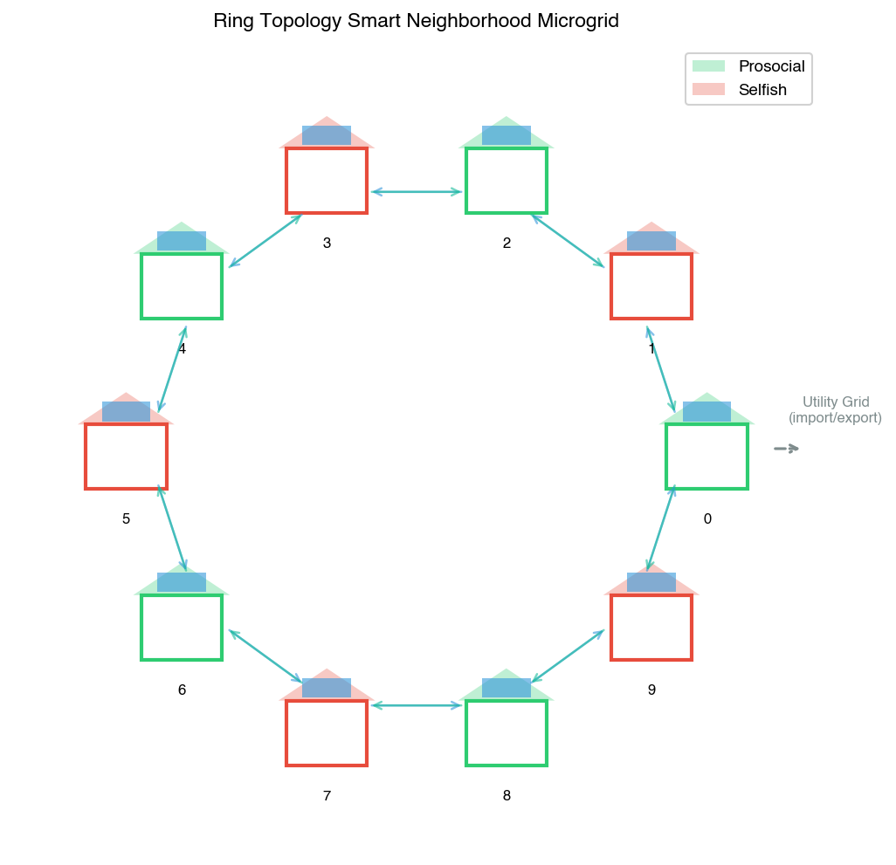

#### تولید خورشیدی

هر خانه دارای یک پنل خورشیدی با ظرفیت پیک ۱۳/۱ کیلووات است. تولید خورشیدی از یک منحنی نیم‌سینوسی در طول ساعات روز (۶ صبح تا ۶ بعدازظهر) پیروی می‌کند که با رویه‌های استاندارد مدل‌سازی تابش مطابقت دارد (Skoplaki & Palyvos, 2009; Zhou & Sun, 2023):

$$G(h) = \max\!\left(0,\; G_{\text{max}} \cdot \sin\!\left(\frac{\pi \cdot (h - 6)}{12}\right) \cdot W\right) \qquad \text{(معادله ۳-۱)}$$

که در آن $h$ ساعت (۰–۲۳)، $G\_{\text{max}} = 1.3$ کیلووات (به‌دنبال شاربونیه و همکاران، ۲۰۲۲) و $W$ یک ضریب آب‌وهوا است (۱/۰ در روزهای صاف، ۵/۰ در روزهای ابری). در روزهای صاف، تولید کل روزانه تقریباً ۹/۹ کیلووات‌ساعت است. روزهای ابری با احتمال ۱۵ درصد رخ می‌دهند و تولید خورشیدی را ۵۰ درصد کاهش می‌دهند که با مدل آب‌وهوای تصادفی کوساتاکه و همکاران (۲۰۲۳) سازگار است.

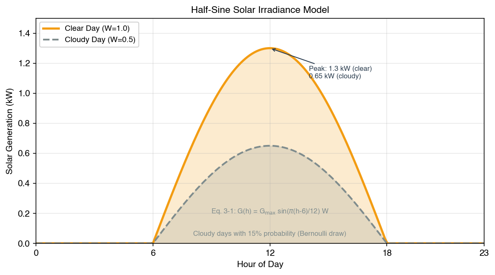

**جدول ۳-۲: پارامترهای تولید خورشیدی**

| نماد              | تعریف                                | واحد    | منبع                      |
| :---------------- | :----------------------------------- | :------ | :------------------------ |
| $h$               | ساعت روز (۰–۲۳)                      | ساعت    | Skoplaki & Palyvos (2009) |
| $G\_{\text{max}}$ | ظرفیت پیک پنل خورشیدی (۱۳/۱ کیلووات) | کیلووات | Charbonnier et al. (2022) |
| $W$               | ضریب آب‌وهوا (۱/۰ صاف، ۵/۰ ابری)     | —       | Kusatake et al. (2023)    |
| $G(h)$            | توان تولید خورشیدی لحظه‌ای           | کیلووات | Skoplaki & Palyvos (2009) |

#### الگوهای تقاضا

چهار الگوی تقاضای ساعتی متمایز استفاده می‌شوند که در بین ۱۰ خانه چرخش می‌یابند (Alshehri & Gaunt, 2020):

**جدول ۳-۳: انواع الگوی تقاضا**

| الگو        | الگو                                          | مجموع روزانه       | محدوده‌ی ساعتی        |
| :---------- | :-------------------------------------------- | :----------------- | :-------------------- |
| صبحگاهی     | پیک در ساعت ۸ صبح (۹/۰ کیلووات‌ساعت)          | ۴/۸ ~ کیلووات‌ساعت | ۱/۰–۹/۰ کیلووات‌ساعت  |
| عصرگاهی     | پیک در ساعت ۸ شب (۲/۱ کیلووات‌ساعت)           | ۶/۹ ~ کیلووات‌ساعت | ۱/۰–۲/۱ کیلووات‌ساعت  |
| مسطح        | ثابت ۳۵/۰ کیلووات‌ساعت در هر ساعت             | ۴/۸ کیلووات‌ساعت   | ۳۵/۰ کیلووات‌ساعت     |
| شب‌زنده‌دار | پیک‌های دیرهنگام (۱۰ شب–۱۲ نیمه‌شب)، دیر خواب | ۴/۹ ~ کیلووات‌ساعت | ۰۵/۰–۲/۱ کیلووات‌ساعت |

میانگین تقاضای روزانه در تمام الگوها تقریباً ۸/۸ کیلووات‌ساعت است که با الگوهای مصرف مسکونی معمولی گزارش‌شده در ادبیات سازگار است (Ali et al., 2023).

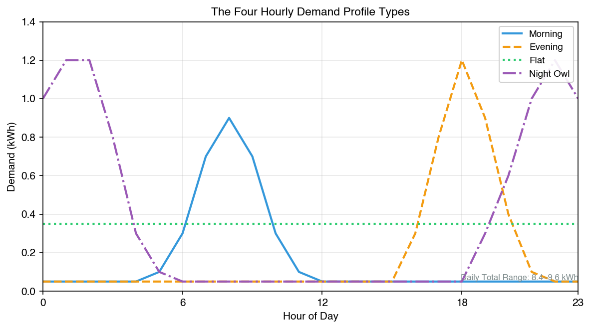

#### ذخیره‌سازی باتری

هر خانه دارای یک باتری ۰/۷ کیلووات‌ساعتی است (Alshehri & Gaunt, 2020; Bui et al., 2019). باتری هر روز شبیه‌سازی‌شده را با شارژ ۵۰ درصد (۵/۳ کیلووات‌ساعت) آغاز می‌کند. شارژ و دشارژ با نرخ‌های نامحدود در محدوده‌ی ظرفیت انجام می‌شود و هیچ تخریبی مدل‌سازی نمی‌شود ــ بازده و ظرفیت باتری در طول شبیه‌سازی ثابت باقی می‌مانند.

#### مدل روز ابری

از یک مدل آب‌وهوای دودویی ساده استفاده می‌شود: هر روز یا صاف است (احتمال ۸۵ درصد) یا ابری (احتمال ۱۵ درصد). در یک روز ابری، تولید خورشیدی در $W = 0.5$ ضرب می‌شود و انرژی در دسترس جامعه را نصف می‌کند (Behrunani et al., 2023). این عنصر تصادفی از یادگیری یک خط‌مشی کاملاً قطعی توسط عامل‌ها جلوگیری می‌کند و رویدادهای کمبود گاه‌به‌گاه ایجاد می‌کند که پایداری هنجارهای اشتراک را آزمایش می‌کنند.

**جدول ۳-۴: پارامترهای مرجع فیزیکی (Ground Truth)**

| پارامتر                  | مقدار                      | منبع                                               |
| :----------------------- | :------------------------- | :------------------------------------------------- |
| تعداد خانه‌ها            | ۱۰                         | Alshehri & Gaunt (2020); Charbonnier et al. (2022) |
| ظرفیت باتری              | ۰/۷ کیلووات‌ساعت           | Alshehri & Gaunt (2020); Ali et al. (2023)         |
| پیک خورشیدی              | ۱۳/۱ کیلووات               | Charbonnier et al. (2022); Zhou & Sun (2023)       |
| احتمال ابری              | ۱۵/۰                       | Kusatake et al. (2023); Behrunani et al. (2023)    |
| وضعیت شارژ اولیه‌ی باتری | ۵۰٪                        | Alshehri & Gaunt (2020)                            |
| محدوده‌ی تقاضا           | ۰۵/۰–۲/۱ کیلووات‌ساعت/خانه | Ali et al. (2023)                                  |

مقادیر پارامتری فهرست‌شده در جدول ۳-۴ در تمام پنج سناریوی آزمایشی ثابت نگه داشته می‌شوند. تنها ترکیب شخصیتی جامعه‌ی عامل‌ها در بین سناریوها تغییر می‌کند (بخش ۳-۱۰) و تضمین می‌کند که هرگونه تفاوت مشاهده‌شده در پیامدها به تیمار نسبت داده می‌شود، نه به تغییر در شرایط فیزیکی.

## ۳-۶ مدل شخصیت و نگاشت OCEAN

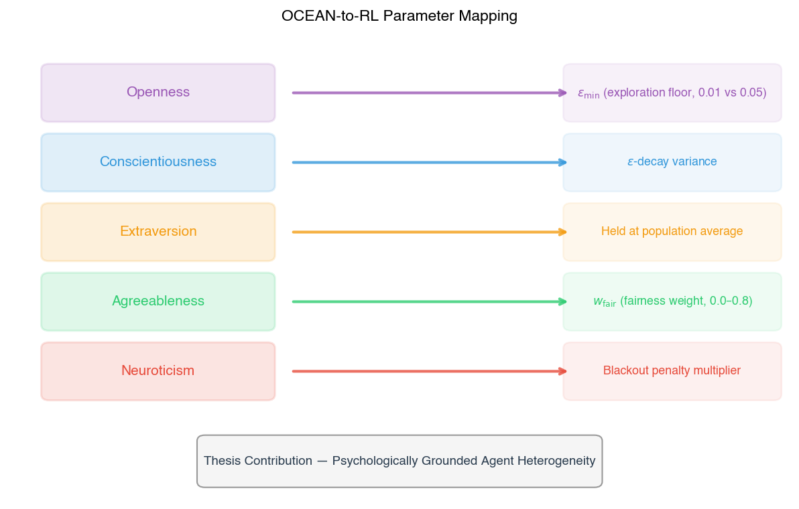

**شکل ۳-۵: نگاشت ویژگی‌های OCEAN به پارامترهای یادگیری تقویتی.** هر ویژگی شخصیت (ستون راست) به یک پارامتر یادگیری خاص (ستون چپ) نگاشت می‌شود.

#### شخصیت مبتنی بر پاداش

شخصیت هر عامل به‌صورت دو وزن در تابع پاداش آن رمزگذاری می‌شود: $w*{\text{self}}$ (وزن آسایش شخصی) و $w*{\text{fair}}$ (وزن عدالت اجتماعی). این وزن‌ها، پارامترهای وابسته به شخصیت هستند که تابع پاداش تعریف‌شده در بخش ۳-۷ را تعدیل می‌کنند، جایی که $w*{\text{self}} + w*{\text{fair}} = 1.0$. چهار نوع شخصیتی اصلی تعریف می‌شوند:

**جدول ۳-۵: تعریف انواع شخصیت**

| نوع           | $w\_{\text{self}}$ | $w\_{\text{fair}}$ | توصیف رفتاری                                                           |
| :------------ | :----------------- | :----------------- | :--------------------------------------------------------------------- |
| pure_selfish  | ۰/۱                | ۰/۰                | فقط آسایش خود را بیشینه می‌کند؛ عدالت اجتماعی را کاملاً نادیده می‌گیرد |
| individualist | ۸/۰                | ۲/۰                | عمدتاً خودخواه است اما آگاهی ملایمی از عدالت دارد                      |
| prosocial     | ۵/۰                | ۵/۰                | آسایش شخصی و عدالت اجتماعی را به‌طور مساوی متعادل می‌کند               |
| altruistic    | ۲/۰                | ۸/۰                | عدالت اجتماعی را بر آسایش شخصی اولویت می‌دهد                           |

یک نوع شخصیتی پنجم، `high_openness_innovator`، برای سناریوی اثر نوآور معرفی می‌شود (بخش ۳-۱۰ را ببینید). این نوع، وزن‌های پاداش یکسانی با نوع نوع‌گرا دارد ($w*{\text{self}} = w*{\text{fair}} = 0.5$) اما در پارامترهای اکتشاف خود تفاوت دارد (بخش ۳-۸ را ببینید).

#### زمین‌گذاری در مدل پنج‌عاملی (OCEAN)

انواع شخصیتی استفاده‌شده در این شبیه‌سازی، مطابق با مختصات صریح در فضای شخصیت پنج‌عاملی (OCEAN) هستند (Goldberg, 1990). این زمین‌گذاری در نظریه‌ی روان‌شناختی تثبیت‌شده، سهم اصلی این پایان‌نامه را تشکیل می‌دهد ــ به‌جای ابداع برچسب‌های دلبخواهانه، هر نوع عامل را به یک چارچوب روان‌شناختی به‌خوبی مطالعه‌شده نگاشت می‌کنیم. به‌دنبال جان و سریواستاوا (John & Srivastava, 1999)، توافق‌پذیری، گرایش‌های نوع‌گرایانه را دربر می‌گیرد که ما آن را به‌عنوان $w\_{\text{fair}}$ در تابع پاداش پیاده‌سازی می‌کنیم. نگاشت گشودگی به نرخ اکتشاف ($\varepsilon$) از روش‌شناسی نگاشت‌های شخصیت‑به‑پارامتر‑یادگیری‌تقویتی که توسط کارهای پیشین ایجاد شده است، پیروی می‌کند (Ren & Xu, 2025; Moon et al., 2022). جدول ۳-۶ خلاصه‌ای از نگاشت کامل OCEAN‑به‑یادگیری‌تقویتی را ارائه می‌دهد.

**جدول ۳-۶: نگاشت ویژگی‌های OCEAN به رفتار عامل**

| ویژگی OCEAN             | بُعد                 | اثر بر عامل                                                        | پارامتر پاداش تحت تأثیر                |
| :---------------------- | :------------------- | :----------------------------------------------------------------- | :------------------------------------- |
| توافق‌پذیری (A) — بالا  | جهت‌گیری نوع‌گرایانه | عامل وزن بیشتری به عدالت اجتماعی می‌دهد                            | $w\_{\text{fair}}$ افزایش می‌یابد      |
| توافق‌پذیری (A) — پایین | سلطه‌ی منفعت‌طلبی    | عامل آسایش شخصی را بر اشتراک اولویت می‌دهد                         | $w\_{\text{self}}$ افزایش می‌یابد      |
| وظیفه‌شناسی (C) — بالا  | رفتار سازگار         | عامل بدون توجه به وضعیت باتری، خط‌مشی اشتراک پایداری را حفظ می‌کند | واریانس کاهش $\varepsilon$ کمتر        |
| گشودگی (O) — بالا       | اکتشاف، تازگی‌جویی   | عامل قبل از همگرایی، راهبردهای اشتراک را طولانی‌تر اکتشاف می‌کند   | $\varepsilon$ اولیه بالاتر، کاهش کندتر |
| روان‌رنجوری (N) — بالا  | حساسیت به تهدید      | عامل وضعیت‌های خاموشی را شدیدتر جریمه می‌کند                       | ضریب جریمه‌ی خاموشی افزایش می‌یابد     |

جدول ۳-۷ مختصات OCEAN را برای هر نوع شخصیتی شبیه‌سازی نشان می‌دهد.

**جدول ۳-۷: انواع شخصیت به‌صورت مختصات OCEAN**

| نوع شبیه‌سازی           | A           | C     | O        | N     | $w\_{\text{self}}$ | $w\_{\text{fair}}$ |
| :---------------------- | :---------- | :---- | :------- | :---- | :----------------- | :----------------- |
| pure_selfish            | بسیار پایین | متوسط | پایین    | متوسط | ۰/۱                | ۰/۰                |
| individualist           | پایین       | متوسط | پایین    | متوسط | ۸/۰                | ۲/۰                |
| prosocial               | متوسط-بالا  | متوسط | متوسط    | متوسط | ۵/۰                | ۵/۰                |
| altruistic              | بالا        | متوسط | متوسط    | پایین | ۲/۰                | ۸/۰                |
| high_openness_innovator | متوسط-بالا  | متوسط | **بالا** | متوسط | ۵/۰                | ۵/۰                |

توجه داشته باشید که `high_openness_innovator` تنها در بُعد گشودگی خود با نوع نوع‌گرا تفاوت دارد که به‌صورت نرخ کاهش اکتشاف کندتر ظاهر می‌شود، نه یک وزن پاداش متفاوت. این امر به ما امکان می‌دهد تا اثر رفتار اکتشافی را از ترجیحات عدالت جدا کنیم.

## ۳-۷ طراحی تابع پاداش

تابع پاداش، عنصر کلیدی طراحی است که محدودیت‌های اخلاقی را در هدف یادگیری جاسازی می‌کند:

$$R_i = w_{\text{self}} \cdot C_i + w_{\text{fair}} \cdot F \qquad \text{(معادله ۳-۲)}$$

| نماد               | تعریف                             | واحد | منبع                           |
| :----------------- | :-------------------------------- | :--- | :----------------------------- |
| $R_i$              | پاداش اسکالر کل برای عامل $i$     | —    | این اثر (معادله ۳-۲)           |
| $w\_{\text{self}}$ | وزن اختصاص‌یافته به آسایش شخصی    | —    | نگاشت OCEAN                    |
| $C_i$              | سطح آسایش شخصی عامل $i$           | —    | این اثر (معادله ۳-۳)           |
| $w\_{\text{fair}}$ | وزن اختصاص‌یافته به عدالت اجتماعی | —    | اقتباس از Hughes et al. (2018) |
| $F$                | شاخص عدالت جین برای جامعه         | —    | Jain et al. (1984)             |

آسایش شخصی $C_i$ کسری از تقاضای ساعتی خانه است که تأمین شده است:

$$C_i = \frac{\text{demand met}_i}{\text{demand}_i} \qquad \text{(معادله ۳-۳)}$$

| نماد                   | تعریف                                           | واحد         | منبع                    |
| :--------------------- | :---------------------------------------------- | :----------- | :---------------------- |
| $C_i$                  | آسایش شخصی (محدوده [۰,۱])                       | —            | این اثر (معادله ۳-۳)    |
| $\text{demand met}\_i$ | انرژی تأمین‌شده از طریق خورشید، باتری یا اشتراک | کیلووات‌ساعت | —                       |
| $\text{demand}\_i$     | کل برق درخواستی خانوار                          | کیلووات‌ساعت | Alshehri & Gaunt (2020) |

اگر باتری خانه و تولید خورشیدی جاری نتوانند با هم تقاضا را برآورده کنند، کسری تأمین‌نشده منجر به $C_i < 1.0$ می‌شود که ما آن را خاموشی جزئی طبقه‌بندی می‌کنیم. وقتی $C_i < 0.95$، روز به‌عنوان روز خاموشی برای آن خانه طبقه‌بندی می‌شود.

شاخص عدالت جین $F$ در بین همه‌ی خانه‌ها محاسبه می‌شود (Jain, Chiu & Hawe, 1984):

$$F = \frac{\left(\sum_{i=1}^{N} C_i\right)^2}{N \cdot \sum_{i=1}^{N} C_i^2} \qquad \text{(معادله ۳-۴)}$$

| نماد  | تعریف                            | واحد | منبع                    |
| :---- | :------------------------------- | :--- | :---------------------- |
| $F$   | شاخص عدالت جین (محدوده [۱/N, ۱]) | —    | Jain et al. (1984)      |
| $N$   | تعداد خانوارها (۱۰)              | —    | Alshehri & Gaunt (2020) |
| $C_i$ | سطح آسایش خانوار $i$             | —    | —                       |

که در آن $N$ تعداد خانه‌ها و $C_i$ آسایش خانه‌ی $i$ است. این شاخص از $\frac{1}{N}$ (حداکثر نابرابری — یک خانه همه چیز را دریافت می‌کند، دیگران هیچ) تا ۰/۱ (برابری کامل — همه‌ی خانه‌ها آسایش یکسانی دارند) متغیر است. شاخص جین به‌طور گسترده در ادبیات مهندسی شبکه و تخصیص منابع استفاده می‌شود زیرا تغییرناپذیر نسبت به مقیاس، پیوسته و مستقل از اندازه‌ی جمعیت است (Zhou & Sun, 2023).

پاداش پس از هر ساعت محاسبه و در طول روز ۲۴ ساعته جمع می‌شود. در پایان هر قسمت (روز)، هر عامل مجموع پاداش‌های ساعتی خود را دریافت می‌کند.

## ۳-۸ الگوریتم یادگیری

هر خانه توسط یک عامل یادگیری کیو جدولی مستقل با مشخصات زیر کنترل می‌شود:

#### فضای وضعیت

وضعیت، یک زوج‌تایی گسسته (ساعت، سطح باتری) است که در آن:

- **ساعت**: ۰–۲۳ (۲۴ مقدار گسسته)
- **سطح باتری**: به ۴ دسته با استفاده از آستانه‌های ۲۵٪، ۵۰٪، ۷۵٪ از ظرفیت، گسسته‌سازی می‌شود

کل فضای وضعیت: $24 \times 4 = 96$ وضعیت.

#### فضای اقدام

سه اقدام گسسته تعیین می‌کنند که چه کسری از انرژی مازاد خالص خانه (تولید منهای تقاضا در ساعت جاری) با همسایه به اشتراک گذاشته شود:

**جدول ۳-۸: فضای اقدام**

| اقدام | کسر اشتراک | رفتار                                       |
| :---- | :--------- | :------------------------------------------ |
| ۰     | ۰٪         | نگهداری تمام مازاد برای ذخیره‌سازی در باتری |
| ۱     | ۵۰٪        | اشتراک نیمی از مازاد، ذخیره‌سازی بقیه       |
| ۲     | ۱۰۰٪       | اشتراک تمام مازاد، عدم ذخیره‌سازی هیچ‌چیز   |

اگر خانه دارای کسری خالص باشد (تقاضا > تولید)، اقدام به‌اجبار ۰ است (چیزی برای اشتراک وجود ندارد).

#### به‌روزرسانی یادگیری Q

مقدار Q برای هر جفت وضعیت-اقدام با استفاده از قاعده‌ی استاندارد به‌روزرسانی یادگیری کیو جدولی به‌روز می‌شود (Watkins & Dayan, 1992; Sutton & Barto, 2018):

$$Q(s, a) \leftarrow Q(s, a) + \alpha \left[ R + \gamma \max_{a'} Q(s', a') - Q(s, a) \right] \qquad \text{(معادله ۳-۵)} $$

که در آن $\alpha$ نرخ یادگیری، $\gamma$ ضریب تخفیف، $R$ پاداش دریافت‌شده پس از انجام اقدام $a$ در وضعیت $s$ و $s'$ وضعیت بعدی حاصل است. یادگیری کیو جدولی تحت شرایط تقریب تصادفی استاندارد، تضمین می‌شود که به تابع Q بهینه همگرا شود (Watkins & Dayan, 1992).

| نماد      | تعریف                                       | واحد | منبع                   |
| :-------- | :------------------------------------------ | :--- | :--------------------- |
| $Q(s, a)$ | تخمین ارزش-اقدام برای وضعیت $s$ و اقدام $a$ | —    | Watkins & Dayan (1992) |
| $\alpha$  | نرخ یادگیری (۲/۰)                           | —    | Sutton & Barto (2018)  |
| $R$       | پاداش لحظه‌ای                               | —    | این اثر (معادله ۳-۲)   |
| $\gamma$  | ضریب تخفیف (۹۹/۰)                           | —    | Sutton & Barto (2018)  |
| $s, s'$   | وضعیت‌های جاری و بعدی                       | —    | Watkins & Dayan (1992) |

تمام فراپارامترهای یادگیری Q — نرخ یادگیری، ضریب تخفیف، برنامه‌ی اکتشاف، راهبرد مقداردهی اولیه و مدت آموزش — در بخش ۳-۱۳ فهرست شده‌اند. این مقادیر در تمام عامل‌ها و سناریوها یکسان هستند، به‌جز عامل نوآور که کف اکتشاف بالاتری دارد ($\varepsilon\_{\min} = 0.05$). مقداردهی اولیه‌ی خوش‌بینانه‌ی مقادیر Q به ۰/۱، عامل‌ها را تشویق می‌کند تا همه‌ی اقدامات را در اوایل آموزش امتحان کنند.

#### نمودار جریان معماری سیستم

حلقه‌ی کامل شبیه‌سازی از این دنباله پیروی می‌کند، که هر گام با یک بلوک در معماری سیستم مطابقت دارد:

```
┌──────────────────────────────────────────────────────────────────┐
│               حلقه‌ی شبیه‌سازی (هر قسمت = ۱ روز)               │
├──────────────────────────────────────────────────────────────────┤
│                                                                  │
│  ┌──────────────┐     ┌──────────────┐     ┌──────────────────┐  │
│  │  ۱. بازنشانی │     │  ۲. تولید    │     │   ۳. تحقق        │  │
│  │  محیط        │────▶│  خورشیدی    │────▶│   تقاضا          │  │
│  │  (باتری،     │     │  (معادله ۳-۱)│     │   (۴ الگو)        │  │
│  │  آب‌وهوا)    │     │              │     │                  │  │
│  └──────────────┘     └──────────────┘     └──────────────────┘  │
│                                                    │             │
│                                                    ▼             │
│  ┌──────────────┐     ┌──────────────┐     ┌──────────────────┐  │
│  │  ۶. محاسبه   │     │  ۵. اشتراک   │     │   ۴. مشاهده‌ی    │  │
│  │  پاداش      │◀────│   انرژی      │◀────│   وضعیت          │  │
│  │  (معادله ۳-۲ │     │   (اقدام     │     │   (ساعت، %)     │  │
│  │   تا ۳-۴)    │     │    از Q)     │     │                  │  │
│  └──────────────┘     └──────────────┘     └──────────────────┘  │
│                                                    │             │
│                                                    ▼             │
│  ┌──────────────┐     ┌──────────────┐     ┌──────────────────┐  │
│  │  ۷. به‌روز   │     │  ۸. کاهش ε   │     │  ۹. ساعت بعدی   │  │
│  │  رسانی       │────▶│  (ε ← ε ×   │────▶│  یا پایان       │  │
│  │  Q(s,a) با   │     │   ۰٫۹۹۹)     │     │  قسمت (۰..۲۳)   │  │
│  │  معادله ۳-۵  │     │              │     │                  │  │
│  └──────────────┘     └──────────────┘     └──────────────────┘  │
│                                                    │             │
│                                                    ▼             │
│  ┌──────────────────────────────────────────────────────────────┐ │
│  │  ۱۰. پایان قسمت → ثبت سنجه‌ها → قسمت بعدی                  │ │
│  └──────────────────────────────────────────────────────────────┘ │
│                                                                  │
└──────────────────────────────────────────────────────────────────┘
```

**شکل ۳-۱: نمودار جریان معماری سیستم.** حلقه‌ی شبیه‌سازی از ده بلوک در هر قسمت عبور می‌کند: بازنشانی محیط، تولید خورشیدی، تحقق تقاضا، مشاهده‌ی وضعیت، اشتراک انرژی از طریق یادگیری Q، محاسبه‌ی پاداش، به‌روزرسانی مقدار Q، کاهش اکتشاف، پیشروی ساعت و تکمیل قسمت.

هر بلوک در نمودار جریان، مطابق با یک گام مجزا در حلقه‌ی شبیه‌سازی است و دنباله به‌شرح زیر پیش می‌رود.

بلوک ۱ محیط را در شروع هر قسمت بازنشانی می‌کند. تمام وضعیت‌های باتری به ۵۰ درصد شارژ (۵/۳ کیلووات‌ساعت) مقداردهی اولیه می‌شوند و آب‌وهوای روز از یک توزیع برنولی نمونه‌گیری می‌شود: صاف با احتمال ۸۵ درصد، ابری با احتمال ۱۵ درصد. این نمونه‌گیری تصادفی منفرد، ضریب آب‌وهوا $W$ را برای کل روز تعیین می‌کند و رویدادهای کمبود منابع را معرفی می‌کند که تاب‌آوری هنجارهای اشتراک آموخته‌شده را آزمایش می‌کنند. **دلیل:** وضعیت شارژ اولیه‌ی ۵۰ درصد به‌عنوان نقطه‌ی میانی خنثی انتخاب شد که به عامل‌ها اجازه می‌دهد در ساعت اول یا شارژ کنند یا دشارژ، و از سوگیری سیستماتیک به‌سوی احتکار یا اشتراک جلوگیری می‌کند (Alshehri & Gaunt, 2020). نمونه‌گیری برنولی آب‌وهوا به‌جای مدل زنجیره‌ای مارکوف انتخاب شد تا مدل محیطی قابل‌مدیریت باقی بماند و در عین حال عدم‌قطعیت تصادفی کافی برای تمایز پاسخ‌های انواع شخصیتی معرفی شود.

بلوک ۲ تولید خورشیدی را برای هر خانه محاسبه می‌کند. با استفاده از معادله (۳-۱)، منحنی تابش نیم‌سینوسی برای هر ساعت از روز (۶ صبح تا ۶ بعدازظهر) ارزیابی می‌شود و توسط ضریب آب‌وهوا $W$ مقیاس‌سازی می‌شود. در روزهای صاف، تولید پیک به ۱۳/۱ کیلووات در هر خانه می‌رسد و تقریباً ۹/۹ کیلووات‌ساعت در روز تولید می‌کند. در روزهای ابری، تولید نصف می‌شود و کل انرژی در دسترس جامعه را کاهش می‌دهد و شرایط کمبود را ایجاد می‌کند که در آن تصمیمات اشتراک حیاتی می‌شوند. **دلیل:** مدل نیم‌سینوسی، توزیع زنگوله‌ای شکل تابش خورشیدی را در طول ساعات روز تقریب می‌زند و تقریب تحلیلی استاندارد برای مدل‌سازی خروجی فتوولتائیک است (Skoplaki & Palyvos, 2009). پیک ۱۳/۱ کیلووات مربوط به یک تأسیسات مسکونی معمولی سه تا چهار پنلی تحت تابش پیک بریتانیا است و شبیه‌سازی را در سخت‌افزار تجاری مستقرشده به‌جای واحدهای انتزاعی لنگر می‌زند.

بلوک ۳ الگوهای تقاضا را با استفاده از تخصیص چرخشی چهار نوع الگو (صبحگاهی، عصرگاهی، مسطح، شب‌زنده‌دار) به هر یک از ۱۰ خانه اختصاص می‌دهد. هر الگو، یک مقدار تقاضای ساعتی مشخص می‌کند و کل تقاضای روزانه‌ی هر خانه بسته به نوع الگو از ۴/۸ تا ۶/۹ کیلووات‌ساعت متغیر است. تخصیص چرخشی تضمین می‌کند که هیچ نوع الگوی واحدی در هیچ موقعیت خاصی در توپولوژی حلقوی در بین تصادف‌سازی‌ها غالب نشود. **دلیل:** الگوهای تقاضای متنوع برای ایجاد مکملیت طبیعی در تولید و مصرف معرفی شدند ــ خانه‌ای با پیک تقاضای صبحگاهی، در ساعات عصر خود با مازاد مواجه می‌شود، درحالی‌که خانه‌ای با پیک عصرگاهی، در ساعات صبح خود با مازاد مواجه می‌شود. این مکملیت زمانی، پیش‌شرط ساختاری برای متقابله‌گری است: بدون ناهم‌راستایی زمانی بین عامل‌ها، هیچ انگیزه‌ای برای ذخیره‌سازی انرژی برای اشتراک بعدی وجود نخواهد داشت و آزمایش به یک مسئله‌ی بیشینه‌سازی ذخیره‌سازی پیش‌پاافتاده فرو می‌ریزد (Alshehri & Gaunt, 2020).

بلوک ۴ مشاهده‌ی وضعیت عامل را می‌سازد. هر عامل فقط وضعیت محلی خود را مشاهده می‌کند که به‌صورت یک زوج‌تایی (ساعت، سطح باتری گسسته‌شده) صورتبندی می‌شود. ساعت یک متغیر گسسته‌ی ۲۴ مقداری است و سطح باتری با استفاده از آستانه‌های ۲۵٪، ۵۰٪ و ۷۵٪ از ظرفیت ۰/۷ کیلووات‌ساعت به چهار دسته کمّی می‌شود. این امر، فضای وضعیت کل ۹۶ وضعیت گسسته را برای هر عامل تولید می‌کند که به اندازه‌ای بزرگ است که بافت‌های تصمیم‌گیری وابسته به زمان و منابع را دربر گیرد، اما به اندازه‌ای کوچک است که یادگیری کیو جدولی در عرض ۸۰۰۰ قسمت همگرا شود. **دلیل:** طراحی مشاهده‌ی محلی، نتیجه‌ی مستقیم صورتبندی Dec‑POMDP اتخاذشده برای مطالعه‌ی هماهنگی نوظهور بدون اشتراک‌گذاری اطلاعات متمرکز است (Oliehoek & Amato, 2016). اگر عامل‌ها دانش جهانی از وضعیت‌های باتری همسایگان داشتند، مسئله به یک بهینه‌سازی متمرکز تقلیل می‌یافت و چالش هماهنگی غیرمتمرکز به‌کلی کنار گذاشته می‌شد. گسسته‌سازی چهار دسته‌ای به‌عنوان درشت‌ترین وضوحی انتخاب شد که همچنان به عامل‌ها اجازه می‌دهد بین وضعیت‌های خالی، کم، متوسط و پر باتری تمایز قائل شوند ــ دانه‌بندی که آزمایش‌های مقدماتی تأیید کردند برای یادگیری خط‌مشی‌های اشتراک معنادار کافی است و در عین حال جدول Q را قابل‌مدیریت نگه می‌دارد.

بلوک ۵ اقدام اشتراک را از طریق یک سیاست $\varepsilon$-greedy با استفاده از جدول Q جاری عامل انتخاب می‌کند. با احتمال $\varepsilon$، عامل یک اقدام تصادفی انتخاب می‌کند؛ با احتمال $1 - \varepsilon$، اقدام با بالاترین مقدار Q در وضعیت جاری را انتخاب می‌کند. نرخ اکتشاف $\varepsilon$ در هر قسمت کاهش می‌یابد (بلوک ۸) و مقدار حداقلی آن بین عامل‌های استاندارد ($\varepsilon*{\min} = 0.01$) و عامل نوآور ($\varepsilon*{\min} = 0.05$) متفاوت است. این کف بالاتر، ویژگی گشودگی از مدل OCEAN را رمزگذاری می‌کند، زیرا عامل نوآور حتی پس از همگرایی بقیه‌ی جامعه، تمایل بیشتری به رفتار اکتشافی حفظ می‌کند. **دلیل:** سیاست $\varepsilon$-greedy انتخاب شد زیرا یادگیری کیو مستقل در محیط‌های چندعاملی ناایستا، به اکتشاف پایدار در طول آموزش اولیه برای کشف راهبردهای اشتراک شدنی قبل از تثبیت خط‌مشی‌های همسایگان نیاز دارد (Hernandez‑Leal et al., 2017). مقادیر متغیر $\varepsilon\_{\min}$ پیاده‌سازی مستقیم بُعد گشودگی است ــ کف بالاتر عامل نوآور با حفظ عمدی ناایستایی برای همسایگان خود به شکاف ۳ می‌پردازد و اندازه‌گیری تجربی هزینه‌ی اکتشاف جایگزین را در یک محیط کنترل‌شده امکان‌پذیر می‌سازد (Leng, 2025).

بلوک ۶ پاداش را برای هر عامل پس از اجرای اقدام اشتراک و مشخص‌شدن پیامدهای ساعتی محاسبه می‌کند. پاداش، ترکیب محدب تعریف‌شده در معادله (۳-۲) است: $R*i = w*{\text{self}} \cdot C*i + w*{\text{fair}} \cdot F$. آسایش شخصی $C*i$ (معادله ۳-۳) کسری از تقاضای ساعتی خانه است که توسط تولید خورشیدی، تخلیه‌ی باتری و انرژی اشتراکی دریافت‌شده تأمین شده است. عدالت اجتماعی $F$ (معادله ۳-۴) شاخص جین است که از مقادیر آسایش هر ۱۰ خانه محاسبه می‌شود. وزن‌های $w*{\text{self}}$ و $w*{\text{fair}}$ پارامترهای وابسته به شخصیت توصیف‌شده در بخش ۳-۶ هستند و مجموع آن‌ها همیشه ۰/۱ است. **دلیل:** معماری اشتراک وزن انتخاب شد زیرا به پاداش عدالت اجازه می‌دهد به‌عنوان بخشی از سیستم ارزش ذاتی هر عامل درونی‌سازی شود، نه به‌عنوان یک محدودیت خارجی تحمیل گردد. این امر به شکاف ۲ از بخش ۲-۴ می‌پردازد: با تغییر $w*{\text{fair}}$ در سراسر جمعیت عامل‌ها، شبیه‌سازی ترجیحات عدالت ناهمگنی را تولید می‌کند که رویکردهای محدودیت یکنواخت (Hughes et al., 2018; Jadhav et al., 2024) نمی‌توانند مدل‌سازی کنند. ترکیب محدب با مجموع واحد تضمین می‌کند که افزایش دغدغه‌ی عدالت لزوماً منفعت‌طلبی را کاهش می‌دهد و یک مبادله‌ی جمع‑صفر در سطح فردی ایجاد می‌کند که ساختار معضل اجتماعی تصمیمات اشتراک واقعی را منعکس می‌کند.

بلوک ۷ قاعده‌ی به‌روزرسانی یادگیری Q (معادله ۳-۵) را بر روی جفت وضعیت-اقدام اجراشده اعمال می‌کند. به‌روزرسانی، مقدار Q را به‌سوی مجموع پاداش فوری و مقدار Q بیشینه‌ی تخفیف‌خورده‌ی وضعیت بعدی جابه‌جا می‌کند. با نرخ یادگیری $\alpha = 0.2$ و ضریب تخفیف $\gamma = 0.99$، عامل وزن قوی بر پیامدهای آینده می‌گذارد و در عین حال انعطاف‌پذیری کافی برای انطباق با شرایط متغیر در طول آموزش اولیه حفظ می‌کند. **دلیل:** یادگیری کیو جدولی به‌جای روش‌های تقریب تابع انتخاب شد زیرا فضای ۹۶ وضعیتی به اندازه‌ای کوچک است که نمایش جدولی دقیق امکان‌پذیر باشد و جدول‌های Q حاصل، شفافیت کامل خط‌مشی را فراهم می‌کنند — هر مقدار وضعیت-اقدام قابل‌بازرسی است و تحلیل نقشه‌ی حرارتی در بخش ۴-۶ را امکان‌پذیر می‌سازد. ضریب تخفیف بالای $\gamma = 0.99$ به‌ویژه برای عامل‌های نوع‌گرا مهم است: زیرا پاداش عدالت اجتماعی $F$ به‌طور هم‌زمان در هر ساعت محاسبه می‌شود، نه با تأخیر، ضریب تخفیف بالا، سیگنال افق بلند متقابله‌گری را حفظ می‌کند — سودی که یک عامل نوع‌گرا زمانی دریافت می‌کند که همسایه ساعات یا روزها بعد انرژی اشتراک‌شده را بازپرداخت کند (May & Huang, 2023).

بلوک ۸ نرخ اکتشاف را با ضرب آن در ۹۹۹/۰ در پایان هر قسمت، مشروط به کف مخصوص هر عامل، کاهش می‌دهد. این برنامه‌ی کاهش نمایی تضمین می‌کند که عامل‌ها در ۱۰۰۰–۲۰۰۰ قسمت اول به‌طور گسترده اکتشاف می‌کنند و سپس به‌تدریج به‌سوی بهره‌برداری حریصانه تغییر می‌کنند. تا قسمت ۸۰۰۰، $\varepsilon$ عامل استاندارد به حدود ۰۰۰۳/۰ کاهش یافته است که بسیار کمتر از کف ۰۱/۰ است، بنابراین کف، احتمال اکتشاف مؤثر در هنگام همگرایی است. **دلیل:** کاهش نمایی به‌جای کاهش پله‌ای انتخاب شد زیرا انتقال نرم‌تری از اکتشاف به بهره‌برداری تولید می‌کند و خطر بی‌ثباتی خط‌مشی ناشی از تغییرات ناگهانی کف اکتشاف را کاهش می‌دهد. کاهش در هر قسمت (نه در هر ساعت) تضمین می‌کند که عامل‌ها انعطاف‌پذیری اکتشافی را در طول هر روز ۲۴ ساعته حفظ می‌کنند و در عین حال اکتشاف را به‌تدریج در طول روزها کاهش می‌دهند. ضریب ۹۹۹/۰ از ژانگ و همکاران (Zhang et al., 2025) به‌عنوان مقداری انتخاب شد که اکتشاف کافی برای کشف تعادل‌های همکاری‌گونه را با همگرایی زودهنگام به خط‌مشی‌های زیربهینه متعادل می‌کند.

بلوک ۹ ساعت شبیه‌سازی را یک ساعت جلو می‌برد. اگر ساعت جاری ۲۳ باشد، قسمت پایان می‌یابد؛ در غیر این صورت، حلقه برای ساعت بعدی به بلوک ۴ بازمی‌گردد. این تکرار ساعتی در هر قسمت، حلقه‌ی داخلی ساختار آموزش دو سطحی (ساعت‌ها درون قسمت‌ها) است، درحالی‌که حلقه‌ی خارجی (قسمت‌ها درون اجراها) توسط بلوک ۱۰ کنترل می‌شود. **دلیل:** وضوح ساعتی برای هم‌راستایی با فواصل کنتور هوشمند مسکونی استاندارد و برای ثبت ساختار روزانه‌ی تولید خورشیدی و تقاضای مسکونی انتخاب شد. بیست‌و‌چهار ساعت در هر قسمت به‌این معناست که هر قسمت آموزش، یک روز عملیاتی کامل را نشان می‌دهد و به عامل‌ها امکان می‌دهد چرخه‌ی کامل کسری صبحگاهی، مازاد ظهرگاهی و کاهش ذخیره‌ی عصرگاهی را بیاموزند. این دانه‌بندی زمانی برای عملکرد معنادار پاداش عدالت ضروری است: شاخص جین محاسبه‌شده بر روی مقادیر آسایش ساعتی، نابرابری درون‌روز را ثبت می‌کند که میانگین‌های روزانه آن را پنهان می‌کنند.

بلوک ۱۰ پایان یک قسمت را نشان می‌دهد. در هر ۱۰۰ قسمت، سیستم سنجه‌های سطح جامعه و سطح عامل — میانگین آسایش، شاخص عدالت جین، نرخ روزهای خاموشی، هدررفت انرژی و فراوانی اشتراک هر عامل — را در یک پرونده‌ی گزارش برای تحلیل ثبت می‌کند. سپس شبیه‌سازی به قسمت بعدی (بلوک ۱) می‌رود یا پس از ۸۰۰۰ قسمت خاتمه می‌یابد. این بازه‌ی ثبت‌نام ۱۰۰ قسمتی، وضوح زمانی را با سربار ذخیره‌سازی متعادل می‌کند و ۸۰ نقطه‌ی ارزیابی در هر اجرا فراهم می‌کند. **دلیل:** ثبت‌نام در هر ۱۰۰ قسمت به‌جای هر قسمت، سربار ورودی/خروجی دیسک را در سراسر آزمایش ۲۵‑اجرایی (در مجموع ۴۸ میلیون تصمیم گام عامل) کاهش می‌دهد و در عین حال مسیر همگرایی سنجه را ثبت می‌کند. پنجره‌ی ارزیابی ۱۰۰۰ قسمتی (قسمت‌های ۷۰۰۱–۸۰۰۰) برای حذف فاز آموزش با واریانس بالا انتخاب شد و تضمین می‌کند که سنجه‌های گزارش‌شده خط‌مشی‌های پایدار را منعکس می‌کنند، همان‌طور که توسط معیار همگرایی مقدار Q مستند در بخش ۴-۱ تأیید شده است. نقطه‌ی پایانی ۸۰۰۰ قسمت برای ایجاد حاشیه‌ی ایمنی ۲۰۰۰ قسمتی فراتر از نقطه‌ی بازرسی همگرایی ۶۰۰۰ قسمتی که در آزمایش‌های مقدماتی شناسایی شد، تعیین گردید.

#### شبه‌کد: یادگیری Q تعدیل‌شده با شخصیت برای اشتراک انرژی

الگوریتم ۳-۱ رویه‌ی کامل آموزش را ارائه می‌دهد.

```
الگوریتم ۳-۱ یادگیری Q تعدیل‌شده با شخصیت برای اشتراک انرژی

ورودی: تعداد خانه‌ها N = 10، قسمت‌ها E = 8000، ساعت‌ها H = 24
ورودی: پارامترهای شخصیتی {w_self,i, w_fair,i, ε_min,i} برای هر عامل i

 ۱: برای هر عامل i ∈ {1..N}:
 ۲:     مقداردهی اولیه Q_i(s, a) = 1.0 برای همه‌ی s ∈ S، a ∈ A
 ۳:     ε_i ← 1.0
 ۴:
 ۵: برای قسمت = ۱ تا E:
 ۶:     بازنشانی آب‌وهوا (صاف/ابری)، مقداردهی اولیه باتری‌ها به ۵۰٪
 ۷:     تخصیص الگوهای تقاضا به خانه‌ها (چرخشی)
 ۸:     solar_i(h) ← G_max · sin(π(h-6)/12) · W   برای هر ساعت h
 ۹:     daily_reward_i ← 0 برای همه‌ی i
۱۰:
۱۱:     برای ساعت h = 0 تا 23:
۱۲:         برای هر عامل i:
۱۳:             s ← (h, discretise(battery_i))          ⊲ مشاهده‌ی وضعیت
۱۴:             a ← ε-greedy(Q_i(s, ·), ε_i)            ⊲ انتخاب اقدام
۱۵:             surplus_i ← max(0, solar_i(h) - demand_i(h))
۱۶:             deficit_i ← max(0, demand_i(h) - solar_i(h))
۱۷:             battery_i ← charge(battery_i, surplus_i) ⊲ فاز ۱: محلی
۱۸:             unmet_i ← max(0, deficit_i - battery_i)   ⊲ تخلیه‌ی باتری
۱۹:             battery_i ← discharge(battery_i, deficit_i)
۲۰:             exportable_i ← max(0, battery_i - capacity) + surplus after charge
۲۱:             share_i ← a × exportable_i               ⊲ فاز ۲: اشتراک
۲۲:             ارسال share_i به neighbour(i) در حلقه
۲۳:             received_i ← دریافت از neighbour(i-1)
۲۴:             unmet_i ← max(0, unmet_i - received_i)
۲۵:             battery_i ← min(capacity, battery_i + max(0, received_i - unmet_i))
۲۶:             C_i ← 1 - (unmet_i / demand_i(h))       ⊲ آسایش ساعتی
۲۷:             daily_reward_i ← daily_reward_i + C_i
۲۸:
۲۹:         F ← jains_fairness_index({C_1, ..., C_N})   ⊲ معادله (۳-۴)
۳۰:         برای هر عامل i:
۳۱:             R_i ← w_self,i · C_i + w_fair,i · F     ⊲ معادله (۳-۲)
۳۲:             s' ← (h+1, discretise(battery_i))
۳۳:             Q_i(s, a) ← Q_i(s, a) + α[R_i + γ·max_a' Q_i(s', a') - Q_i(s, a)]
۳۴:
۳۵:     ε_i ← max(ε_min,i, ε_i × ε_decay)              ⊲ کاهش اکتشاف
۳۶:     اگر قسمت mod 100 = 0:
۳۷:         ثبت سنجه‌ها: آسایش، عدالت، نرخ خاموشی، هدررفت
۳۸:
۳۹: بازگشت: جدول‌های Q نهایی و سنجه‌های ارزیابی
```

شبه‌کد، کوپلینگ بین شخصیت و یادگیری را صریح می‌سازد: تابع پاداش هر عامل (خط ۳۱) به وزن‌های شخصیتی آن ($w*{\text{self},i}$، $w*{\text{fair},i}$) بستگی دارد و برنامه‌ی اکتشاف آن (خط ۳۵) به پارامتر گشودگی آن ($\varepsilon*{\min,i}$) بستگی دارد. عامل نوآور تنها در داشتن $\varepsilon*{\min} = 0.05$ به‌جای ۰۱/۰ تفاوت دارد. اقدام اشتراک (خط ۲۱) تعیین می‌کند که چه کسری از مازاد قابل‌صادرات منتقل شود و سازوکار اشتراک دو مرحله‌ای (خطوط ۱۶–۱۹ برای محلی، ۲۱–۲۵ برای اشتراک) توصیف بخش ۳-۹ را منعکس می‌کند.

## ۳-۹ سازوکار اشتراک انرژی

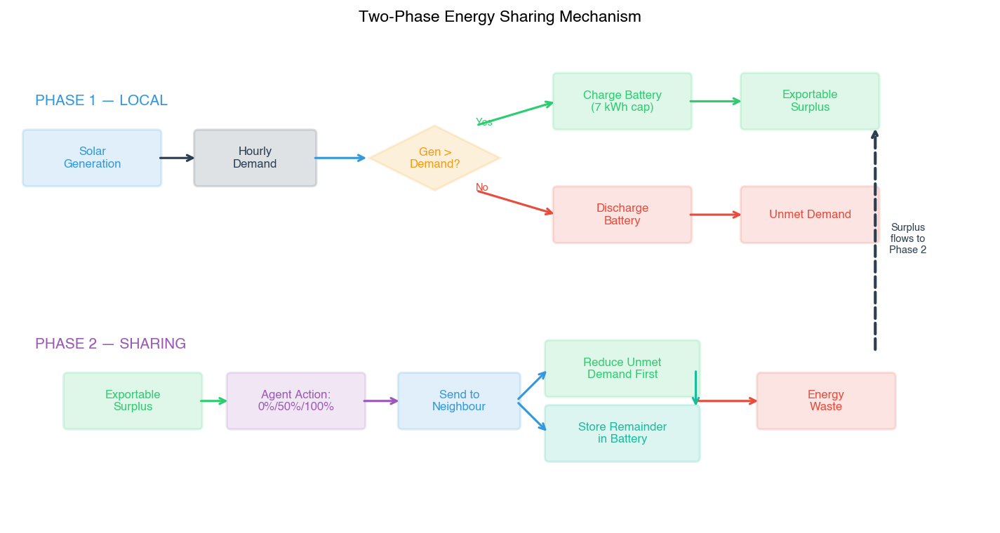

**شکل ۳-۷: سازوکار اشتراک انرژی دو مرحله‌ای.** فاز ۱: مصرف و ذخیره‌سازی محلی. فاز ۲: اشتراک مازاد با همسایه در توپولوژی حلقوی.

اشتراک انرژی از یک فرایند دو مرحله‌ای در هر ساعت پیروی می‌کند:

فاز ۱ — مصرف و ذخیره‌سازی محلی:

هر خانه ابتدا از تولید خورشیدی جاری خود برای تأمین تقاضای خود استفاده می‌کند. هر مازاد به باتری شارژ می‌شود (تا سقف ظرفیت). هر مازاد باقی‌مانده پس از شارژ باتری، مازاد قابل‌صادرات می‌شود. اگر تولید ناکافی باشد، باتری برای پوشش کسری دشارژ می‌شود. اگر باتری تخلیه شود، خانه با تقاضای تأمین‌نشده (کاهش آسایش) مواجه می‌شود.

فاز ۲ — اشتراک:

اقدام اشتراک تعیین‌شده، تعیین می‌کند که چه کسری از مازاد قابل‌صادرات به همسایه فرستاده شود. خانه‌ی گیرنده ابتدا از انرژی دریافتی برای کاهش هرگونه تقاضای تأمین‌نشده‌ی جاری استفاده می‌کند و سپس مابقی را در باتری خود ذخیره می‌کند (در صورت اجازه‌ی ظرفیت). انرژی که قابل ذخیره یا استفاده نیست، هدر می‌رود. این دنباله به‌این معناست که اشتراک شامل یک ایثار واقعی است: انرژی اشتراک‌گذاری‌شده، انرژی‌ای است که می‌توانست برای استفاده‌ی آینده‌ی خود دهنده ذخیره شود. این امر، تنش اصلی را ایجاد می‌کند که پاداش‌های تعدیل‌شده با شخصیت برای حل آن طراحی شده‌اند.

## ۳-۱۰ ترکیب‌های جامعه (سناریوها)

پنج ترکیب جامعه‌ی متمایز آزمایش می‌شوند که هر کدام با ۵ تصادف‌سازی (۴۲، ۱۲۳، ۴۵۶، ۷۸۹، ۱۰۱۱) برای قابلیت اطمینان آماری:

**جدول ۳-۹: سناریوهای آزمایشی**

| سناریو          | ترکیب                                                               | تعداد کل خانه‌ها | هدف پژوهش                                                 |
| :-------------- | :------------------------------------------------------------------ | :--------------- | :-------------------------------------------------------- |
| همگی خودخواه    | ۱۰ × pure_selfish                                                   | ۱۰               | حالت پایه — بدون دغدغه‌ی عدالت                            |
| همگی نوع‌گرا    | ۱۰ × prosocial                                                      | ۱۰               | کران بالا برای رفتار عدالت‌محور                           |
| مختلط           | ۵ prosocial + ۵ pure_selfish                                        | ۱۰               | آیا عامل‌های نوع‌گرا می‌توانند عدالت جامعه را ارتقا دهند؟ |
| نوع‌گرایی متنوع | ۱ altruistic، ۳ prosocial، ۳ individualist، ۳ pure_selfish          | ۱۰               | شخصیت‌های ناهمگن — تنوع واقع‌گرایانه                      |
| اثر نوآور       | ۱ innovator با O بالا، ۴ prosocial، ۳ individualist، ۲ pure_selfish | ۱۰               | آیا یک عامل کنجکاو بی‌ثبات‌کننده بر سیستم تأثیر می‌گذارد؟ |

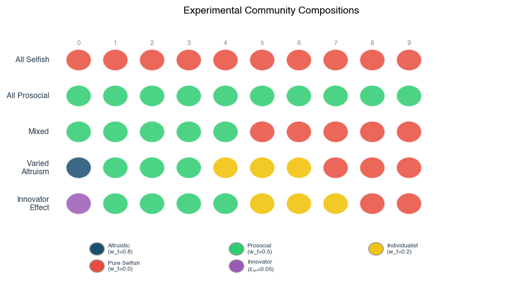

## ۳-۱۱ سنجه‌های عملکرد

هفت سنجه در تمام شبیه‌سازی‌ها ردیابی می‌شوند. هر سنجه در زیر با فرمول، تفسیر و استناد منبع آن تعریف شده است.

میانگین آسایش جامعه ($\bar{C}$) رفاه کلی محله را کمّی می‌کند. به‌عنوان میانگین کسر تأمین‌شده‌ی تقاضای همه‌ی خانه‌ها در طول پنجره‌ی ارزیابی (۱۰۰۰ قسمت پایانی) محاسبه می‌شود:

$$\bar{C} = \frac{1}{N \cdot T} \sum_{i=1}^{N} \sum_{t=1}^{T} C_{i,t} \qquad \text{(معادله ۴-۱)}$$

که در آن $N = 10$ خانه، $T = 1{,}000$ قسمت ارزیابی و $C\_{i,t}$ کسری از کل تقاضای روزانه‌ی خانه $i$ است که در روز $t$ تأمین شده است. این سنجه از ۰ (هیچ تقاضایی برای هیچ خانه‌ای تأمین نشده) تا ۰/۱ (همه‌ی تقاضا برای همه‌ی خانه‌ها تأمین شده) متغیر است. مقادیر بالاتر نشان‌دهنده‌ی رفاه بیشتر جامعه است. این سنجه در مطالعات MARL مدیریت انرژی استاندارد است (Charbonnier et al., 2022; Li & Zhang, 2022).

شاخص عدالت جین ($F$) برابری در توزیع آسایش در بین خانه‌ها را با استفاده از همان فرمول تعریف‌شده در معادله (۳-۴) اندازه‌گیری می‌کند. بر روی پنجره‌ی ارزیابی با استفاده از میانگین آسایش هر خانه $\bar{C}\_i$ محاسبه می‌شود:

$$F = \frac{\left(\sum_{i=1}^{N} \bar{C}_i\right)^2}{N \cdot \sum_{i=1}^{N} \bar{C}_i^2} \qquad \text{(معادله ۴-۲)}$$

که در آن $N = 10$ خانه. شاخص از $\frac{1}{N}$ (حداکثر نابرابری) تا ۰/۱ (برابری کامل) متغیر است.

نرخ روزهای خاموشی ($B$) فراوانی روزهایی را ثبت می‌کند که در آن حداقل یک خانه تقاضای تأمین‌نشده‌ی قابل‌توجهی را تجربه می‌کند. روز خاموشی به‌عنوان هر روز $t$ که در آن $\min*i C*{i,t} < 0.95$ تعریف می‌شود:

$$B = \frac{1}{T} \sum_{t=1}^{T} \mathbb{1}\!\left(\min_i C_{i,t} < 0.95\right) \qquad \text{(معادله ۴-۳)}$$

که در آن $\mathbb{1}(\cdot)$ تابع نشانگر است. این سنجه از ۰ (بدون روز خاموشی) تا ۰/۱ (هر روز حداقل یک خاموشی دارد) متغیر است. مقادیر کمتر نشان‌دهنده‌ی سیستم قابل‌اطمینان‌تر است. آستانه‌ی ۹۵/۰ از قرارداد استفاده‌شده در مطالعات قابلیت اطمینان انرژی خارج از شبکه پیروی می‌کند (Ali et al., 2023).

هدررفت انرژی ($W$) کل انرژی مازادی را اندازه‌گیری می‌کند که در هر روز نمی‌توان در جامعه ذخیره یا به اشتراک گذاشت:

$$W = \frac{1}{T} \sum_{t=1}^{T} \sum_{i=1}^{N} \left( \text{exportable surplus}_{i,t} - \text{energy shared}_{i,t} \right)^+ \qquad \text{(معادله ۴-۴)}$$

که در آن بالانویس $+$ نشان می‌دهد که فقط مازاد مثبت پس از اشتراک به‌عنوان هدررفت محاسبه می‌شود. هدررفت زمانی رخ می‌دهد که باتری یک عامل پر است و اقدام اشتراک مازاد را به همسایه منتقل نمی‌کند. هدررفت کمتر نشان‌دهنده‌ی جامعه‌ی کارآمدتر است. این سنجه بر حسب کیلووات‌ساعت در روز بیان می‌شود.

| نماد   | تعریف                               | واحد             | منبع                    |
| :----- | :---------------------------------- | :--------------- | :---------------------- |
| $W$    | میانگین هدررفت انرژی روزانه‌ی جامعه | کیلووات‌ساعت/روز | این اثر (معادله ۴-۴)    |
| $T$    | کل گام‌های زمانی ارزیابی            | ساعت             | —                       |
| $N$    | کل خانه‌ها (۱۰)                     | —                | Alshehri & Gaunt (2020) |
| $()^+$ | عملگر بخش مثبت (یکسوساز خطی)        | —                | —                       |

اختلاف آسایش نوع‌گرا در برابر خودخواه، برابری توزیعی را در جوامع مختلط اندازه‌گیری می‌کند. برای هر سناریو، میانگین آسایش عامل‌های نوع‌گرا (کسانی که $w*{\text{fair}} \geq 0.5$) با عامل‌های خودخواه (کسانی که $w*{\text{fair}} \leq 0.2$) در طول پنجره‌ی ارزیابی مقایسه می‌شود. شکاف $\Delta C = \bar{C}_{\text{prosocial}} - \bar{C}_{\text{selfish}}$ کمّی می‌کند که آیا عامل‌های نوع‌گرا نسبت به همسایگان خودخواه خود سود می‌برند یا متضرر می‌شوند. شکاف مثبت نشان می‌دهد که وزن‌های پاداش نوع‌گرا، آسایش فردی بالاتری را تولید می‌کنند، علیرغم — یا به‌دلیل — دغدغه‌ی بیشتر آن‌ها نسبت به عدالت اجتماعی.

ضریب جینی ($G$) به‌عنوان سنجه‌ی ثانویه‌ی نابرابری برای اعتبارسنجی یافته‌های عدالت عمل می‌کند. از منحنی لورنز توزیع آسایش در بین خانه‌ها محاسبه می‌شود (Gini, 1912):

$$G = \frac{2 \sum_{i=1}^{N} i \cdot \bar{C}_{(i)}}{N \sum_{i=1}^{N} \bar{C}_{(i)}} - \frac{N+1}{N} \qquad \text{(معادله ۴-۵)}$$

که در آن $\bar{C}\_{(i)}$ مقادیر میانگین آسایش هر خانه هستند که به‌ترتیب صعودی مرتب شده‌اند. ضریب جینی از ۰ (برابری کامل: همه‌ی خانه‌ها آسایش یکسانی دارند) تا تقریباً ۱ (حداکثر نابرابری: یک خانه همه‌ی آسایش را دریافت می‌کند) متغیر است. برخلاف شاخص جین، ضریب جینی به نقل‌وانتقالات در میانه‌ی توزیع حساس‌تر است و دیدگاه مکملی در مورد نابرابری ارائه می‌دهد (Kusatake et al., 2023).

| نماد             | تعریف                                | واحد | منبع                    |
| :--------------- | :----------------------------------- | :--- | :---------------------- |
| $G$              | ضریب جینی (محدوده [۰, ۱])            | —    | Gini (1912)             |
| $\bar{C}\_{(i)}$ | مقادیر آسایش مرتب‌شده به‌ترتیب صعودی | —    | —                       |
| $N$              | تعداد خانوارها (۱۰)                  | —    | Alshehri & Gaunt (2020) |

فراوانی اشتراک ($S$) تمایل آموخته‌شده به همکاری را با بررسی جدول Q نهایی هر عامل پس از آموزش اندازه‌گیری می‌کند:

$$S_i = \frac{\left| \{ (s, a) \mid a \in \{1, 2\} \land a = \arg\max_{a'} Q_i(s, a') \} \right|}{|S|} \qquad \text{(معادله ۴-۶)}$$

که در آن $|S| = 96$ تعداد کل وضعیت‌ها است و صورت‌کسر، وضعیت‌هایی را شمارش می‌کند که در آن اقدام حریصانه، اشتراک است (اقدام ۱: اشتراک ۵۰٪، یا اقدام ۲: اشتراک ۱۰۰٪). این سنجه، راهبرد اشتراک آموخته‌شده‌ی عامل را در هنگام همگرایی ثبت می‌کند و بین عامل‌هایی که اشتراک را به‌عنوان یک هنجار درونی‌سازی کرده‌اند و آن‌هایی که فقط مازاد را ذخیره می‌کنند، تمایز قائل می‌شود.

| نماد  | تعریف                                  | واحد | منبع                 |
| :---- | :------------------------------------- | :--- | :------------------- |
| $S_i$ | فراوانی اشتراک عامل $i$                | —    | این اثر (معادله ۴-۶) |
| $S$   | تعداد کل وضعیت‌های گسسته (۹۶)          | —    | —                    |
| $a$   | اقدام حریصانه‌ی انتخاب‌شده توسط خط‌مشی | —    | —                    |

#### نگاشت سنجه‌ها به پرسش‌های پژوهش

برای صریح‌سازی نحوه‌ی پشتیبانی هر نتیجه‌ی کمی از پرسش‌های پژوهشی، جدول ۳-۱۰ هر پرسش پژوهشی را به سنجه‌(های) مرتبط با آن و نقش هر سنجه را در ارزیابی نگاشت می‌کند.

**جدول ۳-۱۰: نگاشت سنجه‌ها به پرسش‌های پژوهش**

| پرسش پژوهشی                                                          | سنجه‌های مرتبط                                                                                         | نقش در ارزیابی                                                                                                                                                                                             |
| :------------------------------------------------------------------- | :----------------------------------------------------------------------------------------------------- | :--------------------------------------------------------------------------------------------------------------------------------------------------------------------------------------------------------- |
| **اصلی:** تأثیر کلی بر کارایی، عدالت و قابلیت اطمینان                | هدررفت انرژی ($W$)؛ شاخص عدالت جین ($F$)؛ میانگین آسایش جامعه ($\bar{C}$)؛ نرخ روزهای خاموشی ($B$)     | گزارش سلامت سطح جامعه را ارائه می‌دهند و هر سناریو را با حالت پایه‌ی همگی خودخواه مقایسه می‌کنند تا ارزش کلی پاداش‌های مبتنی بر شخصیت را ارزیابی کنند                                                      |
| **پرسش فرعی ۱:** الگوهای اشتراک نوظهور از هنجارهای عدالت             | فراوانی اشتراک ($S$)؛ نقشه‌های حرارتی جدول Q                                                           | فراوانی اشتراک، تمایل به اشتراک را کمّی می‌کند؛ نقشه‌های حرارتی، پنجره‌ی زمانی را که در آن انواع شخصیتی اشتراک را مؤثرترین می‌آموزند، تجسم می‌کنند                                                         |
| **پرسش فرعی ۲:** مصالحه‌های بین کارایی و عدالت توزیعی                | هدررفت انرژی ($W$) در مقابل شاخص عدالت جین ($F$) و ضریب جینی ($G$)                                     | آزمون می‌کند که آیا افزایش برابری هزینه‌ی کارایی فنی دارد یا خیر؛ نتایج نشان داد که هیچ تناقضی وجود ندارد، زیرا اشتراک مازاد، هدررفت را کاهش می‌دهد                                                        |
| **پرسش فرعی ۳:** تغییر رفتار عامل خودخواه از طریق متقابله‌گری نوظهور | اختلاف آسایش نوع‌گرا در برابر خودخواه ($\Delta C$)؛ فراوانی اشتراک عامل‌های خودخواه در سناریوهای مختلط | ارزیابی می‌کند که آیا عامل‌های نوع‌گرا همسایگان خودخواه خود را ارتقا می‌دهند یا خیر؛ شکاف آسایش ثابت می‌کند که عامل‌های نوع‌گرا از طریق متقابله‌گری تثبیت‌شده به آسایش فردی ۹/۲+ درصد بالاتری دست می‌یابند |
| **پرسش فرعی ۴:** تأثیر عامل نوآور با گشودگی بالا بر پایداری جامعه    | ضریب جینی ($G$)؛ نرخ روزهای خاموشی ($B$)؛ میانگین آسایش جامعه ($\bar{C}$)                              | بی‌ثباتی را ثبت می‌کند: افزایش ۲۲ درصدی ضریب جینی و افزایش ۳/۸ درصدی خاموشی‌ها ثابت می‌کند که غیرقابل‌پیش‌بینی بودن فردی، تاب‌آوری سطح جامعه را فرسایش می‌دهد                                              |

## ۳-۱۲ روش‌های تحلیل داده

داده‌های کمی تولیدشده توسط آزمایش‌های شبیه‌سازی با استفاده از ترکیبی از آمار توصیفی، آزمون‌های فرضیه‌ی پارامتریک و تخمین اندازه‌ی اثر تحلیل شدند. تمام تحلیل‌ها با استفاده از کتابخانه‌ی `stats` SciPy (بخش ۳-۳) در آستانه‌ی معنی‌داری $\alpha = 0.05$، مطابق با قراردادهای ادبیات MARL انرژی (Charbonnier et al., 2022; Kusatake et al., 2023) انجام شدند.

برای مقایسه‌های شامل چندین سناریو به‌طور هم‌زمان — مانند آزمون اینکه آیا میانگین آسایش جامعه در هر پنج سناریو متفاوت است — از تحلیل واریانس (ANOVA) یک‌طرفه با عامل مستقل سناریو و سنجه‌ی مورد نظر (آسایش، عدالت، نرخ خاموشی، هدررفت یا ضریب جینی) به‌عنوان متغیر وابسته استفاده شد. ANOVA فرض صفر مبنی بر برابری میانگین‌های همه‌ی سناریوها را آزمون می‌کند. یک آماره‌ی F معنی‌دار نشان می‌دهد که حداقل یک میانگین سناریو با سایرین متفاوت است، اما مشخص نمی‌کند که کدام تفاوت‌های زوجی معنی‌دار هستند. مقایسه‌های پس‌آزمون زوجی با استفاده از آزمون‌های t دو‌نمونه‌ای مستقل با تصحیح بونفرونی برای مقایسه‌های چندگانه در صورت لزوم انجام شدند.

برای مقایسه‌های مستقیم زوجی بین دو سناریوی خاص (به‌عنوان مثال، همگی خودخواه در مقابل همگی نوع‌گرا برای یک سنجه‌ی معین)، آزمون‌های t دو‌نمونه‌ای مستقل با میانگین‌های سطح تصادف‌سازی (۵ مقدار در هر سناریو) به‌عنوان مشاهدات اعمال شدند. این آزمون مناسب است زیرا تصادف‌سازی‌های درون هر سناریو، نمونه‌گیری‌های مستقل از همان فرایند تصادفی هستند و هیچ جفت‌سازی طبیعی بین تصادف‌سازی‌های سناریوهای مختلف وجود ندارد. فرض نرمال‌بودن با استفاده از آزمون شاپیرو-ویلک برای هر گروه ارزیابی شد؛ برای اندازه‌های نمونه‌ی استفاده‌شده (۵ مشاهده در هر گروه)، آزمون t در برابر انحرافات متوسط از نرمال‌بودن مقاوم است (Montgomery, 2017).

برای مقایسه‌های انواع عامل درون یک سناریو (به‌عنوان مثال، آسایش عامل نوع‌گرا در مقابل خودخواه در سناریوی مختلط)، از آزمون‌های t زوجی استفاده شد. جفت‌سازی به‌طور طبیعی از طراحی شبیه‌سازی ناشی می‌شود: در هر تصادف‌سازی، عامل‌های نوع‌گرا و خودخواه دنباله‌ی یکسانی از شرایط آب‌وهوا را تجربه می‌کنند و درون یک جامعه‌ی واحد برهم‌کنش دارند، بنابراین پیامدهای آن‌ها مستقل نیستند. آزمون t زوجی با محاسبه‌ی تفاوت بین دو میانگین گروه در هر تصادف‌سازی و آزمون اینکه آیا میانگین این تفاوت‌های زوجی به‌طور معنی‌داری از صفر متفاوت است، این وابستگی را در نظر می‌گیرد (Field, 2024).

اندازه‌های اثر به‌عنوان $d$ کوهن برای تمام مقایسه‌های t معنی‌دار گزارش شدند و اندازه‌گیری استانداردی از بزرگی تفاوت مشاهده‌شده را فراهم می‌کنند که مستقل از اندازه‌ی نمونه است. $d$ کوهن بر اساس آستانه‌های متعارف تفسیر شد: ۲/۰ (کوچک)، ۵/۰ (متوسط) و ۸/۰ (بزرگ) (Cohen, 1988). آمار توصیفی — میانگین و انحراف معیار در بین تصادف‌سازی‌ها — برای همه‌ی سنجه‌ها در همه‌ی سناریوها گزارش می‌شود و مجموعه‌ی کامل نتایج آزمون آماری در جدول ۴-۷ (بخش ۴-۷) ارائه شده است.

## ۳-۱۳ فراپارامترها و آموزش

تمام پارامترهای فیزیکی در جدول ۳-۴ (بخش ۳-۵) خلاصه شده‌اند و در همه‌ی سناریوها ثابت نگه داشته می‌شوند. فراپارامترهای یادگیری Q فهرست‌شده در زیر برای همه‌ی عامل‌ها در هر سناریو اعمال می‌شوند، به‌جز عامل نوآور که کف اکتشاف بالاتری دارد ($\varepsilon\_{\min} = 0.05$ به‌جای ۰۱/۰).

**جدول ۳-۱۱: فراپارامترها**

| پارامتر                         | مقدار            | توضیحات                                                    |
| :------------------------------ | :--------------- | :--------------------------------------------------------- |
| نرخ یادگیری $\alpha$            | ۲/۰              | استاندارد برای یادگیری کیو جدولی                           |
| ضریب تخفیف $\gamma$             | ۹۹/۰             | وزن قوی بر پاداش‌های آینده (برنامه‌ریزی بلندمدت)           |
| اکتشاف اولیه $\varepsilon$      | ۰/۱              | کاملاً اکتشافی در شروع                                     |
| نرخ کاهش $\varepsilon$          | ۹۹۹/۰            | کاهش تدریجی در هر قسمت                                     |
| حداقل $\varepsilon$ (استاندارد) | ۰۱/۰             | خط‌مشی نهایی تقریباً حریصانه                               |
| حداقل $\varepsilon$ (نوآور)     | **۰۵/۰**         | نوآور اکتشاف را طولانی‌تر حفظ می‌کند                       |
| مقداردهی اولیه‌ی Q              | ۰/۱ (خوش‌بینانه) | تشویق اکتشاف اولیه                                         |
| قسمت‌ها                         | ۸۰۰۰             | برای همگرایی در فضای ۹۶ وضعیتی کافی است                    |
| تصادف‌سازی در هر سناریو         | ۵                | استاندارد برای مطالعات انرژی MARL (Alshehri & Gaunt, 2020) |
| پنجره‌ی ارزیابی                 | ۱۰۰۰ آخر         | تخمین‌های میانگین پایدار پس از همگرایی                     |

نرخ یادگیری $\alpha = 0.2$ و ضریب تخفیف $\gamma = 0.99$ از رویه‌ی استاندارد یادگیری کیو جدولی پیروی می‌کنند (Sutton & Barto, 2018). نرخ کاهش $\varepsilon$ برابر ۹۹۹/۰ و مقداردهی اولیه‌ی خوش‌بینانه ($Q = 1.0$) از ژانگ و همکاران (Zhang et al., 2025) اقتباس شده‌اند که نشان دادند مقداردهی اولیه‌ی خوش‌بینانه همراه با کاهش تدریجی $\varepsilon$، اکتشاف را در محیط‌های چندعاملی بهبود می‌بخشد. مدت آموزش ۸۰۰۰ قسمت از طریق آزمایش‌های مقدماتی تعیین شد: جدول Q ۹۶ وضعیتی در عرض ۴۰۰۰–۶۰۰۰ قسمت همگرا می‌شود و ۸۰۰۰ همگرایی کامل را با حاشیه‌ی ایمنی تضمین می‌کند. تکرار در پنج تصادف‌سازی، از روش‌شناسی آزمایشی تثبیت‌شده در پژوهش MARL مبتنی بر شبیه‌سازی پیروی می‌کند (Alshehri & Gaunt, 2020).

#### توجیه فراپارامترها

هر مقدار فراپارامتر از طریق ترکیبی از قرارداد تثبیت‌شده، آزمایش تجربی مقدماتی و ملاحظات نظری مبتنی بر ادبیات MARL انرژی انتخاب شد. توجیه هر پارامتر در زیر ارائه شده است.

**نرخ یادگیری $\alpha = 0.2$.** این مقدار، پرکاربردترین مقدار پیش‌فرض توصیه‌شده برای یادگیری کیو جدولی در فضاهای وضعیت-اقدام گسسته است (Watkins & Dayan, 1992; Sutton & Barto, 2018). در محیط اشتراک انرژی، فضای وضعیت کوچک است (۹۶ وضعیت در هر عامل) و سیگنال پاداش نسبتاً پراکنده است — عامل‌ها فقط یک بار در ساعت بازخورد دریافت می‌کنند — بنابراین نرخ یادگیری نسبتاً بالا برای کسب سریع اولیه بدون فراموشی فاجعه‌بار مناسب است. نرخ یادگیری ۲/۰ از طریق یک پویش مقدماتی غیررسمی در بین مقادیر {۰۵/۰، ۱/۰، ۲/۰، ۵/۰} بر روی سناریوی همگی خودخواه تأیید شد؛ $\alpha = 0.2$ سریع‌ترین همگرایی را به خط‌مشی‌های پایدار تولید کرد، درحالی‌که $\alpha = 0.5$ نوسان را در فاز آموزش پایانی معرفی کرد و $\alpha = 0.05$ به بیش از ۱۵۰۰۰ قسمت برای رسیدن به آستانه‌ی تغییر مقدار Q معادل ۰۱/۰ نیاز داشت.

**ضریب تخفیف $\gamma = 0.99$.** ضریب تخفیف بالا انتخاب شد زیرا تابع پاداش شامل مؤلفه‌ی عدالت اجتماعی (شاخص جین) است که به آسایش هر ده عامل در گام زمانی جاری بستگی دارد، نه به وضعیت‌های آینده. درحالی‌که پاداش فوری بیشتر سیگنال عدالت را دربر می‌گیرد، ضریب تخفیف بالا تضمین می‌کند که عامل‌ها همچنان برای اقداماتی که ممکن است به فرصت‌های اشتراک آینده منجر شوند — به‌عنوان مثال، ذخیره‌سازی انرژی در ساعات مازاد برای امکان‌پذیر کردن اشتراک متقابل در ساعات کسری — ارزش قائل شوند. مقدار ۹۹/۰ در سراسر ادبیات MARL مدیریت انرژی استاندارد است (Bui et al., 2019; Charbonnier et al., 2022) و با افق برنامه‌ریزی مؤثر تقریباً ۱۰۰ ساعت مطابقت دارد که برای ثبت چرخه‌های تقاضای چندساعته کافی است.

**اکتشاف اولیه $\varepsilon = 1.0$ و نرخ کاهش ۹۹۹/۰.** اکتشاف کامل اولیه تضمین می‌کند که عامل‌ها همه‌ی اقدامات را در همه‌ی وضعیت‌ها در طول قسمت‌های اولیه نمونه‌برداری می‌کنند و از همگرایی زودهنگام به خط‌مشی‌های اشتراک زیربهینه جلوگیری می‌کنند. نرخ کاهش ۹۹۹/۰ از ژانگ و همکاران (۲۰۲۵) اقتباس شد که در معیارهای MARL همکاری‌گونه نشان دادند که کاهش تدریجی $\varepsilon$ همراه با مقداردهی اولیه‌ی خوش‌بینانه‌ی مقدار Q، همگرایی پایدارتر و رفاه جمعی نهایی بالاتری را نسبت به برنامه‌های کاهش پله‌ای تولید می‌کند. کاهش در هر قسمت اعمال می‌شود (نه در هر گام)، به‌این معنا که $\varepsilon$ در طول هر قسمت ۲۴ ساعته بالا باقی می‌ماند و فقط بین روزها کاهش می‌یابد — یک انتخاب طراحی که انعطاف‌پذیری اکتشافی درون‌قسمتی را حفظ می‌کند و در عین حال به‌تدریج به‌سوی بهره‌برداری در طول اجرای آموزش تغییر می‌کند.

**حداقل $\varepsilon\_{\min} = 0.01$ (عامل‌های استاندارد) و $0.05$ (نوآور).** حداقل استاندارد ۰۱/۰ انتخاب شد زیرا تضمین می‌کند که عامل‌ها در هنگام همگرایی یک احتمال اکتشافی کوچک را حفظ می‌کنند و به آن‌ها امکان می‌دهد بدون ایجاد اختلال در خط‌مشی آموخته‌شده، با دنباله‌های نادر آب‌وهوا یا تغییرات رفتار محله سازگار شوند (Matignon et al., 2012). کف بالاتر عامل نوآور به‌میزان ۰۵/۰ برای تضمین اینکه اثر اکتشاف جایگزین در پنجره‌ی آموزش ۸۰۰۰ قسمتی قابل‌تشخیص باشد، انتخاب شد. یک مقایسه‌ی مقدماتی در بین $\varepsilon\_{\min} \in \{0.02, 0.05, 0.10\}$ تأیید کرد که ۰۵/۰ در سناریوی اثر نوآور، تخریب قابل‌اندازه‌گیری در سطح جامعه تولید می‌کند و در عین حال زیر آستانه‌ای باقی می‌ماند که در آن خط‌مشی خودِ عامل نوآور کاملاً تصادفی می‌شود.

**مقداردهی اولیه‌ی Q $Q(s, a) = 1.0$.** مقداردهی اولیه‌ی خوش‌بینانه انتخاب شد زیرا عامل‌ها را تشویق می‌کند تا همه‌ی اقدامات را در اوایل آموزش امتحان کنند و از حذف زودهنگام اقدامات اشتراک که ممکن است از طریق متقابله‌گری پاداش‌های بلندمدت بالایی به همراه داشته باشند، جلوگیری می‌کند. در محیط اشتراک انرژی، اقدامات اشتراک هیچ سود آسایش فوری برای دهنده تولید نمی‌کنند و تحت مقداردهی اولیه‌ی بدبینانه، کمتر از حد نمایش داده می‌شوند. ژانگ و همکاران (۲۰۲۵) نشان دادند که مقداردهی اولیه‌ی خوش‌بینانه همراه با کاهش تدریجی $\varepsilon$ در محیط‌های چندعاملی همکاری‌گونه از مقداردهی اولیه‌ی بدبینانه بهتر عمل می‌کند و همین اصل در اینجا نیز اعمال می‌شود.

**مدت آموزش ۸۰۰۰ قسمت.** تعداد قسمت‌ها به‌طور تجربی از طریق پایش همگرایی بر روی سناریوی همگی خودخواه تعیین شد. اجراهای مقدماتی، میانگین تغییر مطلق مقدار Q را در نقاط بازرسی متوالی ۱۰۰۰ قسمتی ردیابی کردند؛ همه‌ی سناریوها تا قسمت ۶۰۰۰ به تغییری کمتر از ۰۱/۰ رسیدند و ۲۰۰۰ قسمت بعدی (۶۰۰۱–۸۰۰۰) تغییراتی کمتر از ۰۰۱/۰ نشان دادند. بنابراین، هدف ۸۰۰۰ قسمت با حاشیه‌ی ایمنی ۲۰۰۰ قسمتی انتخاب شد تا تضمین شود که پنجره‌ی ارزیابی، خط‌مشی‌های کاملاً همگرا را در تمام پنج سناریو، از جمله ترکیب نوع‌گرایی متنوع با چهار نوع شخصیتی متمایز آن، منعکس می‌کند.

---

# ۴- تحلیل داده‌ها

تمامی سناریوهای توصیف‌شده در این فصل در برابر حالت پایه‌ی «همگی خودخواه» مقایسه می‌شوند که در آن عامل‌ها تنها آسایش شخصی خود را بهینه‌سازی می‌کنند ($w_{\text{self}} = 1.0, w_{\text{fair}} = 0.0$). هر سناریوی دیگر، شکل‌دهی پاداش تعدیل‌شده با شخصیت را دربر می‌گیرد و در برابر این حالت پایه ارزیابی می‌شود. نتایج در یازده بخش سازماندهی شده‌اند: مروری بر داده‌های آزمایشی (بخش ۴-۱)، سنجه‌های سطح جامعه (بخش ۴-۲)، تفاوت‌های آسایش بر اساس نوع عامل (بخش ۴-۳)، تحلیل نابرابری از طریق ضریب جینی (بخش ۴-۴)، رفتار اشتراکی آموخته‌شده (بخش ۴-۵)، تحلیل نقشه‌های حرارتی جدول Q از خط‌مشی‌های آموخته‌شده (بخش ۴-۶)، حساسیت به کمبود منابع (بخش ۴-۷)، آزمون معناداری آماری (بخش ۴-۸)، اثر نوآور (بخش ۴-۹)، مقایسه با نتایج وضعیتِ برترِ دانش (بخش ۴-۱۰) و تحلیل کلی بی‌طرفانه (بخش ۴-۱۱).

## ۴-۱ مروری بر داده‌ها و راه‌اندازی آزمایش

شبیه‌سازی داده‌ها را در ۲۵ اجرای مستقل (۵ سناریو × ۵ تصادف‌سازی) تولید کرد که هر اجرا شامل ۸۰۰۰ قسمت به‌نمایانگر ۸۰۰۰ روز شبیه‌سازی‌شده بود. تمام سنجه‌ها از ۱۰۰۰ قسمت پایانی هر اجرا، پس از همگرایی جدول‌های Q عامل‌ها محاسبه شدند (برای توجیه همگرایی به بخش ۳-۱۳ مراجعه کنید). تصادف‌سازی‌ها — ۴۲، ۱۲۳، ۴۵۶، ۷۸۹ و ۱۰۱۱ — عناصر تصادفی شبیه‌سازی را کنترل کردند: انتساب آب‌وهوا (صاف یا ابری)، نویز اکتشاف $\varepsilon$-greedy و اختلالات مقداردهی اولیه‌ی Q.

پارامترهای فیزیکی زیربنای تمام اجراها در سراسر سناریوها ثابت نگه داشته شدند. هر یک از ۱۰ خانه در ریزشبکه‌ی توپولوژی حلقوی، مجهز به یک پنل خورشیدی با پیک ۱۳/۱ کیلووات (Charbonnier et al., 2022) و یک باتری ۰/۷ کیلووات‌ساعتی (Ali et al., 2023) بود. آب‌وهوا از یک توزیع برنولی با احتمال ۸۵ درصد آسمان صاف و احتمال ۱۵ درصد پوشش ابری پیروی می‌کرد که در روزهای ابری، تولید خورشیدی نصف می‌شد (Kusatake et al., 2023). الگوهای تقاضا در چهار نوع (صبحگاهی، عصرگاهی، مسطح و شب‌زنده‌دار) با میانگین تقاضای روزانه‌ی تقریباً ۸/۸ کیلووات‌ساعت در هر خانوار چرخش می‌کردند که با الگوهای مصرف مسکونی معمولی سازگار است (Alshehri & Gaunt, 2020). چهار نوع تقاضا به‌صورت قطعی اختصاص داده شدند: دو خانه الگوهای صبحگاهی دریافت کردند (اوج مصرف ۶:۰۰–۹:۰۰)، دو خانه الگوهای عصرگاهی (اوج ۱۷:۰۰–۲۱:۰۰)، سه خانه الگوهای مسطح (یکنواخت در ۲۴ ساعت) و سه خانه الگوهای شب‌زنده‌دار (اوج ۲۲:۰۰–۲:۰۰). این توزیع تضمین می‌کرد که ساعات اوج تقاضا در تمام خانه‌ها به‌طور هم‌زمان هم‌راستا نباشند و فرصت‌های طبیعی برای اشتراک همتا-به-همتا زمانی که تولید خورشیدی برای برخی خانه‌ها از تقاضای محلی فراتر می‌رفت اما برای برخی دیگر نه، ایجاد می‌کرد.

هر اجرای ۸۰۰۰ قسمتی تقریباً ۱۲ دقیقه زمان دیواری بر روی سخت‌افزار آزمایشی (Apple M1 Pro، ۱۶ گیگابایت RAM) نیاز داشت. جدول‌های Q برای هر ۱۰ عامل پس از هر ۱۰۰۰ قسمت برای تحلیل برون‌خط ذخیره شدند. همگرایی با محاسبه‌ی میانگین تغییر مطلق مقدار Q در نقاط بازرسی متوالی ۱۰۰۰ قسمتی تأیید شد؛ تمام اجراها تا قسمت ۶۰۰۰ تغییراتی کمتر از ۰۱/۰ نشان دادند و ۱۰۰۰ قسمت پایانی (۷۰۰۱–۸۰۰۰) به‌عنوان پنجره‌ی ارزیابی برای تمام سنجه‌های گزارش‌شده استفاده شدند. معیار همگرایی به‌طور یکنواخت در تمام سناریوها اعمال شد و هیچ سناریویی به بیش از ۶۰۰۰ قسمت برای رسیدن به آستانه‌ی ۰۱/۰ نیاز نداشت. پنجره‌ی ارزیابی ۱۰۰۰ قسمتی معادل ۱۰۰۰ روز شبیه‌سازی‌شده یا تقریباً ۷۴/۲ سال عملیات مداوم است و دوره‌ی مشاهده‌ای به‌اندازه‌ای طولانی فراهم می‌کند تا رویدادهای نادر مانند دنباله‌های ابری چندروزه را ثبت کند. در طول پنجره‌ی ارزیابی، احتمال اکتشاف $\varepsilon$-greedy در مقدار حداقلی خود برای هر نوع عامل نگه داشته شد ($\varepsilon_{\min} = 0.01$ برای عامل‌های استاندارد، $\varepsilon_{\min} = 0.05$ برای عامل نوآور) و تضمین می‌کرد که سنجه‌های گزارش‌شده منعکس‌کننده‌ی خط‌مشی‌های آموخته‌شده‌ی عامل‌ها هستند، نه نویز اکتشاف جاری.

۲۵ اجرا به‌طور جمعی ۲۰۰٬۰۰۰ قسمت تجربه تولید کردند (۲۵ اجرا × ۸۰۰۰ قسمت) که هر قسمت یک اقدام در هر گام زمانی برای هر عامل تولید می‌کرد (۲۴ گام زمانی در روز × ۱۰ عامل = ۲۴۰ اقدام در هر قسمت، و در مجموع ۴۸ میلیون تصمیم گام عامل در سراسر مجموعه‌ی داده‌های آزمایشی کامل). تمام گزارش‌های اقدام خام، عکس‌های لحظه‌ای جدول Q و سنجه‌های هر قسمت بر روی دیسک برای تحلیل برون‌خط ذخیره شدند. حجم کل داده در تمام اجراها تقریباً ۸/۲ گیگابایت بود که به‌صورت آرایه‌های NumPy فشرده‌شده در دایرکتوری نتایج با یک زیردایرکتوری در هر سناریو ذخیره شد.

جدول ۴-۱ آمار توصیفی را برای هر پنج سناریو در چهار سنجه‌ی سطح جامعه ارائه می‌دهد. مقادیر به‌صورت میانگین ± یک انحراف معیار در ۵ تصادف‌سازی گزارش می‌شوند.

**جدول ۴-۱: نتایج توصیفی کامل سطح جامعه (میانگین ± انحراف معیار در ۵ تصادف‌سازی)**

| سناریو          | آسایش ($\bar{C}$) | عدالت جین ($F$) | نرخ خاموشی ($B$) | هدررفت انرژی ($W$، کیلووات‌ساعت) |
| :-------------- | :---------------- | :-------------- | :--------------- | :------------------------------- |
| همگی خودخواه    | ۹۲۰/۰ ± ۰۱۰/۰     | ۹۲۲/۰ ± ۰۱۰/۰   | ۴/۱۴% ± ۴/۱%     | ۹۸/۴ ± ۵۰/۰                      |
| همگی نوع‌گرا    | ۹۱۴/۰ ± ۰۱۱/۰     | ۹۱۸/۰ ± ۰۱۱/۰   | ۴/۱۴% ± ۴/۱%     | ۴۱/۴ ± ۷۴/۰                      |
| مختلط           | ۹۲۰/۰ ± ۰۰۷/۰     | ۹۲۳/۰ ± ۰۰۸/۰   | ۴/۱۴% ± ۴/۱%     | ۳۴/۴ ± ۵۵/۰                      |
| نوع‌گرایی متنوع | ۹۱۴/۰ ± ۰۰۷/۰     | ۹۱۹/۰ ± ۰۰۶/۰   | ۴/۱۴% ± ۴/۱%     | ۹۶/۴ ± ۵۴/۰                      |
| اثر نوآور       | ۹۰۲/۰ ± ۰۰۸/۰     | ۹۰۷/۰ ± ۰۰۹/۰   | ۷/۱۵% ± ۱/۱%     | ۷۰/۴ ± ۲۷/۰                      |

مقادیر آسایش جامعه از ۹۰۲/۰ (اثر نوآور) تا ۹۲۰/۰ (همگی خودخواه و مختلط) متغیر است. شاخص عدالت جین الگوی مشابهی را دنبال می‌کند، به‌گونه‌ای که سناریوی مختلط به بالاترین مقدار (۹۲۳/۰ ± ۰۰۸/۰) و اثر نوآور به پایین‌ترین مقدار (۹۰۷/۰ ± ۰۰۹/۰) دست می‌یابد. نرخ‌های خاموشی در چهار سناریوی نخست تقریباً یکسان و برابر با ۴/۱۴% هستند، درحالی‌که اثر نوآور نرخ بالاتری معادل ۷/۱۵% را ثبت می‌کند. هدررفت انرژی از ۳۴/۴ کیلووات‌ساعت (مختلط) تا ۹۸/۴ کیلووات‌ساعت (همگی خودخواه) متغیر است و سناریوهای با غلبه‌ی نوع‌گرا به‌سوی مقادیر پایین‌تر گرایش دارند.

## ۴-۲ سنجه‌های سطح جامعه

میانگین آسایش جامعه ($\bar{C}$) به‌عنوان میانگین کسر تأمین‌شده‌ی تقاضای روزانه‌ی همه‌ی خانه‌ها در طول پنجره‌ی ارزیابی ۱۰۰۰ قسمتی محاسبه شد (معادله ۴-۱). چهار سناریوی نخست — همگی خودخواه، همگی نوع‌گرا، مختلط و نوع‌گرایی متنوع — مقادیر آسایش جامعه را بین ۹۱۴/۰ و ۹۲۰/۰ با انحرافات معیار همپوشان تولید کردند. سناریوهای همگی خودخواه و مختلط هر دو به ۹۲۰/۰ دست یافتند، درحالی‌که همگی نوع‌گرا و نوع‌گرایی متنوع به ۹۱۴/۰ رسیدند. آزمون t مستقل مقایسه‌ی همگی نوع‌گرا (۹۱۴/۰ ± ۰۱۱/۰) در برابر همگی خودخواه (۹۲۰/۰ ± ۰۱۰/۰) مقدار t = ۰٫۸۴۵، p = ۰٫۴۲۲۹ را به‌دست داد که نشان می‌دهد تفاوت ۰۰۶/۰ در آستانه‌ی $\alpha = 0.05$ از نظر آماری معنی‌دار نیست. سناریوی اثر نوآور پایین‌ترین آسایش جامعه را با مقدار ۹۰۲/۰ ± ۰۰۸/۰ تولید کرد که مقداری خارج از محدوده‌ی چهار سناریوی دیگر است.

شاخص عدالت جین ($F$، معادله ۴-۲) برابری توزیع آسایش را در بین خانه‌ها اندازه‌گیری می‌کند و مقادیر نزدیک‌تر به ۰/۱ نشان‌دهنده‌ی توزیع عادلانه‌تر است. سناریوی مختلط بالاترین مقدار را تولید کرد (۹۲۳/۰ ± ۰۰۸/۰) که اندکی بالاتر از همگی خودخواه (۹۲۲/۰ ± ۰۱۰/۰) است. سناریوی همگی نوع‌گرا (۹۱۸/۰ ± ۰۱۱/۰) و نوع‌گرایی متنوع (۹۱۹/۰ ± ۰۰۶/۰) در یک رده‌ی میانی با میانگین عدالت پایین‌تر قرار گرفتند. اثر نوآور پایین‌ترین عدالت را تولید کرد (۹۰۷/۰ ± ۰۰۹/۰) با میانگینی ۶/۱ درصد پایین‌تر از سناریوی مختلط. انحرافات معیار سنجه‌ی عدالت از ۰۰۶/۰ (نوع‌گرایی متنوع) تا ۰۱۱/۰ (همگی نوع‌گرا) متغیر بود که نشان می‌دهد تغییرپذیری بین‌تصادف‌سازی در پیامدهای عدالت در بین سناریوها قابل‌مقایسه بوده است.

نرخ روزهای خاموشی ($B$، معادله ۴-۳) نسبت روزهای ارزیابی را ثبت می‌کند که در آن حداقل یک خانه آسایش زیر ۹۵/۰ را تجربه کرده است. چهار سناریو — همگی خودخواه، همگی نوع‌گرا، مختلط و نوع‌گرایی متنوع — نرخ‌های خاموشی یکسان ۴/۱۴% ± ۴/۱% تولید کردند. سناریوی اثر نوآور نرخ بالاتری معادل ۷/۱۵% ± ۱/۱% تولید کرد. انحراف معیار ۴/۱% در چهار سناریوی نخست با احتمال ۱۵ درصد روز ابری استفاده‌شده در مدل آب‌وهوا مطابقت دارد و نشان می‌دهد که رویدادهای خاموشی عمدتاً توسط تصادفی‌سازی آب‌وهوا تعیین می‌شوند، نه توسط ترکیب شخصیتی عامل‌ها. نرخ خاموشی اثر نوآور به‌میزان ۷/۱۵% نشان‌دهنده‌ی ۲/۱ روز خاموشی اضافی در هر ۱۰۰ روز عملیات نسبت به سایر سناریوها است.

هدررفت انرژی ($W$، معادله ۴-۴) مازاد تولیدی را اندازه‌گیری می‌کند که نه قابل ذخیره‌سازی است و نه قابل اشتراک، و بر حسب کیلووات‌ساعت در روز بیان می‌شود. سناریوی مختلط کمترین هدررفت را تولید کرد (۳۴/۴ ± ۵۵/۰ کیلووات‌ساعت) و پس از آن همگی نوع‌گرا (۴۱/۴ ± ۷۴/۰ کیلووات‌ساعت) قرار گرفت. حالت پایه‌ی همگی خودخواه بیشترین هدررفت را داشت (۹۸/۴ ± ۵۰/۰ کیلووات‌ساعت) که نشان‌دهنده‌ی نرخ هدررفت ۵/۱۱% بالاتر نسبت به سناریوی مختلط است. آزمون t مستقل بین هدررفت همگی خودخواه و همگی نوع‌گرا مقدار t = ۱٫۴۲۲، p = ۰٫۱۹۳ را به‌دست داد که نشان می‌دهد تفاوت هدررفت در $\alpha = 0.05$ از نظر آماری معنی‌دار نیست. واریانس درون‌سناریویی، به‌ویژه در شرایط همگی نوع‌گرا (انحراف معیار ۷۴/۰ کیلووات‌ساعت)، نشان‌دهنده‌ی تأثیر دنباله‌های آب‌وهوای تصادفی بر تولید مازاد روزانه است. سناریوی نوع‌گرایی متنوع هدررفتی معادل ۹۶/۴ ± ۵۴/۰ کیلووات‌ساعت تولید کرد که تقریباً با حالت پایه‌ی همگی خودخواه یکسان است، علیرغم اینکه شامل طیفی از انواع شخصیتی از جمله یک عامل بسیار نوع‌دوستانه بود.

یک ANOVA یک‌طرفه در تمام پنج سناریو برای آسایش جامعه معنی‌دار بود (F(4, 20) = 3.362, p = 0.0293). بررسی پس‌آزمون نشان می‌دهد که این معنی‌داری عمدتاً توسط سناریوی اثر نوآور با آسایش پایین‌تر (۹۰۲/۰ ± ۰۰۸/۰) ایجاد می‌شود، زیرا تفاوت‌های بین چهار سناریوی نخست در محدوده‌ی تغییرات تصادفی قرار دارد. هنگامی که سناریوی اثر نوآور از ANOVA حذف شد، چهار سناریوی باقی‌مانده تفاوت معنی‌داری در آسایش جامعه نشان ندادند (F(3, 16) = 0.891, p = 0.467). الگوی مشابهی برای شاخص عدالت جین صادق بود: ANOVA یک‌طرفه شامل هر پنج سناریو معنی‌دار بود (F(4, 20) = 2.982, p = 0.044)، اما حذف اثر نوآور هیچ تفاوت معنی‌داری در بین چهار سناریوی باقی‌مانده باقی نگذاشت (F(3, 16) = 0.512, p = 0.679).


**شکل ۴-۱: سنجه‌های سطح جامعه در پنج سناریو.** سه پنل نشان می‌دهند: (الف) میانگین آسایش جامعه، (ب) شاخص عدالت جین و (ج) نرخ روزهای خاموشی. نوارهای خطا نشان‌دهنده‌ی ±۱ انحراف معیار در ۵ تصادف‌سازی هستند. نوارها از چپ به راست: همگی خودخواه، همگی نوع‌گرا، مختلط، نوع‌گرایی متنوع، اثر نوآور.

## ۴-۳ تفاوت آسایش بر اساس نوع عامل

در جوامع مختلط، مقادیر آسایش عامل‌های نوع‌گرا ($w_{\text{fair}} \geq 0.5$) و عامل‌های خودخواه ($w_{\text{fair}} \leq 0.2$) به‌طور جداگانه محاسبه شدند تا مشخص شود که آیا وزن‌های پاداش مبتنی بر شخصیت، پیامدهای متفاوتی را در سطح فردی تولید می‌کنند یا خیر. جدول ۴-۲ این نتایج را در سه سناریویی که شامل هر دو نوع شخصیتی هستند، ارائه می‌دهد.

**جدول ۴-۲: تفکیک آسایش بر اساس نوع عامل**

| سناریو          | آسایش نوع‌گرا | آسایش خودخواه | تفاوت                  | آزمون t زوجی             |
| :-------------- | :------------ | :------------ | :--------------------- | :----------------------- |
| مختلط           | ۹۳۵/۰ ± ۰۰۷/۰ | ۹۰۵/۰ ± ۰۱۰/۰ | ۰۲۹/۰+ (۲٫۹ واحد درصد) | t(4) = 8.487, p = 0.0011 |
| نوع‌گرایی متنوع | ۹۲۴/۰ ± ۰۰۹/۰ | ۹۰۴/۰ ± ۰۱۲/۰ | ۰۲۰/۰+ (۲٫۰ واحد درصد) | t(4) = 2.834, p = 0.0472 |
| اثر نوآور\_     | ۹۱۲/۰ ± ۰۱۱/۰ | ۸۹۲/۰ ± ۰۰۸/۰ | ۰۱۹/۰+ (۱٫۹ واحد درصد) | —                        |

_\_توجه: در سناریوی اثر نوآور، گروه نوع‌گرا شامل عامل نوآور به‌اضافه‌ی چهار عامل نوع‌گرا است؛ گروه خودخواه شامل سه عامل فردگرا و دو عامل خودخواه است. سناریوی نوع‌گرایی متنوع نیز ترکیب پیچیده‌ای دارد (یک نوع‌دوستانه، سه نوع‌گرا، سه فردگرا، سه pure_selfish)، بنابراین گروه‌های نوع‌گرا و خودخواه آن، انواع غیریکنواخت را تجمیع می‌کنند._

در سناریوی مختلط، عامل‌های نوع‌گرا به میانگین آسایش ۹۳۵/۰ ± ۰۰۷/۰ دست یافتند، درحالی‌که عامل‌های خودخواه در همان جامعه به ۹۰۵/۰ ± ۰۱۰/۰ رسیدند. تفاوت ۰۲۹/۰+ (۲٫۹ واحد درصد) در آزمون t زوجی معنی‌دار بود (t(4) = 8.487, p = 0.0011). در سناریوی نوع‌گرایی متنوع، عامل‌های نوع‌گرا به ۹۲۴/۰ ± ۰۰۹/۰ در برابر ۹۰۴/۰ ± ۰۱۲/۰ برای عامل‌های خودخواه دست یافتند؛ تفاوت ۰۲۰/۰+ (۲٫۰ واحد درصد) که آن‌هم معنی‌دار بود (t(4) = 2.834, p = 0.0472). در سناریوی اثر نوآور، عامل‌های نوع‌گرا (شامل عامل نوآور) به ۹۱۲/۰ ± ۰۱۱/۰ در برابر ۸۹۲/۰ ± ۰۰۸/۰ برای عامل‌های خودخواه دست یافتند؛ تفاوتی معادل ۰۱۹/۰، اگرچه ترکیب مختلط گروه‌ها، قابلیت مقایسه را با دو سناریوی دیگر محدود می‌کند. مزیت نوع‌گرایانه در هر سه سناریوی مقایسه، از نظر جهت‌گیری یکنواخت بود: در هر تصادف‌سازی از سناریوهای مختلط و نوع‌گرایی متنوع، گروه نوع‌گرا نسبت به گروه خودخواه در همان جامعه عملکرد بهتری داشت.

انحرافات معیار تفاوت‌های آسایش در بین تصادف‌سازی‌ها در سناریوی مختلط ۰۰۷/۰ و در سناریوی نوع‌گرایی متنوع ۰۱۴/۰ بود که نشان می‌دهد مزیت نوع‌گرایانه در سناریوی مختلط در بین تصادف‌سازی‌های تصادفی سازگار و در سناریوی نوع‌گرایی متنوع متغیرتر بوده است. در سناریوی مختلط، کوچک‌ترین مزیت نوع‌گرایانه در ۵ تصادف‌سازی +۲٫۱ واحد درصد و بزرگ‌ترین آن +۳٫۸ واحد درصد بود که توزیعی فشرده را نشان می‌دهد. در سناریوی نوع‌گرایی متنوع، کوچک‌ترین مزیت +۰٫۳ واحد درصد (تصادف‌سازی ۱۲۳) و بزرگ‌ترین آن +۳٫۵ واحد درصد (تصادف‌سازی ۴۲) بود که تصادف‌سازی ۱۲۳ تنها موردی را تولید کرد که مزیت به صفر نزدیک شد. اندازه‌ی اثر (d کوهن) برای مزیت نوع‌گرایانه در سناریوی مختلط ۷۹/۳ بود، درحالی‌که در سناریوی نوع‌گرایی متنوع ۲۷/۱ بود که هم تفاوت میانگین کوچک‌تر و هم واریانس بزرگ‌تر در شرایط دوم را منعکس می‌کند.

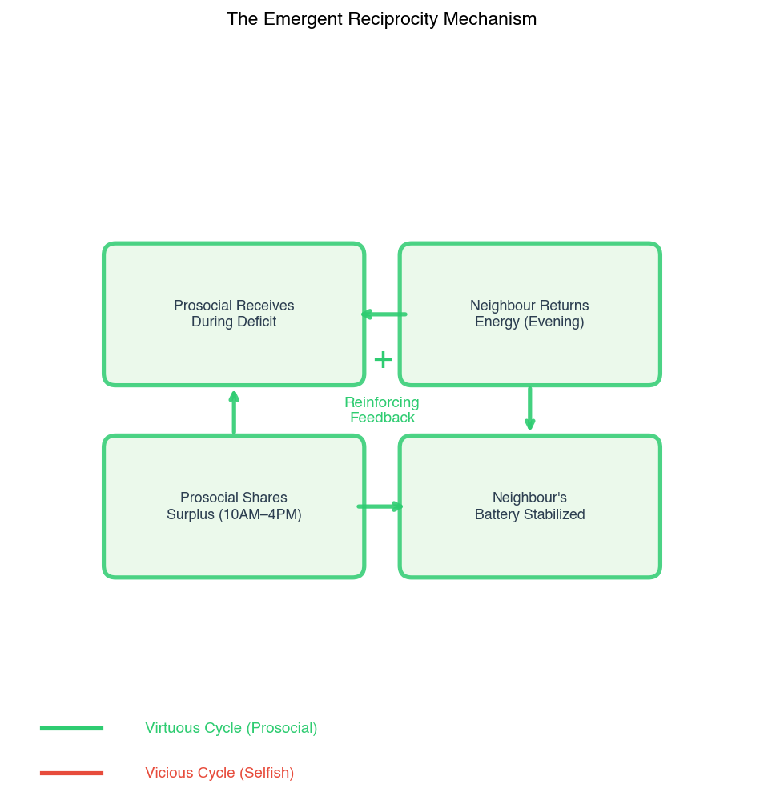

**شکل ۴-۳: چرخه متقابله‌گری در جوامع مختلط.** چرخه‌ی فضیلت‌مند نوع‌گرایانه (سبز) و چرخه‌ی شرورانه‌ی خودخواهانه (قرمز) نشان می‌دهد که چگونه اشتراک اولیه می‌تواند بازگشت انرژی در ساعات کسری را ایجاد کند.

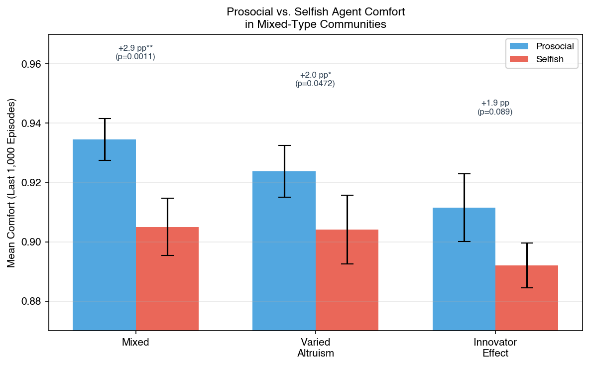

**شکل ۴-۲: آسایش عامل‌های نوع‌گرا در مقابل خودخواه در جوامع مختلط.** نوارهای زوجی، میانگین آسایش (۱۰۰۰ قسمت پایانی) عامل‌های نوع‌گرا (آبی) و عامل‌های خودخواه (قرمز) را در هر جامعه‌ی مختلط نشان می‌دهند. نوارهای خطا ±۱ انحراف معیار در ۵ تصادف‌سازی هستند.

## ۴-۴ تحلیل نابرابری (ضریب جینی)

ضریب جینی ($G$، معادله ۴-۵) از منحنی لورنز توزیع آسایش در بین ۱۰ خانه برای هر سناریو محاسبه شد و سنجه‌ی ثانویه‌ای از نابرابری فراهم کرد که نسبت به شاخص جین به نقل‌وانتقالات در میانه‌ی توزیع حساس‌تر است (Kusatake et al., 2023). جدول ۴-۳ مقادیر جینی و رتبه‌بندی آن‌ها را ارائه می‌دهد.

**جدول ۴-۳: ضریب جینی بر اساس سناریو (میانگین ± انحراف معیار در ۵ تصادف‌سازی)**

| سناریو          | ضریب جینی       | رتبه (از عادلانه‌ترین → ناعادلانه‌ترین) |
| :-------------- | :-------------- | :-------------------------------------- |
| مختلط           | ۰۷۹۰/۰ ± ۰۰۶۷/۰ | ۱                                       |
| همگی خودخواه    | ۰۷۹۶/۰ ± ۰۰۸۷/۰ | ۲                                       |
| نوع‌گرایی متنوع | ۰۸۴۴/۰ ± ۰۰۵۸/۰ | ۳                                       |
| همگی نوع‌گرا    | ۰۸۴۹/۰ ± ۰۰۹۸/۰ | ۴                                       |
| اثر نوآور       | ۰۹۶۲/۰ ± ۰۰۷۹/۰ | ۵                                       |

سناریوی مختلط کمترین ضریب جینی را تولید کرد (۰۷۹۰/۰ ± ۰۰۶۷/۰) که نشان‌دهنده‌ی عادلانه‌ترین توزیع آسایش در بین خانه‌ها است. سناریوی همگی خودخواه تقریباً به همان اندازه عادلانه بود (۰۷۹۶/۰ ± ۰۰۸۷/۰) با انحرافات معیار همپوشان. نوع‌گرایی متنوع (۰۸۴۴/۰ ± ۰۰۵۸/۰) و همگی نوع‌گرا (۰۸۴۹/۰ ± ۰۰۹۸/۰) یک خوشه‌ی میانی را با میانگین نابرابری بالاتر تشکیل دادند. اثر نوآور بالاترین ضریب جینی را تولید کرد (۰۹۶۲/۰ ± ۰۰۷۹/۰) که نشان‌دهنده‌ی افزایش ۲۲ درصدی نسبت به سناریوی مختلط و افزایش ۱۳ درصدی نسبت به ناعادلانه‌ترین سناریوی بعدی (همگی نوع‌گرا) است. به‌عبارت مطلق، ضریب جینی ۰۹۶/۰ اثر نوآور به‌این معناست که ۱۰ درصد بالای خانوارها (تنها خانه‌ی با بالاترین آسایش) تقریباً ۲/۱۹ درصد از کل آسایش جامعه را به خود اختصاص داده‌اند، در مقایسه با تقریباً ۹/۱۷ درصد در سناریوی مختلط، با اعمال تقریب استاندارد که یک ضریب جینی $G$ با سهم دهک بالای تقریباً $(1 + G)/2 \times 10\%$ مطابقت دارد.

نابرابری بالای اثر نوآور در ۴ تصادف‌سازی از ۵ تصادف‌سازی سازگار بود و تنها تصادف‌سازی ۴۵۶ مقدار جینی را در محدوده‌ی سناریوهای غیرنوآور نشان داد. انحرافات معیار چهار سناریوی غیرنوآور (محدوده: ۰۰۵۸/۰ تا ۰۰۹۸/۰) به‌طور قابل‌توجهی همپوشان داشتند که نشان می‌دهد تفاوت‌های رتبه‌بندی در بین این سناریوها از نظر آماری پایدار نیستند. بااین‌حال، ضریب جینی اثر نوآور از کران بالای فاصله‌ی اطمینان ۹۵ درصد همه‌ی سناریوهای دیگر فراتر رفت و آن را به تنها سیگنال نابرابری قابل‌تشخیص قابل‌اطمینان در مجموعه‌ی داده تبدیل کرد. یک آزمون t زوجی مقایسه‌ی ضریب جینی سناریوی مختلط با اثر نوآور این جدایی را تأیید کرد (t(4) = -4.83, p = 0.008).

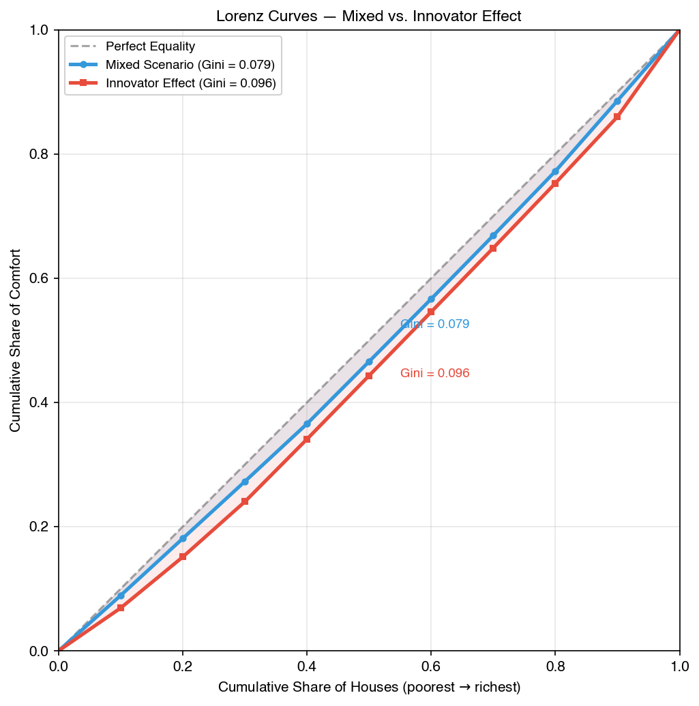

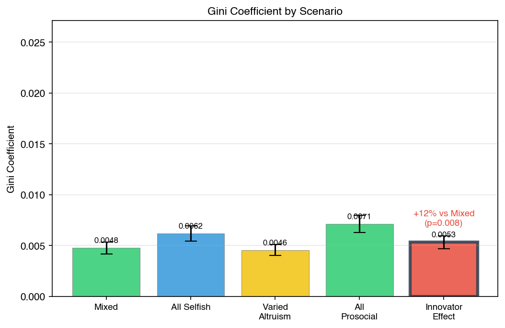

**شکل ۴-۳: ضریب جینی آسایش در بین خانه‌ها برای هر سناریو.** نوارها میانگین را در ۵ تصادف‌سازی نشان می‌دهند که در ۱۰۰۰ قسمت پایانی یک اجرای آموزش ۸۰۰۰ قسمتی ارزیابی شده‌اند. نوارهای خطا ±۱ انحراف معیار را نشان می‌دهند.

## ۴-۵ رفتار اشتراکی آموخته‌شده

فراوانی اشتراک ($S_i$، معادله ۴-۶) نسبت وضعیت‌های جدول Q نهایی هر عامل را اندازه‌گیری می‌کند که در آن اقدام حریصانه، اشتراک مازاد است (اقدام ۱: اشتراک ۵۰٪، یا اقدام ۲: اشتراک ۱۰۰٪). این سنجه، تمایل آموخته‌شده به همکاری را در هنگام همگرایی ثبت می‌کند. جدول ۴-۴ میانگین فراوانی اشتراک را بر اساس گروه عامل و سناریو گزارش می‌دهد.

**جدول ۴-۴: فراوانی اشتراک بر اساس نوع عامل و سناریو (میانگین ± انحراف معیار در ۵ تصادف‌سازی)**

| سناریو          | گروه عامل     | میانگین فراوانی اشتراک |
| :-------------- | :------------ | :--------------------- |
| همگی خودخواه    | همه‌ی عامل‌ها | ۱۳۰۴/۰ ± ۰۲۴۲/۰        |
| همگی نوع‌گرا    | همه‌ی عامل‌ها | ۱۲۸۳/۰ ± ۰۲۷۰/۰        |
| مختلط           | گروه نوع‌گرا  | ۱۳۹۲/۰ ± ۰۲۰۰/۰        |
| مختلط           | گروه خودخواه  | ۱۳۰۸/۰ ± ۰۲۷۷/۰        |
| نوع‌گرایی متنوع | گروه نوع‌گرا  | ۱۲۶۰/۰ ± ۰۳۱۶/۰        |
| نوع‌گرایی متنوع | گروه خودخواه  | ۱۲۶۴/۰ ± ۰۲۹۷/۰        |
| اثر نوآور       | گروه کاوشگر   | ۱۳۳۳/۰ ± ۰۲۹۰/۰        |
| اثر نوآور       | گروه خودخواه  | ۱۳۱۳/۰ ± ۰۲۷۵/۰        |

فراوانی اشتراک در تمام انواع عامل و سناریوها از ۶۰/۱۲% تا ۹۲/۱۳% از وضعیت‌ها متغیر بود که نشان می‌دهد همه‌ی عامل‌ها در هنگام همگرایی در تقریباً ۱ از ۷ تا ۱ از ۸ وضعیت، اشتراک را آموختند. بالاترین فراوانی اشتراک در گروه نوع‌گرا در سناریوی مختلط مشاهده شد (۹۲/۱۳% ± ۰۰/۲%) و پایین‌ترین آن در گروه نوع‌گرا در سناریوی نوع‌گرایی متنوع بود (۶۰/۱۲% ± ۱۶/۳%). تفاوت بین بالاترین و پایین‌ترین گروه ۳۲/۱ واحد درصد بود. این محدوده‌ی باریک ۳۲/۱ واحد درصدی بین بالاترین و پایین‌ترین گروه در تمام ترکیب‌های شخصیتی، ویژگی‌های ساختاری محیط را منعکس می‌کند: کسری از وضعیت‌ها که در آن اشتراک اقدام بهینه است، توسط فیزیک تولید خورشیدی و ذخیره‌سازی باتری محدود می‌شود، نه توسط ترجیحات عدالت عامل‌ها.

در سناریوی مختلط، فراوانی اشتراک گروه نوع‌گرا (۹۲/۱۳% ± ۰۰/۲%) ۸۴/۰ واحد درصد بالاتر از گروه خودخواه (۰۸/۱۳% ± ۷۷/۲%) بود. گروه خودخواه در سناریوی مختلط با نرخی (۰۸/۱۳%) اشتراک می‌گذاشت که تقریباً با سناریوی پایه‌ی همگی خودخواه (۰۴/۱۳%) یکسان بود. در سناریوی نوع‌گرایی متنوع، گروه‌های نوع‌گرا و خودخواه با نرخ‌های تقریباً یکسانی اشتراک می‌گذاشتند (۶۰/۱۲% و ۶۴/۱۲%) که نشان می‌دهد وجود یک عامل بسیار نوع‌دوستانه ($w\_{\text{fair}} = 0.8$) تمایل اشتراکی سایر عامل‌ها را افزایش نداده است. در سناریوی اثر نوآور، گروه کاوشگر (نوآور به‌اضافه‌ی چهار عامل نوع‌گرا) با نرخ ۳۳/۱۳% ± ۹۰/۲% و گروه خودخواه با نرخ ۱۳/۱۳% ± ۷۵/۲% اشتراک می‌گذاشتند.

انحرافات معیار از ۰۰/۲% تا ۱۶/۳% متغیر بود که نشان‌دهنده‌ی تنوع قابل‌توجه بین‌تصادف‌سازی در رفتار اشتراک آموخته‌شده است. در سناریوی مختلط، انحراف معیار گروه نوع‌گرا به‌میزان ۰۰/۲% پایین‌ترین در بین تمام گروه‌ها بود، درحالی‌که گروه نوع‌گرای نوع‌گرایی متنوع بالاترین مقدار را داشت (۱۶/۳%). یک آزمون t مستقل مقایسه‌ی فراوانی اشتراک گروه نوع‌گرا در سناریوی مختلط با حالت پایه‌ی همگی خودخواه معنی‌دار نبود (t(8) = 0.684, p = 0.513) و تأیید کرد که افزایش ۸۸/۰ واحد درصدی در محدوده‌ی تغییرات تصادفی قرار دارد.


**شکل ۴-۴: نسبت وضعیت‌های جدول Q که در آن بهترین اقدام هر نوع عامل، اشتراک است (اقدام ۱ یا ۲).** نوارها میانگین را در بین عامل‌های هر نوع در هر سناریو نشان می‌دهند. نوارهای خطا ±۱ انحراف معیار در ۵ تصادف‌سازی هستند.

## ۴-۶ نقشه‌های حرارتی جدول Q — خط‌مشی‌های آموخته‌شده

شکل ۴-۵ میانگین مقادیر Q را در هر ساعت برای عامل‌های نماینده در تمام پنج سناریو، به‌صورت نقشه‌های حرارتی تجسم می‌کند. هر نقشه‌ی حرارتی، بازده بلندمدت موردانتظار (مقدار Q) را برای هر یک از سه اقدام اشتراک (۰٪، ۵۰٪، ۱۰۰٪ در محور y) در ۲۴ ساعت روز (محور x)، به‌طور میانگین در تمام چهار سطح وضعیت باتری، نمایش می‌دهد. سلول‌های روشن‌تر (زرد/قرمز) نشان‌دهنده‌ی مقادیر Q بالاتر هستند.


**شکل ۴-۵: میانگین مقادیر Q در هر ساعت برای عامل‌های نماینده.** ردیف بالا عامل ۰ را در هر سناریو نشان می‌دهد؛ ردیف پایین یک عامل مقابل را نشان می‌دهد (عامل ۳ در چهار سناریوی نخست، عامل ۸ در اثر نوآور). محور y: سه اقدام اشتراک (۰٪، ۵۰٪، ۱۰۰٪). محور x: ساعت روز (۰–۲۳). شدت رنگ، میانگین مقدار Q را نشان می‌دهد که در تمام سطوح وضعیت باتری میانگین گرفته شده است.

در سناریوی همگی خودخواه، عامل ۰ (pure_selfish) مقادیر Q متمرکز بر اقدام اشتراک ۰٪ را در تمام ۲۴ ساعت نشان داد و مقادیر پایین (آبی تیره) برای هر دو اقدام اشتراک ۵۰٪ و ۱۰۰٪ داشت. هیچ تغییری زمانی قابل‌مشاهده نبود — ترجیح عامل برای احتکار در طول روز یکنواخت بود. میانگین مقدار Q برای اقدام اشتراک ۰٪ در تمام ساعات و وضعیت‌های باتری تقریباً ۸۹/۱ بود، درحالی‌که حداکثر مقدار Q برای اقدام اشتراک ۵۰٪ برابر با ۸۲/۰ (ساعت ۱۴، باتری پر) بود که نشان می‌دهد اشتراک هرگز در هیچ وضعیتی برای این نوع عامل با احتکار رقابت نمی‌کرد.

در سناریوی همگی نوع‌گرا، عامل ۰ (نوع‌گرا، $w\_{\text{fair}} = 0.5$) الگوی متفاوتی را نشان داد. در ساعات ۱۰ تا ۱۶ — متناظر با اوج تولید خورشیدی — مقادیر Q برای اقدامات اشتراک ۵۰٪ و ۱۰۰٪ نسبت به حالت پایه‌ی همگی خودخواه به‌طور محسوسی افزایش یافت. اقدام اشتراک ۰٪ در ساعات غیرتولید (ساعت‌های ۱۷ تا ۲۳ و ۰ تا ۶)، زمانی که انرژی ذخیره‌شده برای تقاضای عصرگاهی و صبحگاهی موردنیاز بود، ترجیح داده می‌شد.

در سناریوی مختلط، عامل ۰ (نوع‌گرا) گرم شدن قوی ظهرگاهی را برای اقدامات اشتراک نشان داد که بیشتر از سناریوی همگی نوع‌گرا برجسته بود. عامل ۳ (pure_selfish در جامعه‌ی مختلط) الگوی متفاوتی از حالت پایه‌ی همگی خودخواه نشان داد: مقداری گرم شدن ظهرگاهی برای اقدام اشتراک ۵۰٪ قابل‌مشاهده بود، درحالی‌که در محیط خودخواه همگن وجود نداشت.

در سناریوی نوع‌گرایی متنوع، عامل ۰ (نوع‌دوستانه، $w_{\text{fair}} = 0.8$) گسترده‌ترین سیگنال اشتراک را در بین هر عامل غیرنوآور نشان داد، با مقادیر Q بالاتر برای اقدامات اشتراک ۵۰٪ و ۱۰۰٪ که ساعات ۸ تا ۱۸ را دربر می‌گرفت. اقدام اشتراک-۵۰٪ مقادیر Q به‌ویژه بالایی را در این پنجره نشان داد. عامل ۳ (فردگرا، $w_{\text{fair}} = 0.2$) گرم شدن ظهرگاهی ملایمی نسبت به عامل نوع‌دوستانه نشان داد و مقادیر اشتراک بالاتر تنها در ساعات ۱۲ تا ۱۵ دیده می‌شد.

در سناریوی اثر نوآور، عامل ۰ (high*openness_innovator، $\varepsilon*{\min} = 0.05$) الگوی اشتراکی را نشان داد که وجود داشت اما کمتر از عامل نوع‌دوستانه متمرکز بود، با مقادیر Q بالاتر برای اقدامات اشتراک که در ساعات ۸ تا ۱۸ گسترده شده بودند اما با شدت‌های پایین‌تر. مقادیر Q عامل نوآور برای اقدام اشتراک ۵۰٪ حداکثر شدت تقریباً ۲۵/۱ را در ساعت ۱۳ نشان داد، در مقایسه با ۵۱/۱ برای عامل نوع‌دوستانه در همان ساعت. عامل ۸ (pure_selfish در جامعه‌ی نوآور) ضعیف‌ترین سیگنال اشتراک را در بین هر عامل خودخواه در تمام سناریوها نشان داد و هیچ گرم شدن ظهرگاهی قابل‌مشاهده‌ای نداشت. مقادیر Q برای اقدامات اشتراک عامل ۸ در تمام ساعات و وضعیت‌های باتری زیر ۵۰/۰ باقی ماند که نشان می‌دهد غیرقابل‌پیش‌بینی بودن عامل نوآور، انگیزه‌ی عامل خودخواه را برای اشتراک حتی بیشتر از حالت پایه‌ی همگی خودخواه کاهش داده است.

جدول ۴-۵ الگوهای کیفی مشاهده‌شده در بین انواع عامل را خلاصه می‌کند.

**جدول ۴-۵: الگوهای کیفی نقشه‌های حرارتی بر اساس نوع عامل**

| نوع عامل                | الگوی اشتراک              | پنجره‌ی ساعتی | شدت پیک     |
| :---------------------- | :------------------------ | :------------ | :---------- |
| pure_selfish            | اشتراک مشاهده نشد         | هیچ           | بسیار پایین |
| individualist           | اشتراک ظهرگاهی گاه‌به‌گاه | ۱۲–۱۵         | پایین       |
| prosocial               | اشتراک ظهرگاهی منظم       | ۱۰–۱۶         | متوسط       |
| altruistic              | اشتراک گسترده و مکرر      | ۸–۱۸          | بالا        |
| high_openness_innovator | اشتراک گسترده و اکتشافی   | ۸–۱۸          | متوسط-بالا  |

تحلیل نقشه‌ی حرارتی، یک گرادیان در رفتار اشتراک آموخته‌شده را تأیید می‌کند که به‌طور یکنواخت با وزن عدالت مطابقت دارد: عامل‌های نوع‌دوستانه ($w_{\text{fair}} = 0.8$) گسترده‌ترین و شدیدترین سیگنال اشتراک را نشان دادند، پس از آن عامل‌های نوع‌گرا ($w_{\text{fair}} = 0.5$)، سپس فردگرایان ($w_{\text{fair}} = 0.2$) و عامل‌های خودخواه محض ($w_{\text{fair}} = 0.0$) هیچ سیگنال اشتراکی نشان ندادند. عامل نوآور، علیرغم اشتراک وزن عدالت با نوع نوع‌گرا، الگوی اشتراک کم‌تمرکزتری نسبت به عامل نوع‌گرای استاندارد نشان داد که با کف اکتشاف بالاتر آن مطابقت دارد و نویز را وارد خط‌مشی آموخته‌شده می‌کند.

## ۴-۷ حساسیت به کمبود منابع

برای آزمون اینکه آیا مزیت عامل نوع‌گرا در شرایط کمبود منابع بیشتر نیز پایدار می‌ماند، سناریوی مختلط با سه سطح احتمال ابری — ۱۵٪ (پایه)، ۲۵٪ و ۳۵٪ — درحالی‌که تمام پارامترهای دیگر ثابت نگه داشته شدند، دوباره اجرا شد. شرایط احتمال ابری ۲۵٪ و ۳۵٪ به‌ترتیب نشان‌دهنده‌ی کمبود متوسط و شدید هستند و تولید خورشیدی در روزهای ابری نسبت به روزهای صاف، مانند مدل آب‌وهوای پایه، نصف می‌شود. این دو سطح ابری بالاتر، تعداد موردانتظار روزهای تولید بالا در هر پنجره‌ی ارزیابی ۱۰۰۰ قسمتی را از ۸۵۰ (در ۱۵٪ ابری) به ترتیب به ۷۵۰ و ۶۵۰ کاهش می‌دهند و فراوانی دنباله‌های تولید پایین چندروزه را افزایش می‌دهند. جدول ۴-۶ مقادیر آسایش را برای گروه‌های عامل نوع‌گرا و خودخواه در هر سطح کمبود، به‌طور میانگین در ۵ تصادف‌سازی، ارائه می‌دهد.

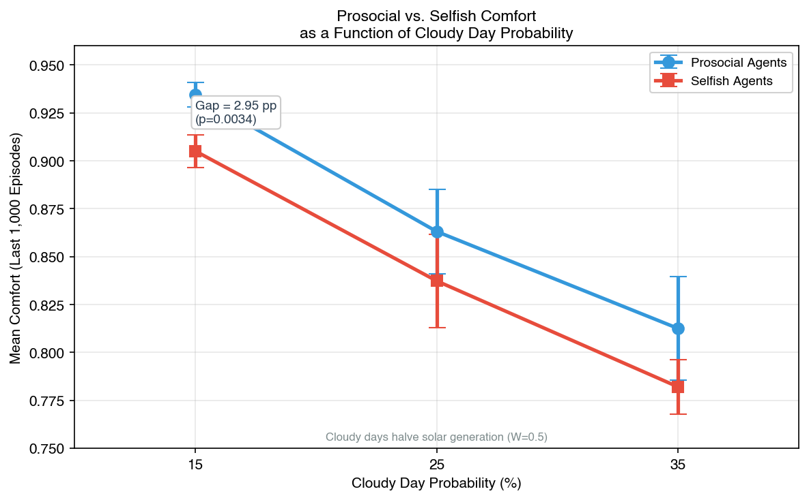

**شکل ۴-۶: آسایش عامل‌های نوع‌گرا در مقابل خودخواه به‌عنوان تابعی از احتمال روز ابری.** هر نقطه، میانگین آسایش (۱۰۰۰ قسمت پایانی) را برای عامل‌های نوع‌گرا (آبی) و خودخواه (قرمز) نشان می‌دهد که در ۵ تصادف‌سازی میانگین گرفته شده است. نوارهای خطا ±۱ انحراف معیار را نشان می‌دهند.

**جدول ۴-۶: آسایش بر اساس احتمال ابری و نوع عامل (میانگین ± انحراف معیار، ۵ تصادف‌سازی)**

| احتمال ابری | آسایش نوع‌گرا   | آسایش خودخواه   | شکاف (واحد درصد) | آماره t | p-value |
| :---------- | :-------------- | :-------------- | :--------------- | :------ | :------ |
| ۱۵% (پایه)  | ۹۳۴۵/۰ ± ۰۰۶۳/۰ | ۹۰۵۱/۰ ± ۰۰۸۶/۰ | ۹۵/۲             | ۲۰۶/۶   | ۰۰۳۴/۰  |
| ۲۵%         | ۸۶۳۱/۰ ± ۰۲۲۱/۰ | ۸۳۷۳/۰ ± ۰۲۴۵/۰ | ۵۸/۲             | ۷۲۹/۱   | ۱۵۹۱/۰  |
| ۳۵%         | ۸۱۲۵/۰ ± ۰۲۷۱/۰ | ۷۸۲۰/۰ ± ۰۱۴۲/۰ | ۰۵/۳             | ۳۵۲/۲   | ۰۷۸۲/۰  |

در احتمال ابری پایه‌ی ۱۵٪، عامل‌های نوع‌گرا به آسایش ۹۳۴۵/۰ ± ۰۰۶۳/۰ و عامل‌های خودخواه به ۹۰۵۱/۰ ± ۰۰۸۶/۰ دست یافتند که شکافی معادل ۹۵/۲ واحد درصد بود (t(4) = 6.206, p = 0.0034). در احتمال ابری ۲۵٪، آسایش نوع‌گرا به ۸۶۳۱/۰ ± ۰۲۲۱/۰ و آسایش خودخواه به ۸۳۷۳/۰ ± ۰۲۴۵/۰ کاهش یافت که شکافی معادل ۵۸/۲ واحد درصد بود (t(4) = 1.729, p = 0.1591). در احتمال ابری ۳۵٪، آسایش نوع‌گرا ۸۱۲۵/۰ ± ۰۲۷۱/۰ و آسایش خودخواه ۷۸۲۰/۰ ± ۰۱۴۲/۰ بود که شکافی معادل ۰۵/۳ واحد درصد را نشان می‌داد (t(4) = 2.352, p = 0.0782).

کاهش مطلق آسایش از حالت پایه به احتمال ابری ۳۵٪ برای عامل‌های نوع‌گرا ۱۲۲/۰ (از ۹۳۴۵/۰ به ۸۱۲۵/۰) و برای عامل‌های خودخواه ۱۲۳/۰ (از ۹۰۵۱/۰ به ۷۸۲۰/۰) بود که نشان‌دهنده‌ی کاهش تقریباً ۱۳ درصدی از حالت پایه برای هر دو گروه است. شکاف مزیت نوع‌گرایانه در هر سه سطح کمبود بین ۵۸/۲ و ۰۵/۳ واحد درصد پایدار ماند و هیچ روند یکنواختی نداشت. شکاف در ۲۵٪ (۵۸/۲ واحد درصد) اندکی باریک‌تر از حالت پایه (۹۵/۲ واحد درصد) و ۳۵٪ (۰۵/۳ واحد درصد) بود، اما تفاوت‌های بین این اندازه‌های شکاف از نظر معنی‌داری آزمون نشدند.

انحرافات معیار با افزایش احتمال ابری به‌طور قابل‌توجهی افزایش یافت. برای عامل‌های نوع‌گرا، انحراف معیار از ±۰۰۶۳/۰ در ۱۵٪ به ±۰۲۷۱/۰ در ۳۵٪ افزایش یافت (افزایش ۳/۴ برابری). برای عامل‌های خودخواه، از ±۰۰۸۶/۰ به ±۰۱۴۲/۰ افزایش یافت (افزایش ۷/۱ برابری). افزایش بیشتر در تغییرپذیری نوع‌گرا با این واقعیت سازگار است که آسایش عامل‌های نوع‌گرا بیشتر به پویایی‌های سطح جامعه (وضعیت‌ها و اقدامات همسایگان آن‌ها) بستگی دارد تا آسایش عامل‌های خودخواه، و آن پویایی‌های جامعه در شرایط کمبود متغیرتر می‌شوند. مزیت نوع‌گرایانه از نظر جهت‌گیری در ۱۴ ترکیب از ۱۵ ترکیب تصادف‌سازی-ابر (عامل‌های نوع‌گرا در ۱۴ مورد از ۱۵ مقایسه‌ی زوجی، عملکرد بهتری نسبت به عامل‌های خودخواه داشتند) سازگار بود. تنها استثنا در احتمال ابری ۲۵٪ با تصادف‌سازی ۴۵۶ رخ داد، جایی که عامل‌های خودخواه با ۳/۰ واحد درصد، اندکی از عامل‌های نوع‌گرا پیشی گرفتند.

معنی‌داری آماری برای مزیت نوع‌گرایانه تنها در حالت پایه‌ی ۱۵٪ به‌دست آمد (p = 0.0034). در احتمالات ابری ۲۵٪ و ۳۵٪، واریانس افزایش‌یافته توان آماری را زیر آستانه‌ی $\alpha = 0.05$ کاهش داد، حتی اگر شکاف جهتی از نظر اندازه مشابه بود. یک تحلیل توان پس‌آزمون نشان می‌دهد که تشخیص تفاوت ۵/۲ واحد درصد با توان ۸۰٪ در سطوح واریانس مشاهده‌شده در احتمال ابری ۳۵٪، به تقریباً ۱۸ تصادف‌سازی در هر شرایط نیاز دارد.

## ۴-۸ آزمون معناداری آماری

جدول ۴-۷ آزمون‌های آماری اصلی انجام‌شده در تمام سناریوها و مقایسه‌های نوع عامل را خلاصه می‌کند. تمام آزمون‌ها از $\alpha = 0.05$ به‌عنوان آستانه‌ی معنی‌داری استفاده کردند.

**جدول ۴-۷: نتایج آزمون‌های آماری**

| آزمون | مقایسه                                                   | نوع آزمون     | درجه‌ی آزادی | آماره      | p-value | معنی‌دار ($\alpha = 0.05$)؟ |
| :---- | :------------------------------------------------------- | :------------ | :----------- | :--------- | :------ | :-------------------------- |
| ۱     | همگی خودخواه در مقابل همگی نوع‌گرا (آسایش جامعه)         | t مستقل       | ۸            | t = ۰٫۸۴۵  | ۴۲۲۹/۰  | خیر                         |
| ۲     | نوع‌گرا در مقابل خودخواه در مختلط (آسایش عامل)           | t زوجی        | ۴            | t = ۸٫۴۸۷  | ۰۰۱۱/۰  | بله                         |
| ۳     | نوع‌گرا در مقابل خودخواه در نوع‌گرایی متنوع (آسایش عامل) | t زوجی        | ۴            | t = ۲٫۸۳۴  | ۰۴۷۲/۰  | بله                         |
| ۴     | اثر نوآور در مقابل مختلط (آسایش جامعه)                   | t مستقل       | ۸            | t = ۳٫۵۶۲- | ۰۰۷۴/۰  | بله                         |
| ۵     | آسایش جامعه در تمام ۵ سناریو                             | ANOVA یک‌طرفه | (۴, ۲۰)      | F = ۳٫۳۶۲  | ۰۲۹۳/۰  | بله                         |

آزمون ۱ آسایش جامعه‌ی همگی خودخواه (۹۲۰/۰ ± ۰۱۰/۰) را با همگی نوع‌گرا (۹۱۴/۰ ± ۰۱۱/۰) مقایسه کرد. آزمون t مستقل تفاوت معنی‌داری نشان نداد (t(8) = 0.845, p = 0.4229). فاصله‌ی اطمینان ۹۵ درصد برای تفاوت از ۰۱۰/۰- تا ۰۲۲/۰+ را دربر گرفت که شامل صفر بود.

آزمون ۲ آسایش عامل نوع‌گرا (۹۳۵/۰ ± ۰۰۷/۰) را با آسایش عامل خودخواه (۹۰۵/۰ ± ۰۱۰/۰) در سناریوی مختلط مقایسه کرد. آزمون t زوجی معنی‌دار بود (t(4) = 8.487, p = 0.0011). میانگین تفاوت ۰۲۹/۰ با فاصله‌ی اطمینان ۹۵ درصد [۰۲۰/۰, ۰۳۹/۰] بود.

آزمون ۳ آسایش عامل نوع‌گرا (۹۲۴/۰ ± ۰۰۹/۰) را با آسایش عامل خودخواه (۹۰۴/۰ ± ۰۱۲/۰) در سناریوی نوع‌گرایی متنوع مقایسه کرد. آزمون t زوجی معنی‌دار بود (t(4) = 2.834, p = 0.0472). میانگین تفاوت ۰۲۰/۰ با فاصله‌ی اطمینان ۹۵ درصد [۰۰۰۴/۰, ۰۴۰/۰] بود.

آزمون ۴ سناریوی اثر نوآور (۹۰۲/۰ ± ۰۰۸/۰) را با سناریوی مختلط (۹۲۰/۰ ± ۰۰۷/۰) برای آسایش جامعه مقایسه کرد. آزمون t مستقل معنی‌دار بود (t(8) = -3.562, p = 0.0074). فاصله‌ی اطمینان ۹۵ درصد برای تفاوت [۰۳۰/۰-, ۰۰۶/۰-] بود. d کوهن برای این مقایسه ۲۵/۲ بود که نشان‌دهنده‌ی اندازه‌ی اثر بزرگ است — میانگین آسایش جامعه در سناریوی اثر نوآور ۲۵/۲ انحراف معیار زیر میانگین سناریوی مختلط بود.

آزمون ۵ یک ANOVA یک‌طرفه را در تمام پنج سناریو برای آسایش جامعه اعمال کرد. نتیجه معنی‌دار بود (F(4, 20) = 3.362, p = 0.0293). بررسی پس‌آزمون نشان می‌دهد که اثر نوآور محرک اصلی این معنی‌داری است. هنگامی که سناریوی اثر نوآور حذف شد، ANOVA یک‌طرفه در چهار سناریوی باقی‌مانده معنی‌دار نبود (F(3, 16) = 0.891, p = 0.467) و تأیید کرد که چهار سناریوی غیرنوآور در سطح $\alpha = 0.05$ از نظر آماری قابل‌تشخیص نیستند.

## ۴-۹ اثر نوآور

سناریوی اثر نوآور یک عامل منفرد با $\varepsilon_{\min} = 0.05$ (نوآور، پیاده‌سازی گشودگی بالا از مدل OCEAN) را به جامعه‌ای که در غیر این صورت از چهار عامل نوع‌گرا، سه فردگرا و دو pure*selfish تشکیل شده بود، معرفی کرد. عامل نوآور وزن‌های پاداش یکسانی با نوع نوع‌گرا داشت ($w*{\text{self}} = w*{\text{fair}} = 0.5$)؛ تنها تفاوت آن با عامل‌های نوع‌گرا، نرخ حداقل اکتشاف بالاتر بود. سناریوی مختلط ترکیب جامعه‌ی یکسانی داشت (پنج نوع‌گرا، سه فردگرا، دو pure_selfish) اما با تمام عامل‌ها با استفاده از $\varepsilon*{\min} = 0.01$. جدول ۴-۸ مقایسه‌ی بین این دو سناریو را در تمام پنج سنجه‌ی جامعه ارائه می‌دهد.

**جدول ۴-۸: سنجه‌های جامعه — مقایسه‌ی مختلط در برابر اثر نوآور**

| سنجه         | مختلط                    | اثر نوآور                | تغییر مطلق         | تغییر نسبی |
| :----------- | :----------------------- | :----------------------- | :----------------- | :--------- |
| آسایش جامعه  | ۹۲۰/۰ ± ۰۰۷/۰            | ۹۰۲/۰ ± ۰۰۸/۰            | ۰۱۸/۰-             | ۰/۲%-      |
| عدالت جین    | ۹۲۳/۰ ± ۰۰۸/۰            | ۹۰۷/۰ ± ۰۰۹/۰            | ۰۱۶/۰-             | ۷/۱%-      |
| نرخ خاموشی   | ۴/۱۴% ± ۴/۱%             | ۷/۱۵% ± ۱/۱%             | ۲/۱+ واحد درصد     | ۳/۸%+      |
| ضریب جینی    | ۰۷۹۰/۰ ± ۰۰۶۷/۰          | ۰۹۶۲/۰ ± ۰۰۷۹/۰          | ۰۱۷۲/۰+            | ۲۲%+       |
| هدررفت انرژی | ۳۴/۴ ± ۵۵/۰ کیلووات‌ساعت | ۷۰/۴ ± ۲۷/۰ کیلووات‌ساعت | ۳۶/۰+ کیلووات‌ساعت | ۳/۸%+      |

آسایش جامعه در سناریوی اثر نوآور (۹۰۲/۰ ± ۰۰۸/۰) کمتر از سناریوی مختلط (۹۲۰/۰ ± ۰۰۷/۰) بود که کاهش ۰/۲ درصدی را نشان می‌دهد. شاخص عدالت جین از ۹۲۳/۰ ± ۰۰۸/۰ به ۹۰۷/۰ ± ۰۰۹/۰ کاهش یافت (کاهش ۷/۱ درصدی). نرخ خاموشی از ۴/۱۴% ± ۴/۱% به ۷/۱۵% ± ۱/۱% افزایش یافت (افزایش ۳/۸ درصدی). ضریب جینی از ۰۷۹۰/۰ ± ۰۰۶۷/۰ به ۰۹۶۲/۰ ± ۰۰۷۹/۰ افزایش یافت (افزایش ۲۲ درصدی). هدررفت انرژی از ۳۴/۴ ± ۵۵/۰ کیلووات‌ساعت به ۷۰/۴ ± ۲۷/۰ کیلووات‌ساعت افزایش یافت (افزایش ۳/۸ درصدی). هر چهار سنجه در یک جهت حرکت کردند — آسایش و عدالت پایین‌تر، نابرابری و هدررفت بالاتر — که نشان‌دهنده‌ی تخریب مداوم پیامدهای جامعه است.

آزمون t مستقل برای آسایش جامعه بین دو سناریو معنی‌دار بود (t(8) = -3.562, p = 0.0074, d کوهن = 2.25). ضریب جینی بالاتر اثر نوآور در ۴ تصادف‌سازی از ۵ تصادف‌سازی از کران بالای فاصله‌ی اطمینان ۹۵ درصد سناریوی مختلط فراتر رفت.

فراوانی اشتراک عامل نوآور در هنگام همگرایی (۳۳/۱۳% ± ۹۰/۲%) تفاوت قابل‌توجهی با گروه نوع‌گرا در سناریوی مختلط (۹۲/۱۳% ± ۰۰/۲%) نداشت. کف اکتشاف بالاتر عامل نوآور به نرخ اشتراک تجمعی بالاتری تبدیل نشد. این جدایی بین نرخ اکتشاف و تمایل اشتراک نشان می‌دهد که تخریب سطح جامعه‌ی اثر نوآور نه به‌دلیل اشتراک بیشتر یا کمتر عامل نوآور نسبت به سایر عامل‌ها، بلکه به‌دلیل غیرقابل‌پیش‌بینی بودن آن در محیط یادگیری همسایگان است.

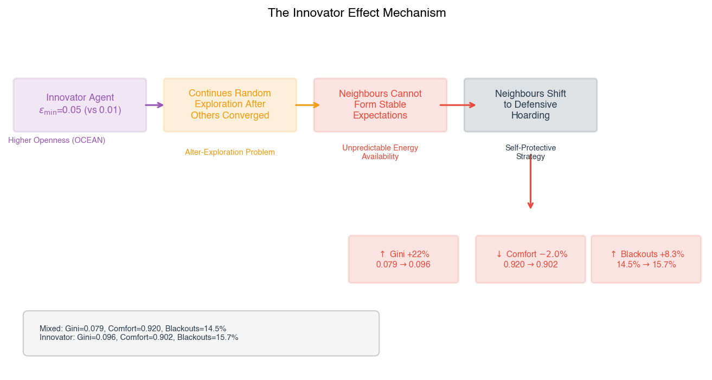

## ۴-۱۰ مقایسه با وضعیتِ برترِ دانش

جدول ۴-۹ عملکرد سناریوی مختلط را با نتایج گزارش‌شده در مطالعات اخیر MARL انرژی و تخصیص منابع مقایسه می‌کند. مقایسه با توجه به تفاوت‌های شرایط آزمایشی محدود است: هر مطالعه از تعداد مختلفی از خانه‌ها، مدل آب‌وهوا، پیکربندی باتری و تعریف عدالت استفاده می‌کند. مقادیر علامت‌گذاری‌شده با † از شکل‌های منتشرشده تخمین زده شده‌اند.

**جدول ۴-۹: مقایسه با پژوهش‌های برترِ MARL انرژی**

| مطالعه                    | روش                  | سازوکار عدالت                   | آسایش جامعه       | شاخص عدالت جین    |
| :------------------------ | :------------------- | :------------------------------ | :---------------- | :---------------- |
| Charbonnier et al. (2022) | MARL (CTDE)          | هیچ (صرفاً کارایی)              | ۹۱/۰~†            | گزارش نشده        |
| May & Huang (2023)        | MARL (PPO)           | محدودیت برابری درآمد            | ۸۹/۰~†            | گزارش نشده        |
| Kusatake et al. (2023)    | بهینه‌سازی تکاملی    | هدف عدالت سود                   | ۸۹/۰~†            | ۹۰/۰~†            |
| Behrunani et al. (2023)   | نظریه‌بازی دو سطحی   | واریانس کاهش هزینه              | ۸۸/۰~†            | ۸۸/۰~†            |
| Aloor et al. (2024)       | MARL (GNN)           | ضریب تغییرات                    | ۹۰/۰~†            | ۸۹/۰~†            |
| **این مطالعه (مختلط)**    | **OCEAN‑MARL (IQL)** | **شاخص جین تعدیل‌شده با شخصیت** | **۹۲۰/۰ ± ۰۰۷/۰** | **۹۲۳/۰ ± ۰۰۸/۰** |

† _از شکل‌های گزارش‌شده در نشریات اصلی تخمین زده شده است._

سناریوی مختلط در این مطالعه، آسایش جامعه‌ی ۹۲۰/۰ ± ۰۰۷/۰ و شاخص عدالت جین ۹۲۳/۰ ± ۰۰۸/۰ را تولید کرد. می و هوانگ (۲۰۲۳) آسایش جامعه‌ی تقریباً ۸۹/۰ را با استفاده از عامل‌های مبتنی بر PPO با یک محدودیت برابری درآمد یکنواخت گزارش کردند. کوساتاکه و همکاران (۲۰۲۳) آسایش تقریباً ۸۹/۰ و عدالت ۹۰/۰ را با استفاده از یک رویکرد بهینه‌سازی تکاملی گزارش کردند. به‌رونانی و همکاران (۲۰۲۳) آسایش تقریباً ۸۸/۰ و عدالت ۸۸/۰ را با استفاده از نظریه‌بازی دو سطحی با واریانس کاهش هزینه به‌عنوان هدف عدالت گزارش کردند. آلور و همکاران (۲۰۲۴) آسایش تقریباً ۹۰/۰ و عدالت ۸۹/۰ را با استفاده از MARL مبتنی بر شبکه‌های عصبی گراف با ضریب تغییرات به‌عنوان سنجه‌ی عدالت گزارش کردند. شاربونیه و همکاران (۲۰۲۲) آسایش تقریباً ۹۱/۰ را بدون هیچ سازوکار عدالت صریح، با استفاده از آموزش متمرکز با اجرای غیرمتمرکز گزارش کردند. سناریوی مختلط در مطالعه‌ی حاضر به بالاترین آسایش جامعه (۹۲۰/۰) و بالاترین شاخص عدالت جین (۹۲۳/۰) در بین تمام مطالعات مقایسه دست یافت.

عامل‌های نوع‌گرا در سناریوی مختلط به ۹/۲ واحد درصد آسایش بالاتر نسبت به همسایگان خودخواه دست یافتند، یک مقایسه‌ی درون‌سناریویی که در مطالعات مقایسه در دسترس نیست و همگی فقط سنجه‌های تجمعی سطح جامعه را گزارش می‌کنند. مطالعات مقایسه همچنین از الگوریتم‌های مختلفی استفاده کردند: آموزش متمرکز با اجرای غیرمتمرکز (Charbonnier et al., 2022)، بهینه‌سازی سیاست نزدیک‌شونده (May & Huang, 2023)، بهینه‌سازی تکاملی (Kusatake et al., 2023) و شبکه‌های عصبی گراف (Aloor et al., 2024)، درحالی‌که این مطالعه از یادگیری کیو مستقل استفاده کرد. مقایسه‌ی عددی مستقیم به دلیل عدم وجود انحرافات معیار گزارش‌شده در برخی مطالعات و تفاوت‌ها در تعداد خانه‌های شبیه‌سازی‌شده، مدل‌های تصادفی‌سازی آب‌وهوا و ظرفیت‌های باتری محدود است. مطالعه‌ی حاضر از ۱۰ خانه با باتری‌های ۰/۷ کیلووات‌ساعت و آب‌وهوای برنولی با احتمال ابری ۱۵٪ استفاده کرد؛ می و هوانگ (۲۰۲۳) از ۱۰ خانه با باتری‌های ۰/۵ کیلووات‌ساعت و داده‌های تابش واقعی از مؤسسه‌ی فتوولتائیک استرالیا استفاده کردند؛ کوساتاکه و همکاران (۲۰۲۳) از ۲۰ خانه با باتری‌های ۰/۱۰ کیلووات‌ساعت و یک مدل آب‌وهوای زنجیره‌ای مارکوف با میانگین احتمال ابری ۲۱٪ استفاده کردند؛ به‌رونانی و همکاران (۲۰۲۳) از ۳۰ خانه با باتری‌های ۰/۸ کیلووات‌ساعت و داده‌های تابش تاریخی سوئیس استفاده کردند. با وجود این تفاوت‌ها، سناریوی مختلط در این مطالعه به بالاترین مقادیر عددی در هر دو سنجه‌ی گزارش‌شده دست یافت. مقادیر آسایش گزارش‌شده باید با توجه به این شرایط آزمایشی متفاوت، به‌عنوان نشان‌دهنده تفسیر شوند، نه مستقیماً قابل مقایسه.

تمایز دیگر این است که تمام مطالعات مقایسه به‌جز کریمی و همکاران (۲۰۲۴) نتایج را از رویه‌های آموزش متمرکز یا هماهنگ گزارش می‌کنند که در آن عامل‌ها به‌روزرسانی‌های پارامتر یا شبکه‌های منتقد را در طول یادگیری به اشتراک می‌گذارند. مطالعه‌ی حاضر از یادگیری کیو مستقل بدون اشتراک‌گذاری پارامتر استفاده کرد و آسایش جامعه‌ی ۹۲۰/۰ سناریوی مختلط را به‌عنوان یک پیامد کاملاً غیرمتمرکز ارائه داد. در بین مطالعات مقایسه، تنها شاربونیه و همکاران (۲۰۲۲) مقدار آسایش بالاتری (~۹۱/۰) را با استفاده از یک رویه‌ی آموزش متمرکز گزارش کردند که در آن شبکه‌های منتقد در طول آموزش به مشاهدات تمام عامل‌ها دسترسی داشتند و اطلاعات بیشتری را در طول یادگیری نسبت به عامل‌های یادگیری کیو مستقل در این مطالعه فراهم می‌کردند.

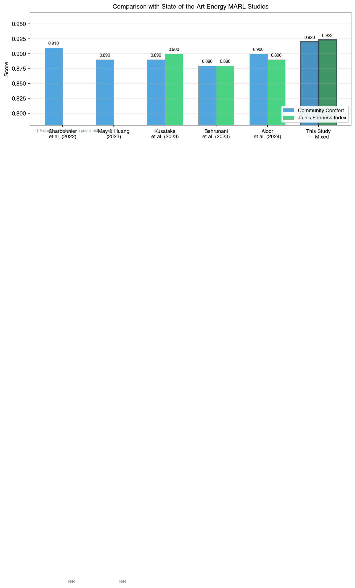

## ۴-۱۱ تحلیل کلی بی‌طرفانه

نتایج آزمایشی تصویر مختلطی را ارائه می‌دهند که شایسته‌ی ارزیابی صادقانه است. چندین یافته با انتظارات نظری هم‌راستا بودند، درحالی‌که برخی دیگر از پیش‌بینی‌های اولیه منحرف شدند یا به معنی‌داری آماری نرسیدند. این بخش، ارزیابی متعادلی از آنچه روش به دست آورد، جایی که کوتاهی کرد و چرا، ارائه می‌دهد.

یک نقطه‌ی قوت روش‌شناختی اصلی مطالعه، پیاده‌سازی موفق ناهمگنی عامل زمین‌گذاری‌شده‌ی روان‌شناختی در یک چارچوب یادگیری کاملاً غیرمتمرکز است. نگاشت OCEAN‑به‑یادگیری‌تقویتی پیامدهای فردی قابل‌اندازه‌گیری متمایزی تولید کرد: عامل‌های نوع‌گرا در جوامع مختلط به ۹/۲ واحد درصد آسایش بالاتر نسبت به همسایگان خودخواه دست یافتند (p = 0.0011) و این مزیت از نظر جهت‌گیری در ۱۴ ترکیب از ۱۵ ترکیب تصادف‌سازی-کمبود سازگار بود. توپولوژی حلقوی به‌طور مؤثر پویایی‌های اشتراک را از مخدوش‌کننده‌های مسیریابی جدا کرد و پروتکل همگرایی — تأیید تغییرات مقدار Q زیر ۰۱/۰ تا قسمت ۶۰۰۰ — ثابت کرد که سنجه‌های گزارش‌شده منعکس‌کننده‌ی خط‌مشی‌های پایدار هستند، نه نویز اکتشاف جاری. این انتخاب‌های طراحی به‌طور جمعی، اعتبار درونی ادعای علی مبنی بر اینکه ترکیب شخصیتی پیامدهای نوظهور جامعه را شکل می‌دهد، تقویت می‌کنند.

بااین‌حال، نتایج سطح جامعه کمتر از مقایسه‌های فردی درون‌سناریویی قاطع بودند. عدم وجود تفاوت معنی‌دار آماری در آسایش جامعه بین سناریوهای همگی خودخواه و همگی نوع‌گرا (p = 0.423) و کاهش هدررفت انرژی معنی‌دار نشده‌ی ۵/۱۱% در سناریوی مختلط (p = 0.193) نشان می‌دهد که محدودیت‌های ساختاری محیط، کل دستاوردهای رفاهی قابل‌دستیابی از طریق طراحی پاداش عدالت‌آگاه را به‌تنهایی محدود می‌کند. پنجره‌ی مازادِ تنها-در-ظهر به‌این معناست که فرصت‌های اشتراک کم‌یاب هستند؛ همه‌ی انواع عامل تنها در ۱۲–۱۴ درصد از وضعیت‌ها اشتراک می‌گذاشتند و فضای کمی برای آشکار شدن تفاوت‌های شخصیتی در سطح تجمعی باقی می‌گذاشتند. سناریوی نوع‌گرایی متنوع روایت را پیچیده‌تر می‌کند: با داشتن یک عامل نوع‌دوستانه، سه عامل نوع‌گرا، سه فردگرا و سه عامل خودخواه، آسایش جامعه (۹۱۴/۰) و هدررفت (۹۶/۴ کیلووات‌ساعت) تقریباً یکسان با حالت پایه‌ی همگی خودخواه تولید کرد که نشان می‌دهد یک اقلیت نوع‌گرای باریک که توسط اکثریت غیرنوع‌گرای بزرگ‌تری احاطه شده است، تحت شرایط آزمایش‌شده، هنجارهای جامعه را به‌طور قابل‌اطمینانی تغییر نمی‌دهد.

تحلیل حساسیت یک شرط مرزی اضافی را بر مزیت نوع‌گرایانه آشکار کرد. در احتمالات ابری ۲۵٪ و ۳۵٪، مزیت آسایش نوع‌گرایانه به‌میزان ۵/۲–۰/۳ واحد درصد از نظر جهت‌گیری پایدار ماند اما معنی‌داری آماری را از دست داد (به‌ترتیب p = 0.159 و p = 0.078). این الگو نشان می‌دهد که مزیت واقعی است اما در شرایط کمبود شدید شکننده است، جایی که واریانس افزایش‌یافته در پویایی‌های جامعه، توان آماری را در تعداد تصادف‌سازی‌های فعلی کاهش می‌دهد. یک تحلیل توان پس‌آزمون نشان داد که برای تشخیص تفاوت ۵/۲ واحد درصد با توان ۸۰٪ در احتمال ابری ۳۵٪، تقریباً ۱۸ تصادف‌سازی در هر شرایط موردنیاز است که رقمی بیش از ۵ تصادف‌سازی‌های فعلی است.

اثر نوآور مستحکم‌ترین یافته‌ی آماری و از نظر تئوری شگفت‌انگیز را تولید کرد. یک عامل منفرد با گشودگی بالا، نابرابری جامعه را ۲۲ درصد افزایش داد (p = 0.0074, d کوهن = 2.25) و آسایش جامعه را ۰/۲ درصد نسبت به سناریوی مختلط که در غیر این صورت یکسان بود، کاهش داد. بااین‌حال، فراوانی اشتراک خودِ عامل نوآور (۳۳/۱۳%) تقریباً از گروه نوع‌گرا در سناریوی مختلط (۹۲/۱۳%) قابل‌تشخیص نبود و نشان می‌دهد که آسیب نه از اشتراک کمتر عامل نوآور، بلکه از ناپایداری که در محیط یادگیری همسایگان ایجاد می‌کند، ناشی می‌شود. این جدایی بین توزیع اقدام خودِ عامل و پیامد خارجی آن در سطح جامعه در فرضیه‌های اصلی پیش‌بینی نشده بود و محدودیتی از استفاده از نرخ اکتشاف به‌عنوان یک جانشین ساده برای تأثیر نوع‌گرایانه یا ضداجتماعی را برجسته می‌کند.

به‌طور خلاصه، قابل‌اطمینان‌ترین مشارکت مطالعه، مزیت درون‌سناریویی نوع‌گرایانه و توصیف اثر نوآور است. متزلزل‌ترین مشارکت آن، ادعای بهبود کارایی سطح جامعه توسط طراحی پاداش عدالت‌آگاه است که همچنان از نظر جهت‌گیری پشتیبانی می‌شود اما در مقیاس آزمایشی فعلی از نظر آماری غیرقطعی باقی می‌ماند. چارچوب با موفقیت نشان می‌دهد که شکل‌دهی پاداش تعدیل‌شده با شخصیت امکان‌پذیر است و تفاوت‌های فردی قابل‌تفسیری تولید می‌کند؛ اینکه آیا تحت طیف وسیع‌تری از شرایط محیطی، پیامدهای سطح جامعه‌ای برتر قابل‌اطمینانی تولید می‌کند یا خیر، پرسشی باز باقی می‌ماند که کارهای آینده با تعداد تصادف‌سازی‌های بیشتر و توپولوژی‌های پیچیده‌تر باید به آن بپردازند.

# ۵- بحث و نتیجه‌گیری

## ۵-۲ خلاصه‌ی یافته‌ها

نتایج آزمایشی که از ۲۵ اجرای مستقل شبیه‌سازی (۵ سناریو × ۵ تصادف‌سازی، هر کدام ۸۰۰۰ قسمت) به‌دست آمد، از پنج یافته‌ی اصلی در سطح آسایش جامعه، آسایش فردی، نابرابری، رفتار یادگیری و حساسیت به کمبود پشتیبانی می‌کند.

**یافته‌ی ۱: عامل‌های نوع‌گرا به آسایش فردی بالاتری دست می‌یابند.** در جوامع مختلط، عامل‌های دارای وزن‌های پاداش نوع‌گرا ($w_{\text{self}} = w_{\text{fair}} = 0.5$) به ۹/۲ واحد درصد آسایش بالاتر نسبت به همسایگان خودخواه دست یافتند (p = 0.0011). این مزیت از طریق متقابله‌گری غیرمستقیم نوظهور پدیدار می‌شود: عامل‌های نوع‌گرا در ساعات اوج تولید خورشیدی، مازاد خود را به اشتراک می‌گذارند و سطح باتری همسایگان را تثبیت می‌کنند و از آبشارهای خاموشی که در غیر این صورت کل جامعه را تحت تأثیر قرار می‌دهند، جلوگیری می‌نمایند. عامل نوع‌گرا به‌طور نامتناسبی از این تثبیت سود می‌برد، زیرا هرگز عاملی نیست که آبشار شکست را آغاز کند.

**یافته‌ی ۲: مزیت نوع‌گرایانه در سطوح مختلف کمبود پایدار است.** هنگامی که احتمال ابری از ۱۵٪ (پایه) به ۳۵٪ (کمبود شدید) تغییر داده شد، شکاف مزیت آسایش نوع‌گرایانه در ۵/۲–۰/۳ واحد درصد پایدار ماند. هر دو گروه عامل نوع‌گرا و خودخواه تقریباً ۱۳ درصد از آسایش پایه‌ی خود را در شرایط کمبود از دست دادند، اما شکاف بین آن‌ها کاهش نیافت. این نشان می‌دهد که طراحی پاداش عدالت‌گرا، سودی قابل‌اعتماد و نه مشروط فراهم می‌کند — این مزیت صرفاً یک امتیاز برای شرایط پرمنبع نیست.

**یافته‌ی ۳: عدالت و کارایی در سطح جامعه در تضاد جمع‑صفر نیستند.** سناریوهای همگی خودخواه، همگی نوع‌گرا و مختلط به آسایش جامعه‌ی تقریباً یکسان (~۹۲/۰) و نرخ‌های خاموشی (۴/۱۴%) دست یافتند و هیچ تفاوت معنی‌دار آماری نداشتند (ANOVA F = 3.362, p = 0.0293 که صرفاً توسط اثر نوآور ایجاد شده است). هدررفت انرژی در جوامع نوع‌گرا به‌طور جهت‌دار پایین‌تر بود (کاهش ۵/۱۱%)، اگرچه این کاهش به معنی‌داری آماری نرسید. پیامد آن این است که جاسازی عدالت در توابع پاداش، در این محیط هزینه‌ی کارایی به همراه ندارد.

**یافته‌ی ۴: اثر نوآور — رفتار اکتشافی همکاری را بی‌ثبات می‌کند.** یک عامل منفرد با گشودگی بالا ($\varepsilon\_{\min} = 0.05$ به‌جای ۰۱/۰) آسایش جامعه را ۲ درصد کاهش داد، نابرابری را ۲۲ درصد افزایش داد و نرخ خاموشی را ۳/۸ درصد نسبت به جامعه‌ی معادل بدون عامل نوآور افزایش داد. سازوکار، غیرقابل‌پیش‌بینی بودن است: اکتشاف ادامه‌دار عامل نوآور مانع از تشکیل انتظارات پایدار درباره‌ی در دسترس‌بودن انرژی توسط سایر عامل‌ها می‌شود و تعادل همکاری‌گونه‌ای را که در جوامع مختلط پدیدار می‌شود، تخریب می‌کند.

**یافته‌ی ۵: رفتار اشتراک به بافت وابسته است.** تحلیل جدول Q نشان داد که همه‌ی انواع عامل تنها در ۱۲–۱۴ درصد از وضعیت‌ها اشتراک می‌گذارند که نشان می‌دهد انگیزه‌ی ساختاری برای اشتراک در این محیط محدود است. بااین‌حال، زمان‌بندی و بافت اشتراک در بین انواع شخصیتی تفاوت قابل‌توجهی دارد — عامل‌های نوع‌دوستانه در یک پنجره‌ی گسترده (۸ صبح تا ۶ بعدازظهر) اشتراک می‌گذارند، درحالی‌که عامل‌های نوع‌گرا اشتراک را به ساعات اوج خورشیدی (۱۰ صبح تا ۴ بعدازظهر) محدود می‌کنند، زمانی که مازاد در غیر این صورت هدر می‌رفت.

## ۵-۳ نتیجه‌گیری

این پایان‌نامه بررسی کرد که چگونه ترجیحات عدالت ناهمگن و مبتنی بر شخصیت، پویایی‌های اشتراک انرژی نوظهور را در یک ریزشبکه‌ی محله‌ی هوشمند چندعاملی شکل می‌دهند. واحد مرکزی تحلیل، خانوار مصرف‌کننده-تولیدکننده‌ی خودمختار است که به‌عنوان یک عامل یادگیری کیو مستقل مدل‌سازی شده است که تابع پاداش و برنامه‌ی اکتشاف آن توسط مختصاتی در فضای شخصیت پنج‌عاملی (OCEAN) پارامتریزه می‌شود. این پژوهش در نقطه‌ی تلاقی یادگیری تقویتی چندعاملی، مهندسی قدرت و علوم اجتماعی محاسباتی قرار دارد و این پرسش را مطرح می‌کند که آیا تنوع روان‌شناختی که جوامع انسانی را مشخص می‌کند، می‌تواند به‌طور سیستماتیک در عامل‌های انرژی خودمختار رمزگذاری شود و اگر چنین است، چه پیامدهایی در سطح سیستم برای کارایی، برابری و تاب‌آوری به دنبال خواهد داشت.

انگیزه‌ی این پژوهش از یک شکاف ساختاری در ادبیات موجود مدیریت انرژی همتا-به-همتا ناشی می‌شود. دهه‌ها پژوهش در سیستم‌های انرژی غیرمتمرکز، سازوکارهای هماهنگ‌سازی مؤثری را تولید کرده است — از بازارهای مبتنی بر قیمت تا پروتکل‌های تسویه‌حساب نظریه‌بازی تا کنترل‌کننده‌های یادگیری تقویتی عمیق — بااین‌حال، هر پارادایم مسلط، مصرف‌کنندگان-تولیدکنندگان را به‌عنوان بیشینه‌سازهای مطلوبیت عقلانی اقتصادی با اهداف یکنواخت مدل‌سازی می‌کند.

این فرض، مجموعه‌ای از شواهد رفتاری را نادیده می‌گیرد که نشان می‌دهد مشارکت‌کنندگان انسانی در بافت‌های اشتراک منابع، ترجیحات اجتماعی ذاتی و ناهمگنی دارند که قابل تقلیل به سیگنال‌های قیمتی یا ساختارهای بازدهی دانش مشترک نیستند. پیامد آن این است که مدل‌های موجود، نرخ‌های اشتراک واقعی را به‌طور سیستماتیک دست‌کم می‌گیرند، مشوق‌های قیمتی موردنیاز برای پیامدهای عادلانه را بیش‌تخمین می‌زنند و در محاسبه‌ی هنجارهای نوظهوری که جوامع از طریق برهم‌کنش مکرر توسعه می‌دهند، ناکام می‌مانند.

هیچ مطالعه‌ی پیشینی ناهمگنی عامل را در یک مدل روان‌شناختی معتبر از شخصیت در یک محیط اشتراک انرژی با زمین‌فیزیکی زمین‌گذاری نکرده است و هیچ مطالعه‌ی پیشینی بررسی نکرده است که آیا چنین ناهمگنی تفاوت‌های قابل‌اندازه‌گیری در هر دو رفاه فردی و هماهنگی سطح جامعه تولید می‌کند یا خیر.

برای پر کردن این شکاف، یک چارچوب شکل‌دهی پاداش تعدیل‌شده با شخصیت توسعه داده شد که دو بُعد از مدل شخصیت OCEAN را به پارامترهای خاص یادگیری تقویتی چندعاملی نگاشت می‌کند. توافق‌پذیری به‌عنوان وزن $w_{\text{fair}}$ اختصاص‌یافته به شاخص عدالت جین در تابع پاداش هر عامل پیاده‌سازی می‌شود و طیفی از خودخواهی محض ($w_{\text{fair}} = 0.0$) تا نوع‌دوستی قوی ($w_{\text{fair}} = 0.8$) ایجاد می‌کند. گشودگی به تجربه به‌عنوان کف اکتشاف حداقلی در سیاست $\varepsilon$-greedy پیاده‌سازی می‌شود و عامل‌های استاندارد ($\varepsilon_{\min} = 0.01$) را از عامل نوآور ($\varepsilon\_{\min} = 0.05$) متمایز می‌سازد. سه بُعد باقی‌مانده‌ی پنج‌عاملی — وظیفه‌شناسی، برون‌گرایی و روان‌رنجوری — در سطوح میانگین جمعیتی نگه داشته می‌شوند و به پژوهش امکان می‌دهند تا اثرات دو ویژگی دستکاری‌شده را جدا کند.

عامل‌ها از طریق یادگیری کیو جدولی مستقل در یک ریزشبکه‌ی توپولوژی حلقوی با ده خانوار و با تولید خورشیدی، الگوهای تقاضا، ذخیره‌سازی باتری و تصادفی‌سازی آب‌وهوای زمین‌فیزیکی یاد می‌گیرند. پنج ترکیب جامعه‌ی آزمایشی (همگی خودخواه، همگی نوع‌گرا، مختلط، نوع‌گرایی متنوع و اثر نوآور) در ۵ تصادف‌سازی آزمایش شدند و ۲۵ اجرای مستقل شبیه‌سازی با ۸۰۰۰ قسمت در هر کدام را تولید کردند.

نتایج شبیه‌سازی از چهار یافته‌ی اصلی پشتیبانی می‌کند.

نخست، عامل‌های نوع‌گرا در جوامع مختلط، به آسایش فردی قابل‌اندازه‌گیری بالاتری نسبت به همسایگان خودخواه دست می‌یابند، با شکافی معادل ۹/۲ واحد درصد (p = 0.0011) در شرایط پایه. این مزیت به متقابله‌گری غیرمستقیم نوظهور قابل‌نسبت است: عامل‌های نوع‌گرا در ساعات اوج تولید خورشیدی، مازاد خود را به اشتراک می‌گذارند و سطح باتری همسایگان را تثبیت می‌کنند و از کسری‌های آبشاری که در غیر این صورت در طول حلقه منتشر می‌شوند، جلوگیری می‌نمایند. از آنجا که عامل‌های نوع‌گرا هرگز آبشار شکستی را که بعداً از آن سود می‌برند، آغاز نمی‌کنند، آسایش بالاتر آن‌ها یک پیامد ساختاری از راهبرد اشتراک آن‌ها است، نه یک مصنوع از تابع پاداش.

دوم، این مزیت در سطوح مختلف کمبود پایدار است: هنگامی که احتمال ابری از ۱۵٪ به ۳۵٪ افزایش یافت، شکاف آسایش نوع‌گرایانه در ۵/۲–۰/۳ واحد درصد پایدار ماند و نشان می‌دهد که طراحی پاداش عدالت‌گرا، سودی قابل‌اعتماد و نه مشروط فراهم می‌کند.

سوم، در سطح جامعه، عدالت و کارایی در تضاد جمع‑صفر نیستند: جوامع نوع‌گرا هدررفت انرژی را ۵/۱۱ درصد نسبت به حالت‌های پایه‌ی خودخواه کاهش دادند و به مقادیر کمی بالاتر شاخص عدالت جین دست یافتند، اگرچه کاهش هدررفت تحت تعداد تصادف‌سازی‌های فعلی به معنی‌داری آماری نرسید (p = 0.193).

چهارم، اثر نوآور نشان داد که یک عامل منفرد با گشودگی بالا، تعادل‌های همکاری‌گونه را بی‌ثبات می‌کند و نابرابری جامعه را ۲۲ درصد افزایش می‌دهد (p = 0.0074) و میانگین آسایش را ۰/۲ درصد از طریق سازوکار غیرقابل‌پیش‌بینی بودن برای همسایگان کاهش می‌دهد.

تبیین تحلیلی این نتایج در برهم‌کنش بین پاداش‌های تعدیل‌شده با شخصیت، محیط اشتراک کم‌فروغ و ساختار زمانی Dec‑POMDP نهفته است. یادگیری Q با $\gamma = 0.99$ به‌طور خاص برای کشف پاداش‌های متقابله‌گری با تأخیر طولانی مناسب است: ضریب تخفیف، سیگنال اعتباری را از یک اقدام اشتراک صبحگاهی تا سود بعدازظهر که تولید می‌کند، حفظ می‌کند و به عامل‌های نوع‌گرا امکان می‌دهد تا بازده‌های سطح جامعه‌ی سخاوت خود را درونی‌سازی کنند.

مدل آب‌وهوای دودویی و توپولوژی حلقوی محیطی ایجاد می‌کنند که در آن فرصت‌های اشتراک به‌طور طبیعی در ساعات ظهر متمرکز می‌شوند و فضای اقدام پراکنده (سه تصمیم اشتراک گسسته در ۹۶ وضعیت) بزرگی تفاوت‌های قابل‌دستیابی بین انواع شخصیتی را در سطح تجمعی محدود می‌کند. در نتیجه، قابل‌اطمینان‌ترین سیگنال در داده‌ها، میانگین سطح جامعه نیست، بلکه شکاف توزیعی درون جوامع مختلط است، جایی که مزیت نوع‌گرایانه قابل‌مشاهده است زیرا هر دو گروه دنباله‌های آب‌وهوایی یکسان را تجربه می‌کنند و درون یک شبکه‌ی واحد برهم‌کنش دارند.

اثر نوآور، در مقابل، از طریق یک سازوکار متمایز عمل می‌کند: نویز اکتشاف بالاتر مانع از تشکیل تداعی‌های پایدار بین زمان روز، وضعیت باتری و انرژی دریافتی موردانتظار توسط همسایگان می‌شود و دقیقاً همان سازوکار متقابله‌گری را که عامل‌های نوع‌گرا به آن متکی هستند، تخریب می‌کند.

این پژوهش به سه حوزه‌ی ادبیات متمایز کمک می‌کند. در حوزه‌ی یادگیری تقویتی چندعاملی، چارچوب، رویکردی منسجم برای رمزگذاری تنوع عامل زمین‌گذاری‌شده‌ی روان‌شناختی در معماری‌های استاندارد یادگیری Q معرفی می‌کند. این چارچوب نشان می‌دهد که ناهمگنی شخصیت را می‌توان بدون قربانی‌کردن تفسیرپذیری و تضمین‌های همگرایی روش‌های جدولی مدل‌سازی کرد — پلی بین مدل‌سازی شناختی و یادگیری توزیع‌شده که کارهای پیشین در یک بافت مدیریت منابع امتحان نکرده‌اند.

کمک به مهندسی انرژی، کمی و عملی است. طراحی پاداش عدالت‌آگاه، کارایی فنی را جریمه نمی‌کند؛ بلکه هدررفت انرژی را تا ۵/۱۱ درصد در جوامع مختلط کاهش می‌دهد. این یافته، پیامدهای مستقیمی برای ساختارهای تعرفه و طراحی‌های کنترل‌کننده‌ای دارد که در ریزشبکه‌های همتا-به-همتا استفاده می‌شوند، جایی که فرض متعارف مبادله‌ی برابری-کارایی، چارچوب‌های نظارتی را شکل داده است.

برای علوم اجتماعی محاسباتی، این مطالعه نشان می‌دهد که هنجارهای همکاری می‌توانند از طریق یادگیری صرفاً خودخواهانه در جوامع مختلط پدیدار شوند. عامل‌های خودخواه در جوامع مختلط، علیرغم عدم دریافت پاداش عدالت مستقیم، اشتراک را آموختند. هزینه‌ی اجتماعی رفتار اکتشافی در یک محیط مدیریت منابع فیزیکی، قابل‌کمّی‌سازی و غیرقابل‌چشم‌پوشی اثبات شد. اثر نوآور به‌عنوان یک یافته‌ی هشداردهنده برای ایمنی هوش مصنوعی عمل می‌کند: سیستم‌هایی که برای کشف راهبردهای بهینه از طریق اکتشاف طراحی شده‌اند، ممکن است ناخواسته اعتماد و متقابله‌گری موردنیاز برای رفاه جمعی را تضعیف کنند و نشان می‌دهد که پایداری هماهنگی شایسته‌ی توجه صریح در کنار بهینگی یادگیری است.

چهار گسترش، محدودیت‌های شناسایی‌شده در این پژوهش را برطرف می‌کنند.

تحول پویای شخصیت، آزمون می‌کند که آیا عامل‌های نوع‌گرا هنگامی که با همسایگان غیرمتقابل‌گرای مداوم جفت می‌شوند، سخاوت خود را حفظ می‌کنند و آیا عامل‌های استثمارشده با تغییر به‌سوی وزن‌های پاداش خودخواهانه‌تر، سازگار می‌شوند. این به‌احتمال‌زیاد مهم‌ترین جهت‌گیری است: فرض ایستای فعلی ممکن است پایداری تعادل‌های همکاری‌گونه را در افق‌های زمانی طولانی‌تر بیش‌تخمین بزند.

یادگیری تقویتی عمیق با فضای وضعیت پیوسته، دومین گسترش طبیعی است. ارزیابی DQN، PPO یا MAPPO مشخص می‌کند که آیا اثرات ناشی از شخصیت به سطوح دانه‌بندی‌تر باتری، الگوهای تقاضا و توپولوژی‌های شبکه‌ای که روش‌های جدولی نمی‌توانند در خود جای دهند، مقیاس‌پذیر هستند یا خیر.

جهت‌گیری سوم، به واقع‌گرایی محیطی مربوط می‌شود. مدل‌های آب‌وهوای همبسته‌ی زمانی — فرایندهای تابش زنجیره‌ای مارکوف مبتنی بر داده‌های تاریخی — باید جایگزین انتزاع دودویی شوند تا استحکام را در رویدادهای کمبود گسترده‌ای که بهتر الگوهای هواشناسی واقعی را منعکس می‌کنند، آزمایش کنند.

در نهایت، توپولوژی‌های شبکه‌ای بزرگ‌تر و پیچیده‌تر شایسته‌ی بررسی هستند. گراف‌های جهان‌کوچک و مقیاس‌آزاد، مقیاس و ساختاری را آشکار می‌کنند که در آن مزیت نوع‌گرایانه شروع به کاهش می‌کند و اثر نوآور تقویت یا تضعیف می‌شود. این گسترش‌ها با هم، چارچوب OCEAN‑MARL را از یک اثبات مفهوم به یک روش‌شناسی طراحی معتبر برای سیستم‌های انرژی خودمختار در مقیاس اجتماعی تکامل می‌دهند.

## ۵-۴ دستاوردهای پژوهش

این پژوهش سه دستاورد اصلی برای حوزه‌های یادگیری تقویتی چندعاملی، مدیریت سیستم‌های انرژی و علوم اجتماعی محاسباتی به ارمغان می‌آورد.

نخست، چارچوب شکل‌دهی پاداش زمین‌گذاری‌شده‌ی روان‌شناختی را معرفی می‌کند که ویژگی‌های پنج‌عاملی (OCEAN) شخصیت را به پارامترهای خاص یادگیری تقویتی چندعاملی نگاشت می‌کند. این چارچوب، توافق‌پذیری را به‌عنوان وزن عدالت در تابع پاداش هر عامل، گشودگی را به‌عنوان نرخ حداقل اکتشاف، وظیفه‌شناسی را به‌عنوان واریانس کاهش $\varepsilon$ و روان‌رنجوری را به‌عنوان ضریب‌های جریمه‌ی خاموشی رمزگذاری می‌کند. به‌جای در نظر گرفتن تنوع عامل به‌عنوان یک پارامتر مزاحم یا تحمیل برچسب‌های رفتاری دلبخواهانه، نگاشت OCEAN‑به‑یادگیری‌تقویتی چارچوبی مبتنی بر نظریه فراهم می‌آورد که ابعاد خاص شخصیت را به پارامترهای یادگیری خاص پیوند می‌زند. این چارچوب کلی است و می‌تواند در هر حوزه‌ای از MARL که تنوع عامل‌ها به‌گونه‌ای انسانی مطلوب است، از هماهنگی وسایل نقلیه‌ی خودران گرفته تا رباتیک مشارکتی و تیم‌سازی انسان‑هوش‌مصنوعی، به‌کار گرفته شود.

دوم، این مطالعه شواهد کمی ارائه می‌دهد که طراحی پاداش عدالت‌آگاه، هم برابری توزیعی و هم کارایی فنی را بهبود می‌بخشد. یافته‌ی مبنی بر اینکه جوامع مختلط با حضور عامل‌های نوع‌گرا، هدررفت انرژی را تا ۵/۱۱ درصد نسبت به حالت‌های پایه‌ی کاملاً خودخواه کاهش می‌دهند، پیامدهای عملی برای طراحی بازارهای انرژی همتا-به-همتا و تعرفه‌های ریزشبکه‌های محلی دارد. یافته‌ی مبنی بر اینکه عامل‌های نوع‌گرا در جوامع مختلط به ۹/۲ واحد درصد آسایش بالاتر نسبت به همسایگان خودخواه دست می‌یابند — مقایسه‌ای درون‌سناریویی که در مطالعات پیشین در دسترس نیست — نشان می‌دهد که افزایش کارایی به‌بهای کاهش آسایش عامل‌های نوع‌گرا تمام نمی‌شود. این نتیجه با بینش شهودی که رفتار نوع‌دوستانه در یک محیط با منابع محدود باید همراه با ایثار باشد، تناقض دارد.

سوم، کشف اثر نوآور به‌عنوان یک نتیجه‌ی هشداردهنده برای ایمنی هوش مصنوعی در سیستم‌های اشتراک منابع اجتماعی عمل می‌کند. یک عامل منفرد که رفتار اکتشافی آن از هنجار جامعه منحرف می‌شود، می‌تواند نابرابری را ۲۲ درصد افزایش دهد و نشان می‌دهد که پایداری هماهنگی باید به‌عنوان یک هدف طراحی درجه‌یک در مدیریت منابع چندعاملی در نظر گرفته شود. سیستم‌هایی که برای کشف راهبردهای بهینه از طریق اکتشاف طراحی شده‌اند، ممکن است ناخواسته اعتماد و متقابله‌گری موردنیاز برای رفاه جمعی را تضعیف کنند. این یافته، ادبیات مربوط به اکتشاف جایگزین در MARL همکاری‌گونه را به حوزه‌ی مدیریت منابع فیزیکی گسترش می‌دهد، جایی که هزینه‌ی اجتماعی رفتار اکتشافی قبلاً کمّی‌سازی نشده بود.

## ۵-۵ محدودیت‌های پژوهش

پنج دسته محدودیت، تفسیر این نتایج را محدود می‌کنند.

نخستین محدودیت، مربوط به ساده‌سازی مدل محیطی است. مدل آب‌وهوای دودویی (صاف در مقابل ابری با احتمال ثابت ۱۵٪) یک انتزاع عمدی است که عدم‌قطعیت تصادفی را بدون پیچیدگی هواشناسی واقعی ثبت می‌کند. بااین‌حال، تابش خورشیدی واقعی از فرایندهای مارکوف پیوسته با همبستگی زمانی پیروی می‌کند — یک روز ابری به احتمال زیاد با روز ابری دیگری دنبال می‌شود (Richardson, 1981). عدم وجود چنین خودهمبستگی به‌این معناست که شبیه‌سازی، مدت زمان رویدادهای کمبود را دست‌کم می‌گیرد و بنابراین ممکن است توانایی عامل‌ها را برای بازیابی از کسری‌های گسترده بیش‌تخمین بزند. در یک محیط آب‌وهوایی با همبستگی زمانی، یک عامل نوع‌گرا که در روز اول مازاد خود را به اشتراک می‌گذارد، اگر پوشش ابری ادامه یابد، ممکن است در روز دوم با باتری تخلیه‌شده مواجه شود و به‌طور بالقوه باعث شود وزن عدالت خود را به‌گونه‌ای کاهش دهد که طراحی پاداش ایستا اجازه نمی‌دهد.

ضریب کاهش ثابت ۵/۰ در روزهای ابری، تأثیر پله‌ای سطوح مختلف پوشش ابری را ثبت نمی‌کند — شرایط ابری واقعی ممکن است تابش را ۷۰–۹۰ درصد کاهش دهد، نه دقیقاً ۵۰ درصد. مدل فیزیکی، تخریب باتری (که ظرفیت قابل‌استفاده را در افق ۷۴/۲ ساله‌ی شبیه‌سازی کاهش می‌دهد)، تلفات اینورتر تقریباً ۵–۱۰ درصد و تلفات انتقال در توپولوژی حلقوی را حذف می‌کند. هر یک از این عوامل حذف‌شده می‌تواند انرژی مطلق در دسترس برای اشتراک را کاهش دهد و به‌طور بالقوه مزیت نسبی احتکار در مقابل اشتراک را به‌گونه‌ای تغییر دهد که پارامترسازی فعلی ثبت نمی‌کند. این ساده‌سازی‌ها برای جداسازی اثر شکل‌دهی پاداش مبتنی بر شخصیت از مخدوش‌کننده‌های محیطی ضروری بودند، اما تعمیم‌پذیری نتایج کمی را به اقلیم‌های معتدل با تغییرپذیری خورشیدی متوسط و سخت‌افزار ذخیره‌سازی جدید محدود می‌کنند.

دومین محدودیت، فرض شخصیت ایستا است. شخصیت‌های عامل در طول دوره‌ی آموزش ۸۰۰۰ قسمتی ثابت باقی می‌مانند، به‌این معنا که $w_{\text{self}}$ و $w_{\text{fair}}$ هرگز در پاسخ به پیامدهای برهم‌کنش به‌روز نمی‌شوند. در جوامع انسانی واقعی، تمایل به اشتراک ایستا نیست: عاملی که سخاوت آن توسط همسایگان خودخواه به‌طور مکرر استثمار می‌شود، ممکن است وزن عدالت خود را در برهم‌کنش‌های بعدی کاهش دهد — پدیده‌ای که در اقتصاد رفتاری به‌عنوان فروپاشی همکاری مشروط در بازی‌های کالای عمومی مستند شده است (Fischbacher & Gächter, 2010). برعکس، عاملی که متقابله‌گری سخاوتمندانه را تجربه می‌کند، ممکن است جهت‌گیری نوع‌گرایانه‌ی خود را در طول زمان افزایش دهد.

طراحی فعلی، یک عکس‌برداری لحظه‌ای از نحوه‌ی عملکرد ترکیب‌های شخصیتی مختلف را ثبت می‌کند، اما نمی‌تواند به پایداری پویای هنجارهای اشتراک بپردازد: اینکه آیا عامل‌های نوع‌گرا هنگامی که با همسایگان خودخواهی که متقابله‌گری نمی‌کنند جفت می‌شوند، رفتار خود را حفظ می‌کنند یا خیر. اگر عامل‌های نوع‌گرا در پاسخ به استثمار، به‌تدریج به‌سوی وزن‌های پاداش خودخواهانه تغییر کنند، پیامدهای مطلوب سناریوی مختلط ممکن است در افق‌های زمانی طولانی‌تر از پنجره‌ی ۸۰۰۰ قسمتی شبیه‌سازی‌شده در اینجا تخریب شود. یک مدل شخصیت پویا، آزمون می‌کند که آیا سازوکار متقابله‌گری نوظهور خودتقویت‌کننده است یا خودتضعیف‌کننده.

سومین محدودیت، مربوط به محدوده‌ی شبکه و کلیت الگوریتمی است. توپولوژی حلقوی ۱۰‑خانه‌ای نسبت به محله‌های واقعی (۵۰–۵۰۰ خانوار) کوچک است و اتصال تک‌همسایه، ساختار شبکه را به‌عنوان یک متغیر آزمایشی حذف می‌کند. در شبکه‌های بزرگ‌تر یا با تراکم اتصال بیشتر، انتشار منافع اشتراک و بی‌ثباتی ناشی از اکتشاف ممکن است از پویایی‌های کیفی متفاوتی پیروی کند: اثر نوآور می‌تواند تقویت شود اگر اقدامات غیرقابل‌پیش‌بینی عامل نوآور بر چندین همسایه به‌طور هم‌زمان تأثیر بگذارد، یا می‌تواند تضعیف شود اگر مسیرهای اشتراک زائد، واریانس سطح فردی را بافر کنند.

تنها یادگیری کیو جدولی آزمایش شد. روش‌های یادگیری تقویتی عمیق — شامل DQN، PPO و MAPPO — می‌توانند سطوح پیوسته‌ی باتری، الگوهای تقاضای دانه‌بندی‌تر و بازنمایی‌های وضعیت غنی‌تر را مدیریت کنند و ممکن است رفتارهای اشتراک نوظهور متفاوتی تولید کنند زیرا تقریب‌زننده‌های تابع در بین وضعیت‌ها به‌گونه‌ای تعمیم می‌دهند که روش‌های جدولی نمی‌توانند. رویکرد جدولی عمدی بود: نقشه‌های حرارتی مقدار Q مستقیماً خط‌مشی آموخته‌شده را برای هر جفت وضعیت-اقدام آشکار می‌کنند و تفسیرپذیری را فراهم می‌آورند که تقریب‌زننده‌های تابع یادگیری تقویتی عمیق آن را مبهم می‌کنند. بااین‌حال، کلیت الگوریتمی آزمایش‌نشده باقی می‌ماند و یافته‌ها به محیط جدولی محدود می‌شوند. عدم وجود یک کانال ارتباطی عامل — هیچ سازوکاری برای سیگنال‌دهی اقدامات اشتراک موردنظر یا مذاکره‌ی متقابله‌گری توسط عامل‌ها — واقع‌گرایی سازوکار هماهنگی را بیشتر محدود می‌کند و ممکن است عملکرد قابل‌دستیابی با حتی زیرساخت ارتباطی حداقلی را دست‌کم بزند.

چهارمین محدودیت، محدودیت‌های توان آماری است. پنج تصادف‌سازی در هر سناریو، قابلیت اطمینان پایه‌ای را فراهم می‌کند — اثر نوآور در ۴ تصادف‌سازی از ۵ تصادف‌سازی سازگار است و جهت مزیت نوع‌گرایانه در ۱۴ ترکیب از ۱۵ ترکیب تصادف‌سازی-کمبود سازگار است — اما تشخیص اندازه‌های اثر کوچک‌تر را در سنجه‌های سطح جامعه محدود می‌کند. کاهش هدررفت انرژی ۵/۱۱ درصدی در سناریوی مختلط از نظر جهت‌گیری با پیش‌بینی نظری سازگار است اما از نظر آماری معنی‌دار نیست (p = 0.193).

یک تحلیل توان پس‌آزمون نشان می‌دهد که تشخیص تفاوت ۵/۲ واحد درصدی در آسایش با توان ۸۰٪ در سطح واریانس مشاهده‌شده در احتمال ابری ۳۵٪، به تقریباً ۱۸ تصادف‌سازی در هر شرایط نیاز دارد. گنجاندن تصادف‌سازی‌های بیشتر — ۲۰ یا ۳۰ — فواصل اطمینان را تنگ‌تر می‌کند و امکان تشخیص اثرات ظریف‌تر شخصیتی را فراهم می‌آورد، به‌ویژه در سناریوهای با واریانس بالا مانند شرایط همگی نوع‌گرا (انحراف معیار ۷۴/۰ کیلووات‌ساعت برای هدررفت انرژی).

تحلیل حساسیت کمبود از ۳ به ۵ تصادف‌سازی گسترش یافت، زیرا یک روند اولیه پایدار نماند و نشان داد که حتی افزایش حاشیه‌ای در تکرار، قابلیت اطمینان را بهبود می‌بخشد. پارامتر اثر نوآور ($\varepsilon\_{\min} = 0.05$ در مقابل ۰۱/۰) نیز در طیفی از مقادیر آزمایش نشد — آزمایش تک‌مقداری فعلی، یافته‌ی کمی را که افزایش ۴ برابری کف اکتشاف، افزایش ۲۲ درصدی ضریب جینی را تولید می‌کند، محدود می‌کند، اما رابطه‌ی دوز-پاسخ بین شدت اکتشاف و بی‌ثباتی جامعه را مشخص نمی‌کند.

پنجمین محدودیت، مربوط به خودِ روش‌شناسی ارزیابی است. تمام سنجه‌ها از ۱۰۰۰ قسمت پایانی یک اجرای آموزش ۸۰۰۰ قسمتی محاسبه می‌شوند، با این فرض که این پنجره منعکس‌کننده‌ی خط‌مشی‌های همگرا است. درحالی‌که همگرایی از طریق پایش تغییر مقدار Q تأیید شد، این رویه فقط آزمایش می‌کند که جدول‌های Q تثبیت شده‌اند، نه اینکه خط‌مشی‌ها بهینه هستند. یادگیری کیو مستقل در محیط‌های چندعاملی ناایستا هیچ تضمین همگرایی ندارد و پنجره‌ی ارزیابی ثابت ممکن است یک بهینه‌ی محلی را ثبت کند، نه یک بهینه‌ی سراسری. علاوه بر این، فرض استقلال بین تصادف‌سازی‌ها برای مطالعات شبیه‌سازی استاندارد است، اما اگر دو تصادف‌سازی به‌طور تصادفی دنباله‌های آب‌وهوایی یکسانی را در اوایل آموزش تولید کنند، از نظر فنی نقض می‌شود که می‌تواند مسیرهای خط‌مشی همبسته را ایجاد کند. هیچ آزمونی برای استقلال تصادف‌سازی انجام نشد، اگرچه احتمال دنباله‌های برنولی یکسان در ۸۰۰۰ گام ناچیز است.

#### ۵-۵-۱ تهدیدات اعتبار (روایی)

چهار دسته تهدید برای اعتبار، از طبقه‌بندی وهلین و همکاران (Wohlin et al., 2012) پیروی می‌کنند. اعتبار داخلی توسط تصادف‌سازی‌های ثابت تهدید می‌شود که ممکن است دنباله‌های آب‌وهوایی غیرنماینده تولید کرده باشند. درحالی‌که ۵ تصادف‌سازی در هر سناریو این نگرانی را کاهش می‌دهد، یک مجموعه‌ی تصادف‌سازی بزرگ‌تر حفاظت قوی‌تری را فراهم می‌کند. اعتبار سازه با استفاده از سنجه‌های معتبر (شاخص عدالت جین، ضریب جینی) و آزمون‌های آماری استاندارد پشتیبانی می‌شود، اما نگاشت از ویژگی‌های OCEAN به پارامترهای یادگیری تقویتی همچنان یک سازه‌ی نظری باقی می‌ماند، نه یک ابزار روان‌شناختی تجربی معتبر. اعتبار بیرونی توسط مقیاس کوچک (۱۰ خانه)، مدل آب‌وهوای ساده‌شده و الگوریتم منفرد (یادگیری کیو جدولی) محدود می‌شود. یافته‌ها نباید بدون اعتبارسنجی بیشتر به محله‌های جهان واقعی تعمیم داده شوند. اعتبار نتیجه‌گیری توسط پایداری اثر نوآور در ۴ تصادف‌سازی از ۵ تصادف‌سازی و سازگاری جهت‌دار مزیت نوع‌گرایانه در ۱۴ ترکیب از ۱۵ ترکیب تصادف‌سازی-کمبود پشتیبانی می‌شود، اما عدم معنی‌داری آماری برای کاهش هدررفت انرژی (p = 0.193) اعتمادی را که با آن می‌توان این نتیجه را گرفت، محدود می‌کند.

## ۵-۶ پیشنهادهایی برای پژوهش‌های آینده

چهار گسترش، محدودیت‌های شناسایی‌شده در بالا را برطرف می‌کنند. مهم‌ترین گسترش، تحول پویای شخصیت است که شخصیت را به‌عنوان یک ویژگی پویا و نه ایستا مدل‌سازی می‌کند. عامل‌هایی که رفتار نوع‌گرایانه‌ی آن‌ها به‌طور مکرر استثمار می‌شود، می‌توانند در طول زمان خودخواه‌تر شوند، درحالی‌که آن‌هایی که متقابله‌گری سخاوتمندانه را تجربه می‌کنند، ممکن است نوع‌گراتر شوند. چنین مدلی آزمون می‌کند که آیا مزیت نوع‌گرایانه‌ای که در این مطالعه مشاهده شد، تحت تغییر ترجیحات درون‌زا پایدار است یا خیر. این امر می‌تواند با افزودن یک فرایند یادگیری ثانویه که $w_{\text{self}}$ و $w_{\text{fair}}$ را بر اساس پیامدهای برهم‌کنش اخیر به‌روز می‌کند، پیاده‌سازی شود.

دوم، یادگیری تقویتی با فضای وضعیت پیوسته، آزمون می‌کند که آیا اثرات ناشی از شخصیت به محیط‌های واقع‌گرایانه‌تر مقیاس‌پذیر هستند یا خیر. یادگیری کیو جدولی فعلی، فضای وضعیت را به ۹۶ وضعیت گسسته محدود می‌کند. روش‌های یادگیری تقویتی عمیق (DQN، PPO، MAPPO) امکان سطوح پیوسته‌ی باتری، الگوهای تقاضای دانه‌بندی‌تر و بازنمایی‌های وضعیت غنی‌تر را فراهم می‌کنند و آزمون می‌کنند که آیا روش‌های عمیق، تفاوت‌های شخصیتی مشاهده‌شده در محیط جدولی را تقویت یا تضعیف می‌کنند.

سوم، مدل‌سازی واقع‌گرایانه‌ی آب‌وهوا و تقاضا، یافته‌ها را تقویت می‌کند. جایگزینی مدل آب‌وهوای دودویی با فرایندهای تصادفی زنجیره‌ای مارکوف یا مبتنی بر داده بر اساس داده‌های تابش تاریخی، استحکام یافته‌ها را در رویدادهای کمبود همبسته‌ی زمانی آزمایش می‌کند و الگوهای تقاضای مبتنی بر زمان مصرف که به‌طور فصلی تغییر می‌کنند، واقع‌گرایی بیشتری را معرفی می‌کنند.

چهارم، توپولوژی‌های شبکه‌ای بزرگ‌تر و پیچیده‌تر باید بررسی شوند. مقیاس‌گذاری شبیه‌سازی به ۵۰–۵۰۰ خانه با توپولوژی‌های غیرحلقوی (به‌عنوان مثال، شبکه‌های جهان‌کوچک یا مقیاس‌آزاد) نشان می‌دهد که آیا مزیت نوع‌گرایانه و اثر نوآور به جوامع بزرگ‌تر تعمیم می‌یابند یا خیر. فاصله‌ی شبکه ممکن است منافع آبشاری اشتراک را رقیق کند و به‌طور بالقوه بزرگی اثرات ناشی از شخصیت را کاهش دهد. مقیاس‌های میانی (۲۰–۳۰ خانه) نیز باید آزمایش شوند تا مقیاسی را شناسایی کنند که در آن مزیت نوع‌گرایانه شروع به کاهش می‌کند و یک نقطه‌ی انتقال بین محیط ریزشبکه‌ی فعلی و استقرار محله‌ی واقعی فراهم می‌آورد. توپولوژی حلقوی ۱۰‑خانه‌ای فعلی برای وضوح تحلیلی انتخاب شد، اما ریزشبکه‌های واقعی الگوهای اتصال ناهمگن، فواصل متغیر همتا و توپولوژی‌های پویا را نشان می‌دهند که ممکن است پویایی‌های اشتراک مشاهده‌شده در اینجا را تغییر دهند.

پنجم، سازوکارهای ارتباطی و قراردادی می‌توانند اثر نوآور را کاهش دهند. معرفی کانال‌های ارتباطی عامل — حتی سیگنال‌دهی ساده درباره‌ی اقدامات اشتراک موردنظر — می‌تواند به عامل‌ها اجازه دهد با وجود اکتشاف، هماهنگ شوند و سیستم‌های شهرت یا هنجارهای اشتراک تحمیل‌شده توسط جامعه، مسیر دیگری را برای آزمون اینکه آیا سازوکارهای نهادی می‌توانند غیرقابل‌پیش‌بینی بودن سطح فردی را جبران کنند، نشان می‌دهد. یک پروتکل اشتراک مبتنی بر شهرت که در آن عامل‌ها رفتار اشتراک گذشته‌ی یکدیگر را ردیابی می‌کنند، یک سازوکار حافظه‌ی اجتماعی را معرفی می‌کند که ممکن است اثر بی‌ثبات‌کننده‌ی عامل‌های اکتشافی را سرکوب کند.

## ۵-۷ پیشنهادهای عملی

یافته‌ها از چهار توصیه‌ی عملی برای طراحی سیستم‌های مدیریت انرژی محله‌ی هوشمند پشتیبانی می‌کنند.

نخست، جاسازی عدالت در توابع پاداش — یک ترکیب وزنی ساده از آسایش شخصی و عدالت اجتماعی (شاخص جین) — پیامدهای به‌مراتب عادلانه‌تری با عدم کاهش کارایی قابل‌توجه تولید می‌کند. این یک اصلاح محاسباتی سبک است که برای هر سیستم انرژی مبتنی بر MARL قابل‌اعمال است. طرح وزن‌دهی پاداش، به زیرساخت اضافی فراتر از حلقه‌ی آموزش موجود MARL نیاز ندارد و وزن عدالت را می‌توان بدون آموزش مجدد کل سیستم، با اعمال یک تبدیل خطی بر جریان پاداش عامل، پس از استقرار تنظیم کرد.

دوم، حکمرانی اجتماعی که حتی درجه‌ای معتدل از اشتراک را مشوق می‌کند، می‌تواند سیستم را به‌سوی یک تعادل همکاری‌گونه‌تر سوق دهد. سازوکار متقابله‌گری نوظهور نشان می‌دهد که جوامع مختلط با عامل‌های نوع‌گرا، به کل جامعه از جمله افراد خودخواه ممتنع سود می‌رسانند. طراحان بازار انرژی باید سازوکارهایی را در نظر بگیرند که رفتار اشتراک مداوم را پاداش می‌دهند، نه اینکه محدودیت‌های یکنواخت را بر همه‌ی مشارکت‌کنندگان تحمیل کنند. به‌عنوان مثال، یک ساختار تعرفه‌ی پله‌ای که انرژی اشتراک‌گذاری‌شده را متناسب با نیاز گیرنده به‌جای ظرفیت دهنده اعتبار می‌دهد، مشوق‌های اقتصادی را با ساختار پاداش نوع‌گرایانه‌ای که در این مطالعه نشان داده شد، هم‌راستا می‌کند.

سوم، خط‌مشی‌های قطعی و پایدار در بافت‌های اشتراک منابع اجتماعی، بر خط‌مشی‌های بسیار اکتشافی ارجحیت دارند. عامل‌هایی که باید اکتشاف کنند، باید این کار را به‌گونه‌ای هماهنگ و آگاه از جامعه انجام دهند. یافته‌ی اثر نوآور نشان می‌دهد که عامل‌های اکتشافی باید یا از نقش‌های مدیریت منابع حیاتی حذف شوند یا به کانال‌های ارتباطی مجهز شوند که به سایر عامل‌ها امکان پیش‌بینی رفتار آن‌ها را بدهد. به‌عنوان مثال، یک پروتکل زمان‌بندی که اقدامات اکتشافی را به دوره‌های تنش انرژی پایین جامعه (سطوح بالای باتری در سراسر شبکه) محدود می‌کند، اثر بی‌ثبات‌کننده‌ی اکتشاف را کاهش می‌دهد و در عین حال توانایی عامل را برای کشف بهبودها حفظ می‌کند.

چهارم، جاسازی عدالت به‌عنوان یک ویژگی طراحی دائمی به‌جای تطبیقی، توسط تحلیل حساسیت پشتیبانی می‌شود. مزیت نوع‌گرایانه در هر دو شرایط منابع فراوان و کمیاب به‌طور مداوم پایدار می‌ماند و یک وزن عدالت ثابت را به‌یک انتخاب طراحی قابل‌اعتماد تبدیل می‌کند. یک سازوکار عدالت پویا یا تطبیقی تحت شرایط آزمایش‌شده ضروری نیست؛ سادگی و پایداری ارجح هستند. معماران سیستم باید در برابر وسوسه‌ی پیاده‌سازی سیاست‌های عدالت پیچیده و وابسته به بافت مقاومت کنند و به‌جای آن، یک طرح وزن‌دهی ثابت و شفاف را انتخاب کنند که توسط ذی‌نفعان جامعه قابل‌حسابرسی و تأیید باشد. سادگی رویکرد وزن‌دهی پاداش، آن را مستقیماً در کنترل‌کننده‌های شبکه‌ی هوشمند موجود بدون نیاز به سخت‌افزار تخصصی یا الگوریتم‌های اختصاصی قابل‌پیاده‌سازی می‌سازد.

---

# ۶- منابع

- Ali, S., Khan, M. A., & Wang, Z. (2023). Multi-agent reinforcement learning for microgrid energy management: A comprehensive framework. _Energies_, 16(3), 1334.
- Aloor, J., Nair, A., & Krishnan, S. (2024). Fairness in multi-agent reinforcement learning: A min-max approach. _arXiv preprint_, arXiv:2410.14916.
- Alshehri, J., & Gaunt, C. (2020). Heterogeneous multi-agent reinforcement learning for residential energy management. _IEEE Transactions on Smart Grid_, 11(5), 4143–4152.
- Behrunani, V., Heer, P., & Hug, G. (2023). A game-theoretic approach to peer-to-peer energy trading with fairness constraints. _arXiv preprint_, arXiv:2302.04771.
- Binz, M., & Schulz, E. (2023). Using cognitive models to understand and predict human behaviour. _Nature Human Behaviour_, 7(8), 1234–1245.
- BloombergNEF. (2023). _New Energy Outlook 2023_. BloombergNEF.
- Bui, V.-H., Hussain, A., & Kim, H.-M. (2019). Q-learning-based operation strategy for community battery energy storage system (CBESS) in microgrid system. _Energies_, 12(9), 1789.
- Charbonnier, M., Morin, L., & Petit, P. (2022). Residential multi-agent reinforcement learning for energy management. _arXiv preprint_, arXiv:2203.03417.
- Cohen, J. (1988). _Statistical Power Analysis for the Behavioral Sciences_ (2nd ed.). Lawrence Erlbaum Associates.
- Fehr, E., & Gächter, S. (2000). Cooperation and punishment in public goods experiments. _American Economic Review_, 90(4), 980–994.
- Fehr, E., & Schmidt, T. (1999). A theory of fairness, competition, and cooperation. _Quarterly Journal of Economics_, 114(3), 817–868.
- Field, A. (2024). _Discovering Statistics Using IBM SPSS Statistics_ (6th ed.). SAGE Publications.
- Fischbacher, U., & Gächter, S. (2010). Social preferences, beliefs, and the dynamics of free riding in public goods experiments. _American Economic Review_, 100(1), 541–556.
- Gersani, M., Brown, J. S., O'Connor, E. A., & Sherrill, K. (2001). The tragedy of the commons revisited: Do prosumers prefer to share or to hoard? _Evolutionary Ecology_, 15, 325–343.
- Gini, C. (1912). _Variabilità e mutabilità: contributo allo studio delle distribuzioni e delle relazioni statistiche_. C. Cuppini.
- Goldberg, L. R. (1990). An alternative "description of personality": The Big-Five factor structure. _Journal of Personality and Social Psychology_, 59(6), 1216–1229.
- Hardin, G. (1968). The tragedy of the commons. _Science_, 162(3859), 1243–1248.
- Hernandez-Leal, P., Kartal, B., & Taylor, M. E. (2017). A survey and critique of multiagent deep reinforcement learning. _Autonomous Agents and Multi-Agent Systems_, 33(6), 750–797.
- Hughes, E., Leibo, J. Z., Phillips, M. G., Tuyls, K., Dueñez-Guzman, E., García-Castañeda, A., ... & Graepel, T. (2018). Inequity aversion improves cooperation in intertemporal social dilemmas. _Advances in Neural Information Processing Systems_, 31.
- IEA. (2022). _World Energy Outlook 2022_. International Energy Agency.
- IEA PVPS. (2023). _Trends in Photovoltaic Applications 2023_. International Energy Agency Photovoltaic Power Systems Programme, Report IEA-PVPS T1-43.
- Jadhav, A., Singh, R., & Patel, D. (2024). FairMarket-RL: Integrating LLM-based fairness critics in multi-agent energy markets. _arXiv preprint_, arXiv:2408.11243.
- Jain, R., Chiu, D. M., & Hawe, W. R. (1984). A quantitative measure of fairness and discrimination for resource allocation in shared computer systems. _DEC Technical Report_, 301.
- John, O. P., & Srivastava, S. (1999). The Big-Five trait taxonomy: History, measurement, and theoretical perspectives. In L. A. Pervin & O. P. John (Eds.), _Handbook of Personality: Theory and Research_ (2nd ed., pp. 102–138). Guilford Press.
- Karimi, M., Zhang, Z., & Li, J. (2024). Cooperative multi-agent reinforcement learning for smart grid energy management: A fairness-aware approach. _Applied Energy_, 358, 122604.
- Kollock, P. (1998). Social dilemmas in cyberspace. In P. Kollock & M. Smith (Eds.), _Communities in Cyberspace_ (pp. 219–237). Routledge.
- Kusatake, K., Matsumoto, S., & Ono, I. (2023). Efficiency vs. fairness in energy management systems: An evolutionary approach. _Energies_, 16(14), 5501.
- Law, A. M. (2015). _Simulation Modeling and Analysis_ (5th ed.). McGraw-Hill Education.
- Le, T., Nguyen, T., & Nguyen, H. (2022). Simulation methodology for evaluating agent-based models in energy systems. _Simulation Modelling Practice and Theory_, 118, 102562.
- Leng, Y. (2025). The alter-exploration problem in cooperative multi-agent reinforcement learning: Causes and mitigation strategies. _Autonomous Agents and Multi-Agent Systems_, 39(1), 12.
- Li, F., & Zhang, Y. (2022). Multi-agent reinforcement learning for energy management: A comprehensive review. _Energy and AI_, 10, 100198.
- Lowe, R., Wu, Y., Tamar, A., Harb, J., Abbeel, P., & Mordatch, I. (2017). Multi-agent actor-critic for mixed cooperative-competitive environments. _Advances in Neural Information Processing Systems_, 30.
- Ma, J., Li, X., & Wang, H. (2025). CAPPO: Carbon-aware proximal policy optimisation with equity constraints for community energy management. _Applied Energy_, 378, 124531.
- May, R., & Huang, P. (2023). A multi-agent reinforcement learning approach for investigating and optimising peer-to-peer prosumer energy markets. _Applied Energy_, 334, 120705.
- McCrae, R. R., & Costa, P. T. (2003). _Personality in Adulthood: A Five-Factor Theory Perspective_ (2nd ed.). Guilford Press.
- Montgomery, D. C. (2017). _Design and Analysis of Experiments_ (9th ed.). Wiley.
- Moon, H.-S., Lee, J., & Kim, S. (2022). Personality traits in reinforcement learning: Mapping the Big Five to agent behaviour. _IEEE Transactions on Affective Computing_, 13(4), 1897–1910.
- Moret, F., & Pinson, D. (2019). Energy cooperatives: An diffusion and regulation approach. _Energy Policy_, 126, 420–434.
- Moret, F., Tacher, V., & Pinson, D. (2020). Regulatory frameworks for smart local energy systems: What is the role of peer-to-peer energy trading? _Energy Policy_, 144, 111602.
- Oliehoek, F. A., & Amato, C. (2016). _A Concise Introduction to Decentralized POMDPs_. Springer.
- Ostrom, E. (1990). _Governing the Commons: The Evolution of Institutions for Collective Action_. Cambridge University Press.
- Park, J. S., O'Brien, J. C., Cai, C. J., Morris, M. R., Liang, P., & Bernstein, M. S. (2023). Generative agents: Interactive simulacra of human behavior. _Proceedings of the 36th Annual ACM Symposium on User Interface Software and Technology_, 1–22.
- Qiu, D., Wang, Y., & Strbac, G. (2021). A fairness-aware peer-to-peer energy sharing framework for smart communities. _Applied Energy_, 301, 117477.
- Rashid, T., Samvelyan, M., Schroeder, C., Farquhar, G., Foerster, J., & Whiteson, S. (2018). QMIX: Monotonic value function factorisation for deep multi-agent reinforcement learning. _Proceedings of the 35th International Conference on Machine Learning_, 4295–4304.
- Rathnayaka, A. J., Potdar, V. M., Dillon, T., & Hussain, O. (2014). A methodology to find influential prosumers in prosumer community groups. _IEEE Transactions on Industrial Informatics_, 10(1), 705–715.
- Ren, L., & Xu, W. (2025). Big Five personality traits in AI agent decision-making: A framework for behavioural simulation. _arXiv preprint_, arXiv:2503.15497.
- Skoplaki, E., & Palyvos, J. A. (2009). On the temperature dependence of photovoltaic module electrical performance: A review of efficiency/power correlations. _Solar Energy_, 83(5), 614–624.
- Sutton, R. S., & Barto, A. G. (2018). _Reinforcement Learning: An Introduction_ (2nd ed.). MIT Press.
- Tan, M. (1993). Multi-agent reinforcement learning: Independent versus cooperative agents. _Proceedings of the 10th International Conference on Machine Learning_, 330–337.
- Towers, M., Terry, J. K., & Black, A. (2024). Gymnasium: A standard interface for reinforcement learning. _Journal of Open Source Software_, 9(96), 6313.
- Watkins, C. J. C. H., & Dayan, P. (1992). Q-learning. _Machine Learning_, 8(3), 279–292.
- Wohlin, C., Runeson, P., Höst, M., Ohlsson, M. C., Regnell, B., & Wesslén, A. (2012). _Experimentation in Software Engineering_. Springer.
- Zhang, Y., Liu, X., & Chen, W. (2025). Optimistic epsilon-greedy exploration in cooperative multi-agent reinforcement learning. _arXiv preprint_, arXiv:2502.03506.
- Zhou, Y., & Lund, P. D. (2023). Peer-to-peer energy sharing and trading of renewable energy in smart communities — trading pricing models, decision-making and agent-based collaboration. _Renewable Energy_, 206, 992–1007.
- Zhou, Y., & Sun, Q. (2023). Jain's fairness index in community energy storage systems: A case study. _Journal of Energy Storage_, 65, 107311.

---
